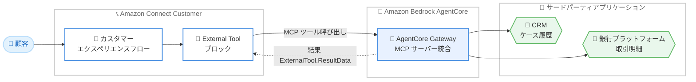

# Amazon Connect Customer - フローでの Model Context Protocol (MCP) ツールサポート

**リリース日**: 2026 年 11 月 2 日
**サービス**: Amazon Connect Customer
**機能**: フローにおける MCP ツールの呼び出し (External Tool ブロック)

📊 [このアップデートのインフォグラフィックを見る](https://takech9203.github.io/aws-news-summary/20261102-connect-flows-mcp-tools.html)

## 概要

Amazon Connect Customer のカスタマーエクスペリエンスフローで、Model Context Protocol (MCP) ツールを呼び出せるようになりました。新しい「External Tool」ブロックを使用することで、フローは Amazon Bedrock AgentCore Gateway を経由してサードパーティアプリケーションに接続し、データの取得やアクションの実行が可能になります。

このアップデートの大きな価値は、エージェンティックな体験 (AI エージェント) で使用しているものと同じツールをフローでも再利用できる点です。カスタム Lambda 関数を作成することなく、CRM のケース履歴の取得や銀行取引明細の参照といった外部システム連携をフロー内で直接実現できます。コンタクトセンターを運用する企業で、顧客対応の自動化や外部システム連携を強化したい管理者・開発者が主な対象です。

**アップデート前の課題**

このアップデート以前は、フローから外部システムに接続する際に以下の課題がありました。

- フローから外部アプリケーションのデータを取得するには、カスタム Lambda 関数の開発・保守が必要だった
- AI エージェント向けに整備した MCP ツールがあっても、フローからは再利用できず、同じ連携処理を二重に実装する必要があった
- 外部システム連携のたびに Lambda の認証設定やエラーハンドリングを個別に実装する運用負荷があった

**アップデート後の改善**

今回のアップデートにより、以下が可能になりました。

- 「External Tool」ブロックを配置するだけで、フローから MCP ツールを直接呼び出せるようになった
- Amazon Bedrock AgentCore Gateway 経由でサードパーティアプリケーションに接続でき、カスタム Lambda 関数が不要になった
- エージェンティックな体験で使用しているツールをフローでもそのまま再利用でき、実装の一元化が可能になった

## アーキテクチャ図



顧客からのコンタクトを処理するフローが「External Tool」ブロックを通じて Amazon Bedrock AgentCore Gateway に接続し、MCP ツールとして統合されたサードパーティアプリケーションからデータを取得する流れを示しています。

## サービスアップデートの詳細

### 主要機能

1. **External Tool ブロック**
   - フローから外部アプリケーションのツールを直接呼び出す新しいフローブロック
   - Amazon Bedrock AgentCore Gateway 経由で Connect Customer インスタンスに統合された外部アプリケーションを利用
   - Voice、Chat、Task、Email のすべてのチャネルに対応し、すべてのフロータイプで使用可能
   - 統合済みのアプリケーション名とツール名を選択するだけで設定でき、入力フィールドはツールスキーマから自動生成される

2. **同期・非同期の実行モード**
   - 同期モード: ツールの実行が完了するまでフローを一時停止してから次のブロックへ進む (タイムアウト最大 8 秒)
   - 非同期モード: ツールの完了を待たずにフローを継続する (タイムアウト最大 60 秒)
   - 非同期実行の結果は、2 つ目の External Tool ブロックを「Load tool result」アクションに設定して取得する
   - スロットリングや 500 エラー発生時は自動でリトライされ、最大 3 回の再試行後にエラー分岐へルーティングされる

3. **結果の名前空間への格納**
   - 実行結果は `$.ExternalTool` 名前空間に格納される
   - `$.ExternalTool.InvocationId` に呼び出し ID、`$.ExternalTool.ResultData` にツールの結果 (最大 32 KB) が格納される
   - 新しい呼び出しごとに結果は上書きされるため、保持が必要な場合はコンタクト属性やフロー属性へのコピーが必要

## 技術仕様

### External Tool ブロックの仕様

| 項目 | 詳細 |
|------|------|
| 対応チャネル | Voice、Chat、Task、Email |
| 対応フロータイプ | すべてのフロー |
| アクション | Invoke tool (デフォルト)、Load tool result |
| 実行モード | 同期 (最大 8 秒)、非同期 (最大 60 秒) |
| 結果サイズ上限 | 32 KB (超過時はエラー分岐へ) |
| 結果の格納先 | `$.ExternalTool.InvocationId`、`$.ExternalTool.ResultData` |
| 分岐 | Success / Error (Load tool result では In progress も追加) |
| リトライ | エラー時に最大 3 回、タイムアウトまで再試行 |

### 動的な設定

- **Application name** と **Tool name** は手動設定に加えて、属性を使った動的設定にも対応
- ツールへの入力は手動、動的、または raw JSON 形式で指定可能

## 設定方法

### 前提条件

1. Amazon Connect Customer インスタンスが有効化されていること (External Tool ブロックは Connect Customer インスタンスでのみ利用可能)
2. Amazon Bedrock AgentCore Gateway が作成済みであること (未作成の場合は Bedrock AgentCore で先に作成)
3. 外部アプリケーションが MCP サーバーとして Connect Customer インスタンスに統合されていること

### 手順

#### ステップ 1: MCP サーバー統合の作成

1. AWS コンソール内の Connect Customer コンソールに移動する
2. 新しい統合を追加し、統合タイプとして **MCP server** を選択する
3. インスタンスに接続する Bedrock AgentCore Gateway を選択する

Connect Customer インスタンスと外部アプリケーションを MCP サーバーとして統合する操作です。

#### ステップ 2: Gateway のインバウンド ID 設定

1. Gateway のインバウンド ID 設定で、**Allowed audiences** フィールドに Gateway ID を追加する
2. Gateway の Discovery URL で構成されたインスタンスを選択し、Connect Customer インスタンスを統合に関連付ける

Gateway ID が未設定の場合、ツールの呼び出しが失敗するため、この設定は必須です。

#### ステップ 3: フローへの External Tool ブロックの追加

1. フローデザイナーで **External Tool** ブロックをフローに配置する
2. **Application name** で統合済みの外部アプリケーションを選択する
3. **Tool name** で呼び出すツールを選択し、スキーマから生成された入力フィールドに値を設定する
4. 実行モード (同期/非同期) とタイムアウトを設定する
5. Success / Error 分岐の遷移先を設定する

統合が完了すると、External Tool ブロックにアプリケーションが名前で表示され、選択できるようになります。

## メリット

### ビジネス面

- **顧客対応の迅速化**: フロー内で CRM のケース履歴や取引明細を直接取得できるため、より少ないステップで顧客の問題を解決できる
- **開発コストの削減**: カスタム Lambda 関数の開発・保守が不要になり、外部連携の実装コストを削減できる
- **一貫した顧客体験**: AI エージェントとフローで同じツールを使用するため、チャネルを問わず一貫したデータに基づく対応が可能

### 技術面

- **ツールの再利用**: エージェンティックな体験向けに整備した MCP ツールをフローでもそのまま再利用でき、実装の重複を排除できる
- **標準プロトコルの採用**: MCP というオープンな標準プロトコルにより、サードパーティアプリケーションとの統合が容易
- **柔軟な実行制御**: 同期・非同期の実行モードと自動リトライにより、ユースケースに応じた堅牢なフロー設計が可能

## デメリット・制約事項

### 制限事項

- External Tool ブロックは Amazon Connect Customer インスタンスでのみ利用可能で、利用できるリージョンも限定されている
- 同期モードのタイムアウトは最大 8 秒、非同期モードは最大 60 秒に制限される
- ツール結果のサイズは 32 KB が上限で、超過するとエラー分岐にルーティングされる

### 考慮すべき点

- `$.ExternalTool` 名前空間の結果は新しい呼び出しごとに上書きされるため、複数ツールを呼び出す場合は結果をコンタクト属性やフロー属性に退避する設計が必要
- Gateway のインバウンド ID 設定で **Allowed audiences** に Gateway ID を追加しないとツール呼び出しが失敗するため、統合時の設定確認が重要
- 外部アプリケーション側の応答遅延がフロー全体の顧客体験に影響するため、同期モードではタイムアウトとエラー分岐の設計を慎重に行う必要がある

## ユースケース

### ユースケース 1: 金融機関での取引照会対応

**シナリオ**: 顧客が最近の取引について金融機関に問い合わせた際、フローが外部の銀行プラットフォームから取引明細を自動取得する。

**実装例**:
```
1. 着信フローで顧客を認証
2. External Tool ブロック (同期モード) で銀行プラットフォームの
   取引照会ツールを呼び出し
3. $.ExternalTool.ResultData の内容に基づき分岐
   - 不審な取引あり → 専門チームのキューへルーティング
   - 通常の取引 → 標準サポートフローを継続
```

**効果**: 顧客がオペレーターに接続される前にコンテキストを収集でき、対応時間の短縮と適切なルーティングを実現。

### ユースケース 2: CRM ケース履歴に基づくパーソナライズ対応

**シナリオ**: 問い合わせの着信時に、サードパーティ CRM から過去のケース履歴を取得し、継続案件かどうかを判定する。

**実装例**:
```
1. External Tool ブロック (同期モード) で CRM の
   ケース検索ツールを呼び出し
2. 結果をコンタクト属性にコピーして保持
3. オープン中のケースがある場合は前回の担当チームへ優先ルーティング
4. 取得したケース情報をエージェントの画面に表示
```

**効果**: 顧客に同じ説明を繰り返させることなく、文脈を踏まえた対応が可能になり顧客満足度が向上。

### ユースケース 3: 非同期実行による待ち時間の有効活用

**シナリオ**: 応答に時間がかかる外部システムへの照会を非同期で実行し、その間に顧客への案内を継続する。

**実装例**:
```
1. External Tool ブロック (非同期モード) で外部システムの
   照会ツールを呼び出し
2. フローは待たずに案内メッセージの再生や Wait ブロックへ進む
3. 2 つ目の External Tool ブロック (Load tool result) で
   $.ExternalTool.InvocationId を指定して結果を取得
4. In progress 分岐でポーリングし、Success 分岐で結果を利用
```

**効果**: 外部システムの応答待ちによる無音時間を回避し、スムーズな顧客体験を維持。

## 料金

公式発表には本機能固有の料金情報は記載されていません。Amazon Connect の利用料金に加えて、Amazon Bedrock AgentCore Gateway の利用料金が発生する可能性があるため、詳細は各サービスの料金ページを確認してください。

## 利用可能リージョン

以下の 9 リージョンで利用可能です。

- 米国東部 (バージニア北部)
- 米国西部 (オレゴン)
- カナダ (中部)
- 欧州 (フランクフルト)
- 欧州 (ロンドン)
- アジアパシフィック (ソウル)
- アジアパシフィック (シンガポール)
- アジアパシフィック (シドニー)
- アジアパシフィック (東京)

## 関連サービス・機能

- **Amazon Bedrock AgentCore Gateway**: 外部アプリケーションを MCP サーバーとして統合するゲートウェイ。本機能の接続基盤
- **Amazon Connect フロー**: コンタクトセンターの顧客体験を定義するフロー。External Tool ブロックはすべてのフロータイプで利用可能
- **AWS Lambda**: 従来のフローからの外部連携手段。本機能により MCP ツールで代替可能なケースが拡大

## 参考リンク

- 📊 [インフォグラフィック](https://takech9203.github.io/aws-news-summary/20261102-connect-flows-mcp-tools.html)
- [公式発表 (What's New)](https://aws.amazon.com/about-aws/whats-new/2026/10/connect-flows-mcp-tools/)
- [ドキュメント: External Tool フローブロック](https://docs.aws.amazon.com/connect/latest/adminguide/external-tool.html)
- [Amazon Connect Customer 製品ページ](https://aws.amazon.com/products/connect/customer/)
- [Amazon Connect 料金ページ](https://aws.amazon.com/connect/pricing/)

## まとめ

Amazon Connect Customer のフローから MCP ツールを直接呼び出せるようになり、カスタム Lambda 関数なしでサードパーティアプリケーションとの連携が実現できます。AI エージェント向けに整備したツール資産をフローでも再利用できるため、Connect Customer を利用中の組織は既存の外部連携 Lambda を本機能で置き換えられるか検討することを推奨します。まずは対象リージョンで Bedrock AgentCore Gateway の統合を試し、同期・非同期モードの動作とタイムアウト設計を検証するとよいでしょう。
