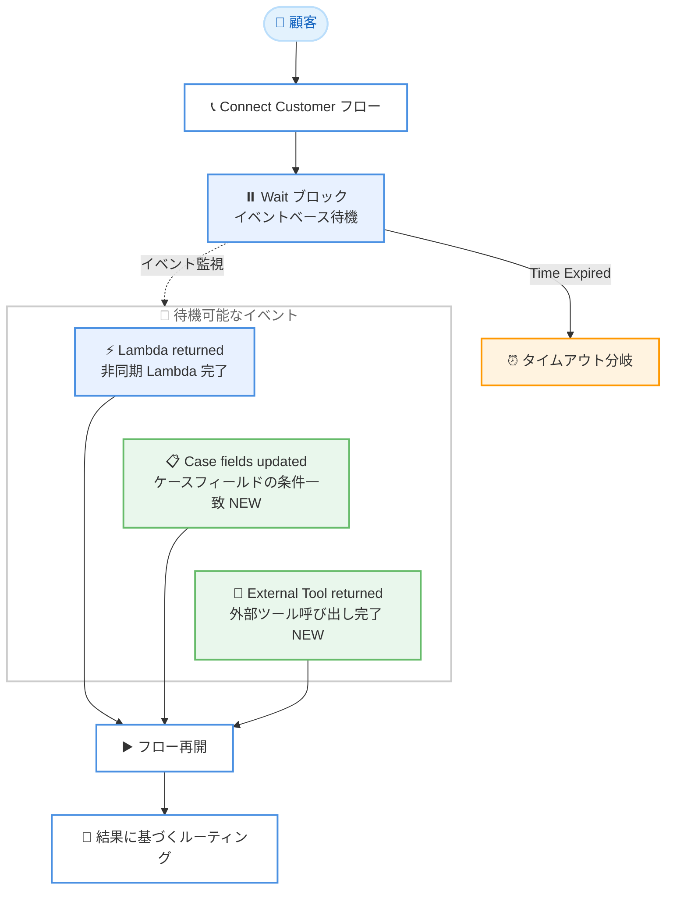

# Amazon Connect Customer - Wait ブロックの Cases / External Tool イベントサポート

**リリース日**: 2026 年 11 月 2 日
**サービス**: Amazon Connect Customer
**機能**: Wait ブロックにおける Cases イベントおよび External Tool イベントのサポート

📊 [このアップデートのインフォグラフィックを見る](https://takech9203.github.io/aws-news-summary/20261102-connect-wait-block-cases-tool-events.html)

## 概要

Amazon Connect Customer のカスタマーエクスペリエンスフローで使用する Wait ブロックが、新たに Cases イベントと External Tool イベントをサポートしました。これまで Wait ブロックのイベントベース待機は非同期 Lambda 呼び出しの完了のみを対象としていましたが、今回のアップデートにより、Connect Customer Cases のケースフィールドが指定した条件を満たすまで、または External Tool の非同期呼び出しが完了するまでフローを一時停止できるようになりました。

たとえば、ケースの返金ステータスフィールドが更新されるまでフローを保留し、更新後に自動的にフローを再開して結果に基づいてルーティングする、といった制御が可能です。重要な情報が揃うまでコンタクトを先に進めないことで、不要な転送を削減し、顧客とエージェント双方の時間を節約できます。コンタクトセンターのフロー設計者や、Connect Customer Cases / External Tool を活用するエンタープライズが主な対象ユーザーです。

**アップデート前の課題**

このアップデート以前には、以下の課題がありました。

- Wait ブロックのイベントベース待機は Lambda の完了のみを対象としており、ケースフィールドの更新を直接待機できなかった
- ケースの状態変化を待つには、Lambda でポーリング処理を実装するなどの回避策が必要だった
- バックエンド処理の完了前にコンタクトが先に進んでしまい、情報不足による不要な転送が発生していた

**アップデート後の改善**

今回のアップデートにより、以下が可能になりました。

- ケースフィールドが指定条件 (文字列、数値、存在チェック、複合条件) を満たすまでフローを待機させることが可能になった
- External Tool の非同期呼び出しの完了をフロー内で直接待機できるようになった
- ポーリング用のカスタム Lambda 実装が不要になり、フロー設計だけでイベント駆動の待機を構成できるようになった

## アーキテクチャ図



Wait ブロックは従来の Lambda 完了イベントに加えて、ケースフィールドの条件一致と External Tool 呼び出しの完了を待機できるようになりました。イベント発生時にフローが再開され、結果に基づいてルーティングされます。

## サービスアップデートの詳細

### 主要機能

1. **Case fields updated イベント**
   - Connect Customer Cases のケースフィールドが定義した条件を満たすまでフローを待機
   - Case ID と「Conditions for Case Fields」を指定して構成
   - 文字列条件、数値条件、存在条件、および And / Or による複合条件をサポート
   - Connect Customer Cases が利用可能なリージョンで使用可能

2. **External Tool returned イベント**
   - External Tool ブロックによる非同期呼び出しの完了を待機
   - External Tool ブロックが利用可能なリージョンで使用可能

3. **既存の Lambda returned イベントとの併用**
   - 非同期実行モードで呼び出した Lambda の RequestId を指定して完了を待機 (従来機能)
   - 各ブランチは単一のイベントタイプを待機するため、複数のイベントを待つ場合はブランチを分けて構成
   - いずれのイベントも発生しない場合は Timeout (最大 7 日間) で分岐

## 技術仕様

### Wait ブロックの主なプロパティ

| 項目 | 詳細 |
|------|------|
| Participant Type | Default (顧客) または Bot (カスタム参加者)。イベントベース待機は Default のみ |
| Timeout | 最大 7 日間。手動設定または動的設定 (秒単位) |
| Set Event based Wait | Lambda returned / Case fields updated / External Tool returned の各イベントを待機 |
| Keep running while waiting | 待機中に Continue ブランチへ一時的にルーティング (プロンプト再生など) |
| ブランチ名 | 静的テキストのみ、最大 100 文字 |
| 対応フロータイプ | Inbound flow、Customer Queue flow |
| 対応チャネル | Voice (条件付き)、Chat、Task、Email |

### Case fields updated の条件タイプ

| 条件タイプ | 詳細 |
|------|------|
| 文字列条件 | フィールド名、比較演算子 (Equals / Starts with / Ends with / Contains)、値を指定 |
| 数値条件 | フィールド名、比較演算子 (Equals / Greater than / Less than / Greater than or equal to / Less than or equal to)、値を指定 |
| 存在条件 | フィールドが存在するかどうかを判定 |
| 複合条件 | And または Or で 2 つ以上のサブ条件を結合。ネストは 1 階層まで |

## 設定方法

### 前提条件

1. Amazon Connect Customer インスタンスが有効化されていること (Cases / External Tool イベントは Connect Customer インスタンスのみ)
2. Case fields updated イベントを使用する場合、Connect Customer Cases が設定済みであること
3. External Tool returned イベントを使用する場合、External Tool ブロックで非同期呼び出しを構成していること

### 手順

#### ステップ1: Wait ブロックをフローに追加

フローデザイナーで Inbound flow または Customer Queue flow を開き、Wait ブロックを配置します。Participant Type に **Default** を選択します。

#### ステップ2: イベントベース待機を構成

Wait ブロックの Config タブで **Set Event based Wait** を有効化し、ブランチ名を入力してイベントタイプを選択します。

- **Case fields updated** の場合: Case ID を指定し、Conditions for Case Fields で条件を定義します。たとえば、ケースが解決済みかつ返金が実施された場合のみルーティングするには、Compound Condition を選択し、「status Equals resolved」という文字列条件と「refund_amount Greater than 0」という数値条件を And で結合します
- **External Tool returned** の場合: 非同期で呼び出した External Tool の完了を待機するよう構成します

#### ステップ3: タイムアウトと待機中の動作を設定

Timeout (最大 7 日間) を設定し、イベントが発生しない場合の Time Expired ブランチの遷移先を構成します。待機中にプロンプト再生などを行う場合は **Keep running while waiting** を有効化し、Continue ブランチに処理を追加します。なお、Continue ブランチ内に Wait ブロックをネストすることはできません。

## メリット

### ビジネス面

- **不要な転送の削減**: 重要な情報が揃ってからコンタクトを進めることで、情報不足による転送やたらい回しを防止
- **顧客体験の向上**: 返金処理などのバックエンド処理完了を待ってから結果を案内できるため、顧客が再度問い合わせる手間を削減
- **エージェントの時間節約**: 必要な情報が揃った状態でコンタクトがルーティングされるため、エージェントの確認作業が減少

### 技術面

- **ポーリング実装の排除**: ケース更新を監視するカスタム Lambda やポーリング処理が不要になり、イベント駆動で待機を実現
- **柔軟な条件定義**: 文字列、数値、存在チェック、複合条件により、きめ細かい再開条件をノーコードで定義可能
- **フロー設計の一元化**: 待機、再開、ルーティングのロジックをすべてフローデザイナー内で完結

## デメリット・制約事項

### 制限事項

- Cases / External Tool イベントは Amazon Connect Customer インスタンスでのみ利用可能
- イベントベース待機は Participant Type が **Default** の場合のみ利用可能
- Wait ブロックのネスト (Continue ブランチ内の Wait ブロック) は不可
- 各ブランチは単一のイベントタイプのみ待機可能。複数のイベントソースを待つ場合はブランチを分ける必要がある
- ブランチ名は静的テキストのみで最大 100 文字
- 複合条件のネストは 1 階層まで

### 考慮すべき点

- タイムアウトは最大 7 日間のため、それ以上かかる処理の待機には別のアーキテクチャが必要
- Case fields updated イベントは Connect Customer Cases の利用可能リージョン、External Tool returned イベントは External Tool ブロックの利用可能リージョンに依存する
- Lambda returned イベントで誤った Invocation ID を指定した場合、タイムアウトまで待機し続ける点に注意 (Cases / External Tool でも設定値の検証が重要)

## ユースケース

### ユースケース1: 返金処理の完了待ちルーティング

**シナリオ**: 顧客から返金依頼を受け付け、バックエンドの返金処理が完了するまでフローを保留し、完了後に結果を案内する。

**実装例**:
```
1. ケースを作成し、返金処理を開始
2. Wait ブロックで Case fields updated イベントを構成
   - Case ID: 対象ケースの ID
   - Compound Condition (And):
     - String condition: status Equals resolved
     - Number condition: refund_amount Greater than 0
3. 条件一致後、返金完了を案内するブランチへルーティング
4. Time Expired の場合はエージェントキューへ転送
```

**効果**: 返金ステータスの更新を自動検知してフローを再開でき、顧客が処理状況を確認するための再入電や、状況不明なままの転送を削減できる。

### ユースケース2: 外部システム処理の完了待ち

**シナリオ**: External Tool で外部の基幹システムに注文変更を非同期で依頼し、処理完了後に結果に基づいて応対を継続する。

**実装例**:
```
1. External Tool ブロックで外部システムを非同期呼び出し
2. Wait ブロックで External Tool returned イベントを構成
3. Keep running while waiting を有効化し、待機中は
   Play prompt ブロックで処理中の案内を再生
4. 呼び出し完了後、結果を判定して成功 / 失敗の案内へ分岐
```

**効果**: 外部システムの応答を待つ間も顧客体験を維持しながら、処理結果が確定してから正確な案内を提供できる。

### ユースケース3: エスカレーション前の情報収集待ち

**シナリオ**: 専門チームによるケースフィールドの更新 (調査結果の記入) を待ってから、適切なスキルを持つエージェントへルーティングする。

**実装例**:
```
1. 問い合わせ内容からケースを作成し、調査タスクを起票
2. Wait ブロックで Case fields updated イベントを構成
   - Exists condition: investigation_result フィールドが存在
3. 調査結果が記入されたら、結果に基づき担当キューへルーティング
4. Time Expired の場合はコールバックを案内
```

**効果**: 調査結果が揃った状態でエージェントに接続されるため、エージェント間の転送回数と平均処理時間を削減できる。

## 料金

Wait ブロックのイベントベース待機自体に追加料金は発生しません。Amazon Connect Customer の利用料金 (チャネルごとの従量課金)、Connect Customer Cases、および連携する Lambda や外部サービスの料金が通常どおり適用されます。詳細は [Amazon Connect 料金ページ](https://aws.amazon.com/connect/pricing/) を参照してください。

## 利用可能リージョン

- **Case fields updated イベント**: Connect Customer Cases が利用可能なリージョンと同一
- **External Tool returned イベント**: External Tool ブロックが利用可能なリージョンと同一

最新のリージョン別機能提供状況は、[Connect Customer のリージョン別機能提供状況](https://docs.aws.amazon.com/connect/latest/adminguide/regions.html#cases_region) を参照してください。

## 関連サービス・機能

- **Amazon Connect Customer Cases**: ケース管理機能。今回のアップデートで、ケースフィールドの更新をフローの再開トリガーとして使用可能になった
- **External Tool ブロック**: 外部ツールを呼び出すフローブロック。非同期呼び出しの完了を Wait ブロックで待機できるようになった
- **AWS Lambda**: 従来からサポートされている待機対象。非同期実行モードの Lambda 呼び出し完了を RequestId で待機できる

## 参考リンク

- 📊 [インフォグラフィック](https://takech9203.github.io/aws-news-summary/20261102-connect-wait-block-cases-tool-events.html)
- [公式発表 (What's New)](https://aws.amazon.com/about-aws/whats-new/2026/10/connect-wait-block-cases-tool-events/)
- [ドキュメント: Wait ブロック](https://docs.aws.amazon.com/connect/latest/adminguide/wait.html)
- [ドキュメント: リージョン別機能提供状況](https://docs.aws.amazon.com/connect/latest/adminguide/regions.html#cases_region)
- [Amazon Connect Customer 製品ページ](https://aws.amazon.com/products/connect/customer/)
- [料金ページ](https://aws.amazon.com/connect/pricing/)

## まとめ

Amazon Connect Customer の Wait ブロックが Cases イベントと External Tool イベントに対応し、ケースフィールドの条件一致や外部ツール呼び出しの完了をトリガーとしてフローを再開できるようになりました。ポーリング用のカスタム実装なしでイベント駆動の待機を構成できるため、返金処理などバックエンド処理の完了を待つシナリオでの不要な転送を削減できます。Connect Customer Cases や External Tool を利用中の場合は、既存フローの待機ロジックを本機能で置き換えられないか検討することを推奨します。
