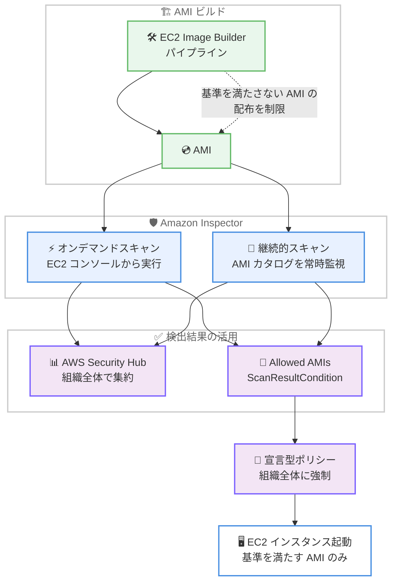

# Amazon EC2 / Amazon Inspector - EC2 AMI の脆弱性スキャン対応

**リリース日**: 2026 年 11 月 2 日
**サービス**: Amazon EC2、Amazon Inspector
**機能**: Amazon Inspector による EC2 Amazon Machine Images (AMI) の脆弱性スキャン

📊 [このアップデートのインフォグラフィックを見る](https://takech9203.github.io/aws-news-summary/20261102-ec2-amis-scanned-through-inspector.html)

## 概要

Amazon Inspector が EC2 Amazon Machine Images (AMI) のソフトウェア脆弱性スキャンに対応しました。インスタンスを起動したり追加のソフトウェアをインストールしたりすることなく、AMI そのものを直接スキャンして脆弱性を検出できます。これにより、AMI からインスタンスが大量に展開される前の段階、つまり「ソース」の時点で問題を修正できるようになります。

スキャン方式は 2 種類あります。アカウント内の AMI カタログを継続的に監視する「継続的スキャン」と、EC2 コンソールから特定の AMI を対象に実行する「オンデマンドスキャン」です。有効化は単一アカウント単位でも AWS Organizations の組織全体でも可能で、Security Hub のアドオンとして有効化すれば検出結果を Security Hub に集約できます。さらに、スキャン結果を Allowed AMIs 設定の条件 (ScanResultCondition) として利用し、宣言型ポリシー (Declarative Policies) で組織全体にセキュリティ基準を強制できます。

ゴールデン AMI を運用するプラットフォームチームやセキュリティチームにとって、AMI のライフサイクル全体 (ビルド、配布、利用) に脆弱性管理を組み込める重要なアップデートです。EC2 Image Builder のパイプラインにもスキャンを統合でき、セキュリティ基準を満たさない AMI の配布を制限できます。

**アップデート前の課題**

- AMI の脆弱性を確認するには、AMI からインスタンスを起動して Amazon Inspector の EC2 スキャン (SSM エージェント方式またはエージェントレス方式) を実行する必要があった
- ゴールデン AMI が古くなり新たな CVE が公開されても、AMI 自体を継続的に評価する仕組みがなく、脆弱な AMI からインスタンスが展開されるリスクがあった
- 組織全体で「脆弱性のない AMI のみ利用を許可する」といった統制を自動的に強制する手段がなかった

**アップデート後の改善**

- インスタンスの起動やソフトウェアのインストールなしで、AMI を直接スキャンして脆弱性を検出できるようになった
- 継続的スキャンにより、AMI カタログを常時監視し、新たに公開された脆弱性を自動で検出できるようになった
- スキャン結果を Allowed AMIs と宣言型ポリシーに連携し、セキュリティ基準を満たす AMI のみ利用可能とする統制を組織全体に適用できるようになった
- EC2 Image Builder パイプラインにスキャンを組み込み、基準を満たさない AMI の配布を制限できるようになった

## アーキテクチャ図



EC2 Image Builder でビルドした AMI を Amazon Inspector がスキャンし、検出結果を Security Hub へ集約するとともに、Allowed AMIs と宣言型ポリシーにより基準を満たす AMI のみインスタンス起動に利用できるよう統制するパイプラインの全体像です。

## サービスアップデートの詳細

### 主要機能

1. **継続的 AMI スキャン**
   - Amazon Inspector でアカウントの AMI スキャンを有効化すると、定義したスキャン条件に一致する AMI を継続的に監視し、脆弱性を検出する
   - 新たに公開された CVE も既存の AMI に対して自動的に評価される
   - 結果は Amazon Inspector コンソールと Amazon EC2 コンソールの両方で確認できる
   - 単一アカウントまたは AWS Organizations の組織全体で有効化可能

2. **オンデマンドスキャン**
   - EC2 コンソールの [アクション] → [セキュリティ] → [オンデマンドスキャンを開始] から、所有する特定の AMI を対象に 1 回限りのスキャンを実行できる
   - Amazon Inspector を有効化していないアカウントでも実行可能
   - 1 つの AMI で同時に実行できるスキャンは 1 件、アカウント全体では同時に最大 20 件のオンデマンドスキャンを実行可能
   - オンデマンドスキャンの結果は Amazon Inspector コンソールには表示されず、Amazon EC2 側 (コンソールの [セキュリティ] タブや API) で確認する

3. **スキャン結果の EC2 への統合**
   - スキャン結果のサマリーは `describe-images` のレスポンスの `ScanResults` フィールドで確認できる
   - 詳細な検出結果は新しい `get-image-findings` コマンドで取得できる (重要度、Inspector スコア、修正の可否、影響を受けるファイルパスなど)
   - `scan-result.*` フィルター (例: `scan-result.highest-finding-severity-label`) で、スキャン結果に基づいて AMI を検索できる
   - AMI を共有または公開すると、共有先のアカウントもスキャン結果と検出結果を参照できる。AMI をコピーすると、サマリーとソース AMI の上位 50 件の検出結果がコピーされる

4. **Security Hub 連携**
   - 組織のアドオンとして AMI スキャンを有効化すると、検出結果が AWS Security Hub に配信される
   - 組織全体の AMI 脆弱性を一元的に可視化できる

5. **Allowed AMIs と宣言型ポリシーによる統制**
   - Allowed AMIs 設定に `ScanResultCondition` を追加し、スキャン結果が基準を満たす AMI のみアカウントで利用可能にできる
   - 宣言型ポリシーを使用して、この基準を AWS Organizations の組織全体に強制できる

6. **EC2 Image Builder 統合**
   - Image Builder パイプラインに Inspector による AMI スキャンを組み込める
   - セキュリティ基準を満たさない AMI の配布を制限し、脆弱なゴールデン AMI の展開を防止できる

## 技術仕様

### スキャン結果サマリーの項目

| 項目 | 詳細 |
|------|------|
| HighestFindingSeverityLabel | 検出結果の最高重要度 (informational、low、medium、high、critical) |
| FindingScanDate | 最新のスキャン日時 |
| {Severity}FixAvailableSince | 重要度ごとに、修正が利用可能と報告された最も早い日時 (該当する検出結果がある場合のみ返却) |

### オンデマンドスキャンの制限

| 項目 | 詳細 |
|------|------|
| AMI あたりの同時スキャン数 | 1 件 |
| アカウントあたりの同時オンデマンドスキャン数 | 最大 20 件 |
| 検出結果ごとの影響ファイルパス | 最大 10 件を返却 |
| get-image-findings の 1 回あたりの取得件数 | 1〜1,000 件 (ページネーション対応) |
| AMI コピー時の検出結果 | サマリーと上位 50 件の検出結果をコピー |

### API 変更履歴

| 日付 | サービス | 変更内容 |
|------|----------|----------|
| 2026/10/27 | [Inspector2](https://awsapichanges.com/archive/changes/5c6356-inspector2.html) | 3 new 23 updated api methods - Machine Image スキャンのサポートを追加 (StartOnDemandScan など) |
| 2026/10/27 | [Amazon EC2](https://awsapichanges.com/archive/changes/5c6356-ec2.html) | 1 new 3 updated api methods - AMI の脆弱性データ表示とスキャン対象指定に対応 (GetImageFindings、DescribeImages の ScanResults など) |
| 2026/10/29 | [EC2 Image Builder](https://awsapichanges.com/archive/changes/76af6f-imagebuilder.html) | 6 updated api methods - Amazon Inspector によるオンデマンド AMI スキャンのサポートを追加 |

## 設定方法

### 前提条件

1. スキャン対象の AMI を所有していること (オンデマンドスキャンの場合)
2. 継続的スキャンを利用する場合は、Amazon Inspector で AMI スキャンを有効化すること
3. 組織全体で利用する場合は、AWS Organizations と委任管理者の設定を行うこと

### 手順

#### ステップ 1: オンデマンドスキャンの実行

```bash
aws inspector2 start-on-demand-scan \
    --resource-id ami-1234567890EXAMPLE \
    --resource-type AMI
```

指定した AMI に対して 1 回限りの脆弱性スキャンを開始します。EC2 コンソールの場合は、AMI を選択して [アクション] → [セキュリティ] → [オンデマンドスキャンを開始] を選択します。

#### ステップ 2: スキャン結果サマリーの確認

```bash
aws ec2 describe-images \
    --image-ids ami-1234567890EXAMPLE \
    --query "Images[].ScanResults"
```

AMI のスキャン結果サマリー (最高重要度、スキャン日時、修正が利用可能になった日時) を取得します。EC2 コンソールでは AMI の [セキュリティ] タブで確認できます。

#### ステップ 3: 詳細な検出結果の確認

```bash
aws ec2 get-image-findings \
    --image-id ami-1234567890EXAMPLE
```

CVE のタイトル、重要度、Inspector スコア、修正の可否、影響を受けるファイルパスなどの詳細な検出結果を取得します。

#### ステップ 4: スキャン結果による AMI の検索

```bash
aws ec2 describe-images \
    --filters "Name=scan-result.highest-finding-severity-label,Values=critical" \
    --query "Images[].ImageId"
```

`scan-result.*` フィルターを使用して、最高重要度が critical の AMI を検索します。脆弱な AMI の棚卸しに活用できます。

#### ステップ 5: 継続的スキャンの有効化

EC2 コンソールで [アクション] → [セキュリティ] → [AMI スキャンの管理] を選択して Amazon Inspector コンソールを開き、AMI スキャンを有効化します。スキャン条件を定義すると、条件に一致するアカウント内の AMI が継続的に監視されます。

## メリット

### ビジネス面

- **リスクの早期低減**: インスタンスとして大量展開される前に AMI の脆弱性を修正でき、侵害されたコンピュートリソースをデプロイするリスクを低減できる
- **コンプライアンス統制の自動化**: Allowed AMIs と宣言型ポリシーにより、組織全体で「基準を満たす AMI のみ利用可能」という統制を自動的に強制できる
- **運用コストの削減**: スキャン用インスタンスの起動やエージェントのインストールが不要になり、AMI 検証の手間とコストを削減できる

### 技術面

- **エージェントレスかつ起動不要**: インスタンスの起動や追加ソフトウェアなしで AMI を直接スキャンできる
- **既存ワークフローへの統合**: `describe-images` や `get-image-findings` などの EC2 API でスキャン結果を取得でき、既存の自動化に組み込みやすい
- **共有 AMI への透過性**: AMI の共有先アカウントもスキャン結果を参照でき、組織内でのゴールデン AMI 配布時に安全性を確認できる

## デメリット・制約事項

### 制限事項

- オンデマンドスキャンは所有している AMI のみが対象で、1 つの AMI で同時に 1 件、アカウント全体で同時に最大 20 件まで
- オンデマンドスキャンの結果は Amazon Inspector コンソールには表示されず、EC2 側で確認する必要がある
- `get-image-findings` では検出結果ごとに最大 10 件の影響ファイルパスのみ返却される
- AMI のコピー時にコピーされる検出結果はソース AMI の上位 50 件までのため、コピー先の検出結果が少なくなる場合がある

### 考慮すべき点

- オンデマンドスキャンと継続的スキャンの両方に Amazon Inspector の料金が発生するため、スキャン条件と頻度の設計が必要
- Allowed AMIs の `ScanResultCondition` を有効化する前に、監査モードなどで既存ワークロードへの影響を確認することが望ましい
- AMI スキャンは起動後のインスタンスの実行時の変更は検出しないため、EC2 インスタンスの継続的スキャンと併用することが望ましい

## ユースケース

### ユースケース 1: ゴールデン AMI パイプラインのセキュリティゲート

**シナリオ**: プラットフォームチームが EC2 Image Builder でゴールデン AMI をビルドし、組織内の各アカウントに配布している。脆弱性を含む AMI の配布を防ぎたい。

**実装例**:
```
1. EC2 Image Builder パイプラインに Inspector の AMI スキャンを統合
2. スキャン結果が基準 (例: critical の検出結果なし) を満たす場合のみ配布を許可
3. 基準を満たさない AMI はパイプラインで配布を制限し、修正ビルドを実施
```

**効果**: 脆弱なゴールデン AMI が組織内に配布されることを防止し、修正を「ソース」の段階で完結できる。

### ユースケース 2: 組織全体での AMI 利用統制

**シナリオ**: セキュリティチームが、重大な脆弱性を含む AMI からのインスタンス起動を組織全体で禁止したい。

**実装例**:
```
1. 組織全体で AMI スキャンを有効化 (Security Hub アドオンとして検出結果を集約)
2. Allowed AMIs 設定に ScanResultCondition を追加し、セキュリティ基準を定義
3. 宣言型ポリシーで組織全体に Allowed AMIs 設定を強制
```

**効果**: 基準を満たさない AMI は組織内のどのアカウントでも利用できなくなり、予防的統制を実現できる。

### ユースケース 3: 既存 AMI カタログの継続的な脆弱性監視

**シナリオ**: 長期間運用している AMI カタログに対して、新たに公開される CVE の影響を継続的に把握したい。

**実装例**:
```
1. Amazon Inspector で継続的 AMI スキャンを有効化し、スキャン条件を定義
2. describe-images の scan-result.* フィルターで脆弱な AMI を定期的に棚卸し
   aws ec2 describe-images \
       --filters "Name=scan-result.highest-finding-severity-label,Values=critical,high" \
       --query "Images[].ImageId"
3. 検出された AMI を更新または廃止 (deprecate / deregister)
```

**効果**: 作成時点では安全だった AMI も、新たな脆弱性の公開後すみやかに検出し、カタログを健全な状態に維持できる。

## 料金

Amazon Inspector の料金体系に基づき、オンデマンドスキャンと継続的 AMI スキャンの両方に課金が発生します。具体的な料金は [Amazon Inspector 料金ページ](https://aws.amazon.com/inspector/pricing/) を参照してください。

## 利用可能リージョン

Amazon Inspector が提供されているすべての AWS 商用リージョンで利用可能です。

## 関連サービス・機能

- **Amazon Inspector**: 本機能のスキャンエンジン。EC2 インスタンス、ECR コンテナイメージ、Lambda 関数に加えて AMI のスキャンに対応
- **AWS Security Hub**: 組織アドオンとして有効化することで、AMI スキャンの検出結果を一元的に集約
- **Allowed AMIs / 宣言型ポリシー**: スキャン結果を条件として AMI の利用可否を制御し、組織全体に強制
- **EC2 Image Builder**: AMI ビルドパイプラインにスキャンを統合し、基準を満たさない AMI の配布を制限
- **AWS Organizations**: 組織全体での有効化と委任管理の基盤

## 参考リンク

- 📊 [インフォグラフィック](https://takech9203.github.io/aws-news-summary/20261102-ec2-amis-scanned-through-inspector.html)
- [公式発表 (What's New)](https://aws.amazon.com/about-aws/whats-new/2026/11/ec2-amis-scanned-through-inspector/)
- [ドキュメント: Scan an Amazon EC2 AMI for software vulnerabilities with Amazon Inspector](https://docs.aws.amazon.com/AWSEC2/latest/UserGuide/ami-scanning.html)
- [ドキュメント: Scanning machine images with Amazon Inspector](https://docs.aws.amazon.com/inspector/latest/user/scanning-machine-images.html)
- [ドキュメント: Allowed AMIs](https://docs.aws.amazon.com/AWSEC2/latest/UserGuide/ec2-allowed-amis.html)
- [料金ページ](https://aws.amazon.com/inspector/pricing/)

## まとめ

Amazon Inspector による EC2 AMI の直接スキャンにより、インスタンス展開前の「ソース」の段階で脆弱性を検出・修正できるようになりました。ゴールデン AMI を運用する組織は、EC2 Image Builder、Security Hub、Allowed AMIs、宣言型ポリシーと組み合わせることで、AMI のビルドから利用までを一貫して統制するセキュリティパイプラインを構築できます。まずは所有する主要な AMI に対してオンデマンドスキャンを実行し、現状の脆弱性を把握することから始めることを推奨します。
