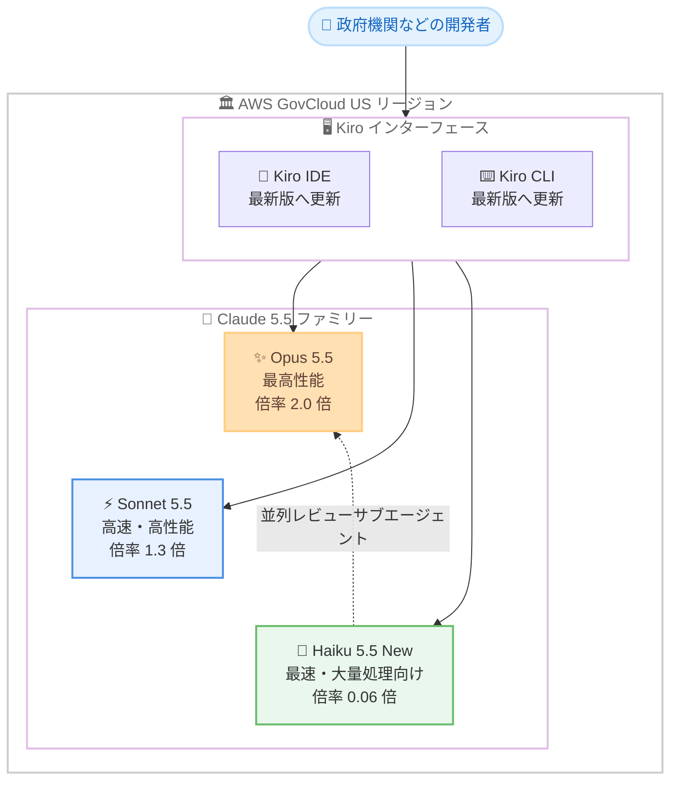

# Kiro - Claude Haiku 5.5 が AWS GovCloud (US) で利用可能に

**リリース日**: 2026 年 11 月 2 日
**サービス**: Kiro
**機能**: Claude Haiku 5.5 のモデル追加

📊 [このアップデートのインフォグラフィックを見る](https://takech9203.github.io/aws-news-summary/20261102-kiro-haiku-5-5-aws-govcloud-us.html)

## 概要

AWS が提供する AI 搭載 IDE である Kiro において、AWS GovCloud (US) リージョンで Anthropic の Claude Haiku 5.5 が利用可能になりました。今回の追加により、Claude 5.5 ファミリーの 3 モデル (Opus 5.5、Sonnet 5.5、Haiku 5.5) がすべて AWS GovCloud (US) の Kiro で選択できるようになり、政府機関や規制の厳しい業界のユーザーが、タスクの性質に応じたモデルの使い分けをコンプライアンス要件を満たした環境で実現できます。

Claude Haiku 5.5 は Claude 5.5 ファミリーで最速のモデルであり、Claude Haiku 4.5 から性能が向上しています。高速な応答が求められる大量処理ワークロードに適しており、長いコンテキストの要約や圧縮、リクエストの分類やルーティング、テキストの一括処理、多数のファイルにまたがる小規模で的を絞った編集などに向いています。また、Opus 5.5 や Sonnet 5.5 が複雑な計画やコーディングを担当する間、並列のレビュー用サブエージェントとして活用することもできます。

Haiku 5.5 は低 (low) から最大 (max) までの 5 段階の思考努力レベルにわたるアダプティブシンキングを備え、デフォルトは中 (medium) です。コンテキストウィンドウは 100 万トークンで、クレジット倍率は 0.06 倍と非常に低く設定されています。なお、100K トークンを超えるリクエストは 0.3 倍のクレジット倍率で課金されます。

**アップデート前の課題**

- 以前は AWS GovCloud (US) の Kiro では Claude 5.5 ファミリーのうち Opus 5.5 と Sonnet 5.5 のみが利用可能で、軽量・高速な Haiku 5.5 を選択できなかった
- 以前は要約、分類、一括テキスト処理などの単純で大量のタスクにも、クレジット倍率の高い上位モデル (Sonnet 5.5 は 1.3 倍、Opus 5.5 は 2.0 倍) を使う必要があった
- 以前は GovCloud 環境で、上位モデルと並行して動く低コストなレビュー用サブエージェントという構成を Claude 5.5 ファミリーで組めなかった

**アップデート後の改善**

- 今回のアップデートにより、AWS GovCloud (US) の Kiro IDE と CLI で Claude 5.5 ファミリーの 3 モデルすべてを選択できるようになった
- 今回のアップデートにより、高速応答が求められる大量処理タスクを 0.06 倍という低いクレジット倍率で実行できるようになった
- 今回のアップデートにより、Opus 5.5 や Sonnet 5.5 がメインの計画・コーディングを担当し、Haiku 5.5 が並列レビューを担う役割分担が可能になった
- 今回のアップデートにより、5 段階の思考努力レベルを持つアダプティブシンキングで、タスクに応じた思考量の調整が可能になった

## アーキテクチャ図



AWS GovCloud (US) の Kiro IDE と CLI で Claude 5.5 ファミリーの 3 モデルがすべて利用可能になり、Haiku 5.5 を並列レビューなどの軽量タスクに使い分けられます。

## サービスアップデートの詳細

### 主要機能

1. **Claude Haiku 5.5: Claude 5.5 ファミリー最速のモデル**
   - Claude 5.5 ファミリーで最速のモデルで、Claude Haiku 4.5 から性能が向上
   - 高速な応答が求められる大量処理ワークロードに最適化
   - 長いコンテキストの要約・圧縮、分類・ルーティング、テキストの一括処理に適合
   - 多数のファイルにまたがる小規模で的を絞った編集にも対応

2. **5 段階のアダプティブシンキング**
   - 低 (low) から最大 (max) までの 5 段階の思考努力レベルを提供
   - デフォルトの思考努力レベルは中 (medium)
   - タスクの複雑さに応じて思考量を調整し、速度と品質のバランスを最適化

3. **100 万トークンのコンテキストウィンドウと低いクレジット倍率**
   - 100 万トークンのコンテキストウィンドウにより、大規模なコンテキストを扱うタスクに対応
   - クレジット倍率は 0.06 倍と Claude 5.5 ファミリーで最も低い
   - 100K トークンを超えるリクエストは 0.3 倍のクレジット倍率で課金

4. **Claude 5.5 ファミリーの出揃いによる役割分担**
   - Opus 5.5 と Sonnet 5.5 が複雑な計画やコーディングを担当する間、Haiku 5.5 を並列レビュー用サブエージェントとして活用可能
   - AWS GovCloud (US) で Claude 5.5 の 3 モデルすべてが利用可能に

## 技術仕様

### モデル仕様

| 項目 | Claude Haiku 5.5 |
|------|------------------|
| 位置づけ | Claude 5.5 ファミリーで最速のモデル |
| 前世代比 | Claude Haiku 4.5 から性能向上 |
| アダプティブシンキング | 5 段階の思考努力レベル (low〜max)、デフォルトは medium |
| コンテキストウィンドウ | 100 万トークン |
| クレジット倍率 | 0.06 倍 (100K トークン超のリクエストは 0.3 倍) |
| 対応インターフェース | Kiro IDE、CLI |
| 提供リージョン | AWS GovCloud (US) |

### Claude 5.5 ファミリーの比較 (AWS GovCloud (US) の Kiro)

| モデル | 特長 | クレジット倍率 |
|--------|------|----------------|
| Claude Opus 5.5 | 最高性能。長時間のエージェント型コーディング向け | 2.0 倍 |
| Claude Sonnet 5.5 | 高速な出力と Opus 5.5 に迫る性能のバランス型 | 1.3 倍 |
| Claude Haiku 5.5 | 最速。大量処理や並列サブエージェント向け | 0.06 倍 (100K トークン超は 0.3 倍) |

## 設定方法

### 前提条件

1. AWS GovCloud (US) リージョンで Kiro を利用していること
2. Kiro IDE または CLI がインストールされていること

### 手順

#### ステップ 1: Kiro IDE または CLI を最新版に更新する

```bash
# Kiro CLI の場合、最新版へ更新する
kiro-cli update
```

新しいモデルを利用するには、Kiro IDE または CLI を最新バージョンに更新します。IDE の場合はアプリケーション内の更新機能を使用します。

#### ステップ 2: Kiro を再起動する

更新を適用するため、Kiro IDE または CLI を再起動します。再起動後に Claude Haiku 5.5 がモデルセレクターに表示されます。

#### ステップ 3: モデルセレクターからモデルを選択する

モデルセレクターを開き、Claude Haiku 5.5 を選択します。要約や分類などの軽量タスクには Haiku 5.5 を、複雑な計画やコーディングには Opus 5.5 や Sonnet 5.5 を使い分けます。

## メリット

### ビジネス面

- **大幅なコスト削減**: クレジット倍率 0.06 倍により、要約・分類・一括処理などの大量タスクを上位モデルの数十分の一のクレジット消費で実行できる
- **コンプライアンス対応環境での選択肢拡大**: 政府機関や規制の厳しい業界のユーザーが、AWS GovCloud (US) の環境で Claude 5.5 ファミリーの全モデルを利用できる
- **生産性の向上**: 最速モデルによる高速応答で、反復的なタスクの待ち時間が短縮される

### 技術面

- **アダプティブシンキング**: 5 段階の思考努力レベルにより、タスクに応じて速度と思考の深さを調整できる
- **並列サブエージェント構成**: 上位モデルがメインタスクを処理する間、Haiku 5.5 を並列レビューに割り当てるマルチエージェント構成を低コストで実現できる
- **大規模コンテキスト対応**: 100 万トークンのコンテキストウィンドウにより、長大なログやコードベースの要約・圧縮に対応できる

## デメリット・制約事項

### 制限事項

- 本アップデートの提供対象は AWS GovCloud (US) リージョンの Kiro IDE と CLI である
- 新しいモデルを利用するには、IDE または CLI を最新バージョンに更新して再起動する必要がある
- 100K トークンを超えるリクエストはクレジット倍率が 0.3 倍に上がるため、大規模コンテキストの多用時はコストに注意が必要

### 考慮すべき点

- Haiku 5.5 は速度重視のモデルであり、複雑な計画や高度なコーディングタスクには Opus 5.5 や Sonnet 5.5 の利用が適している
- デフォルトの思考努力レベルは medium であり、タスクに応じたレベル調整でさらに速度やコストを最適化できる
- 組織での利用状況は、Kiro のモニタリングとトラッキング機能で確認することが推奨される

## ユースケース

### ユースケース 1: 長いコンテキストの要約と圧縮

**シナリオ**: 政府機関向けシステムの長大な設計ドキュメントや会話履歴を、AWS GovCloud (US) 環境内で高速に要約・圧縮したい。

**実装例**:
```text
1. Kiro IDE を最新版に更新して再起動する
2. モデルセレクターで Claude Haiku 5.5 を選択する
3. 長いコンテキストの要約・圧縮タスクを実行する
```

**効果**: 100 万トークンのコンテキストウィンドウと最速の応答により、大量のドキュメントを低コストで効率的に処理できる。

### ユースケース 2: リクエストの分類とテキストの一括処理

**シナリオ**: 大量のテキストデータの分類やルーティング、一括変換を、クレジット消費を抑えながら実行したい。

**実装例**:
```text
1. Kiro CLI を最新版に更新して再起動する
2. モデルセレクターで Claude Haiku 5.5 を選択する
3. 分類・ルーティングや一括テキスト処理のタスクを実行する
```

**効果**: クレジット倍率 0.06 倍により、大量処理のコストを大幅に抑えつつ高速に完了できる。

### ユースケース 3: 上位モデルと組み合わせた並列レビュー

**シナリオ**: Opus 5.5 や Sonnet 5.5 が複雑な実装を進める間、変更内容のレビューを並列で実行し、開発サイクルを短縮したい。

**実装例**:
```text
1. メインのエージェントタスクには Opus 5.5 または Sonnet 5.5 を利用する
2. 並列のレビュー用サブエージェントとして Haiku 5.5 を利用する
3. 多数のファイルにまたがる小規模な修正は Haiku 5.5 に任せる
```

**効果**: 役割分担により、品質を維持しながらクレジット消費と所要時間の両方を最適化できる。

## 料金

Kiro のクレジットベースの料金体系に基づき、モデルごとのクレジット倍率が適用されます。

| モデル | クレジット倍率 |
|--------|----------------|
| Claude Haiku 5.5 | 0.06 倍 |
| Claude Haiku 5.5 (100K トークン超のリクエスト) | 0.3 倍 |

組織の利用状況の確認方法については、[Kiro のモニタリングガイド](https://kiro.dev/docs/enterprise/monitor-and-track/)を参照してください。

## 利用可能リージョン

AWS GovCloud (US) リージョン

## 関連サービス・機能

- **Kiro IDE / CLI**: 今回のアップデートで Haiku 5.5 が追加された AI 搭載の開発環境。最新版への更新と再起動で新モデルを利用可能
- **Claude Opus 5.5 / Sonnet 5.5**: 2026 年 10 月に AWS GovCloud (US) の Kiro へ追加された上位モデル。Haiku 5.5 との使い分けでコスト最適化が可能
- **AWS GovCloud (US)**: 米国政府機関や規制の厳しい業界向けの分離されたリージョン。Kiro の利用方法は GovCloud ユーザーガイドに記載

## 参考リンク

- 📊 [インフォグラフィック](https://takech9203.github.io/aws-news-summary/20261102-kiro-haiku-5-5-aws-govcloud-us.html)
- [公式発表 (What's New)](https://aws.amazon.com/about-aws/whats-new/2026/11/kiro-haiku-5-5-aws-govcloud-us/)
- [AWS GovCloud (US) での Kiro ドキュメント](https://docs.aws.amazon.com/govcloud-us/latest/UserGuide/govcloud-kiro.html)
- [Kiro モニタリングとトラッキングガイド](https://kiro.dev/docs/enterprise/monitor-and-track/)
- [Kiro 公式サイト](https://kiro.dev/)
- [関連レポート: Claude Sonnet 5.5 / Opus 5.5 の GovCloud 提供開始](./2026-10-09-kiro-claude-5-5-aws-govcloud-us.md)

## まとめ

AWS GovCloud (US) の Kiro IDE と CLI で Claude Haiku 5.5 が利用可能になり、Claude 5.5 ファミリーの 3 モデルがすべて出揃いました。政府機関や規制の厳しい業界のユーザーも、要約・分類・一括処理などの大量タスクを 0.06 倍の低いクレジット倍率で高速に処理でき、上位モデルと組み合わせた並列サブエージェント構成も実現できます。利用を開始するには、Kiro IDE または CLI を最新版に更新して再起動し、モデルセレクターから Claude Haiku 5.5 を選択してください。
