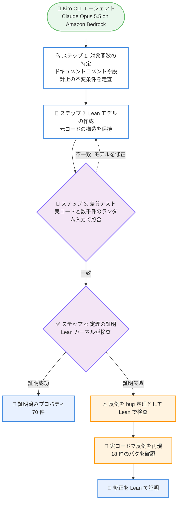

# Kiro - Lean による自身のエージェントハーネスのプロパティ証明

**リリース日**: 2026 年 11 月 2 日
**サービス**: Kiro
**機能**: Lean 4 を用いた Kiro 自身のハーネスの形式検証

📊 [このアップデートのインフォグラフィックを見る](https://takech9203.github.io/aws-news-summary/20261102-kiro-harness-properties-in-lean.html)

## 概要

Kiro チームは、Kiro が自身のコードの一部を定理証明支援系 Lean 4 でモデル化し、そのモデルについて定理を証明し、各モデルを TypeScript / Rust / Python の実コードと照合する自動化された仕組みを構築したことを発表しました。この仕組みを最初に Kiro 自身に適用し、26 個の関数のモデルに対する 96 件の候補プロパティと観察事項を分析しました。結果として、Lean が 70 件を証明し、2 件は有限の境界付きチェックを実施、18 件はモデル内で反証され実コードでも再現、6 件は部分的な結果または観察事項となりました。

この取り組みは、Lean 駆動の検証ワークフローが実際のプロダクション環境でエージェントハーネスのプロパティを検証し、隠れたバグを発見するために利用できることの実証です。検証作業自体も Kiro によって実行されました。Kiro CLI が Amazon Bedrock 経由で提供される Claude Opus 5.5 と Lean 4 スキルのセットを使用し、対象関数の発見、Lean モデルの作成、証明、差分テスト、再現スクリプトの作成までを担いました。Lean のカーネルがすべての証明を独立に検査し、実コードがすべての発見を検証し、定理の記述は人間がレビューしています。

Lean カーネルを通過した証明は、ユニットテストの有限な入力セットだけでなく、定理の前提を満たすモデル化されたすべての入力に対する保証を提供します。プロンプトキャッシュの保証や並行処理のように、テストでは到達しにくい検証パスを補完する、再現可能なプロセスとなっています。

**アップデート前の課題**

ブログ記事によると、この取り組み以前には以下の課題がありました。

- 人間または LLM が書く通常のテストスイートは、誰かが思いついた入力やジェネレーターが生成した入力しかチェックできず、すべてのコーナーケースを捕捉できなかった
- エージェントでは入力の大半がモデルや読み込んだファイルから来るため、テストに書かれる範囲をはるかに超えるケースに到達する
- 並行イベントのまれな順序や、UTF-16 と UTF-8 のような 2 つの表現の境界にあるバグは、テストでは特定の順序しか実行されないため発見が困難だった
- コンテキスト管理の前提 (コンテキストウィンドウ内のコンテンツは上限内、リロードしたセッションは不変、プロンプトキャッシュはトラジェクトリ全体で維持) は設計ドキュメントとユニットテストの中にのみ存在していた

**アップデート後の改善**

- 定理の前提を満たすすべてのモデル化された入力に対して成り立つ普遍的な保証として、70 件のプロパティが証明された
- 証明が通らなかったケースから具体的な反例が得られ、18 件のバグ (エッジケース) を実コード上で再現・確認できた
- 発見の多くについて修正も Lean で記述し、修正が意図した挙動を保ちながらギャップを塞ぐことを証明した
- コードの変更時に差分テストを再実行することで、レビュー前にリグレッションを検出する基盤が整った

## アーキテクチャ図

検証フローの全体像です。Kiro CLI エージェントが対象の特定からモデル作成・証明までを実行し、差分テストで Lean モデルと実コードの一致を確認したうえで、証明の成功または反例の実コード再現につなげます。不一致が見つかった場合はモデルの修正に戻ります。

## サービスアップデートの詳細

### 主要機能

1. **Lean 4 による自己検証ワークフロー**
   - Kiro CLI エージェントが 3 つのコードベース (Kiro エージェントハーネス、Kiro CLI v3、Kiro Crew) を走査し、Lean モデル化が可能なほどコンパクトで、テストが容易ではない興味深い対象関数を特定
   - 各関数の Lean モデルを作成し、Lean カーネルで定理を証明、または挙動を破る入力を Lean の反例として発見
   - Lean 4.28.0 ディストリビューションのみを使用し、Mathlib などの外部 Lake 依存関係は不使用

2. **差分テストによるモデルと実コードの照合**
   - 各 Lean モデルを実行可能ファイルにコンパイルし、実装と並べて数千件のランダム入力で実行 (TypeScript は Node または Bun、Rust は実クレートにリンクした小さなバイナリ、Python は実モジュールのインポート経由)
   - ジェネレーターは境界を狙って入力を生成: マルチバイト・CJK テキスト、上限直前直後の長さ、シャッフル・重複したイベント順序、CLI のセッション開始ホールドの 64 更新制限を超えるフラッディングなど
   - 最終実行では 3 つのコードベース全体で 97,938 ケースを実行し、不一致はゼロ

3. **バグの発見と修正の証明**
   - 18 件のコードの意図がモデル内で反証され、それぞれの反例を分析対象のコードで再現 (セッション開始の競合はモジュールレベルで再現)
   - 2026 年 10 月 1 日時点で CLI と Kiro Crew の GitHub Issue およびエージェントサーバーの Pull Request を検索した結果、これらに合致するオープンな Issue は存在しなかった
   - 大半の発見について、修正を Lean で記述し、保つべき挙動を変えずにギャップを塞ぐことを証明
   - いずれのコードベースのバグもセキュリティ上の問題ではなかった

4. **エージェントが書いた証明の健全性チェック**
   - 未完了のステップ、余分な公理、同時には成立し得ない前提など、Lean がコードの意図を欠いた証明対象を受理してしまうパターンを確認
   - すべての定理の背後にある公理を列挙し、引用・説明したすべての定理について前提を同時に満たす具体的な入力を Lean で検査 (空虚な定理でないことを確認)

## 技術仕様

### 検証結果 (Table 1)

| コードベース | 関数 | プロパティ | 証明済み | 境界付きチェック | エッジケース発見 | 部分的 / 観察 | Lean 定理 | テストケース |
|------|------|------|------|------|------|------|------|------|
| Kiro ハーネス (TypeScript) | 15 | 51 | 36 | 0 | 9 | 6 | 111 | 23,281 |
| Kiro CLI (Rust, TypeScript) | 8 | 29 | 23 | 0 | 6 | 0 | 86 | 65,000 |
| Kiro Crew (Python) | 3 | 16 | 11 | 2 | 3 | 0 | 38 | 9,657 |
| **合計** | **26** | **96** | **70** | **2** | **18** | **6** | **235** | **97,938** |

### 検証されたプロパティのカテゴリ

ハーネスは、非網羅的テストではサンプリングしかできない以下の種類のプロパティに依存しています。

| カテゴリ | 内容 |
|------|------|
| 境界付きコンテンツ | モデルのコンテキストウィンドウに入るすべてのコンテンツにサイズ上限があり、切り捨て時は残りを取得可能 |
| 永続性 | 再起動後も含め、セッションのリロードでモデルはライブ時と完全に同じメッセージを受け取る |
| プロンプトキャッシュ | 各リクエストの先頭 (ツールリスト、最初のメッセージ、履歴) がターン間で不変に保たれ、キャッシュを再利用できる |
| 権限 | 承認は承認した対象のみをカバーし、サブエージェントは親より多くの権限を得ない |
| 順序性 | セッション、ストリーム応答、バックグラウンドタスクはイベントの到着順序によらず正しい状態で終了する |
| クロスリポジトリ契約 | 相互依存する 2 つのコードベース間の契約 (例: Crew のツール許可リスト変換) を 1 つの Lean モデルで両側を含めて証明 |

### 証明されたプロパティの例

- **重複ファイルの除去はリクエストプレフィックスを保つ**: 任意の履歴 xs と新規メッセージ ys について、xs + ys の結果は xs の結果で始まることを証明。重複ファイル添付の除去ステップが前のターンでモデルが見た内容を書き換えないため、プロンプトキャッシュの再利用を妨げない
- **履歴は編集とリロードを生き延びる**: 履歴の解決は 2 回行っても 1 回と同じ結果 (冪等性)、メッセージの削除のみで並べ替えはしない、フォークしたセッションは常に親の有効な履歴で始まる、リロード後のツールカードは 8 つのツール呼び出し状態すべてでユーザーがライブで見た状態と一致
- **切り捨て後の出力は上限を超えない**: CLI のエージェントがシェルコマンド出力などを切り詰める際、切り捨て通知を付加する場合も含め、任意の有効な UTF-8 文字列に対して UTF-8 バイト数で上限を超えないことを証明
- **セッションステータスはイベントの順序に依存しない**: ワークフローイベントの開始・一時停止・完了について、あらゆる配信順序が元の順序と同じステータスを与えることを、サンプルではなくすべての順列について証明
- **サブエージェントは親より制限が緩くならない**: サブエージェントの権限決定と親の決定の組み合わせは常により制限的な側になり、deny や明示的な ask が弱められることはない。ポリシーの厳格化が拒否を承認に変えることもない
- **モデルフォールバックは停止する**: モデルがリクエストを拒否した際の切り替えは 1 ターンに 3 回を超えず、同一ターンで試行済みのモデルには切り替えない
- **2 つのディスパッチャーが同じタスクを取得しない**: Kiro Crew のタスクキューで、claim 呼び出しの成功直後にタスクは admitted 状態となり、他のディスパッチャーからの claim は拒否される (各ストア呼び出しが不可分な 1 ステップであるという前提の下)
- **タスクキューは古いワーカーをフェンスアウトする**: claim 成功のたびに行の generation が増加し、任意の呼び出しシーケンスで generation が減少しないことを証明。新しいワーカーがタスクを取得した後、古いワーカーのフェンスされた書き込みは行を変更できない

### 発見されたバグの例 (Lean の反例として)

- **キャンセルされたジョブが実行される** (Kiro Crew、PR 25130): ワンショットジョブの実行待機中にキャンセルすると、実行は止まるがジョブは有効のまま残り、スケジューラーが数秒後に再実行する。Lean がジョブのライフサイクルモデルで 10 イベントのシーケンスとして発見し、実スケジューラーで再現。修正は Cancel への条件 1 つで、修正後はキャンセルされたジョブを再実行するイベントシーケンスが存在しないことを証明
- **並行処理の競合**: session/new の処理中に別のセッションが CLI に登録すると、セッション開始中に送られた更新 (セッション開始フックからのツール呼び出しなど) が失われる可能性がある。更新を失わせるインターリービングを bug 定理として Lean で検査し、CLI の実コードをモジュールレベルで再現
- **誤った単位で測られた上限**: Kiro ハーネスの 9 件中 7 件は、テキストを上限に切り詰める関数に存在。web_fetch はバイト単位の予算を持つが JavaScript の文字列長 (UTF-16 コードユニット) でページを切るため、中国語や日本語のページは上限の最大 1.5 倍のサイズで返り得る。UTF-16 コードユニットで数えた切り捨てはテキスト末尾の絵文字を分断し得る。grep_search はマッチ行を短縮するがコンテキスト行は短縮しないため、ミニファイされたファイルの非常に長い 1 行がマッチを押し出し得る
- **巨大なコマンド出力**: 2^29 − 24 UTF-16 コードユニット (ASCII テキストで約 512 MiB) を超える出力は、テストしたビルド (Node 26.3.0、V8 14.6、macOS arm64) で V8 が構築できる最長文字列を超える。ハーネスはサイズ上限の適用前に出力を 1 つの文字列に収集するため、未捕捉エラーのハンドラーがプロセスを終了させ、開いているセッションが終了する。バックグラウンドターミナル用コレクターは最新の出力のみを保持し、この上限に到達し得ないことを証明済みのため、修正はすべてのコマンドにこれを使用すること
- **コールドリロード後の Spec ルール**: Spec モードでライブパスとリロードパスが暗黙のルールを異なるメッセージに付加するため、コールドリロード後のターンが再利用可能なプレフィックスを一度変更し、そのターンのキャッシュ再利用を妨げ得る
- **承認済みパス内の glob 文字**: CLI が「常に許可」のパスをエスケープせずに glob パターンに変換する。Next.js のルート app/[slug]/page.tsx では、承認したファイルについて再度確認を求められ、app/s/page.tsx のような別のパスも承認されてしまう。修正 (パスを先にエスケープ) をモデル内で証明済み

### 実行環境・手法

| 項目 | 詳細 |
|------|------|
| 実行主体 | Kiro CLI (Claude Opus 5.5、Amazon Bedrock 経由) + Lean 4 スキルセット |
| 証明環境 | Lean 4.28.0 (Mathlib などの外部 Lake 依存なし) |
| 対象コードベース | Kiro エージェントサーバー (IDE / Web / CLI v3 共通のハーネス)、Kiro CLI v3、Kiro Crew (公開リポジトリのコミット 909e0fc) |
| 人間の役割 | スコープ (リポジトリと対象領域) の設定、定理の記述と発見のレビュー |
| 差分テスト | 合計 97,938 ケース、最終実行で不一致ゼロ |

## メリット

### ビジネス面

- **プロダクション品質の向上**: テストが最も手薄な領域 (多数の入力やイベント順序に依存する挙動) について、ユニットテストでは得られない普遍的な保証を獲得
- **隠れたバグの早期発見**: 既存の Issue や PR に報告されていなかった 18 件のエッジケースを発見し、ユーザー影響が出る前に修正への道筋を確立
- **リグレッション検出の基盤**: コード変更時に差分テストを再実行することで、レビュー前にリグレッションを捕捉するロードマップ上の基盤が整備された

### 技術面

- **網羅的な検証**: 証明はモデル化されたすべての入力 (定理の前提を満たすもの) に対して成立し、すべての順列・すべてのイベントシーケンスをカバー。非網羅的テストのサンプリングとは質的に異なる保証
- **反例の具体性**: 証明が通らない場合、挙動を破る具体的な入力 (反例) が得られ、それ自体を Lean で検査したうえで実コードに対して実行できる
- **クロスリポジトリ検証**: 通常は各リポジトリのテストが自リポジトリしか検証しないのに対し、Lean モデルは両側を含めて契約の一致を証明できる
- **プロセスの再現性**: 対象発見からモデル化、証明、差分テスト、再現までのステップが自動化された反復可能なプロセスになっている

## デメリット・制約事項

### 制限事項

ブログ記事では以下の限界が明示されています。

- **モデルの忠実性**: 証明は Lean モデルのプロパティであり、モデルと実コードの一致は約 100,000 件のサンプリングされた入力の差分テストで確認されたもの。生成されなかった入力での差異は見逃され得る
- **定理の記述**: 定理が意図された挙動の一部を記述し損ねていれば、証明が成功してもバグは逃れ得る (そのため人間がレビュー)
- **型の忠実性**: モデルが Lean の非有界な自然数を使ったりデータ構造を抽象化している箇所では、オーバーフロー、浮動小数点の挙動、操作のコストは捕捉されない
- **信頼基盤はカーネルより大きい**: 証明は Lean カーネルに依存し、差分テストは Lean コンパイラ、入力供給ハーネス、実コードのランタイムにも依存する。native_decide を使う 17 の定理は Lean コンパイラと C ツールチェーンも信頼する
- **結果はコミットに紐づく**: 各モデルは分析時点のコミットのコードを記述しており、後の変更はモデル更新と差分テスト再実行までカバーされない

### 考慮すべき点

- 一部のモデルは前提 (例: タスクストアの各呼び出しが不可分な 1 ステップであること) に依存しており、Lean はその前提自体を検証しない
- ステップは自動化されているが、すべての定理の記述と発見には人間のレビューが必要であり、他の Kiro リポジトリへの拡大はコンピュートだけでなくレビュー工数にも依存する
- 本記事の数値は Kiro チームがレビューした社内の実験結果である

## ユースケース

### ユースケース1: プロンプトキャッシュ保証の検証

**シナリオ**: エージェントの会話が長くなるにつれて、リクエストの再利用可能なプレフィックスが変化するとプロンプトキャッシュが効かなくなり、コストとレイテンシーが増加する。

**実装例**: 重複ファイル添付の除去処理について、「任意の履歴 xs と新規メッセージ ys に対し、xs + ys の結果が xs の結果で始まる」という定理を Lean で証明する。

**効果**: ファイル数や順序によらず、この処理がキャッシュプレフィックスを壊さないことが保証される。テストでは到達が難しい検証パスを証明でカバーできる。

### ユースケース2: 並行処理・イベント順序のバグ発見

**シナリオ**: 複数セッションの同時開始やバックグラウンドタスクの競合など、特定のタイミングでのみ発生するバグは、1 つの順序しか実行しないテストでは捕捉できない。

**実装例**: すべてのセッション開始イベントのシーケンスにわたる定理を Lean で記述し、証明が詰まった箇所から更新を失わせるインターリービングを bug 定理として抽出、実コードで再現する。

**効果**: まれなイベント順序でのみ現れる競合バグを、系統的に発見・再現・修正できる。

### ユースケース3: 権限システムの安全性保証

**シナリオ**: サブエージェントやツール許可リストを使う構成で、意図しない権限昇格が起きないことを保証したい。

**実装例**: サブエージェントの権限決定と親の決定の結合が常により制限的な側になること、許可リストの変換が CLI より多くの権限をハーネス側に与えないこと (kas_le_cli) を定理として証明する。

**効果**: どのようなポリシーの組み合わせでも、サブエージェントが親の拒否する操作を承認できないことが、ポリシー全体に対して保証される。

## 利用可能リージョン

グローバル (Kiro はグローバルに提供されるサービスです)

## 関連サービス・機能

- **Kiro エージェントハーネス**: Kiro IDE、Web、CLI v3 の背後にある共通ハーネス。今回の検証対象の中心
- **Kiro CLI v3**: ターミナルから利用できる Kiro のエージェント。今回は検証対象であると同時に、検証作業を実行したエージェントでもある
- **Kiro Crew**: タスクキューとスケジューラーを持つ Kiro のマルチエージェント機能。公開リポジトリが検証対象に含まれた
- **Amazon Bedrock**: 検証作業を実行した Claude Opus 5.5 の提供基盤
- **Lean 4**: 証明をカーネルで検査するプログラミング言語兼証明支援系

## 参考リンク

- 📊 [インフォグラフィック](https://takech9203.github.io/aws-news-summary/20261102-kiro-harness-properties-in-lean.html)
- [Kiro Blog: Kiro proves properties of its own harness in Lean](https://kiro.dev/blog/harness-properties-in-lean/)
- [Kiro Changelog](https://kiro.dev/changelog/)
- [Lean ドキュメント](https://lean-lang.org/documentation/)
- [Kiro Blog: One agent, every surface](https://kiro.dev/blog/one-agent-every-surface/)

## まとめ

Kiro が自身のエージェントハーネスを Lean 4 でモデル化・証明し、26 関数・96 プロパティの分析で 70 件の証明と 18 件の実コードで再現されたバグ発見を達成した、形式検証のプロダクション適用事例です。コンテキスト管理、権限、プロンプトキャッシュといったエージェントの中核的な保証が「設計ドキュメント上の前提」から「Lean モデルに関する定理」へと変わり、今後は機能設計時の定理化とコード変更時の差分テスト再実行によるリグレッション検出が計画されています。エージェント製品の品質保証手法として、テストと証明を組み合わせたこのワークフローは参考になるため、詳細に関心のある方はブログ本文の一読をお勧めします。
