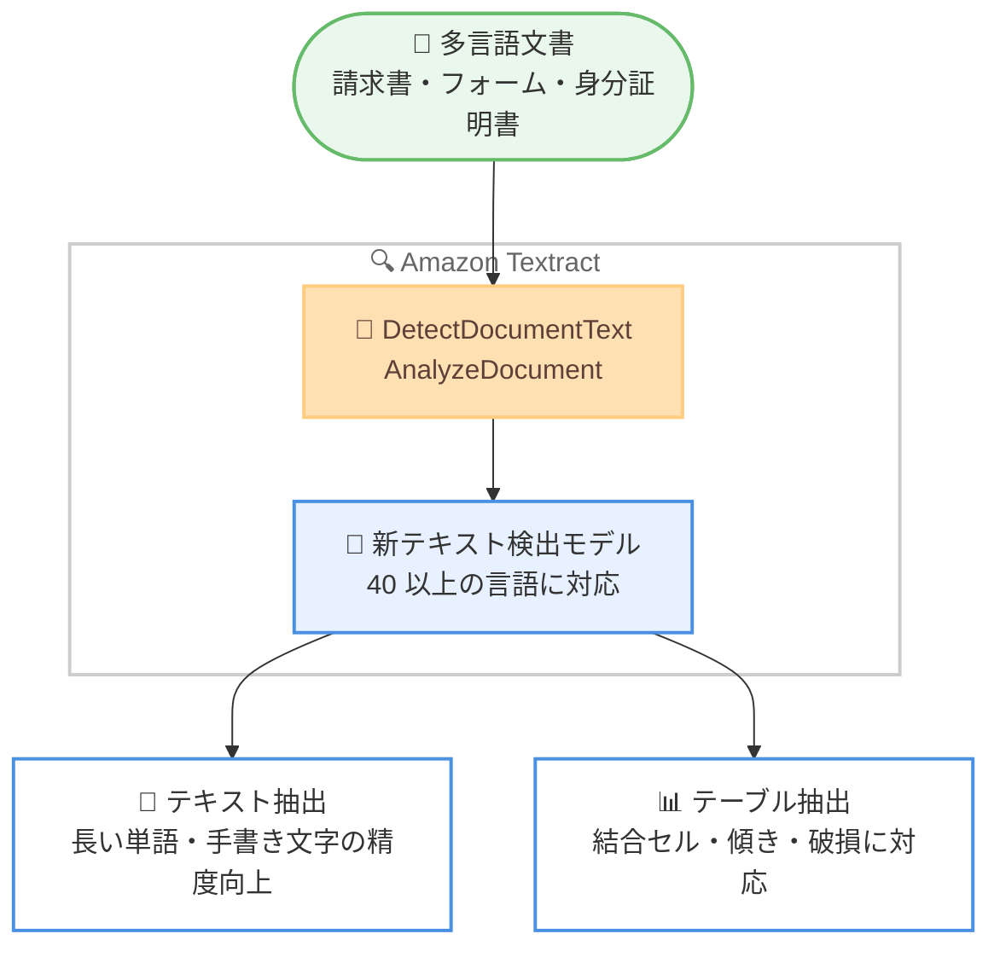

# Amazon Textract - テキスト検出モデルのアップデート

**リリース日**: 2026 年 11 月 2 日
**サービス**: Amazon Textract
**機能**: 更新されたテキスト検出モデル (Updated Text Detection Model)

📊 [このアップデートのインフォグラフィックを見る](https://takech9203.github.io/aws-news-summary/20261102-textract-text-detection-model.html)

## 概要

Amazon Textract のテキスト検出モデルが更新され、認識精度の向上、対応言語の拡大、多言語テーブル抽出の強化が実現されました。新モデルは日本語、アラビア語、中国語 (簡体字・繁体字)、ヘブライ語、ヒンディー語、韓国語、ロシア語などを含む 40 以上の言語に対応し、これまでサポートされていなかったスクリプト (文字体系) の文書も処理できるようになりました。

本アップデートは `DetectDocumentText` API と `AnalyzeDocument` API に適用されますが、**API リクエストやレスポンススキーマの変更は一切不要**です。既存のアプリケーションは自動的に新モデルへルーティングされるため、コード変更なしで精度向上のメリットを享受できます。

請求書、フォーム、本人確認書類など、多言語かつ複雑なレイアウトの文書を大規模に処理するユーザーにとって、特に価値の高いアップデートです。同日に Amazon Textract の東京・チューリッヒリージョン対応も発表されており (別レポート参照)、日本語文書の OCR 処理を国内リージョンで完結できる環境が整いました。

**アップデート前の課題**

- 対応言語が限定されており、日本語、アラビア語、中国語、韓国語などの文書は Textract で直接処理できなかった
- 傾いたテーブルや回転したテーブル、結合セルを含むテーブルの抽出精度に課題があった
- 長い単語や手書き文字の認識精度が十分でないケースがあった

**アップデート後の改善**

- 日本語を含む 40 以上の言語でテキスト検出が可能になり、多言語文書処理のユースケースが大幅に拡大した
- 結合セル、傾き・回転したテーブル、部分的に欠損・破損したテーブルの抽出が堅牢になった
- 長い単語の認識と手書き文字の検出精度が向上した
- API やスキーマの変更が不要なため、既存アプリケーションは自動的に新モデルの恩恵を受けられる

## アーキテクチャ図



既存の API 呼び出しは変更不要のまま、バックエンドで新しいテキスト検出モデルが自動的に適用されます。

## サービスアップデートの詳細

### 主要機能

1. **対応言語の大幅な拡大 (40 以上の言語)**
   - 日本語、韓国語、中国語 (簡体字・繁体字) などの東アジア言語に新規対応
   - アラビア語、ヘブライ語などの右から左に記述する言語に対応
   - ヒンディー語、ロシア語、ウクライナ語、トルコ語に対応
   - フランス語、ドイツ語、スペイン語、イタリア語、ポーランド語、チェコ語、オランダ語、北欧言語、バルト言語、セルビア語 (キリル文字・ラテン文字) など、幅広いヨーロッパ言語をカバー

2. **多言語テーブル抽出の強化**
   - 結合セルを含むテーブルの抽出精度が向上
   - 傾いたテーブルや回転したテーブルへの耐性が向上
   - 部分的に欠損・破損したテーブルからの抽出が堅牢に

3. **テキスト認識精度の向上**
   - 長い単語の認識精度が向上
   - 手書き文字の検出精度が向上

4. **既存アプリケーションへの自動適用**
   - `DetectDocumentText` API と `AnalyzeDocument` API に適用
   - リクエスト・レスポンススキーマの変更は不要
   - アプリケーションは自動的に新モデルで処理される

## 技術仕様

### アップデートの適用範囲

| 項目 | 詳細 |
|------|------|
| 対象 API | `DetectDocumentText`、`AnalyzeDocument` |
| 対応言語数 | 40 以上 |
| 新規対応言語の例 | 日本語、アラビア語、中国語 (簡体字・繁体字)、ヘブライ語、ヒンディー語、韓国語、ロシア語など |
| スキーマ変更 | なし (リクエスト・レスポンスともに変更不要) |
| 適用方法 | 自動 (ユーザー側の作業は不要) |
| 提供リージョン | Amazon Textract が利用可能なすべてのリージョン |

### API 変更履歴

本アップデートは API リクエスト・レスポンススキーマの変更を伴わないため、API 変更はありません。

## 設定方法

### 前提条件

1. AWS アカウントを保有していること
2. Amazon Textract が利用可能なリージョンを使用していること
3. Textract API を呼び出す IAM 権限 (`textract:DetectDocumentText` または `textract:AnalyzeDocument`) があること

### 手順

#### ステップ 1: 既存の API をそのまま呼び出す

```bash
aws textract detect-document-text \
  --document '{"S3Object":{"Bucket":"my-bucket","Name":"invoice-ja.png"}}' \
  --region ap-northeast-1
```

S3 バケット上の日本語文書に対してテキスト検出を実行しています。新モデルは自動的に適用されるため、API 呼び出し方法に変更はありません。

#### ステップ 2: テーブルを含む文書の分析

```bash
aws textract analyze-document \
  --document '{"S3Object":{"Bucket":"my-bucket","Name":"report-table.pdf"}}' \
  --feature-types '["TABLES"]' \
  --region ap-northeast-1
```

`AnalyzeDocument` API でテーブル抽出機能を指定して文書を分析しています。結合セルや傾いたテーブルも、強化された新モデルで抽出されます。

#### ステップ 3: 既存ワークロードの精度検証

新モデルは自動適用されるため追加設定は不要ですが、精度特性が変わる可能性があるため、本番ワークロードで使用しているサンプル文書を用いて出力結果を確認することを推奨します。

## メリット

### ビジネス面

- **多言語文書処理の内製化**: 日本語を含む 40 以上の言語に対応したことで、これまで他のサービスや手作業に頼っていた多言語文書の処理を Textract に統合できる
- **移行コストゼロ**: API やスキーマの変更が不要なため、追加の開発コストなしで精度向上の恩恵を受けられる
- **グローバル展開の加速**: 請求書、フォーム、本人確認書類など、各国言語の文書を単一のサービスで処理できる

### 技術面

- **自動適用**: アプリケーションの変更やモデルバージョンの指定が不要で、運用負荷が発生しない
- **テーブル抽出の堅牢性向上**: スキャン品質が低い文書 (傾き、回転、部分欠損) でも安定した抽出が可能
- **手書き文字・長文単語への対応強化**: 帳票や申込書など手書きを含む実務文書の処理精度が向上

## デメリット・制約事項

### 制限事項

- 対応言語は 40 以上に拡大したが、すべての言語・文字体系をカバーしているわけではない
- 言語ごとの詳細な精度特性は公式発表に記載されておらず、実際の文書での検証が必要

### 考慮すべき点

- モデルが自動的に更新されるため、既存ワークロードで出力結果 (信頼度スコアや検出境界など) が従来と変わる可能性がある。後続処理で閾値判定を行っている場合は再検証を推奨
- 新規対応言語での精度要件が厳しい場合は、本番導入前にサンプル文書による評価を実施することが望ましい

## ユースケース

### ユースケース 1: 日本語請求書の自動処理

**シナリオ**: 経理部門が受領する日本語の請求書を OCR 処理し、基幹システムへ自動登録したい。

**実装例**:
```python
import boto3

textract = boto3.client("textract", region_name="ap-northeast-1")

response = textract.analyze_document(
    Document={"S3Object": {"Bucket": "invoices", "Name": "seikyusho-2026-11.pdf"}},
    FeatureTypes=["TABLES", "FORMS"],
)

for block in response["Blocks"]:
    if block["BlockType"] == "LINE":
        print(block["Text"], block["Confidence"])
```

**効果**: 日本語対応により、国内の請求書処理を Textract で完結でき、手入力コストと転記ミスを削減できる。

### ユースケース 2: 多言語の本人確認書類の検証

**シナリオ**: グローバルに展開する金融サービスで、各国の本人確認書類 (アラビア語、ヒンディー語、韓国語など) からテキストを抽出して KYC プロセスを自動化したい。

**実装例**:
```python
response = textract.detect_document_text(
    Document={"S3Object": {"Bucket": "kyc-docs", "Name": "id-document.jpg"}}
)
```

**効果**: 単一の API で 40 以上の言語の書類を処理でき、国ごとに異なる OCR ソリューションを運用する必要がなくなる。

### ユースケース 3: スキャン品質が低い帳票からのテーブル抽出

**シナリオ**: 紙帳票をスキャンした文書に傾きや部分的な欠損があり、従来はテーブル抽出が安定しなかった。

**実装例**:
```python
response = textract.analyze_document(
    Document={"S3Object": {"Bucket": "scanned-forms", "Name": "skewed-table.png"}},
    FeatureTypes=["TABLES"],
)
```

**効果**: 傾き・回転・結合セル・部分破損に強くなった新モデルにより、再スキャンや手動補正の手間を削減できる。

## 料金

本アップデートによる料金体系の変更はありません。Amazon Textract は処理したページ数に応じた従量課金制で、`DetectDocumentText` と `AnalyzeDocument` (使用する機能により単価が異なる) それぞれに料金が設定されています。詳細は料金ページを参照してください。

## 利用可能リージョン

Amazon Textract が提供されているすべての AWS リージョンで利用可能です。なお、同日 (2026 年 11 月 2 日) に東京リージョンとチューリッヒリージョンへの Textract 提供開始も発表されています。

## 関連サービス・機能

- **Amazon S3**: Textract の入力文書の格納先として利用
- **Amazon Comprehend**: 抽出したテキストに対するエンティティ抽出や感情分析などの自然言語処理
- **Amazon Bedrock**: 抽出したテキストを基盤モデルで要約・分類するインテリジェントドキュメント処理 (IDP) パイプラインの構築
- **AWS Lambda / Step Functions**: 文書処理ワークフローの自動化

## 参考リンク

- 📊 [インフォグラフィック](https://takech9203.github.io/aws-news-summary/20261102-textract-text-detection-model.html)
- [公式発表 (What's New)](https://aws.amazon.com/about-aws/whats-new/2026/11/textract-text-detection-model/)
- [Amazon Textract 製品ページ](https://aws.amazon.com/textract/)
- [Amazon Textract 開発者ガイド](https://docs.aws.amazon.com/textract/)
- [料金ページ](https://aws.amazon.com/textract/pricing/)

## まとめ

Amazon Textract のテキスト検出モデルが更新され、日本語を含む 40 以上の言語への対応と、テーブル抽出・手書き文字認識の精度向上が実現されました。API やスキーマの変更が不要で既存アプリケーションに自動適用されるため、Textract を利用中のユーザーはサンプル文書で出力結果を確認しつつ、多言語文書処理への活用拡大を検討することを推奨します。
