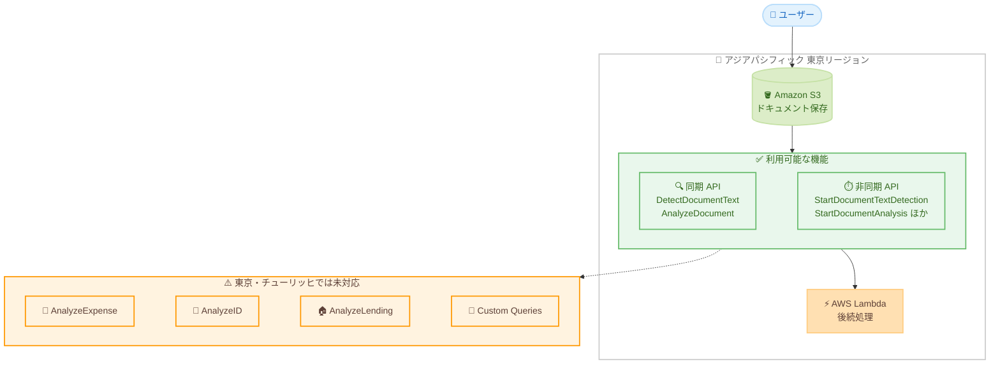

# Amazon Textract - アジアパシフィック (東京) および欧州 (チューリッヒ) リージョンで利用可能に

**リリース日**: 2026 年 11 月 2 日
**サービス**: Amazon Textract
**機能**: 新規リージョン対応 (アジアパシフィック (東京)、欧州 (チューリッヒ))

📊 [このアップデートのインフォグラフィックを見る](https://takech9203.github.io/aws-news-summary/20261102-textract-tokyo-zurich.html)

## 概要

Amazon Textract がアジアパシフィック (東京) および欧州 (チューリッヒ) リージョンで利用可能になりました。Amazon Textract は、スキャンされたドキュメントからテキスト、手書き文字、データを自動的に抽出する機械学習サービスです。単純な OCR を超えて、フォームやテーブルなどの構造化データを抽出できます。

今回のリージョン拡大により、Amazon Textract は合計 18 の AWS リージョンで利用可能になりました。特に東京リージョンへの対応は、日本国内のユーザーにとって大きなアップデートです。これまで日本のユーザーは海外リージョンを利用する必要がありましたが、今後は国内でドキュメント処理を完結できます。

ローンチ時点では、テキスト検出とドキュメント分析の機能が利用可能です。具体的には、DetectDocumentText、AnalyzeDocument、StartDocumentTextDetection、GetDocumentTextDetection、StartDocumentAnalysis、GetDocumentAnalysis の 6 つの API がサポートされます。一方で、AnalyzeExpense、AnalyzeID、AnalyzeLending、Custom Queries (アダプター) は、現時点ではこれらのリージョンでは利用できない点に注意が必要です。

**アップデート前の課題**

- 以前は東京リージョンで Amazon Textract を利用できず、シンガポールやソウルなどの海外リージョンを利用する必要があった
- ドキュメントデータを国外のリージョンに送信する必要があり、データレジデンシー要件のある企業では採用が困難だった
- 海外リージョンへの API 呼び出しによるネットワークレイテンシーが発生していた

**アップデート後の改善**

- 東京リージョンでテキスト検出およびドキュメント分析の API が利用可能になった
- ドキュメントデータを日本国内で処理できるようになり、データレジデンシー要件への対応が容易になった
- 国内リージョンでの処理によりレイテンシーが低減され、同一リージョン内の Amazon S3 や AWS Lambda との連携が効率化された

## アーキテクチャ図



東京リージョン内で完結するドキュメント処理フローと、ローンチ時点で利用可能な API および未対応の機能を示しています。

## サービスアップデートの詳細

### 主要機能

1. **テキスト検出 (Text Detection)**
   - スキャンされたドキュメント画像や PDF から、印刷テキストおよび手書き文字を抽出
   - 同期 API の DetectDocumentText と、非同期 API の StartDocumentTextDetection / GetDocumentTextDetection をサポート
   - 行および単語単位でテキストと位置情報 (バウンディングボックス) を取得可能

2. **ドキュメント分析 (Document Analysis)**
   - フォーム (キーと値のペア) やテーブルなどの構造化データを抽出
   - 同期 API の AnalyzeDocument と、非同期 API の StartDocumentAnalysis / GetDocumentAnalysis をサポート
   - 単純な OCR では難しい、ドキュメントの構造を保持したデータ抽出が可能

3. **リージョン拡大の範囲**
   - アジアパシフィック (東京) と欧州 (チューリッヒ) の 2 リージョンが追加
   - 合計 18 の AWS リージョンで Amazon Textract が利用可能に

## 技術仕様

### 利用可能な API

| API | 処理方式 | 機能 |
|------|------|------|
| DetectDocumentText | 同期 | テキスト検出 |
| AnalyzeDocument | 同期 | ドキュメント分析 (フォーム、テーブルなど) |
| StartDocumentTextDetection | 非同期 | テキスト検出ジョブの開始 |
| GetDocumentTextDetection | 非同期 | テキスト検出ジョブの結果取得 |
| StartDocumentAnalysis | 非同期 | ドキュメント分析ジョブの開始 |
| GetDocumentAnalysis | 非同期 | ドキュメント分析ジョブの結果取得 |

### 未対応の機能 (東京・チューリッヒ)

| 機能 | 用途 |
|------|------|
| AnalyzeExpense | 請求書・領収書の分析 |
| AnalyzeID | 身分証明書の分析 |
| AnalyzeLending | 住宅ローン関連ドキュメントの分析 |
| Custom Queries (アダプター) | カスタマイズされたクエリによる抽出 |

## 設定方法

### 前提条件

1. AWS アカウントを保有していること
2. Amazon Textract へのアクセス権限を持つ IAM ユーザーまたはロールが設定されていること
3. 非同期 API を使用する場合は、対象ドキュメントが同一リージョンの Amazon S3 バケットに保存されていること

### 手順

#### ステップ 1: 東京リージョンで同期 API を実行

```bash
aws textract detect-document-text \
  --document '{"S3Object":{"Bucket":"my-bucket-tokyo","Name":"sample-document.png"}}' \
  --region ap-northeast-1
```

東京リージョン (ap-northeast-1) の S3 バケットに保存されたドキュメント画像からテキストを検出しています。`--region ap-northeast-1` を指定することで、東京リージョンの Textract エンドポイントを利用します。

#### ステップ 2: ドキュメント分析でフォームとテーブルを抽出

```bash
aws textract analyze-document \
  --document '{"S3Object":{"Bucket":"my-bucket-tokyo","Name":"sample-form.png"}}' \
  --feature-types '["FORMS","TABLES"]' \
  --region ap-northeast-1
```

AnalyzeDocument API を使用して、フォーム (キーと値のペア) とテーブルの構造化データを抽出しています。`--feature-types` で抽出対象の要素タイプを指定します。

#### ステップ 3: 複数ページ PDF を非同期 API で処理

```bash
# 非同期ジョブを開始
aws textract start-document-text-detection \
  --document-location '{"S3Object":{"Bucket":"my-bucket-tokyo","Name":"multi-page.pdf"}}' \
  --region ap-northeast-1

# 返却された JobId を使用して結果を取得
aws textract get-document-text-detection \
  --job-id "<JobId>" \
  --region ap-northeast-1
```

複数ページの PDF など大きなドキュメントは非同期 API で処理します。StartDocumentTextDetection でジョブを開始し、返却された JobId を指定して GetDocumentTextDetection で結果を取得します。

## メリット

### ビジネス面

- **データレジデンシー要件への対応**: ドキュメントデータを日本国内 (東京リージョン) で処理できるため、金融、医療、公共分野などデータの国外持ち出しに制約のある業界でも採用しやすくなる
- **コンプライアンス対応の簡素化**: スイス国内にデータを保持する必要がある欧州のユーザーも、チューリッヒリージョンで同様のメリットを享受できる
- **ドキュメント処理の内製化促進**: 紙書類のデジタル化やデータ入力業務の自動化を、国内リージョンで安心して進められる

### 技術面

- **レイテンシーの低減**: 日本国内からの API 呼び出しが東京リージョンで完結するため、海外リージョン利用時と比較して応答時間が短縮される
- **同一リージョン内での連携**: 東京リージョンの Amazon S3、AWS Lambda、Amazon Comprehend などと組み合わせたパイプラインを、リージョンをまたがずに構築できる
- **データ転送の最適化**: リージョン間のデータ転送が不要になり、転送コストと転送時間を削減できる

## デメリット・制約事項

### 制限事項

- AnalyzeExpense (経費分析) は東京・チューリッヒリージョンでは利用できない
- AnalyzeID (身分証明書分析) および AnalyzeLending (ローンドキュメント分析) も未対応
- Custom Queries (アダプター) によるカスタマイズされた抽出も現時点では利用できない

### 考慮すべき点

- 請求書・領収書処理など AnalyzeExpense に依存するワークロードは、引き続き対応済みの海外リージョンを利用する必要がある
- 日本語ドキュメントのサポート状況は、公式ドキュメントで対応言語を確認した上で検証することを推奨
- リージョンごとの利用可能機能とクォータは、エンドポイントとクォータのドキュメントで最新情報を確認する必要がある

## ユースケース

### ユースケース 1: 紙書類のデジタルアーカイブ

**シナリオ**: 日本国内の企業が、紙の契約書や申請書をスキャンしてデジタル化し、検索可能なアーカイブを構築する。データは国内で処理する必要がある。

**実装例**:
```
S3 (東京) へのアップロード → S3 イベントで Lambda 起動
→ StartDocumentTextDetection でテキスト抽出
→ 抽出結果を Amazon OpenSearch Service にインデックス登録
```

**効果**: 国内リージョンで完結する全文検索可能なドキュメントアーカイブを構築でき、データレジデンシー要件を満たしながら書類検索の工数を大幅に削減できる。

### ユースケース 2: 申請フォームのデータ入力自動化

**シナリオ**: 手書きを含む申請フォームを受け付けている組織が、フォームのキーと値のペアを自動抽出し、基幹システムへの入力を自動化する。

**実装例**:
```
AnalyzeDocument (FeatureTypes: FORMS) でキーと値のペアを抽出
→ 抽出結果を検証ロジックでチェック
→ 信頼度スコアが低い項目のみ人手でレビュー (Amazon A2I との連携)
→ 基幹システムの API へ登録
```

**効果**: 手作業によるデータ入力を削減し、入力ミスの防止と処理時間の短縮を実現できる。

### ユースケース 3: 帳票内テーブルデータの抽出と分析

**シナリオ**: 取引先から受領する帳票 PDF に含まれるテーブルデータを抽出し、データ分析基盤に取り込む。

**実装例**:
```
StartDocumentAnalysis (FeatureTypes: TABLES) で非同期処理
→ GetDocumentAnalysis でテーブル構造を取得
→ CSV / Parquet に変換して S3 に保存
→ Amazon Athena や Amazon QuickSight で分析
```

**効果**: 帳票データの手動転記が不要になり、分析基盤へのデータ取り込みを自動化できる。

## 料金

Amazon Textract は処理したページ数に応じた従量課金制です。API の種類 (テキスト検出、フォーム抽出、テーブル抽出など) によってページ単価が異なります。初期費用や最低料金はなく、使用した分のみ課金されます。

東京およびチューリッヒリージョンでの具体的な料金は、[Amazon Textract 料金ページ](https://aws.amazon.com/textract/pricing/) で最新情報を確認してください。

## 利用可能リージョン

今回の拡大により、Amazon Textract は合計 18 リージョンで利用可能になりました。

- 米国東部 (オハイオ、バージニア北部)
- 米国西部 (北カリフォルニア、オレゴン)
- アジアパシフィック (ムンバイ、ソウル、シンガポール、シドニー、**東京** ← New)
- カナダ (中部)
- 欧州 (フランクフルト、アイルランド、ロンドン、パリ、スペイン、**チューリッヒ** ← New)
- AWS GovCloud (米国東部、米国西部)

**注意**: 東京およびチューリッヒリージョンでは、ローンチ時点でテキスト検出とドキュメント分析のみ利用可能です。

## 関連サービス・機能

- **Amazon S3**: 非同期 API の入力ドキュメントの保存先。同一リージョン内で連携することでレイテンシーとコストを最適化できる
- **Amazon Comprehend**: Textract で抽出したテキストに対してエンティティ抽出や感情分析などの自然言語処理を実行できる
- **Amazon Augmented AI (A2I)**: 信頼度スコアの低い抽出結果を人手でレビューするワークフローを構築できる
- **Amazon Bedrock**: 抽出したドキュメントテキストを生成 AI による要約や質問応答に活用できる

## 参考リンク

- 📊 [インフォグラフィック](https://takech9203.github.io/aws-news-summary/20261102-textract-tokyo-zurich.html)
- [公式発表 (What's New)](https://aws.amazon.com/about-aws/whats-new/2026/11/textract-tokyo-zurich/)
- [Amazon Textract 製品ページ](https://aws.amazon.com/textract/)
- [Amazon Textract 開発者ガイド](https://docs.aws.amazon.com/textract/)
- [Amazon Textract 料金ページ](https://aws.amazon.com/textract/pricing/)
- [エンドポイントとクォータ](https://docs.aws.amazon.com/general/latest/gr/textract.html)

## まとめ

Amazon Textract がついに東京リージョンで利用可能になり、データレジデンシー要件のある日本のユーザーもドキュメント処理の自動化を国内で完結できるようになりました。ローンチ時点ではテキスト検出とドキュメント分析のみの対応で、AnalyzeExpense や Custom Queries などは未対応のため、利用予定の機能がサポートされているかを確認した上で移行を検討してください。なお、同日にテキスト検出モデルの更新も発表されており、精度面の強化も進んでいます。
