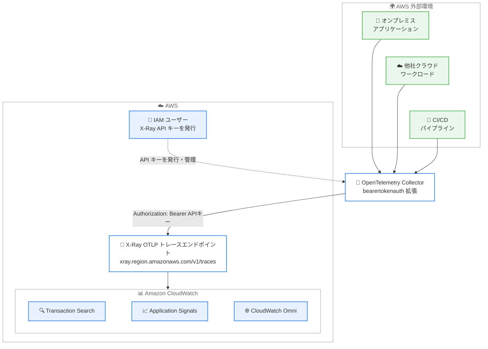

# Amazon CloudWatch - OpenTelemetry トレース向け API キー (ベアラートークン) 認証サポート

**リリース日**: 2026 年 11 月 3 日
**サービス**: Amazon CloudWatch (AWS X-Ray OTLP トレースエンドポイント)
**機能**: OpenTelemetry トレース送信における API キーによるベアラートークン認証

📊 [このアップデートのインフォグラフィックを見る](https://takech9203.github.io/aws-news-summary/20261103-amazon-cloudwatch-api-keys-opentelemetry.html)
<!-- INFOGRAPHIC_BASE_URL は環境変数から取得 -->

## 概要

Amazon CloudWatch が、AWS X-Ray の OpenTelemetry Protocol (OTLP) トレースエンドポイントへのトレース送信において、API キーを使用したベアラートークン認証をサポートしました。これにより、OpenTelemetry Collector や OpenTelemetry SDK のエクスポーターなど、`Authorization` ヘッダーを設定できる任意の OTLP/HTTP クライアントが、AWS Signature Version 4 (SigV4) によるリクエスト署名を行わずに認証できるようになります。

このアップデートは、AWS SDK や一時クレデンシャルを利用できないワークロードを対象としています。具体的には、オンプレミスや他社クラウドで稼働するアプリケーション、CI/CD パイプライン、静的な `Authorization` ヘッダーのみをサポートするサードパーティツールなどです。なお、SigV4 は引き続き CloudWatch へのトレース送信における推奨の認証方式であり、AWS Distro for OpenTelemetry (ADOT) SDK はデフォルトで SigV4 を使用し続けるため、既存環境への変更は不要です。

どちらの認証方式を使用しても、Transaction Search、Amazon CloudWatch Application Signals、Amazon CloudWatch Omni など、同一の CloudWatch 機能を利用できます。

**アップデート前の課題**

このアップデート以前は、OTLP トレースエンドポイントへの送信に SigV4 署名が必須でした。

- 以前は、トレース送信に SigV4 署名が必要であり、AWS SDK や AWS クレデンシャルを利用できない環境 (オンプレミス、他社クラウド、CI/CD パイプラインなど) からの直接送信が困難だった
- 以前は、静的な `Authorization` ヘッダーのみをサポートするサードパーティ製のテレメトリツールから、CloudWatch へ直接トレースを送信できなかった
- 以前は、SigV4 署名のために OpenTelemetry Collector の `sigv4auth` 拡張の構成と AWS クレデンシャルの配布が必要だった

**アップデート後の改善**

今回のアップデートにより、API キーによるシンプルな認証が選択肢に加わりました。

- 今回のアップデートにより、`Authorization: Bearer` ヘッダーを設定できる任意の OTLP/HTTP クライアントから CloudWatch へトレースを送信できるようになった
- 今回のアップデートにより、AWS SDK や一時クレデンシャルを利用できないオンプレミス、他社クラウド、CI/CD パイプラインからのトレース送信が容易になった
- 今回のアップデートにより、API キー認証でも SigV4 と同一の CloudWatch 機能 (Transaction Search、Application Signals、CloudWatch Omni) を利用できるようになった

## アーキテクチャ図



AWS 外部のワークロードが、IAM ユーザーに発行した X-Ray API キーをベアラートークンとして使用し、SigV4 署名なしで OTLP トレースエンドポイントへトレースを送信する流れを示しています。

## サービスアップデートの詳細

### 主要機能

1. **API キーによるベアラートークン認証**
   - X-Ray OTLP トレースエンドポイント (`https://xray.{region}.amazonaws.com/v1/traces`) への送信時に、`Authorization: Bearer` ヘッダーで API キーを指定して認証できる
   - API キーは IAM ユーザーが所有する `xray.amazonaws.com` 向けのサービス固有クレデンシャルで、リクエストはその IAM ユーザーの権限で実行される
   - OTLP トレースエンドポイントへのスパン送信 (`xray:PutTraceSegments` として認可) のみに使用でき、SigV4 が必要な X-Ray API の呼び出しには使用できない

2. **幅広い OTLP/HTTP クライアントのサポート**
   - OpenTelemetry Collector では `sigv4auth` の代わりに `bearertokenauth` 拡張を使用して構成できる
   - OpenTelemetry SDK のエクスポーターや curl など、`Authorization` ヘッダーを設定できる任意の OTLP/HTTP クライアントが利用可能
   - ペイロードは `application/x-protobuf` と `application/json` の両方に対応

3. **キーのライフサイクル管理と監査**
   - API キーには 1 日から 36,600 日の有効期限を設定可能 (未設定の場合は無期限)
   - IAM ユーザーごとに 2 つの API キーを保持でき、ダウンタイムなしでローテーションが可能
   - AWS CloudTrail のデータイベントに `"callWithBearerToken": true` が記録され、API キーによるリクエストを SigV4 リクエストと区別して監査できる

4. **SigV4 との機能同等性**
   - API キー認証でも、Transaction Search、Amazon CloudWatch Application Signals、Amazon CloudWatch Omni を含む同一の CloudWatch 機能を利用できる
   - ADOT SDK はデフォルトで SigV4 を使用し続けるため、既存の構成に変更は不要

## 技術仕様

### 認証方式の比較

| 項目 | SigV4 (推奨) | API キー (ベアラートークン) |
|------|--------------|------------------------------|
| 認証方法 | AWS クレデンシャルによるリクエスト署名 | `Authorization: Bearer` ヘッダー |
| 必要なもの | AWS SDK または sigv4auth 拡張、一時クレデンシャル | IAM ユーザーと X-Ray API キー |
| 主な用途 | AWS 上のワークロード全般 | オンプレミス、他社クラウド、CI/CD、サードパーティツール |
| 利用可能な CloudWatch 機能 | Transaction Search、Application Signals、CloudWatch Omni など | SigV4 と同一 |
| セキュリティ上の位置づけ | 最も強力なセキュリティ体制 (推奨) | 短期クレデンシャルが使えない場合のみ使用 |

### API キーの要件と制限

| 項目 | 詳細 |
|------|------|
| 前提条件 | Transaction Search の有効化 (OTLP トレースエンドポイントの要件) |
| 通信 | HTTPS 必須 (HTTP リクエストは拒否される) |
| 対応エンドポイント | 標準エンドポイント、FIPS エンドポイント、X-Ray のインターフェイス VPC エンドポイント |
| キー数の上限 | IAM ユーザーごとに 2 キー (無停止ローテーション用) |
| 有効期限 | 1〜36,600 日で設定可能 (未設定の場合は無期限) |
| 必要な IAM 権限 | `xray:CallWithBearerToken` および `xray:PutTraceSegments` (管理ポリシー `AWSXRayAPIKeyAccess` を推奨) |
| エラー応答 | キーが無効・期限切れ・非アクティブ、または権限不足の場合は HTTP 403、一時的な障害の場合は HTTP 503 |

### IAM ポリシー例

トレース送信用 IAM ユーザーに付与する権限の例です。

```json
{
    "Version": "2012-10-17",
    "Statement": [
        {
            "Sid": "XRayTracesWithAPIKey",
            "Effect": "Allow",
            "Action": [
                "xray:CallWithBearerToken",
                "xray:PutTraceSegments"
            ],
            "Resource": "*"
        }
    ]
}
```

## 設定方法

### 前提条件

1. Transaction Search が有効化されていること (OTLP トレースエンドポイントの利用に必須)
2. トレース送信専用の IAM ユーザーを作成できること
3. 送信元クライアントが HTTPS で `Authorization` ヘッダーを設定できること

### 手順

#### ステップ1: IAM ユーザーの作成と権限付与

IAM コンソールでトレース送信専用の IAM ユーザー (例: `xray-traces-api-key-user`) を作成し、AWS 管理ポリシー `AWSXRayAPIKeyAccess`、または `xray:CallWithBearerToken` と `xray:PutTraceSegments` を許可するカスタマー管理ポリシーをアタッチします。

#### ステップ2: API キーの作成

```bash
aws iam create-service-specific-credential \
    --user-name xray-traces-api-key-user \
    --service-name xray.amazonaws.com \
    --credential-age-days 30
```

IAM のサービス固有クレデンシャルとして X-Ray 用の API キーを作成するコマンドです。`--credential-age-days` で 30 日の有効期限を設定しています。レスポンスの `ServiceCredentialSecret` が API キー (ベアラートークン) であり、後から再取得できないため、AWS Secrets Manager などに安全に保管します。

#### ステップ3: OpenTelemetry Collector の構成

```yaml
extensions:
  bearertokenauth:
    filename: "/etc/otel/xray-api-key"

receivers:
  otlp:
    protocols:
      http:
        endpoint: "0.0.0.0:4318"

processors:
  batch:

exporters:
  otlphttp/traces:
    compression: gzip
    traces_endpoint: "https://xray.us-east-1.amazonaws.com/v1/traces"
    auth:
      authenticator: bearertokenauth

service:
  extensions: [bearertokenauth]
  pipelines:
    traces:
      receivers: [otlp]
      processors: [batch]
      exporters: [otlphttp/traces]
```

OpenTelemetry Collector で `sigv4auth` の代わりに `bearertokenauth` 拡張を使用し、ファイルから API キーを読み込んで OTLP トレースエンドポイントへ送信する構成例です。環境変数から読み込む場合は `token: "${env:XRAY_API_KEY}"` を使用します。API キーを構成ファイルやソースコードに直接記載してはいけません。

#### ステップ4: curl による送信テスト

```bash
curl -X POST "https://xray.us-east-1.amazonaws.com/v1/traces" \
     -H "Content-Type: application/json" \
     -H "Authorization: Bearer ${XRAY_API_KEY}" \
     -d @spans.json
```

OTLP JSON ペイロードを `Authorization: Bearer` ヘッダー付きでエンドポイントへ直接送信し、認証と疎通を確認するコマンドです。

## メリット

### ビジネス面

- **ハイブリッド・マルチクラウド環境の可観測性統合**: オンプレミスや他社クラウドのワークロードからも CloudWatch へ直接トレースを送信でき、可観測性基盤を CloudWatch に一元化できる
- **サードパーティツールとの連携拡大**: 静的な `Authorization` ヘッダーしかサポートしないツールからも CloudWatch を利用でき、ツール選択の自由度が高まる
- **導入障壁の低減**: AWS SDK の組み込みや SigV4 署名の実装が不要になり、CloudWatch によるトレース収集の導入が容易になる

### 技術面

- **シンプルな認証実装**: `Authorization: Bearer` ヘッダーを 1 つ設定するだけで認証でき、標準の OpenTelemetry Collector の `bearertokenauth` 拡張をそのまま利用できる
- **無停止のキーローテーション**: IAM ユーザーごとに 2 キーを保持できるため、トレース送信を中断せずにキーをローテーションできる
- **ガバナンスと監査**: `iam:ServiceSpecificCredentialAgeDays` 条件キーで有効期限を強制でき、CloudTrail の `callWithBearerToken` フィールドで API キー利用を監査できる

## デメリット・制約事項

### 制限事項

- API キーは OTLP トレースエンドポイントへのスパン送信のみに使用でき、SigV4 が必要な X-Ray API (トレースデータの読み取りなど) には使用できない
- OTLP トレースエンドポイントの利用には Transaction Search の事前有効化が必要
- API キーは IAM ユーザーに紐づく長期クレデンシャルの一種であり、SigV4 と短期クレデンシャルの方が強力なセキュリティ体制を提供するため、AWS は可能な限り SigV4 の利用を推奨している
- ベアラートークン認証が利用可能なリージョンは、ドキュメントに記載された商用リージョンに限られる

### 考慮すべき点

- API キーは作成時にしか取得できないため、AWS Secrets Manager などでの安全な保管と漏えい対策が必須
- すべてのキーに有効期限を設定し、`iam:ServiceSpecificCredentialAgeDays` 条件キーで最大キー年齢を強制することが推奨される
- アプリケーションや連携ごとに専用の IAM ユーザーを分け、最小権限の原則を適用することが推奨される
- 漏えいが疑われる場合は、キーの無効化・削除、または `xray:CallWithBearerToken` の明示的拒否で即座にブロックできる (反映まで約 5 分)
- CloudTrail のデータイベントはデフォルトで記録されないため、監査のためには明示的な有効化が必要

## ユースケース

### ユースケース1: オンプレミスアプリケーションのトレースを CloudWatch に集約

**シナリオ**: オンプレミスのデータセンターで稼働するアプリケーションに OpenTelemetry を導入しているが、AWS クレデンシャルの配布が難しく、CloudWatch へのトレース送信ができていない。

**実装例**:
```
1. トレース送信専用の IAM ユーザーを作成し、AWSXRayAPIKeyAccess をアタッチ
2. 有効期限付きの X-Ray API キーを作成し、社内のシークレット管理基盤に保管
3. オンプレミスの OpenTelemetry Collector に bearertokenauth 拡張を構成して OTLP エンドポイントへ送信
```

**効果**: AWS SDK や一時クレデンシャルの配布なしで、オンプレミスのトレースを CloudWatch に集約し、Transaction Search や Application Signals で AWS 上のワークロードと一元的に分析できる。

### ユースケース2: CI/CD パイプラインのトレーシング

**シナリオ**: GitHub Actions などの CI/CD パイプラインの実行をトレースとして可視化したいが、パイプラインから SigV4 署名を行う仕組みの構築が負担になっている。

**実装例**:
```
1. CI/CD 専用の IAM ユーザーと短い有効期限の API キーを作成
2. API キーを CI/CD のシークレットとして登録
3. パイプラインから OTLP/HTTP で Authorization: Bearer ヘッダーを付けてトレースを送信
```

**効果**: シンプルな HTTP ヘッダー設定のみでパイプラインの実行状況を CloudWatch で可視化でき、ビルドやデプロイのボトルネック分析が可能になる。

### ユースケース3: 他社クラウド上のワークロードのマルチクラウド可観測性

**シナリオ**: 複数のクラウドにワークロードが分散しており、他社クラウド上のサービスのトレースも CloudWatch に統合して、分散トレーシングを一元化したい。

**実装例**:
```
1. 他社クラウド用の IAM ユーザーと API キーを作成し、各クラウドのシークレット管理サービスに保管
2. 各クラウドの OpenTelemetry Collector に bearertokenauth を構成
3. aws:SourceIp 条件で API キーの利用元ネットワークを制限
```

**効果**: クラウドをまたぐリクエストのエンドツーエンドのトレースを CloudWatch Omni や Transaction Search で分析でき、マルチクラウド環境の障害調査時間を短縮できる。

## 料金

API キー認証の利用自体に関する追加料金は発表されていません。トレースの取り込みには CloudWatch / X-Ray の既存の料金が適用されます。また、OTLP トレースエンドポイントの利用には Transaction Search の有効化が必要で、スパンは CloudWatch Logs に送信されるため、関連する料金が発生します。詳細は [Amazon CloudWatch 料金ページ](https://aws.amazon.com/cloudwatch/pricing/) を参照してください。

## 利用可能リージョン

X-Ray OTLP トレースエンドポイントが利用可能なすべての AWS 商用リージョンで利用できます。ドキュメントによると、ベアラートークン認証は東京、大阪を含む以下のリージョンで利用可能です: 米国東部 (バージニア北部、オハイオ)、米国西部 (北カリフォルニア、オレゴン)、アフリカ (ケープタウン)、アジアパシフィック (香港、ハイデラバード、ジャカルタ、マレーシア、メルボルン、ムンバイ、大阪、ソウル、シンガポール、シドニー、タイ、東京)、カナダ (中部)、カナダ西部 (カルガリー)、欧州 (フランクフルト、アイルランド、ロンドン、ミラノ、パリ、スペイン、ストックホルム、チューリッヒ)、南米 (サンパウロ)。

## 関連サービス・機能

- **AWS X-Ray**: OTLP トレースエンドポイントを提供する分散トレーシングサービス。API キーは X-Ray のサービス固有クレデンシャルとして発行される
- **AWS IAM**: API キーの発行・ローテーション・失効を管理。`xray:CallWithBearerToken` アクションと条件キーでガバナンスを実現する
- **CloudWatch Application Signals**: 送信されたトレースを活用してアプリケーションのパフォーマンスを監視する機能。API キー認証でも利用可能
- **AWS CloudTrail**: `callWithBearerToken` フィールドを含むデータイベントで API キーの利用状況を監査できる
- **AWS Secrets Manager**: API キーの安全な保管に推奨されるシークレット管理サービス

## 参考リンク

- 📊 [インフォグラフィック](https://takech9203.github.io/aws-news-summary/20261103-amazon-cloudwatch-api-keys-opentelemetry.html)
- [公式発表 (What's New)](https://aws.amazon.com/about-aws/whats-new/2026/11/amazon-cloudwatch-api-keys-opentelemetry/)
- [Setting up bearer token authentication for traces (AWS X-Ray Developer Guide)](https://docs.aws.amazon.com/xray/latest/devguide/xray-opentelemetry-bearer-token.html)
- [Amazon CloudWatch 製品ページ](https://aws.amazon.com/cloudwatch/)
- [料金ページ](https://aws.amazon.com/cloudwatch/pricing/)

## まとめ

Amazon CloudWatch の OTLP トレースエンドポイントが API キーによるベアラートークン認証をサポートしたことで、オンプレミス、他社クラウド、CI/CD パイプラインなど AWS クレデンシャルを利用しにくい環境からも、標準的な OpenTelemetry ツールで CloudWatch へトレースを送信できるようになりました。SigV4 が引き続き推奨であることを踏まえつつ、短期クレデンシャルを利用できない外部ワークロードについては、有効期限付きの API キーと最小権限の IAM ユーザーを組み合わせた導入を検討することをおすすめします。
