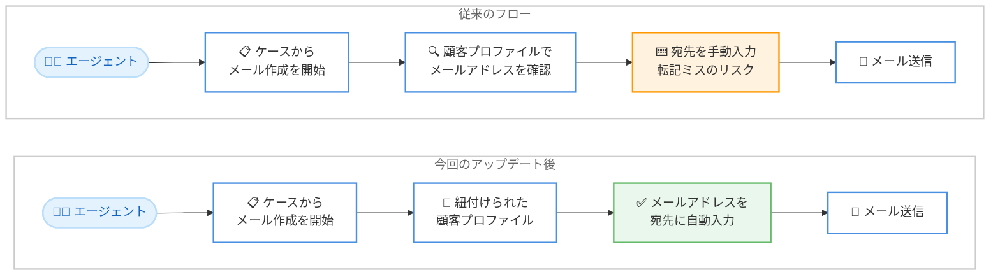

# Amazon Connect Customer (Cases) - ケースから開始する新規メールスレッドでの宛先メールアドレス自動入力

**リリース日**: 2026 年 11 月 3 日
**サービス**: Amazon Connect Customer (Cases)
**機能**: ケースから新規メールスレッドを開始する際の顧客メールアドレスの自動入力 (プレフィル)

📊 [このアップデートのインフォグラフィックを見る](https://takech9203.github.io/aws-news-summary/20261103-amazon-connect-cases-email-addresses.html)

## 概要

Amazon Connect Customer (Cases) において、エージェントがケースから新規メールスレッドを開始する際に、ケースに紐付けられた顧客プロファイル (Customer Profiles) から顧客のメールアドレスが自動的に宛先へ入力されるようになりました。Cases はコンタクトセンターにおける顧客の問い合わせ (ケース) を追跡・共同対応・解決するための機能であり、顧客プロファイルと連携して「誰の問い合わせか」を管理します。

これまでエージェントは、ケースに関するフォローアップメールを送信する際に、顧客プロファイルや過去のやり取りからメールアドレスを調べて手動で入力する必要がありました。今回のアップデートにより、宛先の入力作業が不要になり、エージェントの対応時間の短縮と、手入力に起因する誤送信リスクの低減が期待できます。

コンタクトセンターでメールチャネルと Cases を併用している管理者およびエージェントにとって、日々のフォローアップ業務を効率化する実務的な改善です。

**アップデート前の課題**

このアップデート以前は、ケースからのメール送信時に宛先の手動入力が必要でした。

- ケースから新規メールスレッドを開始する際、エージェントが顧客プロファイルを開いてメールアドレスを確認し、手動で入力する必要があった
- メールアドレスの転記ミスにより、誤った宛先への送信や未達が発生するリスクがあった
- 宛先の確認・入力の手間により、ケースあたりの処理時間 (ハンドリングタイム) が増加していた

**アップデート後の改善**

今回のアップデートにより、宛先入力が自動化されました。

- ケースに紐付けられた顧客プロファイルから、顧客のメールアドレスが新規メールスレッドの宛先に自動入力されるようになった
- メールアドレスの検索・手入力が不要になり、エージェントの作業時間が短縮された
- 手入力に起因する転記ミスや誤送信のリスクが低減された

## アーキテクチャ図



従来はエージェントが顧客プロファイルを参照して宛先を手動入力していましたが、アップデート後はケースに紐付けられた顧客プロファイルからメールアドレスが自動的に宛先へ入力されます。

## サービスアップデートの詳細

### 主要機能

1. **宛先メールアドレスの自動入力**
   - エージェントがケースから新規メールスレッドを開始すると、ケースに紐付けられた顧客プロファイルのメールアドレスが宛先に自動入力される
   - メールアドレスの検索や手入力が不要になり、フォローアップ対応を即座に開始できる

2. **顧客プロファイルとの連携**
   - 自動入力の情報源は、ケースにリンクされた顧客プロファイル (Customer Profiles)
   - プロファイル上の顧客情報を単一の信頼できる情報源として活用することで、ケース対応におけるデータ整合性を維持できる

3. **手入力エラーの削減**
   - 転記ミスによる誤送信や未達のリスクを低減
   - 顧客への連絡品質とコンプライアンスの観点でも有効

## 技術仕様

### 機能の前提となる構成要素

| 項目 | 詳細 |
|------|------|
| 対象機能 | Amazon Connect Customer (Cases) のエージェントワークスペース |
| 動作契機 | エージェントがケースから新規メールスレッドを開始した時 |
| 自動入力の情報源 | ケースにリンクされた顧客プロファイルのメールアドレス |
| 必要なチャネル | Amazon Connect のメールチャネル |
| 追加の統合作業 | 不要 (エージェントワークスペースの標準動作として提供) |

## 設定方法

### 前提条件

1. Amazon Connect インスタンスで Cases が有効化されていること
2. Amazon Connect のメールチャネルが設定されていること
3. 顧客プロファイル (Customer Profiles) が有効化され、顧客のメールアドレスがプロファイルに登録されていること
4. ケースが顧客プロファイルに紐付けられていること

### 手順

#### ステップ 1: ケースと顧客プロファイルの紐付けを確認する

エージェントワークスペースで対象のケースを開き、顧客プロファイルがリンクされていることを確認します。プロファイルにメールアドレスが登録されている必要があります。

#### ステップ 2: ケースから新規メールスレッドを開始する

ケースの画面から新規メールスレッドの作成を開始します。宛先には、紐付けられた顧客プロファイルのメールアドレスが自動的に入力されます。

#### ステップ 3: 内容を確認して送信する

自動入力された宛先を確認し、件名と本文を記載してメールを送信します。送信したメールスレッドはケースに関連付けて管理できます。

## メリット

### ビジネス面

- **対応時間の短縮**: 宛先の検索・入力作業が不要になり、ケースあたりの処理時間を削減できる
- **顧客体験の向上**: 誤送信や未達が減ることで、確実かつ迅速なフォローアップが可能になる
- **運用品質の向上**: 顧客プロファイルを単一の情報源とすることで、連絡先情報の管理が統一される

### 技術面

- **追加開発が不要**: エージェントワークスペースの標準動作として提供され、統合作業なしで利用できる
- **Customer Profiles との連携強化**: ケース・プロファイル・メールチャネルが一体で機能し、データ整合性を維持しやすい
- **手入力エラーの排除**: 人手による転記を排除することで、オペレーションミスを構造的に防止できる

## デメリット・制約事項

### 制限事項

- 自動入力には、ケースが顧客プロファイルに紐付けられており、プロファイルにメールアドレスが登録されている必要がある
- Amazon Connect のメールチャネルが設定済みであることが前提となる
- Cases が利用可能なリージョンでのみ利用できる

### 考慮すべき点

- 顧客プロファイルのメールアドレスが古い場合、意図しない宛先に自動入力されるため、プロファイル情報の鮮度を保つ運用が重要
- 複数のメールアドレスを持つ顧客の場合、送信前にエージェントが宛先を確認する運用ルールを整備することが望ましい

## ユースケース

### ユースケース 1: ケース解決後のフォローアップメール

**シナリオ**: 電話で受け付けた問い合わせをケースとして管理し、調査完了後に結果を顧客へメールで連絡する。

**実装例**:
```
1. 電話応対時にケースを作成し、顧客プロファイルに紐付ける
2. 調査完了後、エージェントがケースから新規メールスレッドを開始
3. 宛先に顧客のメールアドレスが自動入力される
4. 調査結果を記載して送信し、やり取りをケースに記録する
```

**効果**: 宛先確認の手間なくフォローアップを開始でき、対応履歴もケースに一元化される。

### ユースケース 2: 追加情報の依頼

**シナリオ**: ケースの解決に必要な書類や情報を顧客に依頼する。

**実装例**:
```
1. エージェントがケースの不足情報を特定する
2. ケースから新規メールスレッドを開始 (宛先は自動入力)
3. 必要な書類・情報を明記した依頼メールを送信する
```

**効果**: 依頼メールの作成が迅速化し、誤送信による個人情報関連のリスクも低減できる。

### ユースケース 3: 大量ケース処理時のオペレーション効率化

**シナリオ**: キャンペーン期間中など、多数のケースに対して順次メール連絡を行う。

**実装例**:
```
1. エージェントが担当ケースを順番に開く
2. 各ケースから新規メールスレッドを開始すると宛先が自動入力される
3. テンプレートを活用して効率的に連絡を完了する
```

**効果**: ケースごとの宛先入力時間が積み上げで削減され、処理件数の向上につながる。

## 料金

本機能自体に追加料金はありません。Amazon Connect Customer (Cases) の利用料金およびメールチャネルの利用料金が通常どおり適用されます。詳細は [Amazon Connect の料金ページ](https://aws.amazon.com/connect/pricing/) を参照してください。

## 利用可能リージョン

Cases は以下のリージョンで利用可能です。

- 米国東部 (バージニア北部)
- 米国西部 (オレゴン)
- カナダ (中部)
- 欧州 (フランクフルト)
- 欧州 (ロンドン)
- アジアパシフィック (ソウル)
- アジアパシフィック (シンガポール)
- アジアパシフィック (シドニー)
- アジアパシフィック (東京)
- アフリカ (ケープタウン)

## 関連サービス・機能

- **Amazon Connect Customer Profiles**: 自動入力の情報源となる顧客プロファイルを管理する機能。ケースとの紐付けにより顧客情報を一元化する
- **Amazon Connect メールチャネル**: ケースから開始するメールスレッドの送受信基盤
- **Amazon Connect エージェントワークスペース**: ケース・プロファイル・メールを統合的に扱うエージェント向け UI

## 参考リンク

- 📊 [インフォグラフィック](https://takech9203.github.io/aws-news-summary/20261103-amazon-connect-cases-email-addresses.html)
- [公式発表 (What's New)](https://aws.amazon.com/about-aws/whats-new/2026/11/amazon-connect-cases-email-addresses/)
- [Cases 製品ページ](https://aws.amazon.com/products/connect/customer/cases/)
- [Cases ドキュメント (管理者ガイド)](https://docs.aws.amazon.com/connect/latest/adminguide/cases.html)
- [料金ページ](https://aws.amazon.com/connect/pricing/)

## まとめ

Amazon Connect Customer (Cases) で、ケースから新規メールスレッドを開始する際に顧客メールアドレスが自動入力されるようになり、エージェントの作業時間短縮と誤送信リスクの低減が実現しました。Cases とメールチャネルを併用している場合は、顧客プロファイルへのメールアドレス登録とケースへの紐付けを徹底することで、この改善の効果を最大化できます。
