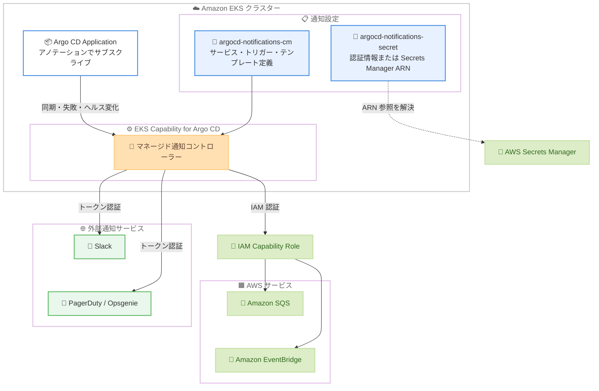

# Amazon EKS - EKS Capability for Argo CD が Argo CD Notifications をサポート

**リリース日**: 2026 年 11 月 3 日
**サービス**: Amazon Elastic Kubernetes Service (Amazon EKS)
**機能**: EKS Capability for Argo CD における Argo CD Notifications のサポート

📊 [このアップデートのインフォグラフィックを見る](https://takech9203.github.io/aws-news-summary/20261103-amazon-eks-argo-cd-notifications.html)

## 概要

Amazon EKS の Capability for Argo CD が Argo CD Notifications をサポートしました。アプリケーションの同期成功、同期失敗、ヘルス状態の変化が発生した際に、通知を送信できるようになります。アップストリームの Argo CD と同じ方法で、クラスター内にトリガーとメッセージテンプレートを定義し、個々の Application にアノテーションを付与してサブスクライブします。

本アップデートにより、Slack、PagerDuty、Opsgenie、Amazon SQS、Amazon EventBridge を含む 16 種類の通知サービスに通知を配信できます。Amazon SQS と Amazon EventBridge への送信は IAM Capability Role で認証されるため、クラスター内に認証情報を保存することなく、デプロイイベントを独自のイベント駆動ワークフローにルーティングできます。また、Slack トークンのようなサードパーティの認証情報が必要なサービスでは、シークレット値の代わりに AWS Secrets Manager の ARN を指定でき、EKS が送信時に自動的に解決します。

EKS Capability for Argo CD を利用して GitOps によるデプロイを運用するプラットフォームチームや開発チームにとって、Argo CD の UI を監視し続けることなくデプロイ結果を把握できるようになる、運用性を大きく向上させるアップデートです。

**アップデート前の課題**

- EKS Capability for Argo CD では通知機能が提供されておらず、デプロイ結果を知るには Argo CD の UI を監視するか、独自の仕組みを構築する必要があった
- 同期失敗やヘルス状態の変化を Slack や PagerDuty などのツールへ自動連携する標準的な方法がなかった
- デプロイイベントを AWS のイベント駆動ワークフローに取り込むには、認証情報の管理を含むカスタム実装が必要だった

**アップデート後の改善**

- マネージドな通知コントローラーにより、Application の同期・失敗・ヘルス変化を 16 種類の通知サービスへ自動配信できるようになった
- Amazon SQS と Amazon EventBridge への送信が IAM Capability Role で認証されるため、クラスターに認証情報を保存せずにイベント駆動ワークフローへ連携できるようになった
- サードパーティの認証情報を AWS Secrets Manager の ARN として参照でき、トークンをクラスター内の Secret に直接保存する必要がなくなった

## アーキテクチャ図



EKS Capability for Argo CD のマネージド通知コントローラーが、ConfigMap で定義したトリガーとテンプレートに基づき、Application のイベントを各通知サービスへ配信します。AWS サービスへは IAM Capability Role で認証し、サードパーティの認証情報は Secrets Manager の ARN 参照で解決できます。

## サービスアップデートの詳細

### 主要機能

1. **マネージドな通知コントローラー**
   - EKS Capability for Argo CD が通知コントローラーをマネージドで実行
   - Application の同期成功、同期失敗、ヘルス状態の変化をトリガーとして通知を送信
   - アップストリームの Argo CD と同じ方式で、`argocd-notifications-cm` ConfigMap にサービス・トリガー・テンプレートを定義し、Application のアノテーションでサブスクライブ
   - 事前定義されたトリガー・テンプレートのカタログはインストールされないため、必要なものを自分で定義する

2. **16 種類の通知サービスへの配信**
   - チャット・コラボレーション: `slack`、`googlechat`、`mattermost`、`teams-workflows`、`telegram`、`webex`
   - インシデント管理: `pagerduty`、`pagerdutyv2`、`opsgenie`
   - AWS サービス: `awssqs`、`eventbridge`
   - その他: `github`、`grafana`、`newrelic`、`pushover`、`gcppubsub`
   - `eventbridge` サービスは本 Capability 固有で、アップストリームには存在しない

3. **IAM Capability Role による AWS サービスへの認証**
   - Amazon SQS と Amazon EventBridge への送信は IAM Capability Role で認証され、サービス定義に認証情報は不要
   - クラスター内に認証情報を保存することなく、デプロイイベントをイベント駆動ワークフローにルーティング可能
   - 別リージョン・別アカウントのキューやイベントバスへも、適切な権限とリソースポリシーがあれば送信可能

4. **AWS Secrets Manager との統合**
   - Slack トークンなどの認証情報について、Secret の値に Secrets Manager の ARN を指定可能
   - EKS が送信時に IAM Capability Role を使用して ARN を自動解決するため、クラスター内にトークン本体を保存する必要がない
   - 解決された値は約 5 分間再利用されるため、ローテーションされたシークレットは約 5 分以内に反映される

## 技術仕様

### 通知の構成要素

| 構成要素 | 詳細 |
|------|------|
| `argocd-notifications-cm` | Argo CD の namespace に作成する ConfigMap。サービス、トリガー、メッセージテンプレートを定義 |
| オプトインラベル | ConfigMap に `eks.amazonaws.com/managed-notifications: "enabled"` ラベルが必須。値は正確に `enabled` である必要がある |
| `argocd-notifications-secret` | 同じ namespace に作成するオプションの Secret。認証情報または Secrets Manager ARN を保持 |
| Application のアノテーション | `notifications.argoproj.io/subscribe.{トリガー}.{サービス}: {宛先}` 形式で各 Application をサブスクライブ |

### アップストリーム Argo CD との主な差異

| 項目 | 詳細 |
|------|------|
| 非対応サービス | `email`、`teams`、`webhook`、`rocketchat`、`nats`、`alertmanager` は利用不可 |
| サポートされる設定キー | `service.`、`trigger.`、`template.`、`subscriptions`、`defaultTriggers`、`context` のみ。その他のキーは無視される |
| サイズ制限 | `template.` / `trigger.` 値は 64 KiB まで。ConfigMap 全体は 256 KiB まで |
| テンプレート関数 | Sprig 関数の一部 (`env`、`merge`、乱数生成系など) は利用不可 |
| 宛先 URL の要件 | `https` 必須、ホスト名はパブリックに解決される FQDN のみ。TLS 証明書検証は常に有効 |
| `gcppubsub` | インライン認証情報 (`keyJSON` の `$` 参照) が必須。`keyFile` や Application Default Credentials は拒否される |

### IAM Capability Role のポリシー例

Amazon SQS と Amazon EventBridge へ送信する場合、IAM Capability Role に以下のようなポリシーをアタッチします。

```json
{
  "Version": "2012-10-17",
  "Statement": [
    {
      "Sid": "SendToQueue",
      "Effect": "Allow",
      "Action": [
        "sqs:GetQueueUrl",
        "sqs:SendMessage"
      ],
      "Resource": "arn:aws:sqs:us-west-2:111122223333:my-queue"
    },
    {
      "Sid": "PutEvents",
      "Effect": "Allow",
      "Action": "events:PutEvents",
      "Resource": "arn:aws:events:us-west-2:111122223333:event-bus/my-event-bus"
    }
  ]
}
```

コントローラーは送信前にキュー名から URL を取得するため、`sqs:SendMessage` だけでなく `sqs:GetQueueUrl` も必要です。キューがカスタマーマネージド KMS キーで暗号化されている場合は、`kms:GenerateDataKey` と `kms:Decrypt` の許可も追加します。

## 設定方法

### 前提条件

1. Argo CD Capability が作成済みの EKS クラスター
2. クラスターと通信できるように設定された `kubectl` CLI
3. 少なくとも 1 つの Argo CD Application

### 手順

#### ステップ 1: 通知設定の ConfigMap と Secret を作成

```yaml
apiVersion: v1
kind: ConfigMap
metadata:
  name: argocd-notifications-cm
  namespace: argocd
  labels:
    eks.amazonaws.com/managed-notifications: "enabled"
data:
  service.slack: |
    token: $slack-token
  trigger.on-sync-succeeded: |
    - when: app.status.operationState.phase in ['Succeeded']
      send: [app-sync-succeeded]
  template.app-sync-succeeded: |
    message: "Application {{.app.metadata.name}} synced successfully."
---
apiVersion: v1
kind: Secret
metadata:
  name: argocd-notifications-secret
  namespace: argocd
type: Opaque
stringData:
  slack-token: arn:aws:secretsmanager:us-west-2:111122223333:secret:my-secret
```

Argo CD の primary namespace に、サービス・トリガー・テンプレートを定義した ConfigMap と、認証情報を保持する Secret を作成します。通知コントローラーはオプトインラベル `eks.amazonaws.com/managed-notifications: "enabled"` のない ConfigMap を無視するため、ラベルの付与が必須です。この例では Slack トークンの代わりに Secrets Manager の ARN を指定しており、EKS が送信時に自動解決します。

#### ステップ 2: Secrets Manager へのアクセス権限を付与

```json
{
  "Effect": "Allow",
  "Action": "secretsmanager:GetSecretValue",
  "Resource": "arn:aws:secretsmanager:us-west-2:111122223333:secret:my-secret-*"
}
```

IAM Capability Role に、参照するシークレットへの読み取り権限を付与します。シークレットがカスタマーマネージド KMS キーで暗号化されている場合は、そのキーに対する `kms:Decrypt` の許可も必要です。

#### ステップ 3: Application をサブスクライブ

```yaml
metadata:
  annotations:
    notifications.argoproj.io/subscribe.on-sync-succeeded.slack: my-channel
```

通知を受け取りたい各 Application にアノテーションを追加します。アノテーション名でトリガーとサービスを指定し、値に宛先 (この例では Slack チャンネル名) を指定します。Application を同期し、チャンネルにメッセージが届くことを確認します。

#### ステップ 4: トラブルシューティング

```bash
kubectl describe configmap argocd-notifications-cm -n argocd
```

通知が届かない場合、ConfigMap に記録される Kubernetes イベント (`NotificationConfigInvalid`、`NotificationSecretRejected` など) を確認します。より詳細な調査には、EKS Capability のログタイプ `EKS_CAPABILITY_ARGOCD_NOTIFICATION_LOGS` を使用して、通知コントローラーのログを CloudWatch Logs、Amazon S3、Amazon Data Firehose に配信できます。

## メリット

### ビジネス面

- **デプロイの可視性向上**: Argo CD の UI を監視し続けることなく、チームがデプロイ結果を即座に把握でき、障害対応の初動が早くなる
- **運用コストの削減**: 通知の仕組みを自前で構築・運用する必要がなく、追加料金なしで利用できる
- **セキュリティリスクの低減**: 認証情報をクラスター内に保存せず、IAM と Secrets Manager で一元管理できる

### 技術面

- **アップストリーム互換の設定方法**: トリガー・テンプレート・アノテーションの定義方法がアップストリームの Argo CD と同じため、既存の知識や設定資産を活用できる
- **イベント駆動アーキテクチャとの統合**: Amazon EventBridge や Amazon SQS 経由でデプロイイベントを後続のワークフロー (自動テスト、監査記録、ChatOps など) に接続できる
- **シークレットの自動ローテーション対応**: Secrets Manager の ARN 参照により、ローテーションされた認証情報が約 5 分以内に自動反映される

## デメリット・制約事項

### 制限事項

- アップストリームが対応する `email`、`teams`、`webhook`、`rocketchat`、`nats`、`alertmanager` サービスは利用できない
- 事前定義されたトリガー・テンプレートのカタログは提供されず、必要な定義をすべて自分で作成する必要がある
- `template.` / `trigger.` 値は 64 KiB、ConfigMap 全体は 256 KiB のサイズ制限があり、一部の Sprig テンプレート関数は利用できない
- 宛先 URL は `https` かつパブリックに解決されるホスト名のみ許可され、TLS 証明書検証は無効化できない

### 考慮すべき点

- ConfigMap にオプトインラベル `eks.amazonaws.com/managed-notifications: "enabled"` がないと設定が一切読み込まれないため、設定時の付け忘れに注意が必要
- 無効なサービス定義は該当 namespace の設定全体を無効化する (未対応のサービスタイプは単独で無視される) ため、設定変更時はイベントで `NotificationConfigValid` を確認することが望ましい
- namespace ごとのセルフサービス設定を有効化すると、テンプレートから `{{ .secrets }}` 変数が利用できなくなるため、認証情報はサービス定義の `$` 参照で扱う必要がある
- EventBridge はイベント詳細に JSON オブジェクトを要求するため、テンプレートの `message` が有効な JSON を出力するように記述する必要がある

## ユースケース

### ユースケース 1: Slack によるデプロイ結果の共有

**シナリオ**: 開発チームが GitOps で複数のマイクロサービスをデプロイしており、同期の成功・失敗をチームの Slack チャンネルで共有したい。

**実装例**:
```yaml
data:
  service.slack: |
    token: $slack-token
  trigger.on-sync-failed: |
    - when: app.status.operationState.phase in ['Error', 'Failed']
      send: [app-sync-failed]
  template.app-sync-failed: |
    message: "Application {{.app.metadata.name}} の同期に失敗しました。"
```

**効果**: Argo CD の UI を監視することなく、デプロイの失敗をチーム全員が即座に認識でき、障害対応が迅速化する。Slack トークンは Secrets Manager の ARN 参照で管理できる。

### ユースケース 2: EventBridge 経由のイベント駆動ワークフロー

**シナリオ**: 同期成功イベントをトリガーに、E2E テストの自動実行や CMDB への記録などの後続処理を自動化したい。

**実装例**:
```yaml
data:
  service.eventbridge: |
    region: us-west-2
    eventBusName: my-event-bus
    source: argocd
    detailType: argocd-sync
  template.app-sync-succeeded: |
    message: '{"app": "{{.app.metadata.name}}", "phase": "Succeeded"}'
```

**効果**: 認証情報をクラスターに保存することなく、デプロイイベントを EventBridge ルール経由で Lambda や Step Functions に接続し、デプロイ後の処理を完全に自動化できる。

### ユースケース 3: PagerDuty による本番障害のエスカレーション

**シナリオ**: 本番環境の Application のヘルス状態が Degraded になった場合に、オンコール担当者へ自動でインシデントを起票したい。

**実装例**:
```yaml
metadata:
  annotations:
    notifications.argoproj.io/subscribe.on-health-degraded.pagerdutyv2: my-service-key
```

**効果**: 本番環境の異常を人手の監視に頼らず検知し、インシデント管理ツールと連携した迅速なエスカレーションフローを実現できる。

## 料金

Argo CD Notifications 機能自体は追加料金なしで利用できます。通知で使用するサービスに関連するリソースには標準料金が適用されます。たとえば Amazon SQS のメッセージ送信、Amazon EventBridge のイベント発行、AWS Secrets Manager のシークレット保存・API 呼び出しには、各サービスの標準料金が発生します。

## 利用可能リージョン

EKS Capability for Argo CD が利用可能なすべての AWS リージョンで利用できます。

## 関連サービス・機能

- **EKS Capability for Argo CD**: 本機能の前提となる、Argo CD をマネージドで提供する EKS の Capability
- **Amazon EventBridge**: デプロイイベントを受け取り、ルールに基づいて Lambda や Step Functions などへルーティングするイベントバス
- **Amazon SQS**: デプロイイベントをキューイングし、独自のコンシューマーで処理するためのメッセージキュー
- **AWS Secrets Manager**: Slack トークンなどのサードパーティ認証情報を安全に保管し、ARN 参照で自動解決されるシークレット管理サービス
- **AWS IAM**: Capability Role を通じて SQS、EventBridge、Secrets Manager へのアクセスを制御

## 参考リンク

- 📊 [インフォグラフィック](https://takech9203.github.io/aws-news-summary/20261103-amazon-eks-argo-cd-notifications.html)
- [公式発表 (What's New)](https://aws.amazon.com/about-aws/whats-new/2026/11/amazon-eks-argo-cd-notifications)
- [ドキュメント: Send notifications for Argo CD Applications](https://docs.aws.amazon.com/eks/latest/userguide/argocd-notifications.html)
- [Amazon EKS の機能](https://aws.amazon.com/eks/features/)
- [Argo CD 公式ドキュメント: Notifications](https://argo-cd.readthedocs.io/en/stable/operator-manual/notifications/)

## まとめ

EKS Capability for Argo CD に Argo CD Notifications が追加され、デプロイ結果を Slack、PagerDuty、Amazon SQS、Amazon EventBridge など 16 種類のサービスへ追加料金なしで通知できるようになりました。IAM Capability Role による認証と Secrets Manager の ARN 参照により、クラスター内に認証情報を保存しない安全な構成が可能です。EKS Capability for Argo CD を利用中のチームは、まず Slack などへの基本的な通知を設定し、次に EventBridge 連携によるイベント駆動のデプロイ後処理の自動化を検討することを推奨します。
