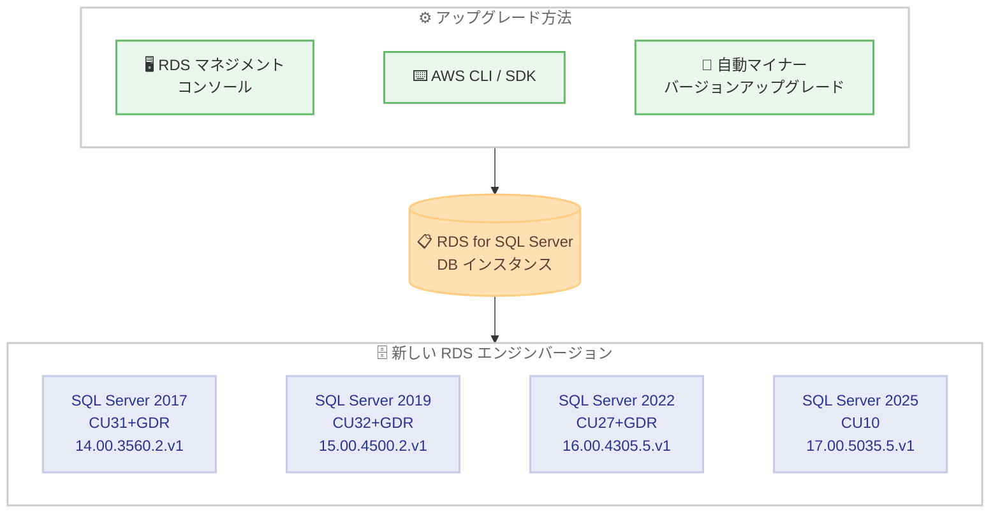

# Amazon RDS for SQL Server - 最新の累積更新プログラム CU および GDR 更新のサポート

**リリース日**: 2026 年 11 月 3 日
**サービス**: Amazon RDS for SQL Server
**機能**: Microsoft SQL Server の最新 Cumulative Update (CU) および General Distribution Release (GDR) 更新のサポート

📊 [このアップデートのインフォグラフィックを見る](https://takech9203.github.io/aws-news-summary/20261103-amazon-rds-supports-latest-cumulative-update-gdr-microsoft-sql-server.html)

## 概要

Amazon RDS for SQL Server が、Microsoft SQL Server の最新の累積更新プログラム (CU) および GDR (General Distribution Release) 更新をサポートしました。今回のリリースでは、SQL Server 2017 CU31+GDR (KB5128496)、SQL Server 2019 CU32+GDR (KB5128494)、SQL Server 2022 CU27+GDR (KB5126934)、SQL Server 2025 CU10 (KB5125471) に対応する新しい RDS エンジンバージョンが提供されます。

CU は機能修正やパフォーマンス改善を含む累積的な更新であり、GDR はセキュリティ修正を中心とした更新です。これらの更新を適用することで、Microsoft が公開した最新のセキュリティ修正とバグ修正を RDS for SQL Server インスタンスに反映できます。各更新に含まれる改善や修正の詳細は、Microsoft の KB ドキュメント (KB5128496、KB5128494、KB5126934、KB5125471) で確認できます。

AWS は、Amazon RDS マネジメントコンソール、AWS SDK、または AWS CLI を使用して、RDS for SQL Server インスタンスをアップグレードし、これらの更新を適用することを推奨しています。

**アップデート前の課題**

今回の新バージョン提供以前は、Microsoft が公開した最新の CU / GDR 更新を RDS for SQL Server に適用できませんでした。

- Microsoft が公開した最新のセキュリティ修正やバグ修正を、RDS 上の SQL Server インスタンスに反映できなかった
- セキュリティコンプライアンス要件により最新パッチ適用が必要な環境では、RDS 側のバージョン提供を待つ必要があった
- SQL Server 2025 を利用するユーザーは、CU10 で修正された問題の影響を受ける可能性があった

**アップデート後の改善**

今回のアップデートにより、以下が可能になりました。

- SQL Server 2017 / 2019 / 2022 / 2025 の各メジャーバージョンで、最新の CU / GDR 更新を含むエンジンバージョンへアップグレード可能
- マネジメントコンソール、AWS CLI、AWS SDK のいずれからも手動アップグレードを実行可能
- 自動マイナーバージョンアップグレードを有効にしている場合、メンテナンスウィンドウ中に重要なセキュリティ更新を自動適用可能

## アーキテクチャ図



RDS for SQL Server DB インスタンスを、コンソール / CLI / SDK による手動アップグレード、または自動マイナーバージョンアップグレードにより、今回提供された最新の CU / GDR 対応バージョンへ更新する流れを示しています。

## サービスアップデートの詳細

### 主要機能

1. **4 つのメジャーバージョンに対する最新 CU / GDR 対応バージョンの提供**
   - SQL Server 2017 CU31+GDR: KB5128496 (RDS バージョン 14.00.3560.2.v1)
   - SQL Server 2019 CU32+GDR: KB5128494 (RDS バージョン 15.00.4500.2.v1)
   - SQL Server 2022 CU27+GDR: KB5126934 (RDS バージョン 16.00.4305.5.v1)
   - SQL Server 2025 CU10: KB5125471 (RDS バージョン 17.00.5035.5.v1)

2. **複数のアップグレード手段**
   - Amazon RDS マネジメントコンソールからの手動アップグレード
   - AWS CLI (`modify-db-instance`) や AWS SDK によるアップグレードの自動化
   - 自動マイナーバージョンアップグレードを有効化している場合、重要なセキュリティ更新がメンテナンスウィンドウ中に自動適用される

3. **アップグレード時の OS 更新の自動適用**
   - RDS for SQL Server では、マイナー / メジャーバージョンアップグレードの実行時に最新のオペレーティングシステム更新が自動的に適用される
   - Single-AZ、Multi-AZ のどちらの構成にも適用される

## 技術仕様

### 提供されるエンジンバージョン

| SQL Server バージョン | 更新内容 | KB 番号 | RDS エンジンバージョン |
|------|------|------|------|
| SQL Server 2017 | CU31+GDR | [KB5128496](https://support.microsoft.com/en-us/help/5128496) | 14.00.3560.2.v1 |
| SQL Server 2019 | CU32+GDR | [KB5128494](https://support.microsoft.com/en-us/help/5128494) | 15.00.4500.2.v1 |
| SQL Server 2022 | CU27+GDR | [KB5126934](https://support.microsoft.com/en-us/help/5126934) | 16.00.4305.5.v1 |
| SQL Server 2025 | CU10 | [KB5125471](https://support.microsoft.com/en-us/help/5125471) | 17.00.5035.5.v1 |

### マイナーバージョンアップグレードの特性

| 項目 | 詳細 |
|------|------|
| 互換性 | マイナーバージョンアップグレードは既存アプリケーションと後方互換性のある変更のみを含む |
| 手動アップグレード | DB インスタンスの変更操作でアップグレードを開始 |
| 自動アップグレード | 自動マイナーバージョンアップグレード有効時、重要なセキュリティ更新がメンテナンスウィンドウ中に適用される |
| OS 更新 | アップグレード時に最新の OS 更新が自動適用される (Single-AZ / Multi-AZ 共通) |
| セキュリティプロトコル | 16.00.4120.1、15.00.4365.2、14.00.3465.1 以降のマイナーバージョンでは TLS 1.0 / TLS 1.1 / RC4 / Curve25519 / Triple DES がデフォルトで無効 |

## 設定方法

### 前提条件

1. Amazon RDS for SQL Server の DB インスタンスを運用していること
2. DB インスタンスの変更 (`rds:ModifyDBInstance` など) を実行できる IAM 権限があること
3. アップグレード前にスナップショットの取得やアプリケーションでの動作確認を計画しておくこと

### 手順

#### ステップ 1: 利用可能なアップグレードターゲットの確認

```bash
aws rds describe-db-engine-versions \
    --engine sqlserver-se \
    --engine-version <現在のエンジンバージョン> \
    --query "DBEngineVersions[].ValidUpgradeTarget[].{EngineVersion:EngineVersion,Description:Description,AutoUpgrade:AutoUpgrade}" \
    --output table
```

現在のエンジンバージョンからアップグレード可能なターゲットバージョンの一覧を表示します。エディションに応じて `sqlserver-ee`、`sqlserver-se`、`sqlserver-ex`、`sqlserver-web` を指定します。

#### ステップ 2: DB インスタンスのアップグレード

```bash
aws rds modify-db-instance \
    --db-instance-identifier my-sqlserver-instance \
    --engine-version 16.00.4305.5.v1 \
    --apply-immediately
```

対象の DB インスタンスのエンジンバージョンを、SQL Server 2022 CU27+GDR に対応する `16.00.4305.5.v1` へ変更します。`--apply-immediately` を指定すると即時に適用され、指定しない場合は次回のメンテナンスウィンドウで適用されます。

#### ステップ 3: 自動マイナーバージョンアップグレードの有効化 (任意)

```bash
aws rds modify-db-instance \
    --db-instance-identifier my-sqlserver-instance \
    --auto-minor-version-upgrade \
    --apply-immediately
```

自動マイナーバージョンアップグレードを有効化します。有効化すると、重要なセキュリティ更新を含む新しいマイナーバージョンが利用可能になった際に、メンテナンスウィンドウ中に自動的にアップグレードされます。

## メリット

### ビジネス面

- **セキュリティコンプライアンスの維持**: GDR に含まれる最新のセキュリティ修正を適用することで、パッチ適用を求めるコンプライアンス要件に対応できる
- **運用リスクの低減**: Microsoft が修正済みの既知の不具合に起因する障害を未然に防止できる
- **運用負荷の軽減**: 自動マイナーバージョンアップグレードにより、パッチ適用作業を省力化できる

### 技術面

- **後方互換性のある更新**: マイナーバージョンアップグレードのため、既存アプリケーションとの互換性を維持したまま適用できる
- **OS 更新の同時適用**: エンジンアップグレード時に最新の OS 更新も自動適用され、個別のメンテナンスが不要
- **複数の適用手段**: コンソールでの手動適用のほか、CLI / SDK によりアップグレード作業を自動化できる

## デメリット・制約事項

### 制限事項

- アップグレード中は DB インスタンスの再起動が発生するため、短時間のダウンタイムが生じる
- 16.00.4120.1、15.00.4365.2、14.00.3465.1 以降のマイナーバージョンでは、TLS 1.0 / TLS 1.1 / RC4 などの古いセキュリティプロトコルがデフォルトで無効になるため、古いクライアントからの接続に影響する可能性がある
- SQL Server 2016 以前の非推奨バージョンには今回の更新は提供されない

### 考慮すべき点

- 本番環境に適用する前に、検証環境で動作確認を行うことが推奨される
- 自動マイナーバージョンアップグレードの適用タイミングはメンテナンスウィンドウに依存するため、業務影響の少ない時間帯に設定しておく必要がある
- Multi-AZ 構成ではフェイルオーバーを伴う場合があるため、アプリケーション側の再接続処理を確認しておく

## ユースケース

### ユースケース 1: セキュリティパッチの定期適用

**シナリオ**: 金融系システムなど、セキュリティポリシーで最新パッチの適用が義務付けられている環境で、RDS for SQL Server の GDR 更新を速やかに適用したい。

**実装例**:
```bash
aws rds modify-db-instance \
    --db-instance-identifier prod-sqlserver \
    --engine-version 16.00.4305.5.v1
```

**効果**: 次回のメンテナンスウィンドウで SQL Server 2022 CU27+GDR が適用され、最新のセキュリティ修正を反映した状態を維持できる。

### ユースケース 2: パッチ適用の自動化による運用省力化

**シナリオ**: 多数の RDS for SQL Server インスタンスを運用しており、個別の手動アップグレード作業を削減したい。

**実装例**:
```bash
aws rds modify-db-instance \
    --db-instance-identifier dev-sqlserver \
    --auto-minor-version-upgrade
```

**効果**: 重要なセキュリティ更新を含むマイナーバージョンが提供された際に、メンテナンスウィンドウ中に自動適用され、手動運用の負荷を削減できる。

### ユースケース 3: SQL Server 2025 の最新 CU への追随

**シナリオ**: SQL Server 2025 を RDS で利用しており、CU10 に含まれる修正を適用して安定性を高めたい。

**実装例**:
```bash
aws rds modify-db-instance \
    --db-instance-identifier sql2025-instance \
    --engine-version 17.00.5035.5.v1 \
    --apply-immediately
```

**効果**: SQL Server 2025 CU10 (KB5125471) の修正が即時適用され、既知の不具合による影響を回避できる。

## 料金

CU / GDR 更新の適用自体に追加料金は発生しません。Amazon RDS for SQL Server の通常の料金 (インスタンス料金、ストレージ料金、ライセンス込みモデルの場合はライセンス料金) が引き続き適用されます。詳細は [Amazon RDS for SQL Server の料金ページ](https://aws.amazon.com/rds/sqlserver/pricing/) を参照してください。

## 利用可能リージョン

What's New の発表にはリージョンの明記はありません。カテゴリ情報には AWS GovCloud (US) が含まれており、商用リージョンに加えて GovCloud でも提供されます。利用するリージョンでの対象エンジンバージョンの提供状況は、`aws rds describe-db-engine-versions` コマンドで確認できます。

## 関連サービス・機能

- **Amazon RDS 自動マイナーバージョンアップグレード**: 重要なセキュリティ更新を含むマイナーバージョンをメンテナンスウィンドウ中に自動適用する機能
- **AWS Organizations アップグレードロールアウトポリシー**: 複数のデータベースリソースや AWS アカウントをまたいで自動マイナーバージョンアップグレードを管理する機能
- **Amazon RDS スナップショット**: アップグレード前のバックアップ取得に使用し、問題発生時の復旧手段となる

## 参考リンク

- 📊 [インフォグラフィック](https://takech9203.github.io/aws-news-summary/20261103-amazon-rds-supports-latest-cumulative-update-gdr-microsoft-sql-server.html)
- [公式発表 (What's New)](https://aws.amazon.com/about-aws/whats-new/2026/11/amazon-rds-supports-latest-cumulative-update-gdr-microsoft-sql-server/)
- [ドキュメント: RDS for SQL Server DB エンジンのアップグレード](https://docs.aws.amazon.com/AmazonRDS/latest/UserGuide/USER_UpgradeDBInstance.SQLServer.html)
- [Amazon RDS for SQL Server 製品ページ](https://aws.amazon.com/rds/sqlserver/)
- [料金ページ](https://aws.amazon.com/rds/sqlserver/pricing/)

## まとめ

Amazon RDS for SQL Server が SQL Server 2017 / 2019 / 2022 / 2025 の最新 CU / GDR 更新に対応し、Microsoft の最新セキュリティ修正とバグ修正を適用できるようになりました。セキュリティとシステム安定性の観点から、検証環境での動作確認を経て、マネジメントコンソールまたは AWS CLI / SDK による早期のアップグレード適用を推奨します。自動マイナーバージョンアップグレードの有効化も、継続的なパッチ適用の省力化手段として検討する価値があります。
