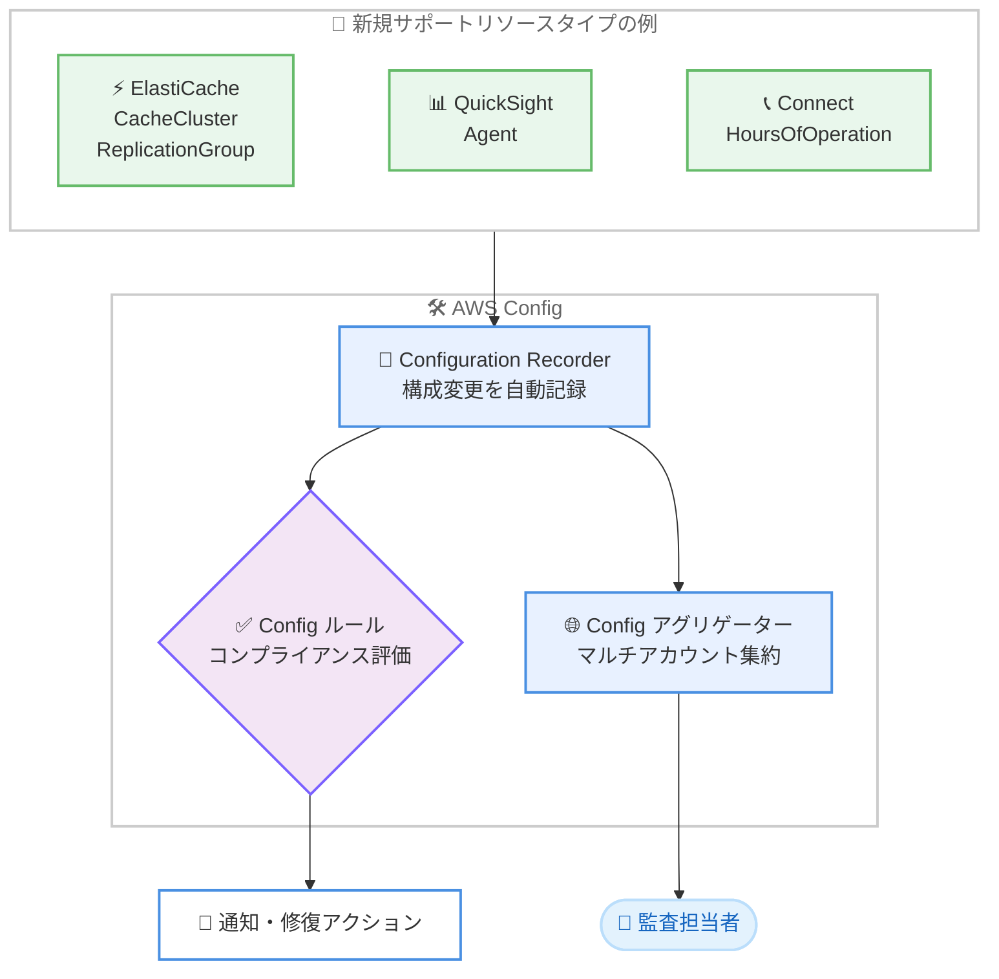

# AWS Config - 10 種類の新しいリソースタイプをサポート

**リリース日**: 2026 年 11 月 3 日
**サービス**: AWS Config
**機能**: 新規リソースタイプ 10 種類の記録サポート

📊 [このアップデートのインフォグラフィックを見る](https://takech9203.github.io/aws-news-summary/20261103-aws-config-new-resource-types.html)

## 概要

AWS Config が、Amazon ElastiCache や Amazon QuickSight などの主要サービスを含む 10 種類の AWS リソースタイプを新たにサポートしました。これにより AWS 環境に対するカバレッジが拡大し、より幅広いリソースの検出、評価、監査、修復が可能になります。

すべてのリソースタイプの記録 (Recording all resource types) を有効化している場合、新しいリソースタイプは追加の設定なしで自動的に追跡されます。また、新規サポートされたリソースタイプは Config ルールおよび Config アグリゲーターでも利用できるため、コンプライアンス評価やマルチアカウント・マルチリージョンでの構成データ集約にそのまま組み込むことができます。

特に ElastiCache のキャッシュクラスターとレプリケーショングループは多くのワークロードで利用されているリソースであり、構成変更の追跡やコンプライアンス監査のニーズが高いリソースタイプです。今回の追加により、ガバナンス要件の厳しい環境でもこれらのリソースを AWS Config で一元管理できるようになります。

**アップデート前の課題**

今回追加された 10 種類のリソースタイプは AWS Config の記録対象外でした。

- ElastiCache のキャッシュクラスターやレプリケーショングループの構成変更履歴を AWS Config で追跡できなかった
- これらのリソースに対して Config ルールによる自動コンプライアンス評価ができなかった
- 構成情報の棚卸しや監査のために、個別のサービス API を使った独自の仕組みが必要だった

**アップデート後の改善**

今回のアップデートにより、以下が可能になりました。

- ElastiCache、QuickSight、Connect など 10 種類のリソースタイプの構成変更を自動的に記録・追跡可能
- 新規リソースタイプに対して Config ルールでコンプライアンス評価を実行可能
- Config アグリゲーターにより、複数アカウント・複数リージョンにまたがる新規リソースタイプの構成データを集約可能

## アーキテクチャ図



新規サポートされたリソースタイプの構成変更が Configuration Recorder により自動記録され、Config ルールでの評価と Config アグリゲーターでの集約に利用できる流れを示しています。

## サービスアップデートの詳細

### 主要機能

1. **10 種類のリソースタイプの記録サポート**
   - ElastiCache や QuickSight など、複数サービスのリソースタイプが新たに記録対象に追加
   - 構成アイテム (Configuration Item) として構成変更の履歴を保持
   - リソース間の関係性やタイムラインをコンソールで確認可能

2. **すべてのリソースタイプを記録している場合の自動追跡**
   - Recording Strategy で「すべてのリソースタイプ」を選択している場合、追加設定なしで自動的に記録を開始
   - 特定のリソースタイプのみ記録している場合は、レコーダー設定に新規タイプを追加することで記録可能

3. **Config ルールと Config アグリゲーターへの対応**
   - 新規リソースタイプをスコープとしたカスタム Config ルール (AWS Lambda / Guard) を作成可能
   - アグリゲーターを通じて組織全体の新規リソースタイプの構成データとコンプライアンス状態を一元的に確認可能

### 新規サポートリソースタイプ一覧

| リソースタイプ | 関連サービス |
|------|------|
| AWS::Billing::BillingView | AWS Billing |
| AWS::Connect::HoursOfOperation | Amazon Connect |
| AWS::ElastiCache::CacheCluster | Amazon ElastiCache |
| AWS::ElastiCache::ReplicationGroup | Amazon ElastiCache |
| AWS::MediaLive::SignalMap | AWS Elemental MediaLive |
| AWS::MPA::IdentitySource | AWS Multi-party approval |
| AWS::Notifications::OrganizationalUnitAssociation | AWS User Notifications |
| AWS::NotificationsContacts::EmailContact | AWS User Notifications Contacts |
| AWS::Oam::Link | Amazon CloudWatch Observability Access Manager |
| AWS::QuickSight::Agent | Amazon QuickSight |

## 技術仕様

### 記録動作

| 項目 | 詳細 |
|------|------|
| 記録方法 | Configuration Recorder による構成アイテムの自動記録 |
| すべてのリソースタイプを記録する設定 | 新規タイプは自動的に記録対象に追加 |
| 特定リソースタイプのみ記録する設定 | レコーダー設定への明示的な追加が必要 |
| Config ルール | 新規リソースタイプをスコープとした評価に対応 |
| Config アグリゲーター | マルチアカウント・マルチリージョン集約に対応 |

## 設定方法

### 前提条件

1. AWS Config の Configuration Recorder が有効化されていること
2. AWS Config 用の IAM ロール (またはサービスリンクロール) に必要な権限が付与されていること
3. 対象リソースが利用可能なリージョンで AWS Config を利用していること

### 手順

#### ステップ 1: 現在の記録設定を確認する

```bash
aws configservice describe-configuration-recorders
```

Configuration Recorder の記録戦略 (すべてのリソースタイプを記録しているか、特定のリソースタイプのみか) を確認します。`allSupported` が `true` の場合、新規リソースタイプは自動的に記録されます。

#### ステップ 2: 特定リソースタイプのみ記録している場合は新規タイプを追加する

```bash
aws configservice put-configuration-recorder \
  --configuration-recorder name=default,roleARN=arn:aws:iam::123456789012:role/aws-config-role \
  --recording-group "allSupported=false,includeGlobalResourceTypes=false,resourceTypes=['AWS::ElastiCache::CacheCluster','AWS::ElastiCache::ReplicationGroup']"
```

記録対象のリソースタイプ一覧に、今回追加されたリソースタイプ (例: ElastiCache のキャッシュクラスターとレプリケーショングループ) を追加します。既存の記録対象タイプも含めて指定する必要がある点に注意してください。

#### ステップ 3: 記録された構成アイテムを確認する

```bash
aws configservice list-discovered-resources \
  --resource-type AWS::ElastiCache::CacheCluster
```

AWS Config が検出した対象リソースの一覧を表示し、新規リソースタイプが正しく記録されていることを確認します。

## メリット

### ビジネス面

- **ガバナンスの強化**: ElastiCache や QuickSight などのリソースを含めた一貫性のある構成管理・監査体制を構築できる
- **監査対応の効率化**: 構成変更履歴が自動的に記録されるため、監査時のエビデンス収集の工数を削減できる
- **運用コストの削減**: 独自の構成追跡の仕組みを構築・維持する必要がなくなる

### 技術面

- **自動追跡**: すべてのリソースタイプを記録する設定であれば、追加作業なしで新規タイプの記録が開始される
- **コンプライアンス評価の拡大**: Config ルールにより新規リソースタイプの設定準拠状況を継続的に評価できる
- **組織全体の可視化**: Config アグリゲーターにより、マルチアカウント環境でも新規リソースタイプの構成情報を一元的に把握できる

## デメリット・制約事項

### 制限事項

- 各リソースタイプの記録は、そのリソースが利用可能なリージョンに限定される
- リージョンごとのサポート状況はドキュメントの Resource Coverage by Region ページでの確認が必要
- 特定リソースタイプのみ記録する設定の場合、新規タイプは自動では追加されず、明示的な設定変更が必要

### 考慮すべき点

- すべてのリソースタイプを記録している場合、新規タイプの構成アイテムが自動的に記録されるため、記録件数の増加に伴い AWS Config の利用料金が増加する可能性がある
- 記録対象の拡大に合わせて、Config ルールや修復アクションの対象範囲の見直しを推奨

## ユースケース

### ユースケース 1: ElastiCache の構成変更追跡と監査

**シナリオ**: 本番環境の ElastiCache レプリケーショングループに対する構成変更 (ノードタイプ変更、自動フェイルオーバー設定など) を追跡し、監査証跡として保持したい。

**実装例**:
```
1. Configuration Recorder で AWS::ElastiCache::ReplicationGroup を記録対象に設定
2. AWS Config コンソールのリソースタイムラインで変更履歴を確認
3. 必要に応じて Amazon EventBridge 経由で構成変更を通知
```

**効果**: 構成変更の履歴が自動的に記録され、いつ、どのような変更が行われたかを監査時に即座に提示できる。

### ユースケース 2: Config ルールによるコンプライアンス評価

**シナリオ**: ElastiCache クラスターが組織のセキュリティ基準 (暗号化設定など) に準拠しているかを継続的に評価したい。

**実装例**:
```
1. AWS::ElastiCache::ReplicationGroup をスコープとするカスタム Config ルールを作成
2. Guard または Lambda 関数で暗号化設定を評価するロジックを実装
3. 非準拠リソースを検出した場合に通知・修復アクションを実行
```

**効果**: 設定基準からの逸脱を自動検出し、手動チェックなしでコンプライアンス状態を維持できる。

### ユースケース 3: マルチアカウント環境での構成データ集約

**シナリオ**: AWS Organizations 配下の複数アカウントに分散する Amazon Connect や QuickSight のリソース構成を一元的に把握したい。

**実装例**:
```
1. 管理アカウントまたは委任管理者アカウントで Config アグリゲーターを設定
2. 組織全体のアカウント・リージョンを集約対象に指定
3. アグリゲーターのダッシュボードで新規リソースタイプの構成とコンプライアンス状態を確認
```

**効果**: 組織全体のリソースインベントリとコンプライアンス状態を単一のビューで確認でき、ガバナンスを強化できる。

## 料金

AWS Config の料金は、記録された構成アイテム数、Config ルールの評価数、適合パック (Conformance Pack) の評価数に基づく従量課金です。新規リソースタイプの記録を開始すると、記録される構成アイテム数が増加するため、利用料金に影響する可能性があります。

詳細は [AWS Config 料金ページ](https://aws.amazon.com/config/pricing/) を参照してください。

## 利用可能リージョン

対象リソースが利用可能なすべての AWS リージョンで利用できます。リージョンごとのリソースタイプ対応状況は [Resource Coverage by Region Availability](https://docs.aws.amazon.com/config/latest/developerguide/what-is-resource-config-coverage.html) で確認できます。

## 関連サービス・機能

- **Amazon ElastiCache**: 今回記録対象に追加されたキャッシュクラスターとレプリケーショングループを提供するインメモリキャッシュサービス
- **Amazon QuickSight**: 今回記録対象に追加された Agent リソースを提供する BI サービス
- **AWS Config ルール / 適合パック**: 新規リソースタイプに対するコンプライアンス評価の仕組み
- **Amazon CloudWatch Observability Access Manager**: 今回記録対象に追加された Oam::Link によりクロスアカウントオブザーバビリティのリンク構成を管理

## 参考リンク

- 📊 [インフォグラフィック](https://takech9203.github.io/aws-news-summary/20261103-aws-config-new-resource-types.html)
- [公式発表 (What's New)](https://aws.amazon.com/about-aws/whats-new/2026/11/aws-config-new-resource-types)
- [ドキュメント: Resource Coverage by Region Availability](https://docs.aws.amazon.com/config/latest/developerguide/what-is-resource-config-coverage.html)
- [AWS Config ドキュメント](https://docs.aws.amazon.com/config/latest/developerguide/WhatIsConfig.html)
- [料金ページ](https://aws.amazon.com/config/pricing/)

## まとめ

AWS Config のリソースカバレッジが拡大し、ElastiCache や QuickSight など利用頻度の高いサービスのリソースを含む 10 種類のリソースタイプを記録・評価できるようになりました。すべてのリソースタイプを記録する設定であれば自動的に追跡が開始されるため、まずは現在の記録設定を確認し、特定タイプのみ記録している場合は必要なリソースタイプの追加を検討してください。
