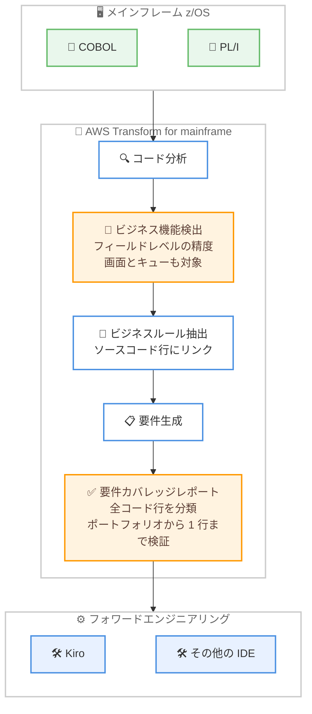

# AWS Transform for mainframe - リイマジンモダナイゼーションワークフローの改善

**リリース日**: 2026 年 11 月 3 日
**サービス**: AWS Transform for mainframe
**機能**: ビジネス機能のフィールドレベル検出と要件カバレッジレポート

📊 [このアップデートのインフォグラフィックを見る](https://takech9203.github.io/aws-news-summary/20261103-aws-transform-mainframe-reimagine.html)

## 概要

AWS Transform for mainframe が、アセスメントとリイマジン (assess and reimagine) ワークフローを改善し、ビジネス機能をデータフィールドレベルの精度で検出できるようになりました。あわせて、新しい要件カバレッジレポートが生成されるようになり、z/OS 上の COBOL および PL/I ワークロードのモダナイゼーションを、より正確なビジネス機能カタログから開始し、構築前に要件のカバレッジを検証できます。

今回のアップデートにより、ビジネス機能は同じデータフィールドに影響を与える場合にのみグループ化されるようになりました。ビジネス機能には画面 (スクリーン) とキューも含まれるようになり、より明確な名前と説明が付与されます。また、要件カバレッジレポートにより、アプリケーションのすべての部分が生成された要件にどのように反映されているかを確認でき、Kiro やその他の IDE でのフォワードエンジニアリングに進む前に、ポートフォリオ全体からソースコード 1 行単位までカバレッジをレビューできます。

メインフレームアプリケーションのモダナイゼーションを進める企業や、レガシーコードからの要件抽出の正確性とトレーサビリティを重視する開発チームにとって重要なアップデートです。

**アップデート前の課題**

このアップデート以前には、以下の課題が存在していました。

- 同じテーブルやファイルを使用するビジネス機能が一括でグループ化されてしまい、ビジネス機能カタログの粒度が粗かった
- 要件とソースコードの対応関係 (トレーサビリティ) を確認するには、AWS Transform の成果物から独自のレポートを構築する必要があった
- 生成された要件がアプリケーション全体をどの程度カバーしているかを、構築前に体系的に検証する手段がなかった

**アップデート後の改善**

今回のアップデートにより、以下が可能になりました。

- ビジネス機能が同じデータフィールドに影響する場合にのみグループ化され、より正確なビジネス機能カタログから着手できるようになった
- ビジネス機能に画面とキューが含まれ、より明確な名前と説明が付与されるようになった
- 要件カバレッジレポートにより、すべてのソースコード行の分類、ビジネスルールと由来するコード行のリンク、要件を裏付けるビジネスルールを構築前に検証できるようになった

## アーキテクチャ図



アセスメントとリイマジンワークフローの流れを示しています。今回強化されたビジネス機能検出 (フィールドレベルの精度) と新規追加された要件カバレッジレポート (オレンジ色) により、Kiro などの IDE でのフォワードエンジニアリングに進む前に要件の網羅性を検証できます。

## サービスアップデートの詳細

### 主要機能

1. **フィールドレベルのビジネス機能検出**
   - 従来は同じテーブルやファイルを使用するビジネス機能がまとめてグループ化されていたが、今回から同じデータフィールドに影響を与える場合にのみグループ化される
   - グループ化の粒度が細かくなることで、より正確なビジネス機能カタログからモダナイゼーションを開始できる
   - ビジネス機能の対象に画面 (スクリーン) とキューが追加された
   - 各ビジネス機能には、より明確な名前と説明が付与される

2. **要件カバレッジレポート**
   - アプリケーションのすべての部分が、生成された要件にどのように反映されているかを示す新しいレポート
   - すべてのソースコード行が、どのように処理されたかによって分類される
   - すべてのビジネスルールが、由来する正確なコード行にリンクされる
   - すべての要件が、それを裏付けるビジネスルールによって裏付けられる
   - ポートフォリオ全体からソースコード 1 行単位まで、カバレッジをレビューできる

3. **フォワードエンジニアリングへの接続**
   - カバレッジを検証した上で、Kiro やその他の IDE でのフォワードエンジニアリングに進むことができる
   - 要件からビジネスルール、ソースコード行までのトレーサビリティが確保された状態で実装フェーズに移行できる

## 技術仕様

### 対象ワークロードとワークフロー

| 項目 | 詳細 |
|------|------|
| 対象プラットフォーム | IBM z/OS |
| 対象言語 | COBOL、PL/I |
| 対象ワークフロー | アセスメントとリイマジン (assess and reimagine) ワークフロー |
| ビジネス機能のグループ化単位 | データフィールド (従来はテーブルまたはファイル) |
| ビジネス機能の対象要素 | プログラムロジック、画面、キュー |
| トレーサビリティ | 要件 → ビジネスルール → ソースコード行 |
| フォワードエンジニアリング先 | Kiro およびその他の IDE |

### 要件カバレッジレポートの構成

| 検証レベル | 内容 |
|------------|------|
| ソースコード行 | すべての行が処理方法によって分類される |
| ビジネスルール | 由来する正確なソースコード行にリンクされる |
| 要件 | 裏付けとなるビジネスルールと紐付けられる |
| レビュー範囲 | ポートフォリオ全体から 1 行単位まで |

## 設定方法

### 前提条件

1. AWS Transform へのアクセスが有効化されていること
2. モダナイゼーション対象の z/OS COBOL または PL/I アプリケーションのソースコード一式が準備されていること
3. アセスメントとリイマジンワークフローを実行する権限が設定されていること

### 手順

#### ステップ 1: アプリケーションコードの分析

AWS Transform for mainframe にメインフレームアプリケーションのソースコードを取り込み、アセスメントとリイマジンワークフローで分析を実行します。依存関係やコードインベントリが構築されます。

#### ステップ 2: ビジネス機能カタログのレビュー

フィールドレベルの精度で検出されたビジネス機能カタログを確認します。画面とキューを含むビジネス機能が、明確な名前と説明とともに表示されます。

#### ステップ 3: 要件カバレッジレポートの検証

生成された要件カバレッジレポートを確認し、すべてのソースコード行の分類、ビジネスルールとコード行のリンク、要件とビジネスルールの対応をポートフォリオ全体から 1 行単位までレビューします。

#### ステップ 4: フォワードエンジニアリングへの移行

カバレッジの検証が完了したら、生成された要件をもとに Kiro やその他の IDE でフォワードエンジニアリングを開始します。

## メリット

### ビジネス面

- **モダナイゼーションリスクの低減**: 構築前に要件のカバレッジを検証できるため、重要なビジネスロジックの漏れを早期に発見できる
- **監査性とコンプライアンスの向上**: 要件からソースコード行までの完全なトレーサビリティにより、モダナイゼーションの正当性を説明しやすくなる
- **独自レポート構築工数の削減**: 従来必要だった独自のトレーサビリティレポート構築が不要になる

### 技術面

- **正確なビジネス機能カタログ**: データフィールド単位のグループ化により、過剰な集約が解消され、分割単位の判断が容易になる
- **包括的なスコープ把握**: 画面とキューがビジネス機能に含まれるため、アプリケーションの全体像を把握しやすくなる
- **行レベルの検証**: すべてのソースコード行の処理分類により、分析漏れの有無を 1 行単位で確認できる

## デメリット・制約事項

### 制限事項

- 対象は z/OS 上の COBOL および PL/I ワークロードであり、その他の言語やプラットフォームについては言及されていない
- アセスメントとリイマジンワークフローに適用される機能であり、リファクタリングなど他のワークフローへの適用は言及されていない

### 考慮すべき点

- ビジネス機能のグループ化粒度が細かくなるため、既存の分析結果と比較するとカタログの構成が変わる可能性がある
- 要件カバレッジレポートのレビューには、対象アプリケーションの業務知識を持つ担当者の関与が望ましい

## ユースケース

### ユースケース 1: 大規模 COBOL アプリケーションの段階的モダナイゼーション

**シナリオ**: 金融機関が数百万行規模の z/OS COBOL アプリケーションをクラウドネイティブなアーキテクチャに移行する。業務影響を最小化するため、ビジネス機能単位で段階的に移行したい。

**実装例**:
```text
1. AWS Transform でアプリケーション全体を分析
2. フィールドレベルで検出されたビジネス機能カタログを確認
3. 影響するデータフィールドが独立したビジネス機能から移行に着手
```

**効果**: データフィールド単位の正確なグループ化により、移行単位の切り出しが容易になり、段階的な移行計画を立てやすくなる。

### ユースケース 2: 監査要件のあるシステムのトレーサビリティ確保

**シナリオ**: 規制業種の企業が PL/I アプリケーションをモダナイズする際、移行後のシステムが既存の業務ルールをすべて踏襲していることを監査人に説明する必要がある。

**実装例**:
```text
1. アセスメントとリイマジンワークフローで要件を生成
2. 要件カバレッジレポートで全ソースコード行の分類を確認
3. 要件 → ビジネスルール → ソースコード行のリンクを監査証跡として活用
```

**効果**: 独自のトレーサビリティレポートを構築することなく、要件とソースコードの対応関係を証跡として提示できる。

### ユースケース 3: Kiro によるスペック駆動のフォワードエンジニアリング

**シナリオ**: 開発チームがメインフレームから抽出した要件をもとに、Kiro を使用してモダンなアプリケーションを再構築する。実装前に要件の網羅性を確認したい。

**実装例**:
```text
1. 要件カバレッジレポートでポートフォリオ全体のカバレッジを確認
2. 不足や要レビュー箇所を特定し、要件を確定
3. 確定した要件を Kiro に引き渡してスペック駆動開発を開始
```

**効果**: 実装開始前に要件の抜け漏れを解消でき、手戻りの少ないフォワードエンジニアリングを実現できる。

## 料金

今回の発表では、本機能に関する追加料金の情報は言及されていません。AWS Transform の最新の料金体系は [AWS Transform の料金ページ](https://aws.amazon.com/transform/pricing/) を参照してください。

## 利用可能リージョン

AWS Transform for mainframe が利用可能なすべての AWS リージョンで利用できます。詳細は [AWS リージョン別サービス表](https://aws.amazon.com/about-aws/global-infrastructure/regional-product-services/) を参照してください。

## 関連サービス・機能

- **Kiro**: AWS が提供する AI 搭載 IDE。生成された要件をもとにスペック駆動のフォワードエンジニアリングを行う移行先として連携する
- **AWS Transform for VMware / .NET**: AWS Transform ファミリーの他のエージェント型モダナイゼーション機能。メインフレーム以外のワークロードのモダナイゼーションに対応する
- **AWS Mainframe Modernization**: メインフレームアプリケーションのリファクタリングやリプラットフォームの実行環境を提供するサービス

## 参考リンク

- 📊 [インフォグラフィック](https://takech9203.github.io/aws-news-summary/20261103-aws-transform-mainframe-reimagine.html)
- [公式発表 (What's New)](https://aws.amazon.com/about-aws/whats-new/2026/11/aws-transform-mainframe-reimagine/)
- [AWS Transform for mainframe 製品ページ](https://aws.amazon.com/transform/mainframe/)
- [AWS Transform ドキュメント](https://docs.aws.amazon.com/transform/)
- [AWS リージョン別サービス表](https://aws.amazon.com/about-aws/global-infrastructure/regional-product-services/)

## まとめ

AWS Transform for mainframe のアセスメントとリイマジンワークフローが強化され、フィールドレベルの精度によるビジネス機能検出と要件カバレッジレポートにより、構築前に要件の網羅性とトレーサビリティを検証できるようになりました。z/OS COBOL や PL/I ワークロードのモダナイゼーションを計画しているチームは、より正確なビジネス機能カタログを起点に、Kiro などでのフォワードエンジニアリングへ安心して移行できます。まずは対象アプリケーションで分析を実行し、要件カバレッジレポートの内容を確認することを推奨します。
