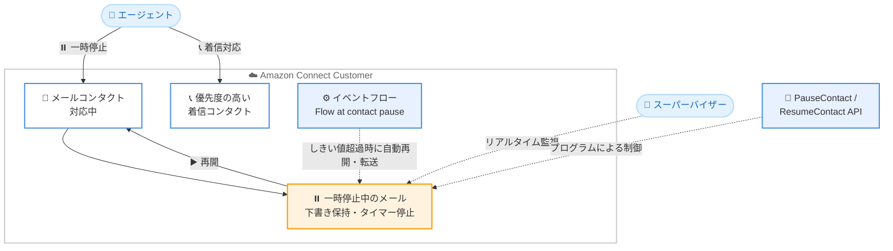

# Amazon Connect Customer - メールの一時停止・再開機能

**リリース日**: 2026 年 11 月 3 日
**サービス**: Amazon Connect Customer
**機能**: メールコンタクトの一時停止 (Pause) と再開 (Resume)

📊 [このアップデートのインフォグラフィックを見る](https://takech9203.github.io/aws-news-summary/20261103-connect-pause-resume-email.html)

## 概要

Amazon Connect Customer で、エージェントがメール対応を一時停止 (Pause) し、後から再開 (Resume) できる機能が利用可能になりました。情報の到着や承認待ちなどでメール対応を中断する必要がある場合に、エージェントはメールを一時停止して優先度の高いコンタクトに対応し、準備が整った時点で作業を再開できます。例えば、返金の承認をスーパーバイザーに依頼して待っている間に、メールを一時停止して着信コールに対応するといった運用が可能です。

一時停止中の時間はアクティブな処理時間とは別に記録されるため、スーパーバイザーはエージェントが実際にメール対応へ費やした時間をより正確に把握できます。エージェントは Agent Workspace または Contact Control Panel (CCP) から直接メールを一時停止・再開でき、各メールがどれだけの時間一時停止されているかを確認できます。スーパーバイザーは一時停止中のメールと一時停止時間をリアルタイムに監視でき、設定したしきい値を超えて一時停止されたままのメールをフローで自動的に再開または転送することもできます。

**アップデート前の課題**

- メール対応中に承認待ちや情報待ちが発生しても、対応を中断する手段がなく、エージェントは他の優先度の高いコンタクトへ柔軟に切り替えにくかった
- 待ち時間も処理時間 (ハンドリングタイム) に含まれてしまい、エージェントの実作業時間を正確に測定できなかった
- 長時間放置されたメールを検知して自動的に対処する仕組みがなかった

**アップデート後の改善**

- エージェントが Agent Workspace / CCP からワンクリックでメールを一時停止・再開できるようになり、優先度の高いコンタクトへ即座に切り替えられるようになった
- 一時停止時間がアクティブな処理時間と分離して記録され、メール対応の実時間を正確に可視化できるようになった
- イベントフローと組み合わせることで、しきい値を超えて一時停止されたメールの自動再開や転送が可能になった
- PauseContact / ResumeContact API により、エージェントの操作なしでプログラムからも一時停止・再開を制御できるようになった

## アーキテクチャ図



エージェントはメールを一時停止して着信などに対応し、後から再開できます。スーパーバイザーによるリアルタイム監視、イベントフローによる自動再開・転送、API によるプログラム制御にも対応しています。

## サービスアップデートの詳細

### 主要機能

1. **エージェントによる一時停止・再開**
   - Agent Workspace または Contact Control Panel (CCP) のメールコンタクト上部にある [Pause] ボタンで一時停止、[Resume] ボタンで再開
   - 一時停止するとエージェントのハンドリングタイマーが停止し、本文と返信コンポーザーは「Paused」バナーの背後に隠され、[Send] は再開までブロックされる
   - 作成途中の返信の下書きは保持され、再開時にそのまま編集を継続できる
   - コンタクトリストには一時停止インジケーターとメールの件名が表示され、複数のコンタクトの中から一時停止中のメールを識別できる

2. **一時停止時間の分離計測と監視**
   - 一時停止中の時間はアクティブな処理時間とは別に記録される
   - エージェントは各メールの一時停止時間を確認できる
   - スーパーバイザーは一時停止中のメールと一時停止時間をリアルタイムに監視できる

3. **フローによる自動化**
   - フローデザイナーの「Set event flow」ブロックで「Flow at contact pause」イベントフックを選択すると、メールの一時停止時に自動実行されるフローを設定できる
   - 設定したしきい値を超えて一時停止されたままのメールを、フローで自動的に再開または転送できる

4. **API によるプログラム制御**
   - PauseContact / ResumeContact API により、エージェントの操作なしでメールの一時停止・再開が可能
   - 対象にはインバウンドメールコンタクトのコンタクト ID を指定する
   - 下書き返信が進行中のインバウンドメールを一時停止すると、関連するエージェント返信コンタクトも同時に一時停止され、再開時も同様に再開される

## 技術仕様

### 機能仕様

| 項目 | 詳細 |
|------|------|
| 操作場所 | Agent Workspace、Contact Control Panel (CCP) |
| 一時停止回数の上限 | 1 つのメールにつき最大 10 回 (超過するとそれ以降の一時停止リクエストは拒否される) |
| 一時停止の時間制限 | なし (担当エージェントはいつでも再開可能) |
| 下書きの扱い | 一時停止中も返信の下書きは保持される |
| 計測 | 一時停止時間はアクティブな処理時間と分離して記録 |
| 同時接続数への影響 | 一時停止中のメールもインスタンスのアクティブメールコンタクト数の上限にカウントされる |
| API | [PauseContact](https://docs.aws.amazon.com/connect/latest/APIReference/API_PauseContact.html)、[ResumeContact](https://docs.aws.amazon.com/connect/latest/APIReference/API_ResumeContact.html) |
| 自動化 | 「Set event flow」ブロックの「Flow at contact pause」イベントフックで一時停止時のフローを設定可能 |

### API の利用例

```bash
# インバウンドメールコンタクトを一時停止する
aws connect pause-contact \
  --instance-id <インスタンス ID> \
  --contact-id <インバウンドメールのコンタクト ID>

# 一時停止したメールコンタクトを再開する
aws connect resume-contact \
  --instance-id <インスタンス ID> \
  --contact-id <インバウンドメールのコンタクト ID>
```

既存の PauseContact / ResumeContact API でメールコンタクトを指定することで、エージェントの操作なしに一時停止・再開を制御できます。指定するのはインバウンドメールコンタクトのコンタクト ID であり、エージェント返信コンタクトを直接一時停止・再開することはできません。

## 設定方法

### 前提条件

1. Amazon Connect インスタンスでメールチャネルを利用していること
2. エージェントが Agent Workspace または CCP でメールコンタクトを処理できるよう設定済みであること
3. 自動再開・転送を行う場合は、フローを編集できる権限があること

### 手順

#### ステップ 1: エージェントがメールを一時停止する

Agent Workspace または CCP で対応中のメールコンタクト上部にある [Pause] ボタンを選択します。ハンドリングタイマーが停止し、下書きが保持された状態でメールが一時停止されます。

#### ステップ 2: メールを再開する

一時停止中のメールコンタクト上部にある [Resume] ボタンを選択します。本文と返信コンポーザーが復元され、下書きの続きから返信作業を再開できます。

#### ステップ 3: 一時停止時の自動フローを設定する (任意)

フローデザイナーで「Set event flow」ブロックを追加し、イベントフックに「Flow at contact pause」を選択して、メールが一時停止された際に実行するフローを指定します。このフローで、一定時間を超えて一時停止されたままのメールを自動的に再開または転送できます。

## メリット

### ビジネス面

- **エージェントの稼働率向上**: 承認待ちや情報待ちの間に優先度の高いコンタクトへ対応でき、エージェントの時間を有効活用できる
- **正確なパフォーマンス測定**: 一時停止時間が処理時間と分離されるため、メール対応の実作業時間に基づいた KPI 管理やキャパシティプランニングが可能になる
- **応答品質の維持**: 下書きが保持されるため、中断後も対応品質を落とさずに返信を完成させられる

### 技術面

- **リアルタイム監視**: スーパーバイザーが一時停止中のメールと一時停止時間をリアルタイムに把握し、滞留を早期に検知できる
- **フローによる自動化**: しきい値を超えて放置されたメールの自動再開・転送により、SLA 違反のリスクを低減できる
- **API 対応**: PauseContact / ResumeContact API により、外部システムの状態 (承認完了など) と連動した自動制御を実装できる

## デメリット・制約事項

### 制限事項

- 1 つのメールを一時停止できる回数は最大 10 回まで。上限に達すると、それ以降の一時停止リクエストは拒否される
- 一時停止中のメールも、インスタンスのアクティブメールコンタクト数の上限にカウントされる
- 一時停止・再開の対象はインバウンドメールコンタクトであり、エージェント返信コンタクトを単独で一時停止・再開することはできない
- AWS GovCloud (US) リージョンおよび中国リージョンでは利用できない

### 考慮すべき点

- 一時停止に時間制限はないため、放置を防ぐにはしきい値ベースの自動再開・転送フローの設定を検討する必要がある
- 一時停止中のメールがアクティブコンタクト数を消費するため、同時処理数の設計時には一時停止中のメールも考慮する必要がある

## ユースケース

### ユースケース 1: 承認待ちの間に着信コールへ対応

**シナリオ**: エージェントが返金対応のメールを作成中に、スーパーバイザーの承認が必要になった。承認を待つ間、着信コールのキューが増加している。

**実装例**:
```text
1. エージェントがメールコンタクトの [Pause] を選択して一時停止
2. 着信コールに対応 (下書きは保持されたまま)
3. 承認が得られたら [Resume] を選択し、下書きの続きから返信を完成させて送信
```

**効果**: 待ち時間を他のコンタクト対応に充てることで、エージェントの稼働率と顧客全体の応答速度が向上する。

### ユースケース 2: 滞留メールの自動転送による SLA 管理

**シナリオ**: 一時停止されたまま長時間放置されたメールが SLA 違反につながるリスクがあるため、一定時間を超えたメールを自動的に別のキューへ転送したい。

**実装例**:
```text
1. フローデザイナーで「Set event flow」ブロックを追加
2. イベントフックに「Flow at contact pause」を選択し、一時停止時に実行するフローを指定
3. フロー内で一時停止時間がしきい値を超えたメールを再開、またはエスカレーション用キューへ転送
```

**効果**: 放置されたメールを自動的に検知・処理することで、SLA 違反を未然に防ぎ、顧客満足度を維持できる。

### ユースケース 3: 外部システムと連動したプログラムによる再開

**シナリオ**: 社内の承認ワークフローシステムで承認が完了したタイミングで、一時停止中のメールを自動的に再開させたい。

**実装例**:
```bash
# 承認完了イベントを受けて Lambda などから実行
aws connect resume-contact \
  --instance-id <インスタンス ID> \
  --contact-id <インバウンドメールのコンタクト ID>
```

**効果**: 承認完了から返信再開までのリードタイムを短縮し、エージェントの手動確認作業を削減できる。

## 料金

今回の発表では、メールの一時停止・再開機能に対する追加料金の記載はありません。Amazon Connect のメールチャネルの料金は従量課金制です。詳細は [Amazon Connect 料金ページ](https://aws.amazon.com/connect/pricing/) を参照してください。

## 利用可能リージョン

以下の 10 リージョンで利用可能です。

- 米国東部 (バージニア北部)
- 米国西部 (オレゴン)
- アフリカ (ケープタウン)
- アジアパシフィック (ソウル)
- アジアパシフィック (シンガポール)
- アジアパシフィック (シドニー)
- アジアパシフィック (東京)
- カナダ (中部)
- 欧州 (フランクフルト)
- 欧州 (ロンドン)

AWS GovCloud (US) リージョンおよび中国リージョンでは利用できません。

## 関連サービス・機能

- **Amazon Connect Agent Workspace / CCP**: エージェントがメールの一時停止・再開を操作する UI
- **Amazon Connect フロー**: 「Set event flow」ブロックと「Flow at contact pause」イベントフックにより、一時停止時の自動処理 (再開・転送) を実現
- **PauseContact / ResumeContact API**: タスクコンタクトなどで提供されていた一時停止・再開 API が、メールコンタクトにも適用可能
- **Amazon Connect リアルタイムメトリクス**: スーパーバイザーによる一時停止中メールと一時停止時間のリアルタイム監視

## 参考リンク

- 📊 [インフォグラフィック](https://takech9203.github.io/aws-news-summary/20261103-connect-pause-resume-email.html)
- [公式発表 (What's New)](https://aws.amazon.com/about-aws/whats-new/2026/11/connect-pause-resume-email/)
- [ドキュメント: Pause and resume emails](https://docs.aws.amazon.com/connect/latest/adminguide/concepts-pause-and-resume-emails.html)
- [API リファレンス: PauseContact](https://docs.aws.amazon.com/connect/latest/APIReference/API_PauseContact.html)
- [API リファレンス: ResumeContact](https://docs.aws.amazon.com/connect/latest/APIReference/API_ResumeContact.html)
- [Amazon Connect 製品ページ](https://aws.amazon.com/connect/)
- [料金ページ](https://aws.amazon.com/connect/pricing/)

## まとめ

メールの一時停止・再開機能により、エージェントは承認待ちなどの中断時間を優先度の高いコンタクト対応に充てられるようになり、一時停止時間の分離計測によってメール対応の実作業時間を正確に把握できるようになりました。メールチャネルを利用しているコンタクトセンターでは、放置メール対策としてしきい値ベースの自動再開・転送フローの設定を併せて検討することを推奨します。
