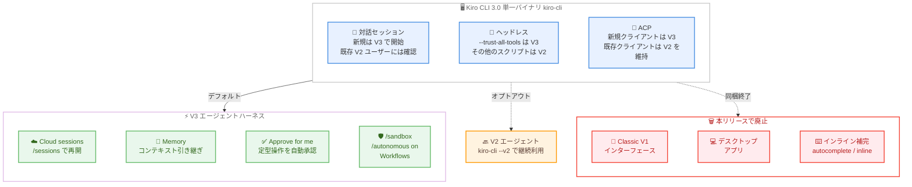

# Kiro - Kiro CLI 3.0 で V3 がデフォルトに、Classic とデスクトップアプリは廃止

**リリース日**: 2026 年 11 月 3 日
**サービス**: Kiro
**機能**: Kiro CLI 3.0.0 - V3 エージェントハーネスのデフォルト化、単一 `kiro-cli` バイナリへの移行、Classic インターフェース / デスクトップアプリ / インライン補完の廃止

📊 [このアップデートのインフォグラフィックを見る](https://takech9203.github.io/aws-news-summary/20261103-kiro-changelog-2026-11-03.html)

## 概要

2026 年 11 月 3 日、Kiro CLI 3.0.0 がリリースされ、**V3 エージェントハーネスが対話型 Kiro CLI セッションのデフォルト**になりました。V3 を実行できるホストでは、新規セッションは V3 で開始されます。既存の V2 ユーザーにはデフォルト適用前に確認が行われ、V2 形式のままのカスタムエージェントは、無効化しない限り Kiro が自動的に V3 形式へアップグレードします。

あわせて、Kiro CLI は **単一のスタンドアロン `kiro-cli` バイナリ** となり、Classic (V1) インターフェース、デスクトップアプリ、インライン補完 (シェルの autocomplete / inline suggestions) が廃止されました。V3 の既定化は起動方法ごとに挙動が異なり、対話セッションは V3 で開始 (既存 V2 ユーザーには確認あり)、ヘッドレス実行は `--trust-all-tools` を使用するスクリプトのみデフォルトで V3、ACP は新規クライアントのみデフォルトで V3 となります。`--v3` フラグの指定は不要になりました。

V3 には V2 にはない機能が備わっています。`/sessions` から切断・再開できる Cloud sessions、リポジトリのコンテキストを引き継ぐ Memory、定型的な操作を自動承認する Approve for me、シェルコマンドを分離する `/sandbox`、サンドボックス有効時にコマンドごとの承認なしでタスクを実行する `/autonomous on`、開始前に計画を提示する Workflows などです。本リリースは破壊的変更 (breaking changes) を含むため、既存のスクリプトやインストール方法への影響を確認する必要があります。

**アップデート前の課題**

- V3 ハーネスを利用するには `--v3` フラグを明示的に指定する必要があり、Cloud sessions や Memory などの新機能がデフォルトでは有効にならなかった
- Classic (V1)、V2、V3 という複数の世代のインターフェースが併存し、デスクトップアプリと CLI という配布形態も分かれていて、どの構成を使うべきか分かりにくかった
- カスタムエージェントが V2 形式のままでは、V3 の新機能を活用する際に手動でのアップグレード作業が必要だった

**アップデート後の改善**

- V3 を実行できるホストでは対話セッションがデフォルトで V3 となり、`--v3` フラグなしで Cloud sessions、Memory、Approve for me、`/sandbox`、`/autonomous on`、Workflows を利用できるようになった
- Kiro CLI が単一のスタンドアロン `kiro-cli` バイナリに統合され、配布形態とインターフェースがシンプルになった
- V2 形式のカスタムエージェントは V3 セッション開始時に自動的にアップグレードされる (無効化も可能) ため、手動の移行作業が不要になった
- 既存の V2 ユーザーにはデフォルト適用前に確認が行われ、`kiro-cli --v2` で V2 エージェントを継続利用できるため、段階的に移行できる

## アーキテクチャ図



Kiro CLI 3.0 における起動方法ごとのデフォルトハーネスの選択と、V3 で利用できる機能、本リリースで廃止されたコンポーネントの全体像を示しています。

## サービスアップデートの詳細

### 主要機能

1. **V3 エージェントハーネスのデフォルト化**
   - V3 を実行できるホストでは、`--v3` フラグなしで V3 がデフォルトになった
   - 対話セッション: 新規セッションは V3 で開始。すでに V2 を使用しているユーザーには、デフォルト適用前に確認が行われる
   - ヘッドレス: `--trust-all-tools` を使用するスクリプトはデフォルトで V3 で開始。その他のスクリプトは V2 のまま
   - ACP: 新規クライアントはデフォルトで V3 で開始。既存クライアントは、すでにサポート済みの場合を除き V2 のまま

2. **V2 形式カスタムエージェントの自動アップグレード**
   - V2 形式のままのカスタムエージェントは、V3 セッション開始時に Kiro が自動的に V3 形式へアップグレードする
   - この自動アップグレードは設定で無効化できる

3. **単一のスタンドアロン `kiro-cli` バイナリ**
   - Kiro CLI は単一のスタンドアロン `kiro-cli` バイナリとなった
   - Classic インターフェース、デスクトップアプリ、インライン補完は本バイナリには含まれない

4. **V3 で利用できる機能 (V2 にはない機能)**
   - **Cloud sessions**: セッションを切断し、後から `/sessions` で再開できる
   - **Memory**: 有効化すると、リポジトリのコンテキストを以降のセッションに引き継ぐ
   - **Approve for me**: 有効化すると、定型的な操作を承認し、安全でない操作をブロックし、それ以外は確認する。ユーザーの deny / ask / allow ルールが常に優先される
   - **`/sandbox`**: シェルコマンドを分離して実行する
   - **`/autonomous on`**: サンドボックス有効時に、コマンドごとの承認なしでタスクを実行する
   - **Workflows**: 開始前に計画を提示する。`/settings` > `Features` で有効化する

### 破壊的変更

1. **Classic インターフェースの廃止**
   - Classic (V1) の対話型エクスペリエンスは動作しなくなった
   - コマンド、エイリアス、設定が Classic を選択している場合、チャット開始時に「Continue with V3」が提示され、スクリプトではその選択が無視される
   - V2 エージェントを使い続けるには `kiro-cli --v2` を実行する

2. **デスクトップアプリの廃止**
   - Kiro CLI はデスクトップアプリを同梱しなくなった
   - 既存の macOS デスクトップアプリのインストールは、次回のアップデートチェック時にスタンドアロンの `kiro-cli` に切り替わる
   - 再インストールやインストール方法の変更は「Moving from the Kiro CLI desktop app」のドキュメントを参照

3. **インライン補完 / インライン提案の廃止**
   - シェルのインライン autocomplete とインライン提案は、デスクトップアプリとともに廃止され、単体での代替機能はない
   - `autocomplete`、`inline`、`translate`、`theme`、`dashboard` コマンドは利用できなくなったため、スクリプトから削除する必要がある
   - `kiro-cli doctor` を実行すると、`kiro-cli diagnostic` または `kiro-cli issue` の利用が案内される

## 技術仕様

### 起動方法ごとのデフォルトハーネス

| 起動方法 | デフォルト | 備考 |
|------|------|------|
| 対話セッション | V3 | 既存の V2 ユーザーにはデフォルト適用前に確認あり |
| ヘッドレス (`--trust-all-tools` あり) | V3 | デフォルトで V3 で開始 |
| ヘッドレス (その他のスクリプト) | V2 | 従来どおり V2 のまま |
| ACP (新規クライアント) | V3 | デフォルトで V3 で開始 |
| ACP (既存クライアント) | V2 | すでにサポート済みの場合を除き V2 のまま |

### 廃止されたコンポーネントと代替手段

| 廃止対象 | 代替手段 |
|------|------|
| Classic (V1) インターフェース | V3 (または `kiro-cli --v2` で V2 エージェントを継続) |
| デスクトップアプリ | スタンドアロンの `kiro-cli` (次回アップデートチェック時に自動切り替え) |
| インライン補完 / インライン提案 | 単体での代替機能なし |
| `autocomplete` / `inline` / `translate` / `theme` / `dashboard` コマンド | 利用不可 (スクリプトから削除が必要) |
| `kiro-cli doctor` | `kiro-cli diagnostic` または `kiro-cli issue` |

## 設定方法

### 前提条件

1. Kiro CLI を利用していること
2. V3 を実行できるホスト環境であること

### 手順

#### ステップ 1: Kiro CLI 3.0 にアップデートする

```bash
kiro-cli update
```

Kiro CLI を最新バージョン (3.0.0) に更新します。既存の macOS デスクトップアプリのインストールは、次回のアップデートチェック時にスタンドアロンの `kiro-cli` に切り替わります。

#### ステップ 2: 対話セッションを開始する

```bash
kiro-cli
```

対話セッションを開始します。V3 を実行できるホストでは V3 がデフォルトで使用され、`--v3` フラグの指定は不要です。すでに V2 を使用していた場合は、デフォルト適用前に確認が表示されます。V2 形式のカスタムエージェントは、無効化していない限り自動的に V3 形式へアップグレードされます。

#### ステップ 3: 必要に応じて V2 を継続利用する

```bash
kiro-cli --v2
```

V2 エージェントを使い続けたい場合は、`--v2` フラグを指定して起動します。コマンドやエイリアスが Classic を選択したままの場合、チャット開始時には「Continue with V3」が提示され、スクリプトではその選択が無視される点に注意してください。

#### ステップ 4: 既存スクリプトへの影響を確認する

廃止された `autocomplete`、`inline`、`translate`、`theme`、`dashboard` コマンドを使用しているスクリプトからは、該当のコマンドを削除します。また、`kiro-cli doctor` を使用している場合は `kiro-cli diagnostic` または `kiro-cli issue` への置き換えを検討します。ヘッドレスで `--trust-all-tools` を使用しているスクリプトはデフォルトで V3 になるため、動作を確認してください。

## メリット

### ビジネス面

- **新機能の標準化**: Cloud sessions や Memory、Workflows などの V3 機能がデフォルトで利用可能になり、チーム全体で最新のエージェント体験に統一できる
- **運用のシンプル化**: 単一の `kiro-cli` バイナリへの統合により、配布・管理するコンポーネントが減り、インストールやアップデートの運用が簡素化される
- **段階的な移行**: 既存 V2 ユーザーへの事前確認と `kiro-cli --v2` によるオプトアウトにより、業務影響を抑えながら計画的に移行できる

### 技術面

- **フラグ指定が不要**: `--v3` フラグなしで V3 を利用でき、起動コマンドやドキュメントを簡素化できる
- **カスタムエージェントの自動移行**: V2 形式のカスタムエージェントが V3 セッション開始時に自動でアップグレードされ、手動の移行作業が不要
- **安全性を高める実行環境**: `/sandbox` によるコマンド分離、Approve for me による定型操作の自動承認とルール優先の制御を、デフォルトの V3 でそのまま利用できる

## デメリット・制約事項

### 制限事項

- Classic (V1) の対話型エクスペリエンスは動作しなくなった
- デスクトップアプリは提供されなくなり、インライン補完とインライン提案には単体での代替機能がない
- `autocomplete`、`inline`、`translate`、`theme`、`dashboard` コマンドは利用できない
- V3 のデフォルト化は V3 を実行できるホストに限られる

### 考慮すべき点

- 廃止されたコマンドを使用している既存のスクリプトは修正が必要
- ヘッドレスで `--trust-all-tools` を使用するスクリプトはデフォルトが V3 に変わるため、挙動の変化を事前に検証することを推奨
- V2 形式のカスタムエージェントは自動アップグレードされるため、意図的に V2 形式を維持したい場合は自動アップグレードを無効化する必要がある
- インライン補完に依存したワークフローは、代替手段の検討が必要

## ユースケース

### ユースケース 1: V3 への全面移行

**シナリオ**: これまで `--v3` フラグを付けて V3 を試用していた開発チームが、チーム全体の標準環境として V3 に移行したい。

**実装例**:
```text
1. kiro-cli update で Kiro CLI 3.0 に更新
2. エイリアスや起動スクリプトから --v3 フラグを削除
3. 対話セッションを開始し、V2 からの移行確認に同意
4. /settings > Features で Workflows を有効化し、Memory や Approve for me を必要に応じて有効化
```

**効果**: フラグ指定なしで全メンバーが V3 の Cloud sessions、Memory、Workflows などを利用でき、環境構築手順が簡素化される。

### ユースケース 2: デスクトップアプリからの移行

**シナリオ**: macOS でデスクトップアプリ版の Kiro CLI を利用しており、本リリース後の環境に移行する必要がある。

**実装例**:
```text
1. 次回のアップデートチェックでスタンドアロンの kiro-cli への自動切り替えを確認
2. 再インストールやインストール方法の変更が必要な場合は
   「Moving from the Kiro CLI desktop app」のドキュメントに従う
3. インライン補完に依存していたワークフローを見直す
```

**効果**: 単一バイナリ構成に移行し、今後のアップデートを `kiro-cli` のみで管理できる。

### ユースケース 3: 既存スクリプト・CI パイプラインの影響確認

**シナリオ**: ヘッドレスで Kiro CLI を呼び出すスクリプトや CI パイプラインを運用しており、3.0 へのアップデートによる影響を最小化したい。

**実装例**:
```text
1. スクリプト内の autocomplete / inline / translate / theme / dashboard コマンドを削除
2. kiro-cli doctor の呼び出しを kiro-cli diagnostic または kiro-cli issue に置き換え
3. --trust-all-tools を使用するスクリプトは V3 がデフォルトになるため、検証環境で動作確認
4. V2 の挙動を維持したい対話利用では kiro-cli --v2 を使用
```

**効果**: 破壊的変更の影響を事前に洗い出し、パイプラインを停止させることなく 3.0 へ移行できる。

## 利用可能リージョン

グローバル (Kiro はグローバルサービス)

## 関連サービス・機能

- **Kiro CLI V3 エージェントハーネス**: 2026 年 10 月 9 日にプレビューとして発表された新しいエージェントハーネス。今回のリリースでデフォルトとなった
- **Cloud sessions**: セッションを切断して後から `/sessions` で再開できる V3 の機能
- **Memory**: リポジトリのコンテキストをセッションをまたいで引き継ぐ V3 の機能
- **Approve for me / `/sandbox` / `/autonomous on`**: V3 の権限管理・サンドボックス・自律実行の機能群。deny / ask / allow ルールが常に優先される
- **Workflows**: 実行前に計画を提示する V3 の機能。`/settings` > `Features` で有効化する
- **ACP (Agent Client Protocol)**: 外部クライアントから Kiro エージェントを利用するためのプロトコル。新規クライアントはデフォルトで V3 になった

## 参考リンク

- 📊 [インフォグラフィック](https://takech9203.github.io/aws-news-summary/20261103-kiro-changelog-2026-11-03.html)
- [Kiro Changelog](https://kiro.dev/changelog/)
- [Changelog: V3 by Default, Classic and Desktop App Retired (CLI 3.0.0)](https://kiro.dev/changelog/cli/3-0/)
- [ドキュメント: Agent harness](https://kiro.dev/docs/cli/agent-harness/)
- [ドキュメント: Moving from the Kiro CLI desktop app](https://kiro.dev/docs/getting-started/installation/#moving-from-the-kiro-cli-desktop-app)
- [ドキュメント: Cloud sessions](https://kiro.dev/docs/cloud-sessions/)
- [ドキュメント: Memory](https://kiro.dev/docs/memory/)
- [ドキュメント: Sandbox](https://kiro.dev/docs/sandbox/)
- [ドキュメント: Workflows](https://kiro.dev/docs/workflows/)

## まとめ

Kiro CLI 3.0.0 により、V3 エージェントハーネスが対話セッションのデフォルトとなり、Cloud sessions、Memory、Approve for me、`/sandbox`、`/autonomous on`、Workflows を `--v3` フラグなしで利用できるようになりました。一方で、Classic (V1) インターフェース、デスクトップアプリ、インライン補完が廃止される破壊的変更を含むため、廃止コマンドを使用するスクリプトの修正と、`--trust-all-tools` を使うヘッドレス実行の挙動確認を早めに実施することを推奨します。V2 を継続したい場合は `kiro-cli --v2` で起動できます。
