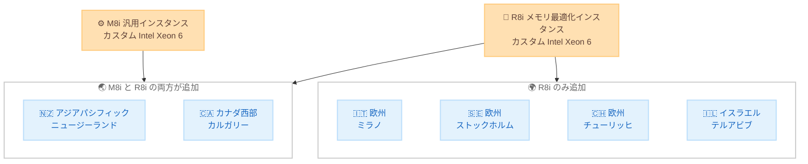

# Amazon RDS for Oracle - M8i および R8i インスタンスの提供リージョン拡大

**リリース日**: 2026 年 11 月 3 日
**サービス**: Amazon RDS for Oracle
**機能**: M8i / R8i インスタンスの追加リージョン対応

📊 [このアップデートのインフォグラフィックを見る](https://takech9203.github.io/aws-news-summary/20261103-rds-oracle-m8i-r8i-instances-new-regions.html)

## 概要

Amazon RDS for Oracle において、第 8 世代 Intel ベースのインスタンスである M8i (汎用) および R8i (メモリ最適化) の提供リージョンが拡大されました。M8i と R8i の両方が アジアパシフィック (ニュージーランド) とカナダ西部 (カルガリー) で利用可能になり、R8i はさらに欧州 (ミラノ)、欧州 (ストックホルム)、欧州 (チューリッヒ)、イスラエル (テルアビブ) でも利用可能になりました。

M8i / R8i インスタンスは、AWS でのみ利用可能なカスタム Intel Xeon 6 プロセッサを搭載しており、AWS によると、比較可能なクラウド上の Intel プロセッサの中で最高のパフォーマンスと最速のメモリ帯域幅を実現しています。前世代の Intel ベースインスタンスと比較して、最大 15% 優れたプライスパフォーマンスと 2.5 倍のメモリ帯域幅を提供します。

今回のリージョン拡大により、これらのリージョンで Oracle データベースを運用するユーザーは、BYOL (Bring Your Own License) モデルで最新世代の Intel ベースインスタンスを選択できるようになります。

**アップデート前の課題**

今回対象となったリージョンでは、RDS for Oracle で M8i / R8i インスタンスを利用できませんでした。

- 対象リージョンでは前世代の Intel ベースインスタンスを使用する必要があった
- 最新世代インスタンスによるプライスパフォーマンス改善の恩恵を受けられなかった
- データレジデンシー要件により特定リージョンを利用するユーザーは、最新インスタンスへの移行を計画できなかった

**アップデート後の改善**

今回のアップデートにより、以下が可能になりました。

- アジアパシフィック (ニュージーランド) とカナダ西部 (カルガリー) で M8i / R8i インスタンスを利用可能
- 欧州 (ミラノ、ストックホルム、チューリッヒ) とイスラエル (テルアビブ) で R8i インスタンスを利用可能
- 前世代比で最大 15% 優れたプライスパフォーマンスと 2.5 倍のメモリ帯域幅を活用可能

## アーキテクチャ図



今回のリージョン拡大で M8i / R8i インスタンスが利用可能になったリージョンの構成を示しています。

## サービスアップデートの詳細

### 主要機能

1. **M8i / R8i インスタンスの新規リージョン提供**
   - M8i と R8i の両方: アジアパシフィック (ニュージーランド)、カナダ西部 (カルガリー)
   - R8i のみ: 欧州 (ミラノ)、欧州 (ストックホルム)、欧州 (チューリッヒ)、イスラエル (テルアビブ)
   - BYOL ライセンスモデルで Oracle Enterprise Edition (EE) と Standard Edition 2 (SE2) に対応

2. **カスタム Intel Xeon 6 プロセッサ**
   - AWS でのみ利用可能なカスタムプロセッサを搭載
   - AWS によると、比較可能なクラウド上の Intel プロセッサの中で最高のパフォーマンスと最速のメモリ帯域幅を実現
   - 前世代の Intel ベースインスタンス比で最大 15% 優れたプライスパフォーマンス
   - 前世代比で 2.5 倍のメモリ帯域幅

3. **幅広いインスタンスサイズ**
   - Enterprise Edition (EE): large から 48xlarge、およびベアメタルの metal-48xl と metal-96xl
   - Standard Edition 2 (SE2): large から 4xlarge、およびベアメタルの metal-48xl と metal-96xl

## 技術仕様

### インスタンスファミリーの概要

| 項目 | 詳細 |
|------|------|
| M8i | 汎用インスタンス。コンピューティングとメモリのバランス型 |
| R8i | メモリ最適化インスタンス。メモリ集約型データベースワークロード向け |
| プロセッサ | カスタム Intel Xeon 6 (AWS 専用) |
| プライスパフォーマンス | 前世代 Intel ベースインスタンス比で最大 15% 向上 |
| メモリ帯域幅 | 前世代比で 2.5 倍 |
| ライセンスモデル | BYOL (Bring Your Own License) |
| 対応エディション | Oracle EE、Oracle SE2 |

### 対応インスタンスサイズ

| エディション | 対応サイズ |
|------|------|
| Enterprise Edition (EE) | large 〜 48xlarge、metal-48xl、metal-96xl |
| Standard Edition 2 (SE2) | large 〜 4xlarge、metal-48xl、metal-96xl |

## 設定方法

### 前提条件

1. 対象リージョン (ニュージーランド、カルガリー、ミラノ、ストックホルム、チューリッヒ、テルアビブ) で RDS for Oracle を利用していること
2. BYOL モデルで利用するための有効な Oracle ライセンスを保有していること
3. 既存インスタンスを変更する場合は、メンテナンスウィンドウまたは即時適用の影響を確認していること

### 手順

#### ステップ1: 利用可能なインスタンスクラスの確認

```bash
aws rds describe-orderable-db-instance-options \
    --engine oracle-ee \
    --license-model bring-your-own-license \
    --query "OrderableDBInstanceOptions[?contains(DBInstanceClass, 'db.r8i')].DBInstanceClass" \
    --region ap-southeast-6 \
    --output table
```

指定したリージョン (この例ではアジアパシフィック (ニュージーランド)) で、Oracle EE の BYOL モデルにおいて利用可能な R8i インスタンスクラスの一覧を取得します。

#### ステップ2: 新規 DB インスタンスの作成

```bash
aws rds create-db-instance \
    --db-instance-identifier my-oracle-db \
    --db-instance-class db.r8i.2xlarge \
    --engine oracle-ee \
    --license-model bring-your-own-license \
    --master-username admin \
    --master-user-password <password> \
    --allocated-storage 100 \
    --region ap-southeast-6
```

R8i インスタンスクラスを指定して、BYOL モデルの Oracle EE データベースインスタンスを新規作成します。

#### ステップ3: 既存インスタンスのインスタンスクラス変更

```bash
aws rds modify-db-instance \
    --db-instance-identifier my-oracle-db \
    --db-instance-class db.m8i.xlarge \
    --apply-immediately
```

既存の DB インスタンスのインスタンスクラスを M8i に変更します。`--apply-immediately` を指定すると即時適用されますが、再起動によるダウンタイムが発生するため、本番環境ではメンテナンスウィンドウでの適用を検討してください。

## メリット

### ビジネス面

- **コスト効率の向上**: 前世代比で最大 15% 優れたプライスパフォーマンスにより、同等のワークロードをより低いコストで実行可能
- **データレジデンシー要件への対応**: ニュージーランド、カナダ西部、欧州各国、イスラエルのデータ所在地要件を満たしながら最新インスタンスを利用可能
- **ライセンス資産の活用**: BYOL モデルにより、既存の Oracle ライセンス投資を活用しながら最新ハードウェアへ移行可能

### 技術面

- **メモリ帯域幅の大幅向上**: 前世代比 2.5 倍のメモリ帯域幅により、メモリ集約型のデータベースワークロードの性能が向上
- **最新プロセッサの活用**: AWS 専用のカスタム Intel Xeon 6 プロセッサによる高いパフォーマンス
- **柔軟なサイズ選択**: large からベアメタルの metal-96xl まで、ワークロードに応じた幅広いサイズを選択可能

## デメリット・制約事項

### 制限事項

- 今回の発表は BYOL モデルが対象であり、License Included モデルについては言及されていない
- SE2 は large から 4xlarge まで (およびベアメタル) に制限され、EE より選択肢が少ない
- M8i の追加はニュージーランドとカルガリーの 2 リージョンのみで、ミラノ、ストックホルム、チューリッヒ、テルアビブは R8i のみ

### 考慮すべき点

- インスタンスクラス変更時には再起動が発生するため、ダウンタイムを考慮した移行計画が必要
- BYOL モデルではインスタンスサイズ (vCPU 数) に応じた Oracle ライセンスの再計算が必要になる場合がある
- リージョンごとの料金は異なるため、料金ページで対象リージョンの価格を確認することを推奨

## ユースケース

### ユースケース1: メモリ集約型 Oracle データベースの性能改善

**シナリオ**: ストックホルムリージョンで前世代のメモリ最適化インスタンス上の Oracle EE データベースを運用しており、大規模なバッファキャッシュを必要とするワークロードの性能改善を図りたい。

**実装例**:
```bash
aws rds modify-db-instance \
    --db-instance-identifier prod-oracle-db \
    --db-instance-class db.r8i.8xlarge \
    --no-apply-immediately
```

**効果**: 2.5 倍のメモリ帯域幅により、メモリ集約型クエリの処理性能が向上し、プライスパフォーマンスも最大 15% 改善される。

### ユースケース2: データレジデンシー要件下での最新インスタンス採用

**シナリオ**: ニュージーランド国内にデータを保持する必要がある企業が、RDS for Oracle を最新世代インスタンスで新規構築したい。

**実装例**:
```bash
aws rds create-db-instance \
    --db-instance-identifier nz-oracle-db \
    --db-instance-class db.m8i.2xlarge \
    --engine oracle-se2 \
    --license-model bring-your-own-license \
    --region ap-southeast-6 \
    --master-username admin \
    --master-user-password <password> \
    --allocated-storage 200
```

**効果**: データ所在地要件を満たしながら、最新のカスタム Intel Xeon 6 プロセッサの性能を活用できる。

### ユースケース3: 大規模 Oracle ワークロードのベアメタル移行

**シナリオ**: テルアビブリージョンで、専有ホスト上での実行が求められる大規模な Oracle EE ワークロードを運用したい。

**実装例**:
```bash
aws rds create-db-instance \
    --db-instance-identifier telaviv-oracle-metal \
    --db-instance-class db.r8i.metal-96xl \
    --engine oracle-ee \
    --license-model bring-your-own-license \
    --region il-central-1 \
    --master-username admin \
    --master-user-password <password> \
    --allocated-storage 1000
```

**効果**: ベアメタルサイズにより、最大規模のメモリ集約型 Oracle ワークロードをマネージドサービス上で実行できる。

## 料金

M8i / R8i インスタンスの料金は、リージョン、インスタンスサイズ、デプロイ構成 (シングル AZ / マルチ AZ) によって異なります。BYOL モデルのため、Oracle ライセンス費用は別途ユーザーが負担します。

具体的な料金は [Amazon RDS for Oracle 料金ページ](https://aws.amazon.com/rds/oracle/pricing/) を参照してください。

## 利用可能リージョン

今回のアップデートで追加されたリージョンは以下のとおりです。

| インスタンス | 追加リージョン |
|------|------|
| M8i および R8i | アジアパシフィック (ニュージーランド)、カナダ西部 (カルガリー) |
| R8i のみ | 欧州 (ミラノ)、欧州 (ストックホルム)、欧州 (チューリッヒ)、イスラエル (テルアビブ) |

その他の対応リージョンを含む最新の提供状況は、料金ページで確認してください。

## 関連サービス・機能

- **Amazon EC2 M8i / R8i インスタンス**: 同じカスタム Intel Xeon 6 プロセッサを搭載した EC2 インスタンスファミリー。RDS のインスタンスクラスの基盤
- **Amazon RDS for SQL Server**: 2026 年 5 月に M8i / R8i インスタンスのサポートを開始しており、他の商用データベースエンジンでも同世代インスタンスを利用可能
- **Amazon RDS マルチ AZ 配置**: M8i / R8i インスタンスと組み合わせることで、高可用性構成を実現

## 参考リンク

- 📊 [インフォグラフィック](https://takech9203.github.io/aws-news-summary/20261103-rds-oracle-m8i-r8i-instances-new-regions.html)
- [公式発表 (What's New)](https://aws.amazon.com/about-aws/whats-new/2026/11/rds-oracle-m8i-r8i-instances-new-regions/)
- [Amazon RDS for Oracle 製品ページ](https://aws.amazon.com/rds/oracle/)
- [Amazon RDS for Oracle 料金ページ](https://aws.amazon.com/rds/oracle/pricing/)

## まとめ

Amazon RDS for Oracle の M8i / R8i インスタンスが、ニュージーランド、カルガリーを含む最大 6 つのリージョンに拡大されました。前世代比で最大 15% のプライスパフォーマンス向上と 2.5 倍のメモリ帯域幅を提供するため、対象リージョンで前世代インスタンスを利用中のユーザーは、料金ページで対象サイズと価格を確認のうえ、移行を検討することを推奨します。
