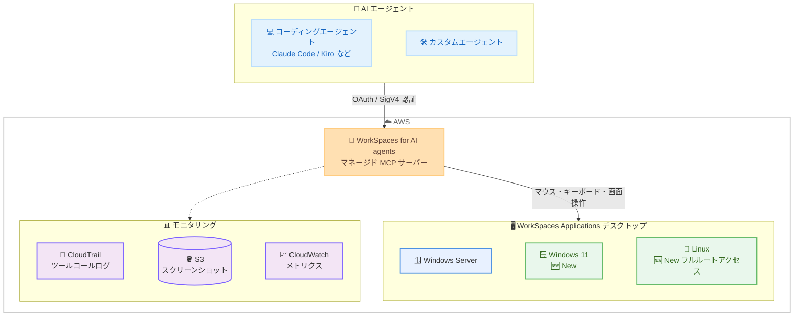

# Amazon WorkSpaces - WorkSpaces for AI agents の Linux / Windows 11 クラウドデスクトップ対応

**リリース日**: 2026 年 11 月 3 日
**サービス**: Amazon WorkSpaces (Amazon WorkSpaces Applications)
**機能**: Amazon WorkSpaces for AI agents の Linux および Windows 11 クラウドデスクトップサポート

📊 [このアップデートのインフォグラフィックを見る](https://takech9203.github.io/aws-news-summary/20261103-workspaces-ai-agents-linux-windows-11.html)

## 概要

Amazon WorkSpaces for AI agents が、従来の Windows Server に加えて Linux および Windows 11 のクラウドデスクトップをサポートしました。WorkSpaces for AI agents は、Amazon WorkSpaces Applications のエージェントアクセス機能であり、AI エージェントにマウス、キーボード、画面を提供し、人間と同じようにデスクトップアプリケーション、レガシーアプリケーション、ブラウザベースのアプリケーションを操作できるようにするマネージド MCP (Model Context Protocol) サーバーです。

今回のアップデートにより、組織は各 AI エージェントをワークフローが必要とする OS に合わせて選択できるようになりました。エージェントは従業員が実際に使用しているものと同じ環境で動作できるため、既存のアプリケーションやワークフローを移行 (リプラットフォーム) する必要がありません。Linux デスクトップは OS へのフルルートアクセスを提供し、ビルド、テスト、自動化スクリプトの実行といった開発者スタイルの作業に適しています。Windows 11 デスクトップでは、チームが日常的に使用するエンタープライズアプリケーションをエージェントが操作できます。

新しい OS オプションはいずれも、Windows Server デスクトップと同じ保護機能 (ネットワーク分離、IAM ベースのアクセス制御、組織の既存のコンプライアンス境界) の下で動作します。

**アップデート前の課題**

このアップデート以前は、以下の課題がありました。

- WorkSpaces for AI agents で利用できるデスクトップ OS は Windows Server のみに限定されていた
- Linux 環境を前提とした開発ワークフロー (ビルド、テスト、自動化スクリプトの実行など) を AI エージェントに任せることが困難だった
- 従業員が日常業務で使用する Windows 11 環境とエージェントの実行環境が異なるため、アプリケーションの挙動差異を考慮する必要があった

**アップデート後の改善**

今回のアップデートにより、以下が可能になりました。

- Linux デスクトップ上でフルルートアクセスを持つエージェントを実行し、ビルド、テスト、自動化スクリプトなどの開発者スタイルの作業を任せられるようになった
- Windows 11 デスクトップ上で、従業員が使用するものと同じエンタープライズアプリケーションをエージェントが操作できるようになった
- エージェントごとにワークフローに最適な OS を選択でき、既存環境のリプラットフォームが不要になった

## アーキテクチャ図



AI エージェントは OAuth または IAM (SigV4) 認証でマネージド MCP サーバーに接続し、MCP ツールを通じて WorkSpaces Applications デスクトップを操作します。今回のアップデートで、操作対象のデスクトップとして Linux と Windows 11 を選択できるようになりました。すべてのツールコールは CloudTrail、S3、CloudWatch に記録されます。

## サービスアップデートの詳細

### 主要機能

1. **Linux クラウドデスクトップのサポート**
   - AI エージェントに OS へのフルルートアクセスを提供
   - ビルドの実行、テスト、自動化スクリプトの実行など、開発者スタイルの作業に最適
   - ターミナル操作を伴う開発ワークフローをエージェントに委任可能

2. **Windows 11 クラウドデスクトップのサポート**
   - 従業員が日常業務で使用するものと同じエンタープライズアプリケーション環境をエージェントに提供
   - 既存の業務アプリケーションをリプラットフォームせずにエージェントが操作可能
   - AppStream API の `PlatformType` 列挙型に Windows 11 が追加され、フリート / イメージで選択可能

3. **一貫したセキュリティとガバナンス**
   - 新しい OS オプションも Windows Server デスクトップと同じ保護機能を継承
   - ネットワーク分離、IAM ベースのアクセス制御を適用
   - 組織の既存のコンプライアンス境界内でエージェントが動作

## 技術仕様

### WorkSpaces for AI agents の構成要素

| 項目 | 詳細 |
|------|------|
| エージェント | ユーザーが用意する任意のエージェント (Claude Code、Kiro、Codex、カスタムエージェントなど) |
| 接続方式 | マネージド MCP サーバーへ OAuth または IAM (SigV4) で接続 |
| MCP エンドポイント | `https://agentaccess-mcp.{region}.api.aws/mcp` (サービス名: `agentaccess-mcp`) |
| 組み込みツール | マウス操作 (Computer Input)、キーボード入力、スクリーンショット取得 (Computer Vision) |
| ツールフォワーディング | デスクトップ上に構成した MCP ツールをエージェントへ転送可能 (PDF 読み取り、ファイルアクセス、シェルコマンド実行など) |
| 対応 OS | Windows Server、Windows 11 (新規)、Linux (新規、フルルートアクセス) |
| 画面解像度 | 1280x720 |
| 画面イメージ形式 | PNG または JPEG |
| セッション観察 | ユーザーコントロールモードによりブラウザでリアルタイム観察、VIEW_STOP モードでエージェントの停止が可能 |
| モニタリング | CloudTrail (ツールコールのデータイベント)、S3 (スクリーンショット保存)、CloudWatch (ツールコール所要時間メトリクス) |

### OS オプションの比較

| 項目 | Windows Server | Windows 11 (新規) | Linux (新規) |
|------|----------------|-------------------|--------------|
| 主な用途 | 汎用的なデスクトップ操作 | エンタープライズアプリケーションの操作 | ビルド・テスト・自動化スクリプトの実行 |
| アクセスレベル | 標準 | 標準 | フルルートアクセス |
| アプリケーション設定の永続化 | 対応 | 対応 | 非対応 |

### API 変更履歴

| 日付 | サービス | 変更内容 |
|------|----------|----------|
| 2026/10/26 | [appstream2](https://awsapichanges.com/archive/changes/8f8240-appstream2.html) | 16 updated api methods - `PlatformType` 列挙型への Windows 11 の追加 |

## 設定方法

### 前提条件

1. AWS アカウントと WorkSpaces Applications (AppStream) を操作できる IAM 権限
2. エージェントが使用するアプリケーションを含むイメージと、対象 OS (Linux / Windows 11 / Windows Server) のフリート
3. エージェント側の AWS 認証情報に `agentaccess-mcp:*` 権限を付与

### 手順

#### ステップ 1: エージェントアクセスを有効化したスタックを作成

```bash
aws appstream create-stack \
    --name my-agent-stack \
    --agent-access-config '{
        "Settings": [
            {"AgentAction": "COMPUTER_VISION", "Permission": "ENABLED"},
            {"AgentAction": "COMPUTER_INPUT", "Permission": "ENABLED"},
            {"AgentAction": "FORWARD_MCP_TOOLS", "Permission": "ENABLED"}
        ],
        "ScreenResolution": "W_1280xH_720",
        "ScreenImageFormat": "PNG"
    }'
```

エージェントアクセス設定 (コンピュータービジョン、コンピューター入力、MCP ツールフォワーディング) を有効化したスタックを作成します。コンピューター入力とコンピュータービジョンの少なくとも一方の有効化が必須で、コンピューター入力を有効にする場合はコンピュータービジョンも有効にする必要があります。

#### ステップ 2: フリートの関連付けとストリーミング URL の生成

```bash
# Linux または Windows 11 のフリートをスタックに関連付け
aws appstream associate-fleet \
    --stack-name my-agent-stack \
    --fleet-name my-linux-fleet

# ストリーミング URL を生成
aws appstream create-streaming-url \
    --stack-name my-agent-stack \
    --fleet-name my-linux-fleet \
    --user-id my-agent-01 \
    --validity 3600
```

対象 OS のフリートをスタックに関連付け、エージェントがセッションに接続するためのストリーミング URL を生成します。レスポンスに含まれる `StreamingURL` を次のステップでエージェントに渡します。1 つのセッションに同時接続できるエージェントは 1 つのみです。

#### ステップ 3: エージェントを MCP サーバーに接続

```python
aws_iam_streamablehttp_client(
    endpoint="https://agentaccess-mcp.ap-northeast-1.api.aws/mcp",
    aws_service="agentaccess-mcp",
    aws_region="ap-northeast-1",
    headers={
        "x-amzn-agentaccess-streaming-session-url": streaming_url,
    },
)
```

mcp-proxy-for-aws を使用して、SigV4 署名付きでマネージド MCP サーバーに接続します。ストリーミング URL は各 MCP リクエストのヘッダーとして渡します。接続後、エージェントは MCP ツールを使用してテキスト入力、ボタン操作、スクリーンショット取得を実行できます。

#### ステップ 4: エージェントのアクティビティを確認

CloudTrail でツールコールのデータイベント、CloudWatch で運用メトリクス、S3 で保存されたスクリーンショットを確認します。ユーザーコントロールモードを有効にしている場合は、ブラウザでエージェントのセッションをリアルタイムに観察し、必要に応じて停止できます。

## メリット

### ビジネス面

- **リプラットフォーム不要**: 従業員が実際に使用している Linux / Windows 11 環境と同じ環境でエージェントが動作するため、既存のアプリケーションやワークフローを変更せずに AI 自動化を導入できる
- **自動化範囲の拡大**: これまで人間のオペレーターが必要だったデスクトップ操作タスクを、OS を問わず AI エージェントに委任できる
- **ガバナンスの一貫性**: OS オプションが増えても、ネットワーク分離や IAM ベースのアクセス制御といった既存のコンプライアンス境界をそのまま適用できる

### 技術面

- **ワークロードに最適な OS 選択**: 開発者スタイルの作業には Linux (フルルートアクセス)、エンタープライズアプリケーション操作には Windows 11 と、エージェントごとに使い分けられる
- **完全な監査証跡**: すべてのツールコールが CloudTrail に記録され、スクリーンショットは S3 に保存、所要時間は CloudWatch で確認できる
- **標準プロトコル採用**: MCP 標準に準拠しているため、Claude Code、Kiro、Codex や任意のフレームワークで構築したエージェントをそのまま接続できる

## デメリット・制約事項

### 制限事項

- 1 つのセッションに同時接続できるエージェントは 1 つのみ (複数エージェントの同時実行には、それぞれ固有のセッションが必要)
- アプリケーション設定の永続化は Windows のみ対応で、Linux では利用できない
- CloudTrail でツールコールを確認するには、データイベントを記録するトレイルの設定が必要

### 考慮すべき点

- スタックとフリートを起動したままにすると課金が継続するため、検証後は停止・削除が必要
- コンピューター入力を有効にする場合はコンピュータービジョンの有効化も必須
- MCP ツールフォワーディングを使用するには、イメージ上に設定ファイルの配置が必要

## ユースケース

### ユースケース 1: Linux 環境での CI 補助・自動化スクリプト実行

**シナリオ**: 開発チームが、ビルド・テスト・運用スクリプトの実行を伴う定型作業を AI エージェントに委任したい。

**実装例**:
```
1. ビルドツールやテストツールを含む Linux イメージを作成
2. Linux フリートとエージェントアクセス有効スタックを構成
3. コーディングエージェントを MCP サーバーに接続し、フルルートアクセスで
   ビルド・テスト・自動化スクリプトを実行させる
```

**効果**: 人間のオペレーターが手作業で行っていた Linux 上の定型作業を自動化し、開発チームはより価値の高い作業に集中できる。

### ユースケース 2: Windows 11 上のエンタープライズアプリケーション操作

**シナリオ**: API を持たないレガシーな業務アプリケーション (Windows 11 上で動作) へのデータ入力や帳票処理を自動化したい。

**実装例**:
```
1. 業務アプリケーションをインストールした Windows 11 イメージを作成
2. エージェントアクセス有効スタックで COMPUTER_VISION と COMPUTER_INPUT を有効化
3. エージェントがスクリーンショットで画面を認識し、マウス・キーボード操作で
   データ入力を実行
```

**効果**: API 化や RPA ツールの導入なしに、従業員と同じ Windows 11 環境でレガシーアプリケーションの操作を自動化できる。

### ユースケース 3: 人間の監視付きエージェント運用

**シナリオ**: コンプライアンス要件により、AI エージェントの操作を人間がリアルタイムで監視し、問題があれば即座に停止できる体制が必要。

**実装例**:
```
1. スタックでユーザーコントロールモード VIEW_STOP を有効化
2. スクリーンショット保存用の S3 バケットと CloudTrail データイベントを構成
3. 監視担当者がブラウザでエージェントセッションをライブ観察し、
   必要に応じて停止ボタンでエージェントを停止
```

**効果**: エージェントの全操作の監査証跡を確保しつつ、人間による即時介入が可能なガバナンス体制を実現できる。

## 料金

WorkSpaces Applications (AppStream) のフリートとスタックの利用に応じた料金が発生します。チュートリアルで作成したリソースも課金対象となるため、使用後はスタックの削除とフリートの停止が推奨されています。詳細な料金体系は公式料金ページを参照してください。

## 利用可能リージョン

What's New では対象リージョンは明記されていませんが、ドキュメントによると WorkSpaces Applications の MCP エンドポイント (`agentaccess-mcp`) は以下の 17 リージョンで提供されています。

- 米国東部 (バージニア北部、オハイオ)、米国西部 (オレゴン)
- アジアパシフィック (東京、ソウル、ムンバイ、シンガポール、シドニー、マレーシア)
- カナダ (中部)
- 欧州 (フランクフルト、ミラノ、スペイン、アイルランド、ロンドン、パリ)
- 南米 (サンパウロ)

## 関連サービス・機能

- **Amazon WorkSpaces Applications (旧 AppStream 2.0)**: WorkSpaces for AI agents の基盤となるアプリケーションストリーミングサービス。スタック、フリート、イメージの概念をそのまま使用する
- **AWS CloudTrail**: エージェントのツールコールをデータイベントとして記録し、監査証跡を提供する
- **Amazon S3**: エージェントが取得したスクリーンショットの保存先、およびホームフォルダーによるファイル保存に使用する
- **Amazon CloudWatch**: ツールコールの所要時間などの運用メトリクスを提供する
- **Agent Toolkit for AWS**: AWS MCP Server を通じてエージェント開発を支援するツールキット。エージェントアクセスのセットアップにも利用できる

## 参考リンク

- 📊 [インフォグラフィック](https://takech9203.github.io/aws-news-summary/20261103-workspaces-ai-agents-linux-windows-11.html)
- [公式発表 (What's New)](https://aws.amazon.com/about-aws/whats-new/2026/11/workspaces-ai-agents-linux-windows-11)
- [ドキュメント: Provide agents access to WorkSpaces](https://docs.aws.amazon.com/appstream2/latest/developerguide/agent-access.html)
- [ドキュメント: Get started providing agents with access to WorkSpaces Applications](https://docs.aws.amazon.com/appstream2/latest/developerguide/getting-started-agent-access.html)
- [サンプルコード: sample-code-for-workspaces-agent-access](https://github.com/aws-samples/sample-code-for-workspaces-agent-access)

## まとめ

Amazon WorkSpaces for AI agents が Linux と Windows 11 に対応したことで、AI エージェントによるデスクトップ操作の自動化を、開発者ワークフローからエンタープライズアプリケーション操作まで幅広いユースケースに適用できるようになりました。既存環境のリプラットフォームが不要で、ネットワーク分離や IAM によるガバナンスも一貫して適用されるため、コンピュータユースエージェントの本番導入を検討している組織は、まず Getting Started チュートリアル (約 15 分) での検証から始めることを推奨します。
