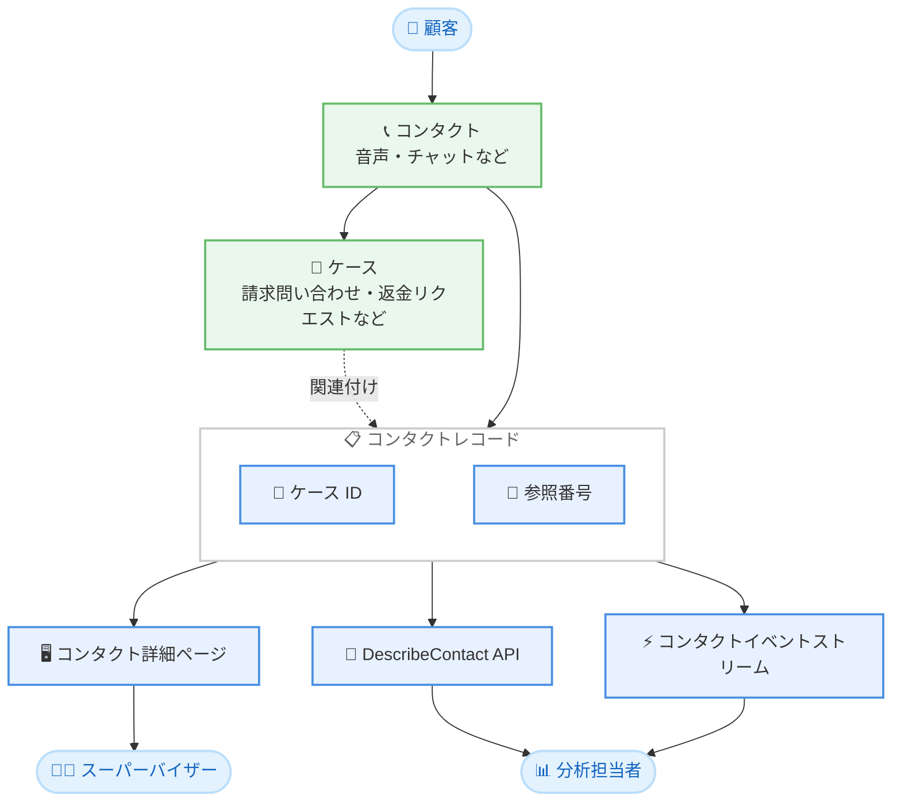

# Amazon Connect Customer - コンタクトレコードへの関連ケース表示

**リリース日**: 2026 年 11 月 4 日
**サービス**: Amazon Connect (Amazon Connect Customer / Connect Customer Cases)
**機能**: コンタクトレコードにおける関連ケース (ケース ID・参照番号) の表示

📊 [このアップデートのインフォグラフィックを見る](https://takech9203.github.io/aws-news-summary/20261104-amazon-connect-cases-contact-records.html)

## 概要

Amazon Connect Customer は、コンタクトレコードにケース ID と参照番号を表示する機能を発表しました。これにより、スーパーバイザーや分析担当者は、どの顧客課題 (ケース) がコンタクトボリュームを生み出しているかを把握できるようになります。

ケースは、請求に関する問い合わせや返金リクエストなど、複数のやり取りや複数のチームにまたがる顧客の課題を追跡するために使用されます。今回のアップデートにより、スーパーバイザーはコンタクト詳細ページ上で、そのやり取りに紐づくケースを直接確認できます。また、分析担当者は DescribeContact API やコンタクトイベントストリームから同じデータを取得し、各ケースが何件のやり取りを発生させているかを測定できます。

**アップデート前の課題**

このアップデート以前には、以下の課題がありました。

- コンタクト詳細ページから、そのコンタクトに関連するケースを直接確認できなかった
- スーパーバイザーは、コンタクトに紐づくケースを特定するためにケースを 1 件ずつ検索する必要があった
- 分析担当者が「どのケースがどれだけのコンタクトを生んでいるか」を定量的に把握することが困難だった

**アップデート後の改善**

今回のアップデートにより、以下が可能になりました。

- コンタクト詳細ページ上で、そのやり取りに関連付けられたケースの ID と参照番号を直接確認できるようになった
- ケースを個別に検索する手間が不要になり、スーパーバイザーの調査作業が効率化された
- DescribeContact API およびコンタクトイベントストリーム経由で関連ケース情報を取得し、ケースごとのコンタクト件数などを分析できるようになった

## アーキテクチャ図



コンタクトに関連付けられたケースの ID と参照番号がコンタクトレコードに記録され、コンタクト詳細ページ、DescribeContact API、コンタクトイベントストリームの 3 つの経路から参照できる構成を示しています。

## サービスアップデートの詳細

### 主要機能

1. **コンタクト詳細ページでの関連ケース表示**
   - コンタクト詳細ページ上に、そのやり取りに紐づくケースが表示される
   - スーパーバイザーがケースを 1 件ずつ検索する必要がなくなる
   - 顧客対応の全体像をコンタクト単位で素早く把握できる

2. **DescribeContact API による関連ケース情報の取得**
   - コンタクトレコードに含まれるケース ID と参照番号を API 経由で取得できる
   - 外部の分析基盤やレポーティングツールとの連携が可能
   - ケースごとに何件のやり取りが発生したかを定量的に測定できる

3. **コンタクトイベントストリームへの反映**
   - コンタクトイベントストリームからも関連ケース情報を取得できる
   - ニアリアルタイムでのモニタリングや自動処理への活用が可能

## 技術仕様

### 関連ケース情報の参照経路

| 参照経路 | 主な利用者 | 用途 |
|------|------|------|
| コンタクト詳細ページ | スーパーバイザー | コンタクトに紐づくケースの即時確認 |
| DescribeContact API | 分析担当者・開発者 | ケース単位のコンタクト件数分析、外部システム連携 |
| コンタクトイベントストリーム | 分析担当者・開発者 | ニアリアルタイムのモニタリング、イベント駆動の自動化 |

### コンタクトレコードに追加される情報

| 項目 | 詳細 |
|------|------|
| ケース ID | コンタクトに関連付けられたケースの識別子 |
| 参照番号 | ケースの参照番号 (エージェントや顧客が参照する番号) |

## 設定方法

### 前提条件

1. Amazon Connect インスタンスで Connect Customer Cases (ケース機能) が有効化されていること
2. エージェントまたはフローにより、コンタクトとケースの関連付けが行われていること
3. コンタクト詳細の閲覧や DescribeContact API 呼び出しに必要な権限が付与されていること

### 手順

#### ステップ 1: コンタクト詳細ページで関連ケースを確認する

Amazon Connect の管理 Web サイトでコンタクト検索からコンタクト詳細ページを開くと、そのコンタクトに関連付けられたケースの情報を確認できます。追加の設定作業は不要です。

#### ステップ 2: DescribeContact API で関連ケース情報を取得する

```bash
aws connect describe-contact \
  --instance-id <インスタンス ID> \
  --contact-id <コンタクト ID>
```

指定したコンタクトのコンタクトレコードを取得します。レスポンスに、関連付けられたケースのケース ID と参照番号が含まれます。

#### ステップ 3: コンタクトイベントストリームで関連ケース情報を活用する

コンタクトイベントストリーム (Amazon EventBridge 経由) を設定している場合、イベントデータから関連ケース情報を取得し、分析基盤への取り込みや自動処理に活用できます。

## メリット

### ビジネス面

- **コンタクトドライバーの可視化**: どの顧客課題 (ケース) がコンタクトボリュームを生んでいるかを把握し、改善施策の優先順位付けに活用できる
- **スーパーバイザーの業務効率化**: ケースを個別に検索する手間がなくなり、調査・エスカレーション対応が迅速になる
- **顧客体験の改善**: 繰り返しコンタクトが多いケースを特定し、根本原因の解消につなげられる

### 技術面

- **API によるデータ活用**: DescribeContact API で関連ケース情報を取得し、BI ツールやデータレイクと連携できる
- **イベント駆動の自動化**: コンタクトイベントストリームを通じて、ケース関連イベントをニアリアルタイムで処理できる
- **追加の統合作業が不要**: 既存のケース機能を利用していれば、コンタクトレコードに自動的に情報が反映される

## デメリット・制約事項

### 制限事項

- Connect Customer Cases (ケース機能) を利用していることが前提となる
- 利用可能リージョンが限定されている (下記「利用可能リージョン」を参照)

### 考慮すべき点

- コンタクトとケースの関連付けが適切に運用されていない場合、分析の精度が低下する
- DescribeContact API やイベントストリームを利用した分析基盤の構築には別途実装が必要となる

## ユースケース

### ユースケース 1: スーパーバイザーによるエスカレーション対応の迅速化

**シナリオ**: 顧客からのクレームに関するコンタクトについて、スーパーバイザーが過去の経緯を確認する必要がある。

**実装例**:
```
1. Amazon Connect 管理 Web サイトでコンタクト検索を実行
2. 対象コンタクトの詳細ページを開く
3. 表示された関連ケースの ID・参照番号から、ケースの内容と対応履歴を確認
```

**効果**: ケースを個別に検索することなく、コンタクトに紐づく課題の全体像を即座に把握でき、エスカレーション対応が迅速化される。

### ユースケース 2: ケース単位のコンタクト件数分析

**シナリオ**: 分析担当者が、どの種類のケースが多くの問い合わせを発生させているかを定量的に分析したい。

**実装例**:
```bash
aws connect describe-contact \
  --instance-id <インスタンス ID> \
  --contact-id <コンタクト ID> \
  --query 'Contact'
```

コンタクトレコードから関連ケース情報を取得し、ケース ID ごとにコンタクト件数を集計します。

**効果**: 繰り返しコンタクトを発生させているケースの種類を特定し、セルフサービス化や FAQ 整備などの改善施策につなげられる。

### ユースケース 3: イベントストリームを活用したニアリアルタイムモニタリング

**シナリオ**: 特定のケースに関連するコンタクトが一定件数を超えた場合に、運用チームへ通知したい。

**実装例**:
```
1. コンタクトイベントストリーム (EventBridge) をデータ処理パイプラインに接続
2. イベントに含まれる関連ケース情報をケース ID ごとに集計
3. しきい値を超えた場合に SNS などで運用チームへ通知
```

**効果**: 大量のコンタクトを発生させている課題をニアリアルタイムで検知し、早期対応により顧客影響を最小化できる。

## 料金

本アップデート (コンタクトレコードへの関連ケース表示) 自体に追加料金は発表されていません。Connect Customer Cases の利用には Amazon Connect の料金体系に基づく料金が適用されます。詳細は [Amazon Connect 料金ページ](https://aws.amazon.com/connect/pricing/) を参照してください。

## 利用可能リージョン

本機能は以下のリージョンで利用可能です。

- 米国東部 (バージニア北部)
- 米国西部 (オレゴン)
- カナダ (中部)
- 欧州 (フランクフルト)
- 欧州 (ロンドン)
- アジアパシフィック (ソウル)
- アジアパシフィック (シンガポール)
- アジアパシフィック (シドニー)
- アジアパシフィック (東京)
- アフリカ (ケープタウン)

## 関連サービス・機能

- **Connect Customer Cases**: 顧客の課題をケースとして追跡・管理する機能。本アップデートの前提となる機能
- **Amazon Connect コンタクトレンズ**: 会話分析機能。ケース情報と組み合わせることで顧客課題の分析を強化できる
- **Amazon EventBridge**: コンタクトイベントストリームの配信基盤。関連ケース情報のニアリアルタイム処理に利用

## 参考リンク

- 📊 [インフォグラフィック](https://takech9203.github.io/aws-news-summary/20261104-amazon-connect-cases-contact-records.html)
- [公式発表 (What's New)](https://aws.amazon.com/about-aws/whats-new/2026/11/amazon-connect-cases-contact-records/)
- [Connect Customer Cases 製品ページ](https://aws.amazon.com/products/connect/customer/cases/)
- [ドキュメント (Connect Customer Cases)](https://docs.aws.amazon.com/connect/latest/adminguide/cases.html)
- [DescribeContact API リファレンス](https://docs.aws.amazon.com/connect/latest/APIReference/API_DescribeContact.html)
- [料金ページ](https://aws.amazon.com/connect/pricing/)

## まとめ

コンタクトレコードに関連ケースの ID と参照番号が表示されるようになり、スーパーバイザーの調査効率と分析担当者のデータ活用性が大きく向上します。Connect Customer Cases を利用しているコンタクトセンターでは、コンタクト詳細ページでの確認に加え、DescribeContact API やコンタクトイベントストリームを活用したケース単位のコンタクト分析の導入を検討することを推奨します。
