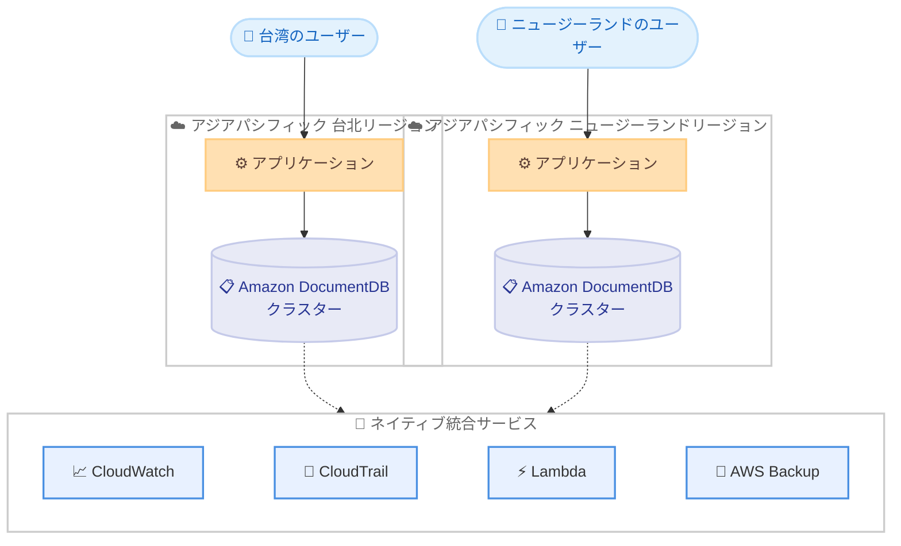

# Amazon DocumentDB - アジアパシフィック (台北) およびアジアパシフィック (ニュージーランド) リージョンで利用可能に

**リリース日**: 2026 年 11 月 4 日
**サービス**: Amazon DocumentDB (with MongoDB compatibility)
**機能**: アジアパシフィック (台北) およびアジアパシフィック (ニュージーランド) リージョンへのサービス提供拡大

📊 [このアップデートのインフォグラフィックを見る](https://takech9203.github.io/aws-news-summary/20261104-amazon-documentdb-mongodb-compatibility-asia-pacific-taipei-new-zealand-regions.html)

## 概要

Amazon DocumentDB (with MongoDB compatibility) が、アジアパシフィック (台北) リージョンおよびアジアパシフィック (ニュージーランド) リージョンで利用可能になりました。これにより、台湾およびニュージーランドに拠点を置くユーザーは、ローカルリージョンでフルマネージドなドキュメントデータベースを利用できるようになります。

Amazon DocumentDB は、フルマネージドのネイティブ JSON データベースであり、インフラストラクチャを管理することなく、重要なドキュメントワークロードをほぼあらゆる規模でシンプルかつコスト効率よく運用できます。ミッションクリティカルな MongoDB ワークロードの運用に必要なスケーラビリティと耐久性を提供するよう設計されており、ストレージはアプリケーションへの影響なしに最大 128 TiB まで自動的にスケールします。

今回のリージョン拡大により、台湾・ニュージーランド国内のデータレジデンシー要件への対応や、現地ユーザー向けアプリケーションの低レイテンシー化が可能になります。

**アップデート前の課題**

このアップデート以前は、台湾およびニュージーランドのユーザーに以下の制約がありました。

- 台北リージョンおよびニュージーランドリージョンでは Amazon DocumentDB を利用できず、近隣の他リージョン (東京、シドニーなど) を利用する必要があった
- 他リージョン利用時はネットワークレイテンシーが増加し、現地ユーザー向けアプリケーションの応答性能に影響があった
- データを国内に保持するというデータレジデンシー要件を満たすことが困難だった

**アップデート後の改善**

今回のアップデートにより、以下が可能になりました。

- 台北およびニュージーランドリージョンで Amazon DocumentDB クラスターを直接作成・運用できるようになった
- アプリケーションとデータベースを同一リージョンに配置することで、レイテンシーを低減できるようになった
- 台湾・ニュージーランド国内のデータレジデンシー要件に対応したアーキテクチャを構築できるようになった

## アーキテクチャ図



新たに利用可能になった 2 つのリージョンで Amazon DocumentDB クラスターを構築し、現地ユーザーに低レイテンシーでサービスを提供する構成を示しています。各クラスターは CloudWatch、CloudTrail、Lambda、AWS Backup などの AWS サービスとネイティブに統合されます。

## サービスアップデートの詳細

### 主要機能

1. **アジアパシフィック (台北) リージョンでの提供開始**
   - 台北リージョンで Amazon DocumentDB クラスターの作成・運用が可能に
   - 台湾国内のユーザー向けアプリケーションのレイテンシーを低減
   - 台湾国内のデータレジデンシー要件に対応可能

2. **アジアパシフィック (ニュージーランド) リージョンでの提供開始**
   - ニュージーランドリージョンで Amazon DocumentDB クラスターの作成・運用が可能に
   - ニュージーランド国内のユーザー向けアプリケーションのレイテンシーを低減
   - ニュージーランド国内のデータレジデンシー要件に対応可能

3. **既存機能をそのまま利用可能**
   - ストレージはアプリケーションへの影響なしに最大 128 TiB まで自動スケール
   - 毎秒数百万リクエストをサポートし、アプリケーションのダウンタイムなしで最大 15 の低レイテンシーリードレプリカへ数分でスケールアウト可能
   - Amazon CloudWatch、AWS CloudTrail、AWS Lambda、AWS Backup などとのネイティブ統合

## 技術仕様

### Amazon DocumentDB の主な特徴

| 項目 | 詳細 |
|------|------|
| データベースタイプ | フルマネージドのネイティブ JSON ドキュメントデータベース |
| 互換性 | MongoDB 互換 |
| 最大ストレージ | 128 TiB (自動スケール、アプリケーションへの影響なし) |
| リードレプリカ | 最大 15 個の低レイテンシーリードレプリカ (数分で追加、ダウンタイムなし) |
| スループット | 毎秒数百万リクエストをサポート |
| 統合サービス | Amazon CloudWatch、AWS CloudTrail、AWS Lambda、AWS Backup など |
| 作成方法 | AWS Management Console、AWS CLI、AWS SDK |

## 設定方法

### 前提条件

1. AWS アカウントを保有していること
2. 台北リージョンまたはニュージーランドリージョンが AWS アカウントで有効化されていること (オプトインリージョンの場合)
3. クラスターを配置する VPC とサブネットグループが対象リージョンに作成されていること

### 手順

#### ステップ1: 対象リージョンでクラスターを作成

```bash
aws docdb create-db-cluster \
  --db-cluster-identifier my-docdb-cluster \
  --engine docdb \
  --master-username myuser \
  --master-user-password mypassword \
  --region ap-east-2
```

台北リージョンに Amazon DocumentDB クラスターを作成するコマンドです。`--region` にはニュージーランドリージョンのリージョンコードを指定することもできます。リージョンコードは公式ドキュメントで確認してください。

#### ステップ2: インスタンスを追加

```bash
aws docdb create-db-instance \
  --db-instance-identifier my-docdb-instance \
  --db-instance-class db.r6g.large \
  --engine docdb \
  --db-cluster-identifier my-docdb-cluster \
  --region ap-east-2
```

作成したクラスターにプライマリインスタンスを追加するコマンドです。読み取り負荷が高い場合は、同様のコマンドでリードレプリカを最大 15 個まで追加できます。

#### ステップ3: アプリケーションから接続

クラスターのエンドポイントを取得し、MongoDB 互換ドライバーを使用してアプリケーションから接続します。接続文字列はクラスター詳細画面または `describe-db-clusters` コマンドで確認できます。

## メリット

### ビジネス面

- **データレジデンシー対応**: 台湾・ニュージーランド国内にデータを保持する要件を満たすアーキテクチャを構築可能
- **ユーザー体験の向上**: 現地ユーザーに近いリージョンでデータベースを運用することで、アプリケーションの応答性能が向上
- **運用コストの削減**: フルマネージドサービスのため、インフラストラクチャ管理の負担なく重要なドキュメントワークロードを運用可能

### 技術面

- **低レイテンシー**: アプリケーションとデータベースを同一リージョンに配置することで、ネットワークレイテンシーを最小化
- **高いスケーラビリティ**: ストレージの自動スケール (最大 128 TiB) と最大 15 個のリードレプリカによる読み取りスケールアウト
- **AWS サービスとの統合**: CloudWatch によるモニタリング、CloudTrail による監査、AWS Backup によるバックアップ管理をそのまま利用可能

## デメリット・制約事項

### 制限事項

- 新規リージョンでは、既存リージョンと比較して利用可能なインスタンスタイプや機能に差異がある場合があるため、事前に確認が必要
- 台北およびニュージーランドリージョンはオプトインリージョンであり、利用前にアカウントでの有効化が必要になる場合がある

### 考慮すべき点

- 既存の他リージョンのクラスターから移行する場合は、AWS Database Migration Service (DMS) などを利用した移行計画が必要
- リージョンごとに料金が異なる場合があるため、料金ページで対象リージョンの料金を確認することを推奨

## ユースケース

### ユースケース1: 台湾国内向け Web アプリケーションのデータベース

**シナリオ**: 台湾のユーザーを対象とした EC サイトで、商品カタログやユーザープロファイルを JSON ドキュメントとして管理したい。データは台湾国内に保持する必要がある。

**実装例**:
```
1. 台北リージョンに Amazon DocumentDB クラスターを作成
2. 同一リージョンの ECS / EKS 上のアプリケーションから接続
3. 読み取り負荷に応じてリードレプリカを追加
```

**効果**: データレジデンシー要件を満たしつつ、現地ユーザーへの低レイテンシーなレスポンスを実現できます。

### ユースケース2: ニュージーランドの公共・金融系ワークロード

**シナリオ**: ニュージーランド国内の規制要件により、データを国内リージョンで管理する必要がある金融系アプリケーションで、ドキュメントデータベースを利用したい。

**実装例**:
```
1. ニュージーランドリージョンに Amazon DocumentDB クラスターを作成
2. AWS CloudTrail で監査ログを取得し、AWS Backup でバックアップを一元管理
3. CloudWatch でパフォーマンスをモニタリング
```

**効果**: 国内データ保持の要件に対応しながら、フルマネージドサービスによる運用負荷の軽減と監査対応を両立できます。

### ユースケース3: 既存 MongoDB ワークロードの移行

**シナリオ**: 台湾またはニュージーランドでオンプレミスの MongoDB を自己運用しており、インフラ管理の負担を軽減するためマネージドサービスへ移行したい。

**実装例**:
```
1. 対象リージョンに Amazon DocumentDB クラスターを作成
2. AWS DMS またはネイティブツールでデータを移行
3. MongoDB 互換ドライバーを利用し、アプリケーションの変更を最小限に抑えて切り替え
```

**効果**: MongoDB 互換性によりアプリケーション改修を最小限に抑えつつ、パッチ適用やバックアップなどの運用作業から解放されます。

## 料金

Amazon DocumentDB の料金は、インスタンス料金 (オンデマンド、秒単位課金)、ストレージ使用量、I/O、バックアップストレージ、データ転送量に基づく従量課金制です。リージョンごとに料金が異なるため、台北およびニュージーランドリージョンの最新料金は料金ページで確認してください。

## 利用可能リージョン

今回のアップデートにより、以下のリージョンで新たに利用可能になりました。

- アジアパシフィック (台北)
- アジアパシフィック (ニュージーランド)

その他の利用可能リージョンについては、[AWS リージョン別サービス一覧](https://aws.amazon.com/about-aws/global-infrastructure/regional-product-services/) を参照してください。

## 関連サービス・機能

- **Amazon CloudWatch**: Amazon DocumentDB のメトリクス監視とアラート設定にネイティブ統合
- **AWS CloudTrail**: API 操作の監査ログ記録にネイティブ統合
- **AWS Lambda**: イベント駆動型の処理との連携が可能
- **AWS Backup**: バックアップの一元管理にネイティブ統合
- **AWS Database Migration Service**: 既存の MongoDB や他リージョンのクラスターからの移行に利用可能

## 参考リンク

- 📊 [インフォグラフィック](https://takech9203.github.io/aws-news-summary/20261104-amazon-documentdb-mongodb-compatibility-asia-pacific-taipei-new-zealand-regions.html)
- [公式発表 (What's New)](https://aws.amazon.com/about-aws/whats-new/2026/11/amazon-documentdb-mongodb-compatibility-asia-pacific-taipei-new-zealand-regions/)
- [Amazon DocumentDB 製品ページ](https://aws.amazon.com/documentdb/)
- [Amazon DocumentDB 料金ページ](https://aws.amazon.com/documentdb/pricing/)
- [Amazon DocumentDB ドキュメント](https://docs.aws.amazon.com/documentdb/)

## まとめ

Amazon DocumentDB がアジアパシフィック (台北) およびアジアパシフィック (ニュージーランド) リージョンで利用可能になり、両国のユーザーは低レイテンシーかつデータレジデンシー要件に対応したドキュメントデータベースを利用できるようになりました。該当地域でドキュメントワークロードや MongoDB 互換データベースの利用を検討している場合は、料金とインスタンスタイプの提供状況を確認のうえ、ローカルリージョンでのクラスター構築を検討することを推奨します。
