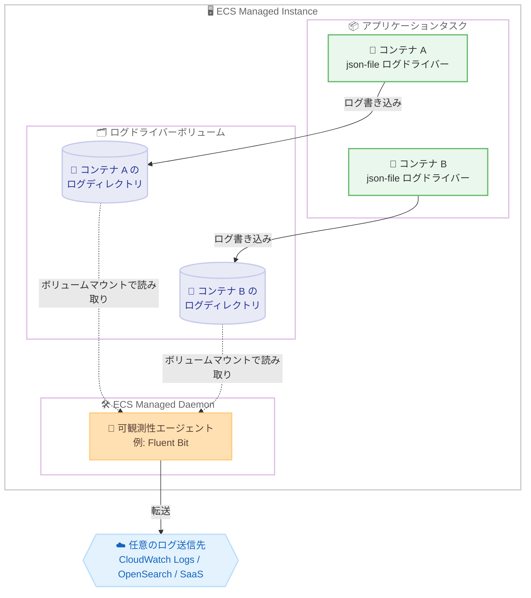

# Amazon ECS - Managed Daemons による json-file ログ収集 (ECS Managed Instances)

**リリース日**: 2026 年 11 月 4 日
**サービス**: Amazon Elastic Container Service (Amazon ECS)
**機能**: ECS Managed Instances での json-file ログドライバーサポートと、Managed Daemons 向けログドライバーボリューム

📊 [このアップデートのインフォグラフィックを見る](https://takech9203.github.io/aws-news-summary/20261104-amazon-ecs-managed-instances-json-file-log-driver.html)

## 概要

Amazon ECS は、ECS Managed Instances 上のアプリケーションコンテナで json-file ログドライバーをサポートし、あわせて ECS Managed Daemons 向けに「ログドライバーボリューム」を導入しました。この 2 つの機能を組み合わせることで、Managed Daemons として実行する任意の可観測性エージェントがアプリケーションコンテナのログファイルを直接読み取り、任意の送信先に転送できるようになります。

アプリケーションコンテナは標準的な Docker の json-file 形式でログをローカルに書き込みます。この形式は Fluent Bit や Fluentd をはじめとする多くの可観測性エージェントがネイティブに読み取れるため、既存のログ収集パイプラインをほぼそのまま ECS Managed Instances に持ち込めます。デーモンはボリュームマウント経由でログファイルにアクセスするため、ホストのバインドマウントパスの指定やルート権限は不要です。

対象ユーザーは、ECS Managed Instances を利用しつつ、CloudWatch Logs 以外のログ基盤 (OpenSearch、Splunk、Datadog などのサードパーティ SaaS) や独自のログ収集エージェントを使いたいプラットフォームチーム・運用チームです。

**アップデート前の課題**

- ECS Managed Instances では json-file ログドライバーが利用できず、ファイルベースのログ収集を前提とするエージェントを使いにくかった
- デーモンがアプリケーションログを読むには、ホストのバインドマウントパスやルート権限といったホスト依存の設定が必要だった
- どのディレクトリにどのコンテナのログがあるかをエージェント側で管理する必要があり、ログの発生元コンテナの特定が煩雑だった

**アップデート後の改善**

- アプリケーションコンテナの `logConfiguration` に json-file を指定するだけで、標準の Docker json-file 形式でログがローカルに書き込まれるようになった
- Managed Daemon のタスク定義でログドライバーボリューム (`logDriverVolumeConfiguration`) を定義し、`mountPoints` でマウントするだけで、ホストパスの指定やルート権限なしにログファイルへアクセスできるようになった
- インスタンスごとに 1 つのデーモンで、json-file ドライバーを使用するすべてのアプリケーションコンテナのログをまとめて収集できるようになった
- コンテナ ID ごとの専用ディレクトリにログが保存されるため、ログを発生元のコンテナまで容易にトレースできるようになった

## アーキテクチャ図



アプリケーションコンテナが json-file 形式で書き込んだログを、Managed Daemon がログドライバーボリューム経由で読み取り、任意の送信先へ転送する流れを示しています。

## サービスアップデートの詳細

### 主要機能

1. **ECS Managed Instances での json-file ログドライバーサポート**
   - アプリケーションタスク定義の `logConfiguration` で `json-file` を指定可能
   - 標準的な Docker json-file 形式でログがインスタンスのローカルに書き込まれる
   - 多くの可観測性エージェントがこの形式をネイティブに読み取れるため、既存エージェントを流用しやすい

2. **Managed Daemons 向けログドライバーボリューム**
   - デーモンタスク定義のボリュームで `logDriverVolumeConfiguration` を指定 (サポートされる `driver` は `json-file` のみ)
   - ホストのバインドマウントパスやルート権限なしで、アプリケーションコンテナのログファイルにアクセス可能
   - 同一ボリュームで `host` と `logDriverVolumeConfiguration` の同時指定は不可

3. **コンテナ単位のログディレクトリ管理**
   - ボリューム内はコンテナ ID を名前とするディレクトリに分かれ、各ディレクトリに `<container-id>-json.log` とローテーション済みログファイルが格納される
   - ログはコンテナが削除されるまで保持され、削除時に該当ディレクトリも削除される
   - ディレクトリ名からログの発生元コンテナを特定できるため、トレーサビリティが向上

4. **1 デーモンでインスタンス全体のログを収集**
   - インスタンスごとに 1 つの Managed Daemon で、json-file ドライバーを使用するすべてのアプリケーションコンテナのログを収集可能
   - 収集したログは CloudWatch Logs、Amazon OpenSearch Service、サードパーティ SaaS など任意の送信先に転送できる

## 技術仕様

### ログドライバーボリュームの仕様

| 項目 | 詳細 |
|------|------|
| 対象環境 | ECS Managed Instances 上の ECS Managed Daemons |
| サポートされるドライバー | `json-file` のみ |
| ログの格納構造 | コンテナ ID ごとのディレクトリに `<container-id>-json.log` とローテーション済みファイル |
| ログの保持期間 | コンテナが削除されるまで (削除時にディレクトリも削除) |
| アクセス方法 | デーモンコンテナの `mountPoints` でボリュームをマウント |
| 必要権限 | ホストバインドマウントパスの指定やルート権限は不要 |
| 対象ログ | `logConfiguration` に `json-file` を指定したコンテナのみ (他のログドライバー使用コンテナは対象外) |
| 設定手段 | AWS マネジメントコンソール、AWS CLI、API、AWS SDK、AWS CloudFormation |

### デーモンタスク定義の設定例

```json
{
    "family": "log-collector-daemon",
    "containerDefinitions": [{
        "name": "log-reader",
        "image": "public.ecr.aws/my-company/log-reader:latest",
        "essential": true,
        "mountPoints": [{
            "sourceVolume": "app-logs",
            "containerPath": "/var/log/tasks"
        }]
    }],
    "volumes": [{
        "name": "app-logs",
        "logDriverVolumeConfiguration": {
            "driver": "json-file"
        }
    }]
}
```

## 設定方法

### 前提条件

1. ECS Managed Instances を使用する ECS クラスターが構成済みであること
2. ECS Managed Daemons が利用可能なリージョンであること
3. ログ収集エージェントのコンテナイメージ (Fluent Bit など) が利用可能であること

### 手順

#### ステップ1: アプリケーションタスク定義で json-file ログドライバーを指定

```json
{
    "containerDefinitions": [{
        "name": "my-app",
        "image": "my-app:latest",
        "logConfiguration": {
            "logDriver": "json-file"
        }
    }]
}
```

アプリケーションコンテナのログドライバーを `json-file` に設定します。これにより、コンテナのログが標準の Docker json-file 形式でインスタンスのローカルに書き込まれます。

#### ステップ2: ログドライバーボリュームを持つデーモンタスク定義を登録

```bash
aws ecs register-daemon-task-definition \
    --cli-input-json file://daemon-taskdef.json
```

`logDriverVolumeConfiguration` を含むボリュームを定義し、デーモンコンテナの `mountPoints` でマウントしたデーモンタスク定義 (前述の設定例を参照) を登録します。

#### ステップ3: Managed Daemon をデプロイしてログ転送を確認

デーモンタスク定義をクラスターの Managed Daemon として設定すると、各 Managed Instance 上でデーモンが起動します。マウントしたパス (例: `/var/log/tasks`) 配下のコンテナ ID ディレクトリからログファイルを読み取り、エージェントの設定に従って任意の送信先へ転送されることを確認します。

## メリット

### ビジネス面

- **既存ログ基盤の継続利用**: 既存の可観測性ツールやサードパーティ SaaS をそのまま利用でき、ECS Managed Instances への移行時にログ収集パイプラインを作り直す必要がない
- **追加コストなし**: 本機能自体に追加料金は発生せず、利用中のリージョンでそのまま利用できる
- **運用負荷の削減**: インスタンスごとに 1 つのデーモンで全コンテナのログを収集でき、エージェント運用がシンプルになる

### 技術面

- **権限の最小化**: ホストバインドマウントやルート権限が不要になり、最小権限の原則に沿ったログ収集構成を実現できる
- **標準形式による高い互換性**: Docker 標準の json-file 形式のため、多くのエージェントが追加開発なしでログを読み取れる
- **トレーサビリティの向上**: コンテナ ID ごとのディレクトリ構造により、ログと発生元コンテナの対応付けが容易

## デメリット・制約事項

### 制限事項

- ログドライバーボリュームでサポートされる `driver` は `json-file` のみ
- ボリュームに書き込まれるのは `json-file` ログドライバーを指定したコンテナのログのみで、awslogs など他のドライバーを使用するコンテナのログは含まれない
- 同一ボリュームで `host` と `logDriverVolumeConfiguration` を同時に指定することはできない
- コンテナが停止して ECS により削除されると該当ディレクトリも削除されるため、削除前にログを読み取る必要がある

### 考慮すべき点

- ログはコンテナ削除まで保持されるため、エージェントの収集間隔や障害時の復旧時間を考慮し、ログの取りこぼしが発生しない設計にする
- json-file 形式のログはインスタンスのローカルストレージを消費するため、ログ量が多いワークロードではローテーションやストレージ容量を考慮する
- CloudWatch Logs への直接送信で十分な場合は、従来どおり awslogs ログドライバーの利用も選択肢となる

## ユースケース

### ユースケース1: Fluent Bit によるサードパーティログ基盤への転送

**シナリオ**: 全社のログ基盤として Datadog や Splunk などの SaaS を利用しており、ECS Managed Instances 上のアプリケーションログも同じ基盤に集約したい。

**実装例**:
```json
{
    "family": "fluent-bit-daemon",
    "containerDefinitions": [{
        "name": "fluent-bit",
        "image": "public.ecr.aws/aws-observability/aws-for-fluent-bit:stable",
        "essential": true,
        "mountPoints": [{
            "sourceVolume": "app-logs",
            "containerPath": "/var/log/tasks",
            "readOnly": true
        }]
    }],
    "volumes": [{
        "name": "app-logs",
        "logDriverVolumeConfiguration": {
            "driver": "json-file"
        }
    }]
}
```

**効果**: ホスト権限なしで全アプリケーションコンテナのログを収集し、既存の SaaS ログ基盤へ統一的に転送できる。

### ユースケース2: EC2 ベース ECS からの移行

**シナリオ**: EC2 起動タイプの ECS クラスターで json-file ログとファイル収集型エージェントを利用しており、インフラ管理を削減するために ECS Managed Instances へ移行したい。

**実装例**:
```json
{
    "containerDefinitions": [{
        "name": "legacy-app",
        "image": "legacy-app:latest",
        "logConfiguration": {
            "logDriver": "json-file"
        }
    }]
}
```

**効果**: 既存のログ収集アーキテクチャ (json-file + ファイル収集エージェント) を変更せずに ECS Managed Instances へ移行でき、移行リスクとコストを低減できる。

### ユースケース3: コンテナ単位のログ分析とトラブルシューティング

**シナリオ**: 同一インスタンス上で多数のタスクが稼働しており、障害発生時に特定コンテナのログだけを迅速に抽出・分析したい。

**実装例**:
```bash
# デーモンコンテナ内でのログ確認例
ls /var/log/tasks/
cat /var/log/tasks/<container-id>/<container-id>-json.log
```

**効果**: コンテナ ID ごとのディレクトリ構造により、対象コンテナのログファイルを直接特定でき、障害調査の時間を短縮できる。

## 料金

本機能に追加料金はありません。ECS Managed Instances の通常の料金 (基盤となる EC2 インスタンスの料金と管理料金) のみが適用されます。収集したログを CloudWatch Logs やその他のサービスに送信する場合は、送信先サービスの料金が別途発生します。

## 利用可能リージョン

Amazon ECS Managed Instances および Managed Daemons が提供されているすべての AWS 商用リージョンで利用可能です。

## 関連サービス・機能

- **Amazon ECS Managed Instances**: AWS がインスタンスのプロビジョニングと運用を管理する ECS のコンピューティングオプション。本機能の前提となる実行環境
- **Amazon ECS Managed Daemons**: 各 Managed Instance 上で自動的に実行されるデーモンタスク。ログ収集・監視・セキュリティエージェントの実行基盤
- **Amazon CloudWatch Logs**: awslogs ログドライバーによる直接送信や、エージェント経由の転送先として利用可能なログ管理サービス
- **AWS for Fluent Bit**: AWS が提供する Fluent Bit ディストリビューション。ファイルベースのログ収集エージェントとして本機能と組み合わせて利用可能

## 参考リンク

- 📊 [インフォグラフィック](https://takech9203.github.io/aws-news-summary/20261104-amazon-ecs-managed-instances-json-file-log-driver.html)
- [公式発表 (What's New)](https://aws.amazon.com/about-aws/whats-new/2026/11/amazon-ecs-managed-instances-json-file-log-driver/)
- [ドキュメント: Managed Daemons のタスク定義とボリューム](https://docs.aws.amazon.com/AmazonECS/latest/developerguide/managed-daemons-task-definitions.html#managed-daemons-volumes)
- [Amazon ECS Managed Instances](https://aws.amazon.com/ecs/managed-instances/)
- [Amazon ECS 製品ページ](https://aws.amazon.com/ecs/)

## まとめ

ECS Managed Instances での json-file ログドライバーサポートと Managed Daemons のログドライバーボリュームにより、ホスト権限なしで任意の可観測性エージェントによるログ収集が可能になりました。CloudWatch Logs 以外のログ基盤を利用している場合や、EC2 ベースの ECS からの移行を検討している場合は、既存のログ収集アーキテクチャを維持したまま ECS Managed Instances を採用できるため、デーモンタスク定義での `logDriverVolumeConfiguration` の活用を検討することを推奨します。
