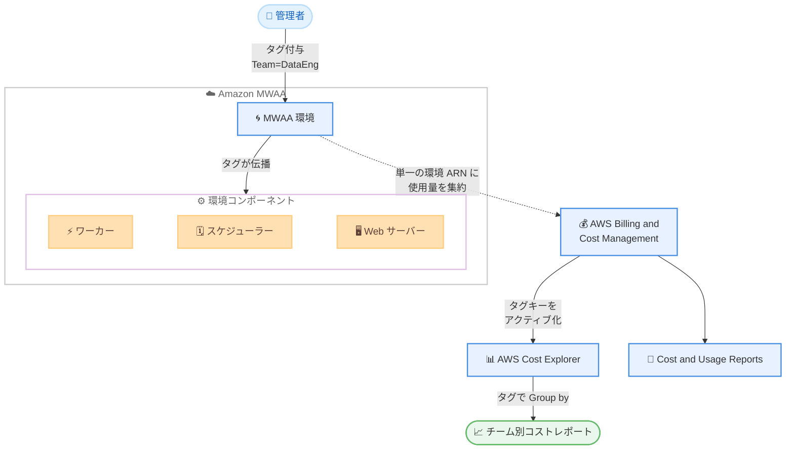

# Amazon MWAA - コスト配分タグのサポート

**リリース日**: 2026 年 11 月 4 日
**サービス**: Amazon Managed Workflows for Apache Airflow (MWAA)
**機能**: コスト配分タグ (Cost Allocation Tags) のサポート

📊 [このアップデートのインフォグラフィックを見る](https://takech9203.github.io/aws-news-summary/20261104-amazon-mwaa-cost-allocation-tags.html)

## 概要

Amazon Managed Workflows for Apache Airflow (MWAA) がコスト配分タグをサポートしました。MWAA 環境に適用したタグが、その環境を実行するコンピューティングリソース (ワーカー、スケジューラー、Web サーバー) にも伝播されるようになり、AWS Cost Explorer や AWS Cost and Usage Reports (CUR) でタグ単位の MWAA コストの内訳を確認できるようになりました。

このアップデートにより、プラットフォームチームは Airflow のコストを、各環境を所有するチーム、プロジェクト、コストセンターに対してショーバックまたはチャージバックできます。タグは新規環境の作成時、または既存環境の更新時に、MWAA コンソール、AWS CLI、MWAA API のいずれからでも適用できます。

複数のチームが MWAA 環境を共有基盤上で運用している組織や、FinOps の観点でワークフロー基盤のコスト可視化を進めたい組織にとって有用なアップデートです。

**アップデート前の課題**

このアップデート以前は、MWAA のコスト帰属に以下の課題がありました。

- 環境に付与したタグがワーカー、スケジューラー、Web サーバーなどのコンポーネントのコストに反映されず、タグによるコスト集計が環境全体をカバーできなかった
- Cost Explorer のリソース別表示では、追加ワーカーや追加 Web サーバーがそれぞれ別のリソースとして表示され、環境単位の合計コストの把握が困難だった
- チームやプロジェクト単位で Airflow のコストを正確に按分するには、手動での集計や推計が必要だった

**アップデート後の改善**

今回のアップデートにより、以下が可能になりました。

- 環境に付与した 1 つのタグで、環境本体とワーカー、スケジューラー、Web サーバーを含むすべてのコンポーネントのコストをカバーできるようになった
- Cost Explorer のリソース別表示で、環境とそのコンポーネントの使用量が単一の環境 ARN に集約されて表示されるようになった
- タグキーで Group by するだけで、チーム、プロジェクト、コストセンター単位のコスト配分 (ショーバック / チャージバック) が実現できるようになった

## アーキテクチャ図



環境に付与したタグがワーカー、スケジューラー、Web サーバーに伝播し、すべての使用量が単一の環境 ARN に集約されて Cost Explorer や CUR でタグ別に集計できる流れを示しています。

## サービスアップデートの詳細

### 主要機能

1. **タグのコンピューティングリソースへの伝播**
   - 環境に適用したタグが、環境を実行するワーカー、スケジューラー、Web サーバーに伝播される
   - 環境上の 1 つのタグで、環境とすべてのコンポーネントのコストをカバー
   - タグは環境の新規作成時または既存環境の更新時に、MWAA コンソール、AWS CLI (`tag-resource`)、`TagResource` API で付与可能

2. **環境 ARN への使用量の集約**
   - オンボード後は、環境、ワーカー、スケジューラー、Web サーバーの使用量が個別リソースではなく単一の環境 ARN に帰属される
   - オンボード前は追加ワーカーや追加 Web サーバーがリソース別表示で個別の行として表示されていたが、オンボード後は環境 ARN の下に 1 行として表示される
   - コストの帰属方法が変わるだけで、コストの総額自体は変わらない

3. **Cost Explorer / CUR でのタグ別コスト分析**
   - AWS Billing and Cost Management コンソールでタグキーをコスト配分タグとしてアクティブ化すると、Cost Explorer や CUR でタグ別にコストを集計可能
   - Cost Explorer の Group by でタグキーを選択すると、環境ごとの料金がタグキーで分類される
   - タグキーのアクティブ化は、組織の管理アカウントで 1 回実施すればよい

## 技術仕様

### コスト帰属モデルの比較

| 項目 | オンボード前 | オンボード後 |
|------|-------------|-------------|
| コストの帰属先 | 環境、追加ワーカー、追加スケジューラー、追加 Web サーバーが個別に計上 | 単一の環境 ARN に集約 |
| タグによるコスト集計 | 環境タグがコンポーネントのコストをカバーしない | 環境上の 1 つのタグで全コンポーネントをカバー |
| Cost Explorer のリソース別表示 | コンポーネントごとに個別の行 | 環境 ARN の下に 1 行 |
| コスト総額 | 変化なし | 変化なし |

### タグ付与の例 (AWS CLI)

```bash
aws mwaa tag-resource \
  --resource-arn arn:aws:airflow:ap-northeast-1:123456789012:environment/MyEnvironment \
  --tags '{"Team": "DataEngineering", "CostCenter": "CC-1234"}'
```

## 設定方法

### 前提条件

1. Amazon MWAA 環境が作成済みであること (既存環境の場合は環境の更新によるオンボードが必要)
2. コスト配分タグのアクティブ化のため、組織の管理アカウントで AWS Billing and Cost Management コンソールにアクセスできること
3. タグ操作のための IAM 権限 (`airflow:TagResource` など) があること

### 手順

#### ステップ 1: 環境にタグを付与する

```bash
aws mwaa tag-resource \
  --resource-arn arn:aws:airflow:ap-northeast-1:123456789012:environment/MyEnvironment \
  --tags '{"CostCenter": "CC-1234"}'
```

対象の MWAA 環境に、レポートに使用したいタグキー (例: `CostCenter` や `Team`) を付与します。MWAA コンソールや `TagResource` API からも同様に設定できます。

#### ステップ 2: 既存環境をオンボードする

```bash
aws mwaa update-environment \
  --name MyEnvironment
```

既存環境を完全にオンボードするには、環境を更新します。更新により環境とすべてのコンポーネントがオンボードされます。なお、新しいコスト追跡モデルの提供開始後に作成された環境は自動的にオンボードされます。

#### ステップ 3: タグキーをコスト配分タグとしてアクティブ化する

管理アカウントで AWS Billing and Cost Management コンソールの [コスト配分タグ] ページを開き、対象のタグキーを選択して [アクティブ化] を選択します。アクティブ化は組織で 1 回実施すればよく、アクティブ化後、コストレポートに反映されるまで最大 24 時間かかります。

#### ステップ 4: Cost Explorer でタグ別にコストを確認する

AWS Cost Explorer で Group by にタグキーを選択すると、各環境の料金がタグキーごとにグループ化されて表示されます。

## メリット

### ビジネス面

- **ショーバック / チャージバックの実現**: Airflow のコストを環境を所有するチーム、プロジェクト、コストセンターに正確に按分できる
- **FinOps の推進**: タグベースのコスト可視化により、組織的なコスト管理ポリシーを MWAA にも一貫して適用できる
- **コスト把握の簡素化**: 手動での集計や推計が不要になり、コストレポート作成の工数を削減できる

### 技術面

- **1 タグで全コンポーネントをカバー**: 環境上のタグがワーカー、スケジューラー、Web サーバーに伝播するため、コンポーネント単位でのタグ管理が不要
- **環境 ARN への集約**: リソース別表示で環境単位の合計コストを 1 行で確認でき、分析が容易になる
- **既存の仕組みとの統合**: Cost Explorer、CUR、コスト配分タグという既存の AWS 標準の仕組みをそのまま利用できる

## デメリット・制約事項

### 制限事項

- 既存環境を完全にオンボードするには、環境の更新が必要 (新モデル提供後に作成した環境は自動オンボード)
- 環境を更新しない場合でも、最近作成または更新された環境のワーカーと Web サーバーは置き換え時に新モデルへ移行されるが、長期間更新されていない環境は自動移行されないため、環境の更新が必要
- コンポーネントがオンボードされるまでは、その使用量は環境ではなくコンポーネント自身のリソースに計上されるため、環境のタグにそのコンポーネントのコストが含まれない

### 考慮すべき点

- タグキーと値は大文字と小文字が区別される
- タグのアクティブ化や非アクティブ化は、それ以降に発生した使用量にのみ適用され、過去の請求期間のコストデータは変更されない
- タグのアクティブ化後、コストレポートに表示されるまで最大 24 時間かかる

## ユースケース

### ユースケース 1: マルチチーム環境でのチャージバック

**シナリオ**: データプラットフォームチームが複数の事業部門向けに MWAA 環境を提供しており、各部門に実際の利用コストを請求したい。

**実装例**:
```bash
# 部門ごとの環境にタグを付与
aws mwaa tag-resource \
  --resource-arn arn:aws:airflow:ap-northeast-1:123456789012:environment/SalesAnalytics \
  --tags '{"BusinessUnit": "Sales"}'

aws mwaa tag-resource \
  --resource-arn arn:aws:airflow:ap-northeast-1:123456789012:environment/MarketingETL \
  --tags '{"BusinessUnit": "Marketing"}'
```

**効果**: Cost Explorer で `BusinessUnit` タグで Group by するだけで、部門別の MWAA コストが自動集計され、チャージバックの根拠データとして利用できる。

### ユースケース 2: プロジェクト別のコスト追跡

**シナリオ**: 複数のデータパイプラインプロジェクトが並行して進行しており、プロジェクトごとのワークフロー実行コストを予算管理に反映したい。

**実装例**:
```bash
aws mwaa tag-resource \
  --resource-arn arn:aws:airflow:ap-northeast-1:123456789012:environment/ProjectAlpha \
  --tags '{"Project": "Alpha", "CostCenter": "CC-1001"}'
```

**効果**: プロジェクト単位でワーカーや Web サーバーのスケーリングによるコスト増も含めた総コストを追跡でき、予算超過の早期検知につながる。

### ユースケース 3: CUR と組み合わせた詳細なコスト分析

**シナリオ**: FinOps チームが CUR を Amazon Athena で分析しており、MWAA のコストも他サービスと同じタグ体系で横断分析したい。

**実装例**:
```sql
-- CUR に対する Athena クエリの例
SELECT
  resource_tags_user_team AS team,
  SUM(line_item_unblended_cost) AS total_cost
FROM cur_table
WHERE line_item_product_code = 'AmazonMWAA'
GROUP BY resource_tags_user_team
ORDER BY total_cost DESC;
```

**効果**: 組織共通のタグ体系で MWAA を含む全サービスのコストを横断的に分析でき、一貫したコストガバナンスを実現できる。

## 料金

コスト配分タグの利用自体に追加料金はかかりません。MWAA の料金体系 (環境の稼働時間、ワーカー / スケジューラー / Web サーバーのインスタンスサイズと数、ストレージなどに基づく従量課金) に変更はありません。今回のアップデートはコストの帰属方法を変更するものであり、コストの総額自体は変わりません。

## 利用可能リージョン

Amazon MWAA が利用可能なすべての AWS リージョンで利用できます (東京リージョン、大阪リージョンを含む)。詳細は [AWS リージョン表](https://docs.aws.amazon.com/mwaa/latest/userguide/get-started.html#regions) を参照してください。

## 関連サービス・機能

- **AWS Cost Explorer**: タグキーで Group by することで、MWAA のコストをチームやプロジェクト単位で可視化できる
- **AWS Cost and Usage Reports (CUR)**: タグ情報を含む詳細な使用量データを取得し、Athena などで分析できる
- **AWS Billing and Cost Management**: ユーザー定義タグのコスト配分タグとしてのアクティブ化を管理する
- **AWS Organizations**: 管理アカウントでタグキーを 1 回アクティブ化すれば、組織全体のコストレポートに適用される

## 参考リンク

- 📊 [インフォグラフィック](https://takech9203.github.io/aws-news-summary/20261104-amazon-mwaa-cost-allocation-tags.html)
- [公式発表 (What's New)](https://aws.amazon.com/about-aws/whats-new/2026/11/amazon-mwaa-cost-allocation-tags/)
- [ドキュメント: Cost allocation tags in Amazon MWAA](https://docs.aws.amazon.com/mwaa/latest/userguide/cost-allocation-tags.html)
- [ドキュメント: Use cost allocation tags](https://docs.aws.amazon.com/awsaccountbilling/latest/aboutv2/cost-alloc-tags.html)
- [ドキュメント: Activating user-defined cost allocation tags](https://docs.aws.amazon.com/awsaccountbilling/latest/aboutv2/activating-tags.html)
- [料金ページ](https://aws.amazon.com/managed-workflows-for-apache-airflow/pricing/)

## まとめ

Amazon MWAA のコスト配分タグ対応により、環境上の 1 つのタグでワーカー、スケジューラー、Web サーバーを含む全コンポーネントのコストをカバーでき、チームやプロジェクト単位のショーバック / チャージバックが容易になりました。複数チームで MWAA を運用している場合は、既存環境を更新してオンボードし、組織共通のタグ体系でタグを付与した上で、管理アカウントでタグキーをアクティブ化することを推奨します。
