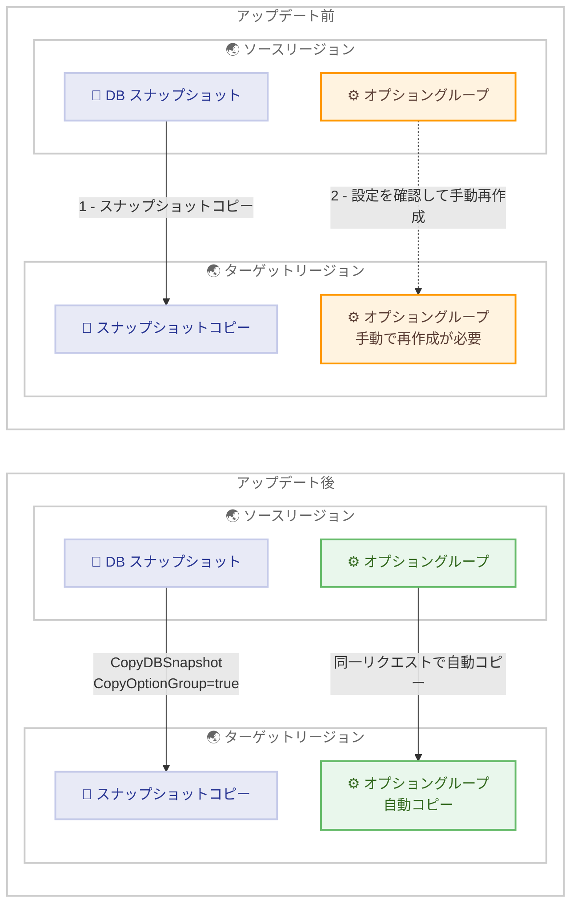

# Amazon RDS for Oracle - クロスリージョンスナップショットコピー時のオプショングループコピー対応

**リリース日**: 2026 年 11 月 4 日
**サービス**: Amazon RDS for Oracle
**機能**: クロスリージョンスナップショットコピーにおけるオプショングループのコピー

📊 [このアップデートのインフォグラフィックを見る](https://takech9203.github.io/aws-news-summary/20261104-amazon-rds-oracle-cross-region-snapshot-copy-option-group.html)

## 概要

Amazon RDS for Oracle において、DB スナップショットを別の AWS リージョンにコピーする際に、スナップショットに関連付けられたオプショングループも同時にコピーできるようになりました。`CopyDBSnapshot` API および CLI コマンドの `CopyOptionGroup` パラメータを `true` に設定することで、1 回のリクエストでスナップショットとオプショングループの両方をターゲットリージョンへコピーできます。

オプショングループはリージョン固有のリソースであるため、従来はクロスリージョンコピーの際にオプショングループを引き継ぐことができず、お客様がターゲットリージョンで手動によりオプショングループを再作成する必要がありました。今回のアップデートにより、クロスリージョンの災害対策 (DR) やリージョン間移行のワークフローが簡素化されます。なお、`CopyOptionGroup` パラメータは従来からクロスアカウントコピーをサポートしており、今回新たにクロスリージョンコピーにも対応しました。

Oracle Transparent Data Encryption (TDE) や Oracle Enterprise Manager などのオプションを利用する RDS for Oracle ユーザー、特にクロスリージョンでのバックアップコピーや DR 構成を運用しているユーザーにとって、運用負荷を軽減できるアップデートです。

**アップデート前の課題**

このアップデート以前は、オプショングループがリージョン固有であることに起因する以下の課題がありました。

- クロスリージョンスナップショットコピーではオプショングループを引き継げず、ターゲットリージョンで手動によりオプショングループを再作成する必要があった
- スナップショットのコピーとオプショングループの再作成という 2 つの作業が必要で、手順が複雑だった
- オプショングループの再作成漏れや設定差異により、復元した DB インスタンスにデフォルトのオプショングループが適用され、元のインスタンスと構成が一致しないリスクがあった

**アップデート後の改善**

今回のアップデートにより、以下が可能になりました。

- `CopyOptionGroup` パラメータを `true` に設定するだけで、1 回のリクエストでスナップショットとオプショングループの両方をターゲットリージョンへコピーできるようになった
- ターゲットリージョンでのオプショングループの手動再作成が不要になった
- クロスアカウントコピーとクロスリージョンコピーの両方で同じパラメータを利用でき、クロスリージョンかつクロスアカウントのコピーにも対応し、運用手順を統一できるようになった

## アーキテクチャ図



アップデート前は、スナップショットのコピーとは別にターゲットリージョンでオプショングループを手動再作成する必要がありましたが、アップデート後は `CopyDBSnapshot` の 1 回のリクエストで両方をコピーできます。

## サービスアップデートの詳細

### 主要機能

1. **クロスリージョンでのオプショングループコピー**
   - `CopyDBSnapshot` API / `copy-db-snapshot` CLI コマンドの `CopyOptionGroup` パラメータが、従来のクロスアカウントコピーに加えてクロスリージョンコピーにも対応
   - `true` に設定すると、ソーススナップショットに関連付けられたオプショングループがターゲットリージョンにコピーされ、スナップショットコピーに関連付けられる
   - クロスリージョンとクロスアカウントを組み合わせたコピーにも対応

2. **コピー済みオプショングループの再利用**
   - オプショングループがすでにコピー先に存在し、コピー後に変更がない場合は再コピーされない
   - ソースのオプショングループがコピー後に変更されている場合は、新しいバージョンがコピー先に作成される
   - デフォルトのオプショングループはコピーされない

3. **コピーされたオプショングループへのタグ付け**
   - `--tag-specifications` オプション (CLI) または `TagSpecifications` パラメータ (API) でリソースタイプ `og` を指定して、コピーされたオプショングループにタグを付与可能
   - `CopyOptionGroup` が有効な場合にのみ指定可能で、デフォルトではタグは付与されない

## 技術仕様

### 機能の対応範囲

| 項目 | 詳細 |
|------|------|
| 対象エンジン | Amazon RDS for Oracle |
| 対象 API | `CopyDBSnapshot` (パラメータ: `CopyOptionGroup`) |
| 対象 CLI | `aws rds copy-db-snapshot` (オプション: `--copy-option-group`) |
| 対応コピー方式 | クロスアカウントコピー (従来から対応)、クロスリージョンコピー (今回追加)、両方の組み合わせ |
| コピー対象オプション | クロスリージョンコピーをサポートするオプションのみがコピーに含まれる |
| デフォルトオプショングループ | コピー対象外 |
| コンソール対応 | [Copy option group from source DB snapshot] チェックボックスで指定可能 |

### CLI での実行例

```bash
aws rds copy-db-snapshot \
    --source-db-snapshot-identifier arn:aws:rds:us-west-2:123456789012:snapshot:oracle-snapshot-20261104 \
    --target-db-snapshot-identifier mydbsnapshotcopy \
    --copy-option-group \
    --tag-specifications 'ResourceType=og,Tags=[{Key=environment,Value=production}]'
```

ターゲットリージョンでこのコマンドを実行すると、スナップショットのクロスリージョンコピーと同時に、ソーススナップショットに関連付けられたオプショングループがターゲットリージョンにコピーされ、タグが付与されます。

## 設定方法

### 前提条件

1. Amazon RDS for Oracle の DB スナップショット (手動スナップショットまたは自動バックアップ) が存在すること
2. コピーを実行する IAM ユーザーまたはロールに `rds:CopyDBSnapshot` 権限があり、ソースリージョンとターゲットリージョンの両方へのアクセスが許可されていること
3. 暗号化されたスナップショットをコピーする場合は、ターゲットリージョンで有効な KMS キーと、必要な KMS 権限 (`kms:CreateGrant`、`kms:Decrypt` など) があること

### 手順

#### ステップ 1: ソーススナップショットの ARN を確認する

```bash
aws rds describe-db-snapshots \
    --db-instance-identifier my-oracle-instance \
    --region us-west-2 \
    --query "DBSnapshots[*].[DBSnapshotIdentifier,DBSnapshotArn,OptionGroupName]" \
    --output table
```

ソースリージョンで DB スナップショットの一覧を取得し、コピー対象のスナップショット ARN と関連付けられているオプショングループ名を確認します。

#### ステップ 2: オプショングループを含めてクロスリージョンコピーを実行する

```bash
aws rds copy-db-snapshot \
    --source-db-snapshot-identifier arn:aws:rds:us-west-2:123456789012:snapshot:oracle-snapshot-20261104 \
    --target-db-snapshot-identifier oracle-snapshot-copy \
    --copy-option-group \
    --region ap-northeast-1
```

ターゲットリージョン (この例では東京リージョン) でコマンドを実行し、`--copy-option-group` を指定してスナップショットとオプショングループを同時にコピーします。クロスリージョンコピーの場合、ソーススナップショットは ARN 形式で指定します。

#### ステップ 3: コピー結果を確認する

```bash
aws rds describe-db-snapshots \
    --db-snapshot-identifier oracle-snapshot-copy \
    --region ap-northeast-1 \
    --query "DBSnapshots[*].[DBSnapshotIdentifier,Status,OptionGroupName]" \
    --output table
```

ターゲットリージョンでスナップショットコピーのステータスが `available` になり、コピーされたオプショングループが関連付けられていることを確認します。復元時には、このオプショングループが適用された DB インスタンスを作成できます。

## メリット

### ビジネス面

- **DR 対応の迅速化**: クロスリージョンのバックアップコピーが 1 ステップで完結するため、災害対策の準備や復旧手順が簡素化され、目標復旧時間 (RTO) の短縮に寄与する
- **運用コストの削減**: オプショングループの手動再作成作業が不要になり、運用担当者の作業時間を削減できる
- **構成ミスのリスク低減**: 手動再作成に伴う設定漏れや差異を防止し、復元後のインスタンスがソースと同じオプション構成を持つことを保証しやすくなる

### 技術面

- **API の一貫性**: クロスアカウントコピーで利用していた `CopyOptionGroup` パラメータと同じインターフェースでクロスリージョンコピーを実行でき、自動化スクリプトの変更が最小限で済む
- **冪等性のある動作**: コピー先に変更のない同一オプショングループがすでに存在する場合は再コピーされないため、繰り返しのコピー処理でも重複リソースが発生しない
- **タグによるガバナンス**: `TagSpecifications` でコピーされたオプショングループにタグを付与でき、コスト配分やリソース管理のポリシーを維持できる

## デメリット・制約事項

### 制限事項

- クロスリージョンコピーをサポートするオプションのみがコピーに含まれる (クロスリージョンコピーに対応しないオプションは除外される)
- デフォルトのオプショングループはコピーされない
- 中国 (北京、寧夏) リージョンとの間ではスナップショットのコピー自体ができない。AWS GovCloud (US) リージョンと商用リージョン間のコピーも不可
- ソース DB インスタンスが Oracle または SQL Server の TDE を使用している場合など、`CopyOptionGroup` を使用しないケースでは従来どおり `OptionGroupName` でターゲットリージョンのオプショングループを明示的に指定する必要がある

### 考慮すべき点

- クロスリージョンスナップショットコピーにはリージョン間のデータ転送料金が発生する
- コピーされたスナップショットは手動スナップショットとして保持され、ストレージ料金の課金対象になる
- `CopyOptionGroup` を指定した場合、コンソールでは [Target DB option group] を同時に指定できない (いずれか一方を選択)
- クロスリージョンコピーはリージョンやデータ量によって完了まで数時間かかる場合があり、同時実行数にも制限がある (1 アカウントあたり同一ターゲットリージョンへ最大 20 件)

## ユースケース

### ユースケース 1: クロスリージョン DR の構築

**シナリオ**: 東京リージョンで稼働する RDS for Oracle インスタンス (Oracle Enterprise Manager などのオプションを使用) のスナップショットを、DR 用に大阪リージョンへ定期的にコピーする。

**実装例**:
```bash
aws rds copy-db-snapshot \
    --source-db-snapshot-identifier arn:aws:rds:ap-northeast-1:123456789012:snapshot:prod-oracle-daily \
    --target-db-snapshot-identifier prod-oracle-daily-dr \
    --copy-option-group \
    --copy-tags \
    --region ap-northeast-3
```

**効果**: オプショングループの手動再作成なしで DR リージョンにスナップショットと構成情報が揃い、有事の際にすぐに同一構成で復元できる。

### ユースケース 2: リージョン間のデータベース移行

**シナリオ**: 米国リージョンで運用してきた RDS for Oracle インスタンスを、データレジデンシー要件に対応するため東京リージョンへ移行する。

**実装例**:
```bash
aws rds copy-db-snapshot \
    --source-db-snapshot-identifier arn:aws:rds:us-east-1:123456789012:snapshot:migration-snapshot \
    --target-db-snapshot-identifier migration-snapshot-tokyo \
    --copy-option-group \
    --region ap-northeast-1

aws rds restore-db-instance-from-db-snapshot \
    --db-instance-identifier oracle-tokyo \
    --db-snapshot-identifier migration-snapshot-tokyo \
    --region ap-northeast-1
```

**効果**: 移行先リージョンでオプショングループを事前準備する手順が不要になり、移行手順がシンプルになる。復元したインスタンスはソースと同じオプション構成を維持できる。

### ユースケース 3: クロスリージョンかつクロスアカウントのバックアップ集約

**シナリオ**: 本番アカウントの RDS for Oracle スナップショットを、別リージョンにあるバックアップ専用アカウントへ集約し、ランサムウェア対策として分離保管する。

**実装例**:
```bash
# 本番アカウントでスナップショットをバックアップアカウントに共有した後、
# バックアップアカウント側のターゲットリージョンで実行
aws rds copy-db-snapshot \
    --source-db-snapshot-identifier arn:aws:rds:us-west-2:111122223333:snapshot:prod-oracle-snapshot \
    --target-db-snapshot-identifier backup-oracle-snapshot \
    --copy-option-group \
    --tag-specifications 'ResourceType=og,Tags=[{Key=backup-source,Value=prod-account}]' \
    --region us-east-1
```

**効果**: クロスアカウントとクロスリージョンのコピーを 1 回のリクエストで実行でき、オプショングループも含めた完全なバックアップを別アカウント・別リージョンに分離保管できる。

## 料金

この機能自体に追加料金はありません。ただし、以下の既存の料金が適用されます。

- **データ転送料金**: ソースリージョンからターゲットリージョンへのスナップショットコピーには、リージョン間データ転送料金が発生します
- **スナップショットストレージ料金**: コピーされたスナップショットは手動スナップショットとして保持され、バックアップストレージ料金の課金対象になります

詳細は [Amazon RDS の料金ページ](https://aws.amazon.com/rds/pricing/)を参照してください。

## 利用可能リージョン

すべての商用 AWS リージョンおよび AWS GovCloud (US) リージョンで利用可能です。

## 関連サービス・機能

- **Amazon RDS オプショングループ**: Oracle の TDE や Enterprise Manager など、DB エンジンの追加機能を管理する仕組み。リージョン固有のリソースであり、今回のアップデートでクロスリージョンコピーに対応した
- **AWS KMS**: 暗号化されたスナップショットをクロスリージョンコピーする場合、ターゲットリージョンで有効な KMS キーの指定が必要
- **AWS Backup**: RDS スナップショットのクロスリージョン・クロスアカウントコピーを含むバックアップの一元管理が可能。要件に応じて使い分けを検討

## 参考リンク

- 📊 [インフォグラフィック](https://takech9203.github.io/aws-news-summary/20261104-amazon-rds-oracle-cross-region-snapshot-copy-option-group.html)
- [公式発表 (What's New)](https://aws.amazon.com/about-aws/whats-new/2026/11/amazon-rds-oracle-cross-region-snapshot-copy-option-group/)
- [ドキュメント: Copying a DB snapshot for Amazon RDS](https://docs.aws.amazon.com/AmazonRDS/latest/UserGuide/USER_CopySnapshot.html)
- [API リファレンス: CopyDBSnapshot](https://docs.aws.amazon.com/AmazonRDS/latest/APIReference/API_CopyDBSnapshot.html)
- [料金ページ](https://aws.amazon.com/rds/pricing/)

## まとめ

Amazon RDS for Oracle のクロスリージョンスナップショットコピーで、オプショングループを 1 回のリクエストで同時にコピーできるようになりました。クロスリージョン DR やリージョン間移行を運用しているユーザーは、オプショングループの手動再作成手順を廃止し、`--copy-option-group` オプションを利用したワークフローへの移行を検討することを推奨します。
