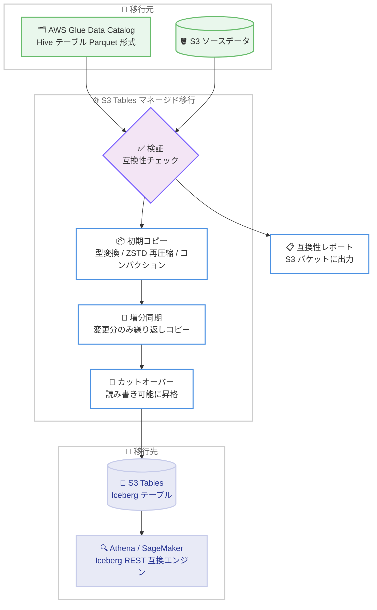

# Amazon S3 Tables - Apache Hive テーブルから Apache Iceberg へのマネージド移行

**リリース日**: 2026 年 11 月 4 日
**サービス**: Amazon S3 Tables
**機能**: Apache Hive テーブルの Apache Iceberg テーブルへのマネージド移行

📊 [このアップデートのインフォグラフィックを見る](https://takech9203.github.io/aws-news-summary/20261104-amazon-s3-tables-managed-migration-hive-to-iceberg.html)

## 概要

Amazon S3 Tables が、Apache Hive テーブルを Apache Iceberg テーブルへ変換するマネージド移行機能を発表しました。AWS Glue Data Catalog に登録された Parquet 形式の Hive テーブルを対象に、データの検証、互換性チェック、型変換、ファイルの再圧縮、コンパクションまでを S3 Tables が一括して実行します。これにより、データレイクのモダナイゼーションをシンプルかつコスト効率よく進めることができます。

Iceberg は ACID トランザクション、スキーマ進化、タイムトラベルといった機能をデータレイクにもたらしますが、既存の Hive テーブルからの移行にはテーブルごとに独自の移行パイプラインを構築する必要があり、数週間を要することが一般的でした。今回のマネージド移行機能により、本番ワークロードを稼働させたまま、コンソールまたは API の操作だけで安全に移行を完了できます。

対象ユーザーは、Hive ベースのデータレイクを運用しており、Iceberg への移行を検討しているデータエンジニアリングチームやアナリティクス基盤の管理者です。

**アップデート前の課題**

このアップデート以前には、以下の課題がありました。

- Hive から Iceberg への移行には、テーブルごとにカスタムの移行パイプラインを構築する必要があり、数週間かかることがあった
- 移行中も本番ワークロードを止めないための増分同期やロールバックの仕組みを自前で設計・実装する必要があった
- 移行後のファイル最適化 (圧縮形式の変更やコンパクション) も別途作業が必要だった

**アップデート後の改善**

今回のアップデートにより、以下が可能になりました。

- S3 Tables が検証、変換、データコピーをマネージドで実行し、テーブルごとのパイプライン構築が不要になった
- 本番ワークロードを中断せずに移行でき、各ステップの検査、ソース側の変更の繰り返し同期、元のソースデータへの復帰が可能になった
- ソーステーブルが Snappy 圧縮の場合は Zstandard (ZSTD) への再圧縮とファイルのコンパクションが自動的に行われ、ストレージコストの削減、オブジェクト数の削減、クエリの高速化が実現された
- 移行後の Iceberg テーブルはデータの増加に合わせて自動的に最適化され続ける

## アーキテクチャ図



Glue に登録された Hive テーブルを S3 Tables のマネージド移行が検証・コピー・同期し、カットオーバー後に Iceberg テーブルとして読み書き可能になる流れを示しています。

## サービスアップデートの詳細

### 主要機能

1. **マネージドな検証と互換性チェック**
   - データをコピーする前に、対象となるすべてのソースオブジェクトを特定し、互換性レポートを生成
   - レポートは指定した S3 バケットに `tableCompatibilityReport`、`objectCompatibilityReport`、`objectMigrationReport` のプレフィックスで出力される
   - `unmatchedSourceFieldsPolicy` や `incompatibleValuesPolicy` などの移行ポリシーで、非互換データ検出時の動作 (例: `fail`) を制御可能

2. **無停止の移行と増分同期**
   - 移行中、移行先の Iceberg テーブルは読み取り専用となり、ソース側への書き込みは継続可能
   - `sync-table-migration` により変更分のみを何度でも同期でき、ソースとの差分を最小化してからカットオーバーできる
   - ソースへの書き込み停止が必要なのはカットオーバー時の数分間のみ

3. **ストレージとクエリ性能の自動最適化**
   - ソースが Snappy 圧縮の場合、Zstandard (ZSTD) へ再圧縮し、ファイルをコンパクション
   - ストレージコストの削減、オブジェクト数の削減、クエリの高速化を実現
   - 移行後も S3 Tables の自動メンテナンス (コンパクション、スナップショット管理) により継続的に最適化

4. **AI エージェントによる移行の自動化**
   - Agent Toolkit for AWS (GitHub: aws/agent-toolkit-for-aws) に移行用スキル `migrating-hive-tables-to-s3-tables` が提供される
   - Kiro などの AI エージェントが IAM ポリシーの分析・推奨、移行計画の検証、API 呼び出しの実行、カットオーバーまでの進捗監視を自律的に実施可能

## 技術仕様

### 移行機能の仕様

| 項目 | 詳細 |
|------|------|
| 移行元 | AWS Glue Data Catalog に登録された Parquet 形式の Hive テーブル |
| 移行先 | S3 Tables の Apache Iceberg テーブル (Iceberg v2 / Parquet / ZSTD) |
| スコープ | 同一 AWS アカウント・同一リージョン内 (ローンチ時点) |
| 移行フロー | Start → Sync → Complete の 3 ステップ |
| 移行中の移行先テーブル | 読み取り専用 (カットオーバーで読み書き可能に昇格) |
| 書き込み停止時間 | カットオーバー時の数分間のみ |
| レポート出力 | 互換性レポート・移行レポートを S3 バケットに出力 |
| 操作方法 | AWS マネジメントコンソール、S3 Tables 移行 API (AWS CLI / SDK) |

### API 操作の例

```bash
# 移行の開始 (移行先テーブル定義、ソース指定、ポリシー、レポート出力先を JSON で指定)
aws s3tables start-table-migration \
  --cli-input-json file://migration-config.json

# ソース側の変更分を移行先に同期 (何度でも実行可能)
aws s3tables sync-table-migration \
  --table-bucket-arn arn:aws:s3tables:ap-northeast-1:123456789012:bucket/my-table-bucket \
  --namespace analytics \
  --name sales_data
```

`start-table-migration` の入力 JSON には、IAM ロール ARN、移行先テーブル (テーブルバケット ARN、名前空間、テーブル名、KMS 暗号化、ストレージクラス、スキーマ、ソート順)、Glue ソーステーブル、メンテナンス設定 (コンパクション対象ファイルサイズ、スナップショット保持)、移行ポリシー、レポート出力先を指定します。

## 設定方法

### 前提条件

1. 移行元の Hive テーブルが AWS Glue Data Catalog に登録されており、データ形式が Parquet であること
2. 移行先の S3 テーブルバケットが移行元と同一アカウント・同一リージョンに存在すること (ローンチ時点の制約)
3. 移行ジョブがソースデータの読み取りと移行先テーブルへの書き込みを行うための IAM ロールが用意されていること

### 手順

#### ステップ 1: 移行先テーブルの作成と移行の開始

コンソールの場合、S3 コンソールで移行先のテーブルバケットを選択し、[Create table from migration] を選択します。名前空間とテーブル名を定義すると、移行先テーブルにはパフォーマンスとストレージ効率に最適化されたデフォルト設定が適用されます。CLI の場合は `start-table-migration` を実行します。

```bash
aws s3tables start-table-migration --cli-input-json file://migration-config.json
```

このコマンドは、指定した Glue ソーステーブルの検証と互換性チェックを行い、問題がなければ移行先 Iceberg テーブルへの初期コピーを開始します。

#### ステップ 2: 互換性レポートの確認と増分同期

```bash
aws s3tables sync-table-migration \
  --table-bucket-arn <テーブルバケット ARN> \
  --namespace <名前空間> \
  --name <テーブル名>
```

S3 バケットに出力された互換性レポートと移行レポートを確認し、ソース側で発生した変更を増分同期します。各同期は変更分のみをコピーするため、必要な回数だけ繰り返して差分を最小化できます。

#### ステップ 3: カットオーバーの実行

ソースへの書き込みを数分間停止し、移行を完了 (Complete) します。移行先の Iceberg テーブルが読み書き可能に昇格し、Amazon Athena、Amazon SageMaker Unified Studio、または Iceberg REST API 互換のクエリエンジンから利用できるようになります。

## メリット

### ビジネス面

- **移行期間の大幅短縮**: テーブルごとに数週間かかっていたパイプライン構築が不要になり、データレイクモダナイゼーションの計画を加速できる
- **コスト効率**: Hive から Iceberg への変換自体は無料で、コピーされたデータ分のみ課金。ZSTD 再圧縮とコンパクションによりストレージコストも削減できる
- **事業継続性**: 本番ワークロードを稼働させたまま移行でき、書き込み停止はカットオーバー時の数分間のみ

### 技術面

- **リスク低減の仕組み**: 事前の互換性レポート、各ステップの検査、繰り返しの増分同期、元のソースデータへの復帰が可能で、安全に移行を進められる
- **移行後の自動最適化**: 移行先テーブルは S3 Tables の自動メンテナンスにより、データ増加に合わせて継続的に最適化される
- **AI エージェント対応**: Agent Toolkit for AWS の移行スキルにより、移行ワークフロー全体を AI エージェントに委任できる

## デメリット・制約事項

### 制限事項

- 移行元は AWS Glue に登録された Parquet 形式の Hive テーブルに限定される (他のファイル形式は対象外)
- ローンチ時点では同一 AWS アカウント・同一リージョン内の移行のみサポート
- 利用可能リージョンは米国、アジアパシフィック、欧州の一部リージョンに限定される (東京リージョンは対応)

### 考慮すべき点

- 移行中は移行先テーブルが読み取り専用となるため、カットオーバーのタイミングを業務影響の少ない時間帯に計画する必要がある
- 移行ポリシー (`unmatchedSourceFieldsPolicy`、`incompatibleValuesPolicy`) の設定により、非互換データ検出時の挙動が変わるため、事前に互換性レポートを確認することが重要
- コピーされるデータ量に応じた課金が発生するため、大規模テーブルの移行時はコストを事前に見積もること

## ユースケース

### ユースケース 1: Hive ベースのデータレイクの段階的モダナイゼーション

**シナリオ**: 数百の Hive テーブルを持つデータレイクを運用しており、ACID トランザクションやスキーマ進化のために Iceberg への移行を計画している。

**実装例**:
```
1. 互換性レポートで全テーブルの移行可否を事前評価
2. 優先度の高いテーブルから start-table-migration で順次移行
3. sync-table-migration で差分を同期しながら段階的にカットオーバー
```

**効果**: テーブルごとのパイプライン開発が不要になり、移行プロジェクト全体の期間とコストを大幅に削減できる。

### ユースケース 2: 本番稼働中の分析基盤の無停止移行

**シナリオ**: 日次バッチと BI ダッシュボードが稼働する本番テーブルを、サービスを止めずに Iceberg へ移行したい。

**実装例**:
```
1. 本番書き込みを継続したまま初期コピーを実行
2. カットオーバー直前まで増分同期を繰り返して差分を最小化
3. 業務影響の少ない時間帯に数分間の書き込み停止でカットオーバー
4. Athena などのクエリ先を新しい Iceberg テーブルに切り替え
```

**効果**: 書き込み停止をカットオーバー時の数分間に抑え、分析業務への影響を最小化できる。

### ユースケース 3: AI エージェントによる移行ワークフローの自動化

**シナリオ**: 多数のテーブル移行を少人数のチームで効率的に進めるため、移行作業を AI エージェントに委任したい。

**実装例**:
```
1. Agent Toolkit for AWS の migrating-hive-tables-to-s3-tables スキルを導入
2. Kiro などのエージェントに IAM ポリシーの分析・推奨と移行計画の検証を依頼
3. エージェントが Start → Sync → Complete の API を実行し、進捗を監視
```

**効果**: 移行の計画から実行、監視までを自動化し、運用負荷を軽減しながら移行を大規模に展開できる。

## 料金

Hive から Iceberg への変換自体に追加料金はかかりません。移行ジョブがコピーしたデータに対してのみ課金されます。また、S3 Intelligent-Tiering に保存されているソースオブジェクトは、現在のアクセス階層を維持します。

移行後は S3 Tables の通常の料金 (ストレージ、リクエスト、メンテナンスなど) が適用されます。詳細は Amazon S3 の料金ページを参照してください。

## 利用可能リージョン

以下のリージョンで利用可能です。

- 米国東部 (バージニア北部、オハイオ)
- 米国西部 (オレゴン)
- アジアパシフィック (ムンバイ、シンガポール、シドニー、東京)
- 欧州 (フランクフルト、アイルランド、ストックホルム)

## 関連サービス・機能

- **AWS Glue Data Catalog**: 移行元の Hive テーブルを管理するカタログ。移行対象テーブルは Glue に登録されている必要がある
- **Amazon Athena / Amazon SageMaker Unified Studio**: 移行後の Iceberg テーブルに対するクエリエンジンとして利用可能
- **Agent Toolkit for AWS**: 移行ワークフローを AI エージェントで自動化するためのスキルを提供
- **S3 Intelligent-Tiering**: ソースオブジェクトのアクセス階層が移行後も維持されるストレージクラス

## 参考リンク

- 📊 [インフォグラフィック](https://takech9203.github.io/aws-news-summary/20261104-amazon-s3-tables-managed-migration-hive-to-iceberg.html)
- [公式発表 (What's New)](https://aws.amazon.com/about-aws/whats-new/2026/11/amazon-s3-tables-managed-migration-hive-to-iceberg/)
- [AWS Blog: Amazon S3 Tables now offer managed migration of Apache Hive tables to Apache Iceberg](https://aws.amazon.com/blogs/aws/amazon-s3-tables-now-offer-managed-migration-of-apache-hive-tables-to-apache-iceberg/)
- [Amazon S3 Tables](https://aws.amazon.com/s3/features/tables/)
- [ドキュメント: S3 Tables の移行](https://docs.aws.amazon.com/AmazonS3/latest/userguide/s3-tables-migrate.html)
- [Agent Toolkit for AWS (GitHub)](https://github.com/aws/agent-toolkit-for-aws)
- [料金ページ](https://aws.amazon.com/s3/pricing/)

## まとめ

Amazon S3 Tables のマネージド移行機能により、従来テーブルごとに数週間を要した Hive から Iceberg への移行が、検証・コピー・同期・カットオーバーまで一貫したマネージドワークフローで実行できるようになりました。東京リージョンでも利用可能なため、Hive ベースのデータレイクを運用しているチームは、まず互換性レポートで移行可否を評価し、優先度の高いテーブルから段階的な移行を検討することを推奨します。
