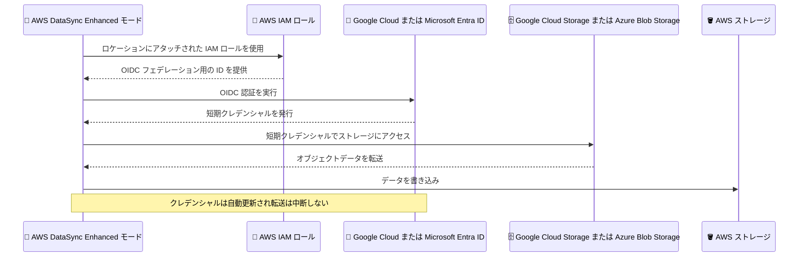

# AWS DataSync - Enhanced モードが Google Cloud と Microsoft Azure 向けに OpenID Connect (OIDC) をサポート

**リリース日**: 2026 年 11 月 4 日
**サービス**: AWS DataSync
**機能**: Enhanced モードにおける Google Cloud Storage および Microsoft Azure Blob Storage への OIDC 認証サポート

📊 [このアップデートのインフォグラフィックを見る](https://takech9203.github.io/aws-news-summary/20261104-datasync-enhanced-oidc-google-azure.html)
<!-- INFOGRAPHIC_BASE_URL は環境変数から取得 -->

## 概要

AWS DataSync の Enhanced モードが、Google Cloud Storage および Microsoft Azure Blob Storage ロケーションへの接続時に OpenID Connect (OIDC) 認証をサポートしました。DataSync は AWS Identity and Access Management (IAM) ロールを使用して Google Cloud または Microsoft Entra ID から短期クレデンシャルを取得し、転送中はクレデンシャルが自動的に更新されるため、転送が中断することなく継続されます。

これまで、DataSync で Google Cloud Storage や Azure Blob Storage と連携するには、HMAC (hash-based message authentication code) キーや SAS (shared access signature) トークンといった長期クレデンシャルを用意して DataSync に渡す必要がありました。今回のアップデートにより、こうした長期クレデンシャルへの依存を排除し、長期クレデンシャルの利用を禁止するセキュリティポリシーを持つ組織でも、ポリシーに準拠したままクロスクラウドのデータ移動が可能になります。

利用を開始するには、AWS CLI、API、または AWS CloudFormation を使用して、DataSync ロケーションに IAM ロールをアタッチします。マルチクラウド環境でのデータ統合やクラウド間移行を行うお客様にとって、セキュリティと運用性の両面で大きな改善となるアップデートです。

**アップデート前の課題**

このアップデート以前は、他社クラウドストレージへの接続に長期クレデンシャルの管理が必要でした。

- 以前は、Google Cloud Storage への接続に HMAC キー、Azure Blob Storage への接続に SAS トークンといった長期クレデンシャルを発行して DataSync に設定する必要があった
- 以前は、SAS トークンが転送中に有効期限切れになると DataSync がストレージにアクセスできなくなり、新しいトークンでロケーションを更新してタスクを再実行する必要があった
- 以前は、長期クレデンシャルの利用を禁止するセキュリティポリシーを持つ組織では、ポリシーに準拠したクロスクラウド転送の実現が困難だった

**アップデート後の改善**

今回のアップデートにより、IAM ロールベースの OIDC 認証でクロスクラウド転送が可能になりました。

- 今回のアップデートにより、IAM ロールを使用して Google Cloud または Microsoft Entra ID から短期クレデンシャルを取得できるようになり、HMAC キーや SAS トークンの発行・管理が不要になった
- 今回のアップデートにより、クレデンシャルが自動的に更新されるため、転送中の有効期限切れによる中断を心配する必要がなくなった
- 今回のアップデートにより、長期クレデンシャルを禁止するセキュリティポリシーに準拠しながらクロスクラウドのデータ移動が実現できるようになった

## アーキテクチャ図



DataSync Enhanced モードが IAM ロールを起点に OIDC 認証で短期クレデンシャルを取得し、他社クラウドストレージへアクセスする流れを示しています。長期クレデンシャルは一切登場しません。

## サービスアップデートの詳細

### 主要機能

1. **OIDC 認証によるクロスクラウド接続**
   - Google Cloud Storage および Microsoft Azure Blob Storage ロケーションへの接続時に OIDC 認証を選択可能
   - DataSync が IAM ロールを使用して Google Cloud または Microsoft Entra ID から短期クレデンシャルを取得
   - HMAC キーや SAS トークンといった長期クレデンシャルの発行・保管・ローテーションが不要

2. **クレデンシャルの自動更新**
   - 転送中に短期クレデンシャルが自動的に更新される
   - 大規模データセットの長時間転送でも、クレデンシャルの有効期限切れによる転送中断が発生しない

3. **IAM ロールによるシンプルなセットアップ**
   - AWS CLI、API、AWS CloudFormation を使用して DataSync ロケーションに IAM ロールをアタッチするだけで利用開始可能
   - アクセス制御を AWS 側の IAM と外部クラウド側の ID 基盤のフェデレーション設定で一元的に管理

## 技術仕様

### 対象ロケーションと認証方式の比較

| 項目 | 従来の認証 | 今回追加された認証 |
|------|------------|--------------------|
| Google Cloud Storage | HMAC キー (長期クレデンシャル) | OIDC (IAM ロール経由の短期クレデンシャル) |
| Microsoft Azure Blob Storage | SAS トークン (長期クレデンシャル) | OIDC (IAM ロール経由の短期クレデンシャル) |
| クレデンシャルの更新 | 手動 (期限切れ時はロケーション更新とタスク再実行が必要) | 自動更新 (転送は中断しない) |
| 対象タスクモード | Basic / Enhanced | Enhanced モード |

### Enhanced モードの特徴

| 項目 | 詳細 |
|------|------|
| 性能 | リスト、準備、転送、検証を並列実行し、Basic モードより高速 |
| 対象オブジェクト数 | 実質無制限 (Basic モードはクォータあり) |
| エージェント | Azure Blob と Amazon S3 間の Enhanced モード転送はエージェント不要 |
| ログ | JSON 形式の構造化ログ |

## 設定方法

### 前提条件

1. DataSync Enhanced モードを利用できる AWS リージョンであること
2. Google Cloud または Microsoft Entra ID 側で、AWS からの OIDC フェデレーションを受け入れる設定が完了していること
3. DataSync ロケーションにアタッチする IAM ロールが作成済みであること

### 手順

#### ステップ1: IAM ロールの準備

DataSync が短期クレデンシャルの取得に使用する IAM ロールを作成します。Google Cloud または Microsoft Entra ID 側では、この IAM ロールを信頼するフェデレーション設定 (Google Cloud の Workload Identity 連携、Microsoft Entra ID のワークロード ID フェデレーションなど) を構成します。詳細な設定要件は AWS DataSync User Guide を参照してください。

#### ステップ2: DataSync ロケーションへの IAM ロールのアタッチ

```bash
# AWS CLI、API、または AWS CloudFormation を使用して
# DataSync ロケーションに IAM ロールをアタッチする
# 例: Azure Blob Storage ロケーションの更新
aws datasync update-location-azure-blob \
  --location-arn "arn:aws:datasync:us-east-1:123456789012:location/loc-xxxxxxxxxxxxxxxxx" \
  --cli-input-json file://oidc-config.json
```

AWS CLI、API、または AWS CloudFormation を使用して、対象の DataSync ロケーションに IAM ロールをアタッチします。具体的なパラメータは AWS DataSync User Guide の最新の手順を確認してください。

#### ステップ3: Enhanced モードタスクの作成と実行

```bash
# Enhanced モードでタスクを作成
aws datasync create-task \
  --source-location-arn "arn:aws:datasync:us-east-1:123456789012:location/loc-source" \
  --destination-location-arn "arn:aws:datasync:us-east-1:123456789012:location/loc-dest" \
  --task-mode "ENHANCED"
```

OIDC 認証を設定したロケーションをソースまたはデスティネーションとして指定し、タスクモードに `ENHANCED` を指定してタスクを作成・実行します。

## メリット

### ビジネス面

- **セキュリティポリシーへの準拠**: 長期クレデンシャルの利用を禁止するセキュリティポリシーを持つ組織でも、ポリシーに準拠したままクロスクラウドのデータ移動が可能になる
- **運用負荷の削減**: HMAC キーや SAS トークンの発行、保管、ローテーション、失効管理といったクレデンシャルライフサイクル管理の作業が不要になる
- **マルチクラウド戦略の推進**: 他社クラウドから AWS へのデータ移行や、マルチクラウド環境でのデータ統合をより安全に実現できる

### 技術面

- **短期クレデンシャルによるリスク低減**: クレデンシャルが短期間で失効するため、漏えい時の影響範囲を最小化できる
- **自動更新による転送の安定性**: 転送中にクレデンシャルが自動更新されるため、大規模データセットの長時間転送でも有効期限切れによる失敗が発生しない
- **IAM による一元的なアクセス管理**: AWS 側のアクセス制御を IAM ロールに集約でき、監査やガバナンスが容易になる

## デメリット・制約事項

### 制限事項

- OIDC 認証は Enhanced モードでのみサポートされる (Basic モードのタスクでは従来どおり長期クレデンシャルが必要)
- 対象は Google Cloud Storage と Microsoft Azure Blob Storage のロケーションに限られる
- 設定は AWS CLI、API、AWS CloudFormation で行う (発表時点でコンソールからの設定は案内されていない)

### 考慮すべき点

- Google Cloud または Microsoft Entra ID 側で、AWS からの OIDC フェデレーションを受け入れる設定が別途必要になる
- 既存の HMAC キーや SAS トークンを使用したロケーションから移行する場合は、ロケーション設定の更新とタスクの動作確認を計画的に実施する必要がある
- タスクモードは作成後に変更できないため、既存の Basic モードタスクで OIDC を利用するには Enhanced モードでタスクを作り直す必要がある

## ユースケース

### ユースケース1: Azure Blob Storage から Amazon S3 への大規模移行

**シナリオ**: 長期クレデンシャルの発行が社内セキュリティポリシーで禁止されている企業が、Azure Blob Storage 上の大量のオブジェクトを Amazon S3 へ移行したい。

**実装例**:
```
1. Microsoft Entra ID 側で AWS の IAM ロールを信頼するワークロード ID フェデレーションを構成
2. DataSync の Azure Blob Storage ロケーションに IAM ロールをアタッチ (OIDC 認証)
3. Enhanced モードタスクで S3 へ転送 (エージェント不要・実質無制限のオブジェクト数)
```

**効果**: SAS トークンを一切発行せずにポリシー準拠の移行を実現。クレデンシャルの自動更新により、長時間の大規模転送も中断なく完了できる。

### ユースケース2: Google Cloud Storage のデータを AWS の分析基盤へ定期転送

**シナリオ**: Google Cloud 上のアプリケーションが生成するデータを、Amazon S3 ベースのデータレイクへ定期的に取り込み、Amazon Athena や Amazon Redshift で分析したい。

**実装例**:
```
1. Google Cloud の Workload Identity 連携で AWS の IAM ロールを信頼するよう構成
2. DataSync の Google Cloud Storage ロケーションに IAM ロールをアタッチ (OIDC 認証)
3. Enhanced モードタスクをスケジュール実行して S3 へ継続的に転送
```

**効果**: HMAC キーのローテーション運用が不要になり、定期転送パイプラインの運用負荷とセキュリティリスクを同時に低減できる。

### ユースケース3: クレデンシャル期限切れによる転送失敗の解消

**シナリオ**: 従来 SAS トークンで Azure Blob Storage から転送していたが、トークンの有効期限切れにより長時間タスクが失敗することがあり、再設定と再実行の運用負荷が課題だった。

**実装例**:
```
1. 既存の Azure Blob Storage ロケーションの認証を SAS トークンから OIDC へ変更
2. IAM ロールをロケーションにアタッチし、Enhanced モードタスクで転送
```

**効果**: クレデンシャルが自動更新されるため、有効期限切れによるタスク失敗と手動復旧作業が不要になる。

## 料金

OIDC 認証の利用自体に関する追加料金は発表されていません。DataSync の料金は転送したデータ量に基づく従量課金で、Enhanced モードと Basic モードで料金体系が異なります。また、Google Cloud や Azure 側のデータ転送 (エグレス) 料金やリクエスト料金が別途発生する点に注意が必要です。詳細は [AWS DataSync 料金ページ](https://aws.amazon.com/datasync/pricing/) を参照してください。

## 利用可能リージョン

DataSync Enhanced モードが利用可能なすべての AWS リージョンで利用できます。

## 関連サービス・機能

- **Amazon S3**: クロスクラウド転送の主要な転送先。Azure Blob と S3 間の Enhanced モード転送はエージェント不要で実行できる
- **AWS IAM**: OIDC 認証の起点となる IAM ロールを管理し、短期クレデンシャル取得のアクセス制御を担う
- **AWS CloudFormation**: DataSync ロケーションへの IAM ロールのアタッチを含む構成を IaC として管理できる
- **AWS Secrets Manager**: 従来の SAS トークンなどのクレデンシャルを安全に保管する選択肢 (OIDC 利用時はクレデンシャル保管自体が不要になる)

## 参考リンク

- 📊 [インフォグラフィック](https://takech9203.github.io/aws-news-summary/20261104-datasync-enhanced-oidc-google-azure.html)
- [公式発表 (What's New)](https://aws.amazon.com/about-aws/whats-new/2026/11/datasync-enhanced-oidc-google-azure/)
- [AWS DataSync User Guide](https://docs.aws.amazon.com/datasync/latest/userguide/what-is-datasync.html)
- [Azure Blob Storage との転送設定 (ドキュメント)](https://docs.aws.amazon.com/datasync/latest/userguide/creating-azure-blob-location.html)
- [タスクモードの選択 (ドキュメント)](https://docs.aws.amazon.com/datasync/latest/userguide/choosing-task-mode.html)
- [料金ページ](https://aws.amazon.com/datasync/pricing/)

## まとめ

AWS DataSync Enhanced モードの OIDC サポートにより、HMAC キーや SAS トークンといった長期クレデンシャルを使わずに、Google Cloud Storage や Azure Blob Storage とのクロスクラウド転送を実現できるようになりました。長期クレデンシャルを禁止するセキュリティポリシーを持つ組織や、クレデンシャルの期限切れによる転送失敗に悩まされていたお客様は、IAM ロールをロケーションにアタッチして OIDC 認証への移行を検討することをおすすめします。
