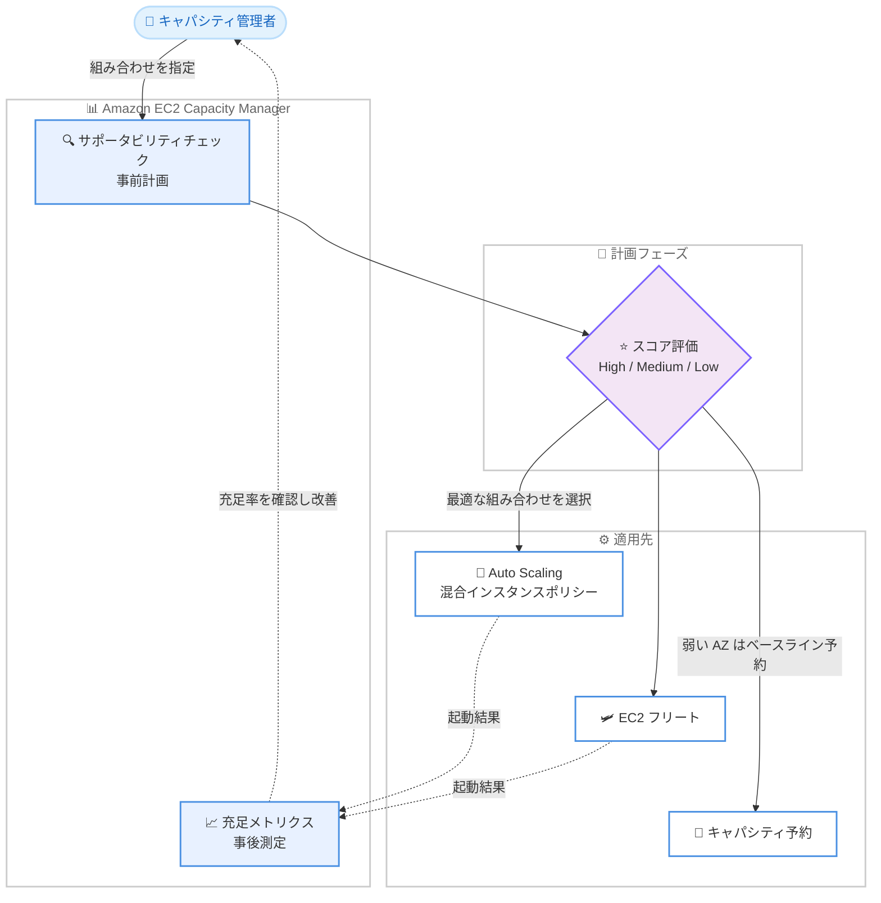

# Amazon EC2 Capacity Manager - サポータビリティチェックとキャパシティ充足メトリクス

**リリース日**: 2026 年 11 月 4 日
**サービス**: Amazon Elastic Compute Cloud (Amazon EC2)
**機能**: EC2 Capacity Manager のサポータビリティチェックとキャパシティ充足メトリクス

📊 [このアップデートのインフォグラフィックを見る](https://takech9203.github.io/aws-news-summary/20261104-ec2-capacity-manager-supportability-and-fulfillment.html)

## 概要

Amazon EC2 Capacity Manager に、リアルタイムのサポータビリティチェック (Supportability Checks) とキャパシティ充足メトリクス (Capacity Fulfillment Metrics) という 2 つの新機能が追加されました。サポータビリティチェックは、インスタンスを起動したり予約したりすることなく、各インスタンスタイプとアベイラビリティーゾーン (AZ) の組み合わせがキャパシティリクエストをどの程度サポートできるかを High / Medium / Low の 3 段階と総合スコアで評価する機能です。キャパシティ充足メトリクスは、リクエストしたキャパシティに対して実際に提供されたキャパシティの割合を、AWS Organizations 全体、アカウント、リージョン、タグ付けされたワークロード単位で計測する機能です。

この 2 つの機能は、スケールアップの両面をカバーします。サポータビリティチェックで「どこで実行すべきか」を事前に計画し、充足メトリクスで「実際にどれだけ提供されたか」を測定するという流れです。大規模なスケールアップやキャパシティ計画を行う前に、どの AZ とインスタンスタイプの組み合わせが必要なキャパシティを提供できる可能性が高いかを把握し、実行後にはその選択の有効性をデータで検証できます。

対象ユーザーは、ミッションクリティカルなワークロードを大規模に運用し、キャパシティ計画やインスタンスタイプの柔軟性 (ダイバーシフィケーション) 戦略を管理するエンタープライズのインフラ担当者や SRE チームです。両機能は AWS Unified Operations (グローバルエンタープライズ向けの AWS サポートプラン) に含まれる形で提供されます。

**アップデート前の課題**

- 大規模スケールアップの前に、特定のインスタンスタイプと AZ の組み合わせがキャパシティを提供できるかを事前に評価する手段がなく、実際に起動を試みるかキャパシティ予約を作成して確認する必要があった
- リクエストしたキャパシティのうち実際にどれだけが充足されたかを、組織・アカウント・リージョン・ワークロード横断で定量的に把握することが困難だった
- インスタンスタイプの多様化 (ダイバーシフィケーション) がキャパシティ獲得にどの程度貢献しているかをデータで検証できなかった

**アップデート後の改善**

- インスタンスを起動・予約せずに、インスタンスタイプ × AZ の組み合わせごとのキャパシティ提供可能性を High / Medium / Low のスコアで事前評価できるようになった
- リクエスト vCPU 数、充足 vCPU 数、充足率、リクエストあたりの平均組み合わせ数といったメトリクスを、組織・アカウント・リージョン・タグ単位で追跡できるようになった
- インスタンスタイプと AZ ごとの内訳 (ブレークダウン) により、どの組み合わせが効果的だったかを分析し、Auto Scaling の混合インスタンスポリシーや EC2 フリート、Karpenter の設定改善につなげられるようになった

## アーキテクチャ図



サポータビリティチェックで事前に組み合わせを評価し、その結果を Auto Scaling や EC2 フリートの設定に反映した後、充足メトリクスで実際の結果を測定して改善サイクルを回す流れを示しています。

## サービスアップデートの詳細

### 主要機能

1. **サポータビリティチェック (Supportability Checks)**
   - インスタンスを起動・予約することなく、各インスタンスタイプと AZ の組み合わせがキャパシティリクエストをどの程度サポートできるかを評価
   - マーケットタイプ (オンデマンド / スポット)、必要キャパシティ量、対象 AZ、インスタンスタイプ (または vCPU / メモリ範囲などの属性ベース要件) を指定して実行
   - 各組み合わせに High (十分なキャパシティあり)、Medium (余裕は少ないが収まる)、Low (不足) のレーティングと総合スコアを返却
   - コンソールの Supportability タブ、または `get-capacity-manager-supportability-scores` API で実行

2. **キャパシティ充足メトリクス (Capacity Fulfillment Metrics)**
   - リクエストレベルの 4 つのメトリクスを提供: リクエスト vCPU 数、充足 vCPU 数、リクエスト充足率 (vCPU 加重)、リクエストあたりの平均「インスタンスタイプ × AZ」組み合わせ数
   - 組み合わせ数が 1 を超える値は、ダイバーシフィケーション (柔軟性) が機能していることを示す
   - AWS Organizations 全体、アカウント、リージョン、タグ付けされたワークロード単位でフィルタリング可能
   - コンソールの Fulfillment タブ、または `get-capacity-manager-metric-data` API で取得 (スポットメトリクスには Spot プレフィックスが付与される)

3. **組み合わせごとのブレークダウン分析**
   - View breakdown オプションで、`InstAzFulfillmentRate` メトリクスによる組み合わせ単位の充足率を表示
   - AZ ディメンションに加えて、インスタンスタイプまたはインスタンスファミリーの指定が必要
   - 組み合わせ単位の充足率はリクエスト全体の充足率より低くなる傾向がある (代替の組み合わせがギャップを埋めるため)。例: リクエスト充足率 88.2% に対し、28 組み合わせの平均は 46.6%

## 技術仕様

### サポータビリティチェックの仕様

| 項目 | 詳細 |
|------|------|
| 評価レーティング | High / Medium / Low + 総合スコア |
| 指定パラメータ | マーケットタイプ、キャパシティ量、AZ、インスタンスタイプまたは属性ベース要件 |
| AZ 数の上限 | 1 回のチェックで最大 10 AZ (複数リージョンにまたがる指定も可能) |
| 組み合わせ数の上限 | 1 回のチェックで最大 100 組み合わせ |
| スコアの性質 | ガイダンスであり、キャパシティの保証ではない (保証にはキャパシティ予約を使用) |
| 実行タイミングの推奨 | 起動ごとではなく計画時に実行 (クロスリージョン依存とクォータ枯渇を回避) |

### 充足メトリクスの仕様

| メトリクス | 説明 |
|------------|------|
| リクエスト vCPU 数 | キャパシティリクエストで要求された vCPU の総数 |
| 充足 vCPU 数 | 実際に提供された vCPU の総数 |
| リクエスト充足率 | vCPU 加重のリクエスト充足割合 |
| 平均組み合わせ数 | リクエストあたりのインスタンスタイプ × AZ 組み合わせ数 (1 超で柔軟性あり) |
| InstAzFulfillmentRate | 組み合わせ単位の充足率 (AZ ディメンション + インスタンスタイプ / ファミリーが必要) |

### API 変更履歴

| 日付 | サービス | 変更内容 |
|------|----------|----------|
| 2026/10/28 | [ec2](https://awsapichanges.com/archive/changes/bdcc3b-ec2.html) | 1 new 4 updated api methods - `GetCapacityManagerSupportabilityScores` の追加と `GetCapacityManagerMetricData` などの更新 |

## 設定方法

### 前提条件

1. AWS Unified Operations サポートプランに加入していること
2. EC2 Capacity Manager を有効化していること (組織レベルまたは単一アカウント)
3. タグ単位で分析する場合は、モニタリング対象のタグキーを有効化していること (`aws:eks:cluster-name` など一部のタグは有効化不要)

### 手順

#### ステップ 1: Capacity Manager の有効化とタグの設定

```bash
# Capacity Manager のコンソールから有効化 (組織レベルまたはアカウント単位)
# 必要に応じてモニタリング対象のタグキーを有効化する
```

Capacity Manager を有効化すると、組織またはアカウントのキャパシティデータの収集が開始されます。タグキーを有効化すると、ワークロード単位での充足メトリクスのフィルタリングが可能になります。

#### ステップ 2: 充足メトリクスの確認

```bash
# 充足メトリクスを取得
aws ec2 get-capacity-manager-metric-data \
  --region us-east-1 \
  # リージョン、アカウント、タグでフィルタリングし、
  # 充足率や組み合わせ数のメトリクスを指定して取得
```

このコマンドは、リクエスト vCPU 数、充足 vCPU 数、充足率などのメトリクスを取得します。コンソールでは Fulfillment タブから同じ情報を確認でき、View breakdown でインスタンスタイプ × AZ ごとの内訳を表示できます。

#### ステップ 3: サポータビリティチェックの実行

```bash
# サポータビリティスコアを取得
aws ec2 get-capacity-manager-supportability-scores \
  --region us-east-1 \
  # マーケットタイプ、必要キャパシティ量、対象 AZ、
  # インスタンスタイプ (または属性ベース要件) を指定
```

このコマンドは、指定したインスタンスタイプと AZ の各組み合わせについて High / Medium / Low のレーティングと総合スコアを返します。スコアの高い組み合わせを Auto Scaling の混合インスタンスポリシーや EC2 フリートの設定に反映します。

## メリット

### ビジネス面

- **スケールアップの成功率向上**: 大規模イベントやピーク需要の前に、キャパシティを獲得できる可能性が高い構成を事前に特定でき、機会損失のリスクを低減できる
- **キャパシティ戦略の定量評価**: 充足率という客観的な指標により、キャパシティ戦略の有効性を経営層やステークホルダーに説明しやすくなる
- **過剰予約の抑制**: 事前評価により、不要なキャパシティ予約 (使用有無にかかわらず課金される) を減らし、弱い AZ のみベースライン予約を行うといった最適化が可能になる

### 技術面

- **起動不要の事前評価**: インスタンスを実際に起動したり予約したりせずにキャパシティ提供可能性を評価でき、検証コストとクォータ消費を回避できる
- **組織横断の可視性**: AWS Organizations 全体、アカウント、リージョン、タグ単位で充足状況を一元的に把握できる
- **ダイバーシフィケーションの効果測定**: 平均組み合わせ数メトリクスにより、インスタンスタイプの多様化が実際に機能しているかをデータで確認し、Auto Scaling や Karpenter の設定改善につなげられる

## デメリット・制約事項

### 制限事項

- 両機能の利用には AWS Unified Operations サポートプランへの加入が必要
- サポータビリティチェックは 1 回あたり最大 10 AZ、最大 100 組み合わせまで
- サポータビリティスコアはあくまでガイダンスであり、キャパシティの保証ではない (確実なキャパシティ確保にはオンデマンドキャパシティ予約が必要)
- 組み合わせ単位のブレークダウン (`InstAzFulfillmentRate`) には AZ ディメンションとインスタンスタイプまたはファミリーの指定が必要

### 考慮すべき点

- サポータビリティチェックは起動のたびに実行するのではなく、計画時に実行することが推奨される (クロスリージョン依存の回避とクォータ枯渇の防止のため)
- 組み合わせ単位の充足率はリクエスト全体の充足率より低く見えるのが正常であり、数値の解釈に注意が必要
- 弱い AZ に対してキャパシティ予約を作成する場合、予約は使用の有無にかかわらず課金されるため、サイズを慎重に設計する必要がある

## ユースケース

### ユースケース 1: 大規模イベント前のキャパシティ計画

**シナリオ**: EC サイトがセールイベントに向けて数千 vCPU 規模のスケールアップを計画しており、どのインスタンスタイプと AZ の組み合わせを Auto Scaling グループに設定すべきか判断したい。

**実装例**:
```
1. 候補となるインスタンスタイプ群 (例: m7i, m7a, m6i) と対象 AZ を指定して
   サポータビリティチェックを実行
2. High レーティングの組み合わせを混合インスタンスポリシーに設定
3. Low レーティングの AZ にはオンデマンドキャパシティ予約で
   ベースライン分のみ確保
```

**効果**: 起動失敗のリスクを事前に低減し、イベント当日のスケールアップ成功率を高められる。不要なキャパシティ予約も抑制できる。

### ユースケース 2: スポットワークロードの充足率モニタリング

**シナリオ**: バッチ処理基盤をスポットインスタンスで運用しており、リクエストしたキャパシティがどの程度充足されているかを継続的に監視したい。

**実装例**:
```
1. Capacity Manager の Fulfillment タブで Spot プレフィックス付き
   メトリクスを確認
2. タグキーを有効化し、ワークロード単位で充足率をフィルタリング
3. View breakdown で組み合わせごとの充足率を分析し、
   充足率の低い組み合わせを特定
```

**効果**: 充足率の低下を早期に検知し、インスタンスタイプの追加やダイバーシフィケーション強化などの対策を打てる。

### ユースケース 3: Kubernetes クラスターのノード戦略改善

**シナリオ**: Amazon EKS で Karpenter を使用してノードをプロビジョニングしており、ノードプールのインスタンスタイプ選定を改善したい。

**実装例**:
```
1. aws:eks:cluster-name タグ (有効化不要) でクラスター単位の
   充足メトリクスを確認
2. 平均組み合わせ数メトリクスで柔軟性の度合いを評価
3. サポータビリティチェックの結果をもとに Karpenter の
   NodePool の requirements を調整
```

**効果**: データに基づいてノードプールの柔軟性を高め、ポッドのスケジューリング遅延やキャパシティ不足を減らせる。

## 料金

両機能は AWS Unified Operations (ミッションクリティカルなワークロードを運用するグローバルエンタープライズ向けの AWS サポートプラン) に含まれており、追加料金の記載はありません。利用には同プランへの加入が必要です。

## 利用可能リージョン

すべての AWS 商用リージョンで利用可能です。

## 関連サービス・機能

- **Amazon EC2 Auto Scaling**: サポータビリティチェックの結果を混合インスタンスポリシーに反映し、柔軟なスケーリング構成を実現できる
- **EC2 フリート / スポットフリート**: 充足メトリクスでフリートのキャパシティ獲得状況を測定し、インスタンスタイプの構成を最適化できる
- **オンデマンドキャパシティ予約 (ODCR)**: サポータビリティスコアが低い AZ に対して、確実なキャパシティ確保の手段として併用できる
- **Karpenter / Amazon EKS**: クラスターのノードプロビジョニング戦略の評価と改善に充足メトリクスを活用できる
- **AWS Unified Operations**: 両機能の提供基盤となるエンタープライズ向けサポートプラン

## 参考リンク

- 📊 [インフォグラフィック](https://takech9203.github.io/aws-news-summary/20261104-ec2-capacity-manager-supportability-and-fulfillment.html)
- [公式発表 (What's New)](https://aws.amazon.com/about-aws/whats-new/2026/11/ec2-capacity-manager-supportability-and-fulfillment/)
- [AWS Blog: Plan and measure EC2 flexibility with Amazon EC2 Capacity Manager](https://aws.amazon.com/blogs/compute/plan-and-measure-ec2-flexibility-with-amazon-ec2-capacity-manager/)
- [Amazon EC2 Capacity Manager ユーザーガイド](https://docs.aws.amazon.com/AWSEC2/latest/UserGuide/capacity-manager.html)
- [AWS Unified Operations](https://aws.amazon.com/premiumsupport/unified-operations/)

## まとめ

EC2 Capacity Manager のサポータビリティチェックと充足メトリクスにより、キャパシティ計画の「事前評価」と「事後測定」の両方をデータドリブンに行えるようになりました。AWS Unified Operations を利用する大規模環境では、スケールアップ前のサポータビリティチェックを変更管理プロセスに組み込み、充足メトリクスで継続的に柔軟性の改善を検証することを推奨します。
