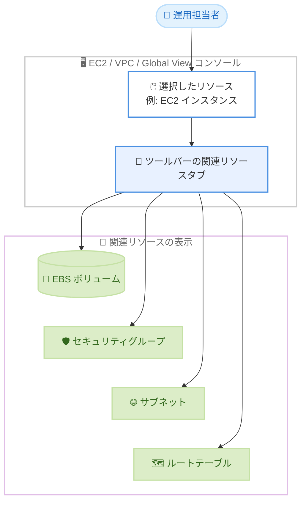

# Amazon EC2 / Amazon VPC - 全リソースタイプでの関連リソース表示

**リリース日**: 2026 年 11 月 4 日
**サービス**: Amazon Elastic Compute Cloud (Amazon EC2)、Amazon Virtual Private Cloud (Amazon VPC)、AWS Global View
**機能**: EC2 / VPC / Global View コンソールにおける全リソースタイプでの関連リソース表示

📊 [このアップデートのインフォグラフィックを見る](https://takech9203.github.io/aws-news-summary/20261104-ec2-vpc-related-resources-all-types.html)

## 概要

Amazon EC2、Amazon VPC、AWS Global View の各コンソールで、すべてのリソースタイプについて関連リソースを表示できるようになりました。これまで関連リソースの表示はセキュリティグループのみに限定されていましたが、今回のアップデートにより、EC2 インスタンス、EBS ボリューム、起動テンプレート、Auto Scaling グループ、サブネット、ルートテーブル、セキュリティグループ、ネットワーク ACL など、幅広いリソースタイプで関連リソースを確認できます。あわせて、関連リソースタブがコンソールのツールバーに移動し、より簡単にアクセスできるようになりました。

たとえば、インスタンスのトラブルシューティング時に、そのインスタンスにアタッチされた EBS ボリューム、セキュリティグループ、サブネット、ルートテーブルを、コンソールページを切り替えることなく 1 か所で確認できます。ネットワーク管理者は、サブネットに紐づくルートテーブル、ネットワーク ACL、インスタンスの関係をたどることができ、設定レビューやセキュリティ監査が容易になります。

対象ユーザーは、EC2 / VPC リソースの運用・トラブルシューティングを行うインフラ担当者、ネットワーク構成のレビューや監査を行うネットワーク管理者・セキュリティ担当者です。コンソールの機能強化のため、追加の設定や料金なしですぐに利用できます。

**アップデート前の課題**

- 関連リソースの表示はセキュリティグループのみに限定されており、他のリソースタイプでは依存関係をコンソール上で直接確認できなかった
- インスタンスに関連する EBS ボリューム、サブネット、ルートテーブルなどを確認するには、複数のコンソールページを行き来する必要があった
- サブネットとルートテーブル、ネットワーク ACL、インスタンスの関係を把握するのに手間がかかり、設定レビューや監査に時間を要した

**アップデート後の改善**

- EC2 / VPC / Global View コンソールのすべてのリソースタイプで関連リソースを表示できるようになった
- インスタンスを選択するだけで、紐づく EBS ボリューム、セキュリティグループ、サブネット、ルートテーブルなどをページ遷移なしで確認できるようになった
- 関連リソースタブがコンソールツールバーに移動し、どのリソースビューからも素早くアクセスできるようになった
- インフラの依存関係を把握しやすくなり、トラブルシューティングや構成レビューを効率化できるようになった

## アーキテクチャ図



コンソールでリソースを選択すると、ツールバーの関連リソースタブから、そのリソースに紐づく EBS ボリューム、セキュリティグループ、サブネット、ルートテーブルなどをページ遷移なしで確認できる流れを示しています。

## サービスアップデートの詳細

### 主要機能

1. **全リソースタイプへの関連リソース表示の拡大**
   - これまでセキュリティグループのみだった関連リソース表示が、すべてのリソースタイプに拡大
   - EC2 インスタンス、EBS ボリューム、起動テンプレート、Auto Scaling グループ、サブネット、ルートテーブル、セキュリティグループ、ネットワーク ACL などが対象
   - リソース間の依存関係をコンソール上で直接確認可能

2. **関連リソースタブのツールバーへの移動**
   - 関連リソースタブがコンソールのツールバーに配置され、アクセスが容易に
   - リソースを選択した状態からワンクリックで関連リソースを表示可能

3. **EC2 / VPC / Global View の 3 つのコンソールでの提供**
   - Amazon EC2 コンソール、Amazon VPC コンソールの両方で利用可能
   - AWS Global View でも利用でき、複数リージョンにまたがるリソースの確認と組み合わせられる

## 技術仕様

### 対象コンソールとリソースタイプ

| 項目 | 詳細 |
|------|------|
| 対象コンソール | Amazon EC2 コンソール、Amazon VPC コンソール、AWS Global View |
| 対象リソースタイプ | すべてのリソースタイプ (インスタンス、EBS ボリューム、起動テンプレート、Auto Scaling グループ、サブネット、ルートテーブル、セキュリティグループ、ネットワーク ACL など) |
| 表示場所 | コンソールツールバーの関連リソースタブ |
| 追加設定 | 不要 (コンソール標準機能) |
| 追加料金 | なし |

### 必要な権限

関連リソースを表示するには、対象リソースに対する読み取り系の権限 (例: `ec2:DescribeInstances`、`ec2:DescribeVolumes`、`ec2:DescribeSubnets`、`ec2:DescribeRouteTables`、`ec2:DescribeSecurityGroups` など) が必要です。表示したいリソースタイプに応じた Describe 系のアクションを IAM ポリシーで許可してください。

## 設定方法

### 前提条件

1. AWS アカウントを保有していること
2. 対象リソースに対する読み取り権限 (Describe 系アクション) を持つ IAM ユーザーまたはロールでコンソールにサインインできること
3. 確認したい EC2 / VPC リソースが存在すること

### 手順

#### ステップ1: コンソールで対象リソースを開く

AWS マネジメントコンソールから Amazon EC2 コンソールまたは Amazon VPC コンソールを開き、確認したいリソース (例: インスタンス、サブネット) の一覧ページで対象リソースを選択します。

#### ステップ2: ツールバーの関連リソースタブを開く

コンソールツールバーに表示される関連リソースタブを選択します。選択中のリソースに関連するリソースが一覧表示されます。

#### ステップ3: 関連リソースをたどって依存関係を確認する

表示された関連リソース (例: インスタンスに紐づく EBS ボリューム、セキュリティグループ、サブネット、ルートテーブル) を確認します。複数リージョンにまたがる確認が必要な場合は、AWS Global View から同様に関連リソースを表示できます。

## メリット

### ビジネス面

- **トラブルシューティング時間の短縮**: 依存関係を 1 か所で確認できるため、障害調査にかかる時間を削減できる
- **監査・レビューの効率化**: サブネットとルートテーブル、ネットワーク ACL などの関係を素早くたどれるため、設定レビューやセキュリティ監査の工数を削減できる
- **追加コストなし**: コンソールの標準機能として提供され、追加料金や設定作業は不要

### 技術面

- **依存関係の可視化**: インスタンス、ボリューム、ネットワークリソース間の依存関係をコンソール上で直接把握できる
- **ページ遷移の削減**: 複数のコンソールページを行き来する必要がなくなり、操作ミスや確認漏れを防ぎやすい
- **Global View との組み合わせ**: 複数リージョンのリソースを横断的に確認しながら、関連リソースもあわせて把握できる

## デメリット・制約事項

### 制限事項

- コンソール (マネジメントコンソール / Global View) 上の機能であり、AWS CLI や API で同等の関連リソース一覧を直接取得する機能ではない
- 関連リソースの表示には、対象リソースタイプに対する読み取り権限が必要
- AWS Global View は閲覧専用であり、リソースの変更はできない

### 考慮すべき点

- 最小権限の IAM ポリシーを運用している場合、関連リソースの表示に必要な Describe 系権限が不足していると一部のリソースが表示されない可能性がある
- 依存関係の網羅的な分析や自動化が必要な場合は、AWS Config などのサービスとの併用を検討する

## ユースケース

### ユースケース1: インスタンス障害のトラブルシューティング

**シナリオ**: アプリケーションが稼働する EC2 インスタンスで接続障害が発生し、原因がネットワーク設定かストレージかを切り分けたい。

**実装例**:
```
1. EC2 コンソールで対象インスタンスを選択
2. ツールバーの関連リソースタブを開く
3. 紐づくセキュリティグループ、サブネット、ルートテーブル、EBS ボリュームを確認
4. セキュリティグループのルールやルートテーブルの経路を順に確認して原因を特定
```

**効果**: コンソールページを切り替えずに依存リソースを一覧でき、障害の切り分け時間を短縮できる。

### ユースケース2: ネットワーク構成のレビューとセキュリティ監査

**シナリオ**: ネットワーク管理者が、特定のサブネットに紐づくルートテーブル、ネットワーク ACL、インスタンスを棚卸しして、意図しない経路や過剰な公開がないかを監査したい。

**実装例**:
```
1. VPC コンソールで対象サブネットを選択
2. 関連リソースタブで、関連するルートテーブル、ネットワーク ACL、インスタンスを確認
3. 各関連リソースをたどり、経路設定と ACL ルールをレビュー
```

**効果**: サブネットを起点に関連リソースを体系的にたどれるため、構成レビューと監査の網羅性と効率が向上する。

### ユースケース3: マルチリージョン環境の依存関係確認

**シナリオ**: 複数リージョンにリソースを展開しており、リージョンごとのリソースとその依存関係を横断的に確認したい。

**実装例**:
```
1. AWS Global View を開き、対象リージョンまたはリソースタイプで検索
2. 確認したいリソースを選択し、関連リソースを表示
3. 必要に応じてリソース ID から各サービスのコンソールへ遷移して詳細を確認
```

**効果**: リージョンをまたいだリソースの把握と依存関係の確認を 1 つのコンソールで完結でき、マルチリージョン運用の負荷を軽減できる。

## 料金

本機能に追加料金はありません。Amazon EC2 / Amazon VPC / AWS Global View コンソールの標準機能として提供されます。

## 利用可能リージョン

すべての AWS 商用リージョンで利用可能です。

## 関連サービス・機能

- **AWS Global View**: 複数リージョンのリソースを単一コンソールで表示・検索できる機能。本アップデートにより関連リソース表示にも対応
- **Amazon EC2 コンソール**: インスタンス、EBS ボリューム、起動テンプレート、Auto Scaling グループなどの管理画面。関連リソースタブで依存関係を確認可能
- **Amazon VPC コンソール**: サブネット、ルートテーブル、セキュリティグループ、ネットワーク ACL などの管理画面。ネットワーク構成のレビューに活用可能
- **AWS Config**: リソース構成と関係性の記録・評価サービス。依存関係の継続的な追跡や自動評価が必要な場合に併用を検討

## 参考リンク

- 📊 [インフォグラフィック](https://takech9203.github.io/aws-news-summary/20261104-ec2-vpc-related-resources-all-types.html)
- [公式発表 (What's New)](https://aws.amazon.com/about-aws/whats-new/2026/11/ec2-vpc-related-resources-all-types/)
- [ドキュメント: AWS Global View](https://docs.aws.amazon.com/AWSEC2/latest/UserGuide/global-view.html)
- [Amazon EC2 製品ページ](https://aws.amazon.com/ec2/)
- [Amazon VPC 製品ページ](https://aws.amazon.com/vpc/)

## まとめ

EC2 / VPC / Global View コンソールの関連リソース表示がすべてのリソースタイプに拡大され、インフラの依存関係の把握とトラブルシューティングが大幅に効率化されます。追加設定や料金なしで利用できるため、インスタンスの障害調査やネットワーク構成のレビューを行う際は、ツールバーの関連リソースタブを活用することを推奨します。
