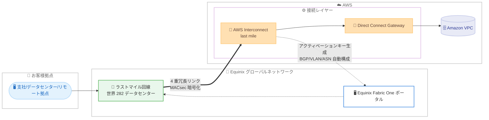

# AWS Interconnect - last mile - Equinix をパートナーとしたプレビューを開始

**リリース日**: 2026 年 11 月 4 日
**サービス**: AWS Interconnect - last mile
**機能**: フルマネージドなラストマイル接続 (Equinix パートナー、プレビュー)

📊 [このアップデートのインフォグラフィックを見る](https://takech9203.github.io/aws-news-summary/20261104-interconnect-last-mile-preview-equinix.html)
<!-- INFOGRAPHIC_BASE_URL は環境変数から取得 -->

## 概要

AWS は、支社、データセンター、リモート拠点を AWS へ簡単に接続できるフルマネージドな接続サービス「AWS Interconnect - last mile」について、Equinix をパートナーとしたプレビュー提供を発表しました。Equinix は世界 282 のデータセンターからなるグローバルネットワークを持つデータセンター事業者であり、お客様は数クリックで自社インフラストラクチャから AWS へのプライベート接続を確立できます。

利用者は、AWS Management Console から希望する AWS リージョン、帯域速度、Direct Connect Gateway、Equinix Fabric One プロジェクト ID を選択するだけで接続を開始できます。接続を開始すると AWS がアクティベーションキーを生成し、そのキーを Equinix Fabric One ポータルに入力することでセットアップが完了します。Equinix 側から接続を開始することも可能です。AWS と Equinix は 2 つのロケーションと 4 つの独立したリンクにまたがる 4 重冗長の容量を事前プロビジョニングしており、BGP ピアリング、VLAN 設定、ASN 割り当てといった複雑なネットワーク構成も自動化されます。

プレビューでは、San Jose メトロ経由の US West (us-west-1) と Northern Virginia メトロ経由の US East (us-east-1) で、1 Gbps の接続を無料で利用できます。各接続には 99.99% の可用性 SLA が付帯し、AWS と Equinix のエッジデバイス間のトラフィックはデフォルトで MACsec により暗号化されます。GA 時にはコンソールから 1 Gbps〜100 Gbps へ帯域をスケールできるようになる予定です。Lumen (GA)、AT&T (ゲート付きプレビュー)、Megaport (プレビュー) に続くパートナー追加であり、ラストマイル接続の選択肢がさらに拡大しました。

**アップデート前の課題**

このアップデート以前は、拠点から AWS への専用線接続の構築に多くの手間がかかっていました。

- 以前は、クロスコネクトの発注やルーターの設置・設定を個別に行う必要があった
- 以前は、BGP ピアリング、VLAN 設定、ASN 割り当てなどを手動で構成する必要があり、専門知識と時間を要した
- 以前は、ラストマイルパートナーが Lumen、AT&T、Megaport に限られており、Equinix のデータセンターを利用するお客様は個別に接続を構成する必要があった

**アップデート後の改善**

今回のアップデートにより、Equinix を利用したラストマイル接続が可能になりました。

- 今回のアップデートにより、世界 282 のデータセンターからなる Equinix のグローバルネットワークを利用した接続が選択できるようになった
- 今回のアップデートにより、2 つのロケーションと 4 つの独立したリンクにまたがる 4 重冗長の事前プロビジョニング容量により、高い耐障害性を持つ接続を数クリックで確立できるようになった
- 今回のアップデートにより、99.99% の SLA とデフォルトの MACsec 暗号化が提供され、プレビュー期間中は 1 Gbps の接続を無料で評価できるようになった

## アーキテクチャ図

お客様拠点から Equinix のラストマイル回線を経由し、AWS Interconnect と Direct Connect Gateway を通じて Amazon VPC へプライベート接続する流れを示しています。AWS が生成するアクティベーションキーを Equinix Fabric One ポータルに入力することでプロビジョニングが完了し、BGP、VLAN、ASN の構成は自動的に処理されます。

## サービスアップデートの詳細

### 主要機能

1. **Equinix をパートナーとしたプレビュー提供**
   - 世界 282 のデータセンターからなる Equinix のグローバルネットワークを利用して、拠点から AWS へのプライベート接続を確立できる
   - プレビューでは San Jose メトロ経由の us-west-1 と Northern Virginia メトロ経由の us-east-1 で利用可能
   - プレビュー期間中は 1 Gbps の接続を無料で利用できる

2. **数クリックでのラストマイル接続の確立**
   - AWS Management Console から、希望する AWS リージョン、帯域速度、Direct Connect Gateway、Equinix Fabric One プロジェクト ID を選択するだけで接続を開始できる
   - AWS が生成するアクティベーションキーを Equinix Fabric One ポータルに入力してセットアップを完了する
   - Equinix 側から接続を開始することも可能で、コンソールに加え CLI および API からも Interconnect を作成できる

3. **4 重冗長の事前プロビジョニング容量**
   - AWS と Equinix が、2 つのロケーションと 4 つの独立したリンクにまたがる 4 重冗長の容量を事前にプロビジョニングする
   - クロスコネクトの発注やルーターのセットアップが不要になる
   - BGP ピアリング、VLAN 設定、ASN 割り当てを自動的に構成する

4. **セキュリティと高可用性**
   - AWS と Equinix のエッジデバイス間のトラフィックは、デフォルトで MACsec により暗号化される
   - 各接続には 99.99% の可用性 SLA が付帯する
   - GA 時には、コンソールから 1 Gbps〜100 Gbps の帯域変更が可能になる予定

## 技術仕様

### 接続に必要なパラメータ

| 項目 | 詳細 |
|------|------|
| AWS リージョン | 接続先となる希望の AWS リージョン |
| 帯域速度 (bandwidth) | 確立する接続の帯域幅。プレビューでは 1 Gbps、GA 時には 1 Gbps〜100 Gbps に対応予定 |
| Direct Connect Gateway | 接続先の Direct Connect Gateway |
| Equinix Fabric One プロジェクト ID | パートナー (Equinix) 側のプロジェクト識別子 |
| アクティベーションキー | 接続開始時に AWS が生成し、Equinix Fabric One ポータルでのプロビジョニングに使用する |

### 自動構成・事前プロビジョニングされる項目

| 項目 | 詳細 |
|------|------|
| BGP ピアリング | 経路交換のためのピアリング設定を自動化 |
| VLAN 設定 | 仮想 LAN の構成を自動化 |
| ASN 割り当て | 自律システム番号の割り当てを自動化 |
| 冗長容量 | 2 ロケーション・4 リンクにまたがる 4 重冗長の容量を事前プロビジョニング |
| MACsec 暗号化 | AWS と Equinix のエッジデバイス間のトラフィックをデフォルトで暗号化 |

### パートナー向けオープン API パッケージ

- GitHub リポジトリ (https://github.com/aws/Interconnect) でオープン API パッケージが公開されている
- マネージドな L3 接続を調整するための API を定義し、パートナーが標準化された方法でサービスへ参画できる

## 設定方法

### 前提条件

1. Direct Connect Gateway が作成済みであること
2. Equinix Fabric One のプロジェクト ID を保有していること
3. プレビュー対象メトロ (San Jose または Northern Virginia) で利用可能であること

### 手順

#### ステップ1: Interconnect の作成

AWS Management Console、CLI、API のいずれかで、希望する AWS リージョン、帯域速度、Direct Connect Gateway、Equinix Fabric One プロジェクト ID を選択して Interconnect を作成します。この操作により、AWS が接続に必要な構成を準備します。なお、Equinix 側から接続を開始することも可能です。

#### ステップ2: アクティベーションキーによるプロビジョニング完了

接続を開始すると、AWS がアクティベーションキーを生成します。このキーを Equinix Fabric One ポータルに入力することで、Equinix 側のプロビジョニングが完了し、拠点から AWS への接続が確立されます。

#### ステップ3: 接続の確認

BGP ピアリング、VLAN 設定、ASN 割り当ては自動的に構成されるため、プロビジョニング完了後に Direct Connect Gateway を介した VPC への疎通を確認します。

## メリット

### ビジネス面

- **接続構築の迅速化**: 数クリックで接続を開始でき、クロスコネクトの発注やルーターの設置が不要なため、接続確立にかかる時間を短縮できる
- **広範なカバレッジ**: 世界 282 のデータセンターからなる Equinix のグローバルネットワークを活用できる
- **無料での評価**: プレビュー期間中は 1 Gbps の接続を無料で利用でき、コストをかけずにサービスを評価できる

### 技術面

- **高い耐障害性**: 2 ロケーション・4 リンクにまたがる 4 重冗長の事前プロビジョニング容量と 99.99% の SLA により、ミッションクリティカルなワークロードにも適用しやすい
- **デフォルトの暗号化**: AWS と Equinix のエッジデバイス間のトラフィックが MACsec でデフォルト暗号化され、追加設定なしで通信を保護できる
- **構成の自動化**: BGP、VLAN、ASN の設定が自動化され、手動設定に伴う設定ミスのリスクを低減できる

## デメリット・制約事項

### 制限事項

- 現時点ではプレビューであり、利用可能なメトロは San Jose (us-west-1) と Northern Virginia (us-east-1) に限定される
- プレビューで利用できる帯域は 1 Gbps のみで、1 Gbps〜100 Gbps の帯域変更は GA 時に提供予定の機能である
- Equinix Fabric One のプロジェクト ID が必要であり、Equinix との契約が前提となる

### 考慮すべき点

- プレビュー段階のサービスであるため、本番環境への適用は提供状況や SLA を十分に確認したうえで判断する必要がある
- 接続元の拠点が Equinix のデータセンターフットプリントでカバーされているかを事前に確認する必要がある
- GA 後の料金はメトロと最も遠い AWS リージョンとの距離に基づくティアで決まるため、構成による料金差を事前に見積もる必要がある

## ユースケース

### ユースケース1: Equinix コロケーション利用企業のハイブリッド接続

**シナリオ**: Equinix のデータセンターにサーバーを設置している企業が、AWS とのハイブリッド構成で業務システムを稼働させたい。

**効果**: 既存の Equinix Fabric One プロジェクトを利用して数クリックで AWS へのプライベート接続を確立でき、クロスコネクトの発注やルーター設定の作業を削減できます。

### ユースケース2: 高い耐障害性が求められるミッションクリティカル接続

**シナリオ**: 金融系システムなど、回線障害時にも業務を継続できる高可用性のクラウド接続が必要である。

**効果**: 2 ロケーション・4 リンクにまたがる 4 重冗長の容量と 99.99% の SLA により、単一リンク障害やロケーション障害に耐える接続を追加の設計作業なしで利用できます。

### ユースケース3: 暗号化要件のあるプライベート接続

**シナリオ**: コンプライアンス要件により、オンプレミスと AWS 間の通信経路での暗号化が求められている。

**効果**: AWS と Equinix のエッジデバイス間のトラフィックがデフォルトで MACsec により暗号化されるため、追加の暗号化設定なしでセキュリティ要件を満たしやすくなります。

## 料金

プレビュー期間中は、San Jose メトロ経由の US West (N. California) と Northern Virginia メトロ経由の US East (N. Virginia) で、1 Gbps の接続を無料で利用できます。

GA 後の AWS Interconnect - last mile は、Interconnect ごとに選択した帯域幅と自動割り当てされる料金ティアに基づく時間課金制で、GB あたりのデータ転送料金は発生しません。料金ティアは、Interconnect メトロと最も遠い AWS リージョンとの地理的距離に基づいて決定されます。詳細は [料金ページ](https://aws.amazon.com/interconnect/lastmile/pricing/) を参照してください。

### 料金例

| 構成 | 料金 |
|--------|------------------|
| プレビュー: San Jose または Northern Virginia メトロ、1 Gbps | 無料 |
| GA 後: 帯域幅と料金ティアに基づく時間課金 | 料金ページを参照 |

## 利用可能リージョン

プレビューでは、以下のメトロで Equinix 経由の接続が利用可能です。

- San Jose メトロ経由: US West (N. California、us-west-1)
- Northern Virginia メトロ経由: US East (N. Virginia、us-east-1)

## 関連サービス・機能

- **AWS Direct Connect**: 専用のネットワーク接続を提供するサービス。AWS Interconnect - last mile は Direct Connect Gateway と連携してプライベート接続を確立する
- **AWS Direct Connect Gateway**: 複数の VPC やリージョンへの接続を集約するゲートウェイ。接続作成時に指定する
- **AWS Interconnect - multicloud**: 他クラウドプロバイダーとのプライベート接続を提供する姉妹機能
- **Equinix Fabric One**: Equinix 側の接続管理ポータル。アクティベーションキーの入力や接続の開始に使用する

## 参考リンク

- 📊 [インフォグラフィック](https://takech9203.github.io/aws-news-summary/20261104-interconnect-last-mile-preview-equinix.html)
- [公式発表 (What's New)](https://aws.amazon.com/about-aws/whats-new/2026/11/interconnect-last-mile-preview-equinix/)
- [ドキュメント](https://docs.aws.amazon.com/interconnect/)
- [料金ページ](https://aws.amazon.com/interconnect/lastmile/pricing/)
- [オープン API パッケージ (GitHub)](https://github.com/aws/Interconnect)

## まとめ

AWS Interconnect - last mile の Equinix プレビューにより、世界 282 のデータセンターからなる Equinix のグローバルネットワークを利用して、数クリックで拠点から AWS へのプライベート接続を確立できるようになりました。4 重冗長の事前プロビジョニング容量、デフォルトの MACsec 暗号化、99.99% の SLA に加え、プレビュー期間中は 1 Gbps の接続を無料で利用できる点が特徴です。Equinix のデータセンターを利用中または検討中のお客様は、既存の Direct Connect Gateway と組み合わせて San Jose または Northern Virginia メトロでの評価を進めることを推奨します。
