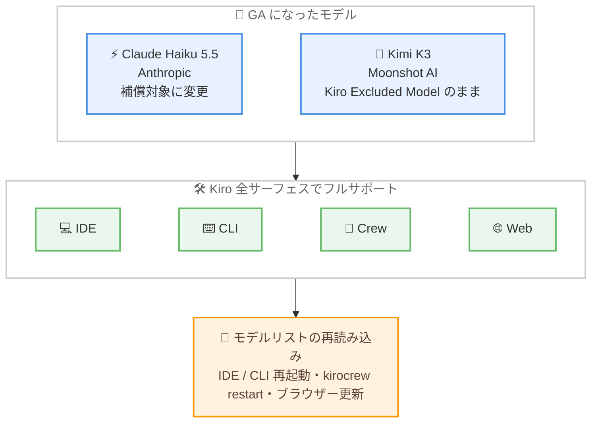

# Kiro - Claude Haiku 5.5 と Kimi K3 の一般提供開始 (GA)

**リリース日**: 2026 年 11 月 4 日
**サービス**: Kiro
**機能**: Claude Haiku 5.5 および Kimi K3 の一般提供 (GA)

📊 [このアップデートのインフォグラフィックを見る](https://takech9203.github.io/aws-news-summary/20261104-kiro-changelog-2026-11-04.html)

## 概要

Kiro において、Anthropic の Claude Haiku 5.5 と Moonshot AI の Kimi K3 が一般提供 (GA) となりました。両モデルは Kiro IDE、CLI、Crew、Web のすべてのサーフェスでフルサポート付きで利用でき、これまで付与されていた Experimental (実験的) ラベルは撤廃されました。

あわせて補償 (indemnity) の取り扱いも更新されました。Kiro Excluded Models に対する補償の例外は Claude Haiku 5.5 には適用されなくなり、同モデルは補償の対象となりました。一方、Kimi K3 は引き続き Kiro Excluded Model のままであり、補償の例外が適用される点に注意が必要です。

最新のモデルリストを読み込むには、IDE または CLI の再起動、Crew では `kirocrew restart` の実行、Web ではブラウザーの更新が必要です。

**アップデート前の課題**

- Claude Haiku 5.5 と Kimi K3 は Experimental ラベル付きの実験的提供であり、本番用途での採用判断が難しかった
- Claude Haiku 5.5 は Kiro Excluded Models として補償の例外が適用されており、企業利用時の法的リスク評価が必要だった
- 実験的提供のモデルは、サーフェスごとのサポート状況が安定版モデルと同等である保証がなかった

**アップデート後の改善**

- 両モデルが GA となり、Kiro IDE、CLI、Crew、Web の全サーフェスでフルサポート付きで利用可能になった
- Claude Haiku 5.5 は Kiro Excluded Models の補償例外の対象外となり、補償付きで安心して利用できるようになった
- Experimental ラベルの撤廃により、チームや企業での標準モデルとして採用しやすくなった

## アーキテクチャ図



GA となった 2 つのモデルが Kiro の全サーフェスでフルサポートされる構成と、最新モデルリストを反映するために必要な操作を示しています。

## サービスアップデートの詳細

### 主要機能

1. **Claude Haiku 5.5 の一般提供 (GA)**
   - Kiro IDE、CLI、Crew、Web の全サーフェスでフルサポート
   - Experimental ラベルが撤廃され、安定版モデルとして利用可能
   - Kiro Excluded Models の補償例外が適用されなくなり、補償付きで利用可能
   - 導入時の Blog 記事によると、Claude 5.5 ファミリーで最速のモデルであり、Adaptive Thinking (low から max までの 5 段階の思考レベル、デフォルトは medium) と 1M トークンのコンテキストウィンドウを備える

2. **Kimi K3 の一般提供 (GA)**
   - Kiro IDE、CLI、Crew、Web の全サーフェスでフルサポート
   - Experimental ラベルが撤廃され、安定版モデルとして利用可能
   - 導入時の Blog 記事によると、Moonshot AI が提供するオープンウェイトの 2.8T パラメータモデル (Moonshot AI 調べ) で、1M トークンのコンテキストウィンドウと Mixture-of-Experts アーキテクチャを採用
   - **注意**: Kimi K3 は引き続き Kiro Excluded Model であり、補償の例外が適用される

3. **モデルリストの更新手順**
   - IDE または CLI: アプリケーションを再起動
   - Crew: `kirocrew restart` を実行
   - Web: ブラウザーでページを更新

## 技術仕様

### GA モデルの比較

| 項目 | Claude Haiku 5.5 | Kimi K3 |
|------|------------------|---------|
| 提供元 | Anthropic | Moonshot AI |
| モデル種別 | プロプライエタリ | オープンウェイト |
| コンテキストウィンドウ | 1M トークン | 1M トークン |
| 特徴 | Claude 5.5 ファミリー最速、Adaptive Thinking 対応 | 2.8T パラメータ、Mixture-of-Experts |
| 対応サーフェス | IDE、CLI、Crew、Web | IDE、CLI、Crew、Web |
| Experimental ラベル | 撤廃 | 撤廃 |
| Kiro Excluded Model | 対象外になった (補償あり) | 引き続き対象 (補償の例外あり) |

### 補償 (indemnity) の取り扱い

| モデル | アップデート前 | アップデート後 |
|--------|----------------|----------------|
| Claude Haiku 5.5 | Kiro Excluded Model (補償の例外) | 補償の例外が適用されない |
| Kimi K3 | Kiro Excluded Model (補償の例外) | 変更なし (引き続き Kiro Excluded Model) |

## 設定方法

### 前提条件

1. Kiro IDE、CLI、Crew、Web のいずれかを利用していること
2. 対象モデルを利用できる Kiro プラン (導入時の Blog 記事によると、両モデルは Pro、Pro+、Pro Max、Power プラン向けに提供開始) を契約していること

### 手順

#### ステップ 1: モデルリストの再読み込み

```bash
# CLI の場合: Kiro CLI を再起動する

# Crew の場合: 以下のコマンドで Crew を再起動する
kirocrew restart
```

IDE の場合はアプリケーションを再起動し、Web の場合はブラウザーでページを更新します。これにより GA 版の最新モデルリストが読み込まれます。

#### ステップ 2: モデルの選択

モデルセレクターから Claude Haiku 5.5 または Kimi K3 を選択します。Experimental ラベルが表示されなくなっていることを確認できます。

## メリット

### ビジネス面

- **本番採用の判断が容易に**: Experimental ラベルの撤廃により、チームや組織の標準モデルとして採用する際の懸念が解消される
- **法的リスクの低減**: Claude Haiku 5.5 が補償の対象となったことで、企業利用時のリスク評価が簡素化される
- **モデル選択肢の拡大**: プロプライエタリモデルとオープンウェイトモデルの両方が GA となり、要件に応じた使い分けが可能

### 技術面

- **全サーフェスでの一貫した利用**: IDE、CLI、Crew、Web のすべてで同じモデルをフルサポート付きで利用できる
- **高速・低コストな処理**: Claude Haiku 5.5 は要約、分類、ルーティング、大量テキスト処理など、速度とコストが重視されるタスクに適する
- **大規模コンテキストでの開発**: 両モデルとも 1M トークンのコンテキストウィンドウを備え、大規模コードベースや仕様書全体を扱える

## デメリット・制約事項

### 制限事項

- Kimi K3 は引き続き Kiro Excluded Model であり、補償の例外が適用される
- 最新のモデルリストを反映するには、IDE または CLI の再起動、Crew での `kirocrew restart` の実行、Web でのブラウザー更新が必要
- 導入時の Blog 記事によると、両モデルの利用には Pro 以上の有料プランが必要

### 考慮すべき点

- 補償が必要な企業ユースケースでは、Kimi K3 ではなく Claude Haiku 5.5 などの補償対象モデルを選択する
- クレジット倍率はモデルごとに異なるため、ワークロードの特性に応じてコスト効率を評価する

## ユースケース

### ユースケース 1: 高頻度・低レイテンシーのサブエージェント処理

**シナリオ**: Crew で複数のエージェントを並列実行し、コードレビューや長いコンテキストの要約・圧縮を高速に処理したい。

**実装例**:
```
Crew のサブエージェント用モデルとして Claude Haiku 5.5 を指定し、
レビューや要約などの大量・高頻度タスクを低コストで並列処理する
```

**効果**: 導入時の Blog 記事によると、Claude Haiku 5.5 は要約・分類・ルーティング・一括テキスト処理などの高ボリュームタスクに適しており、並列レビューのサブエージェントとしても活用できる。GA 化により本番ワークフローへの組み込みが容易になる。

### ユースケース 2: 補償要件のある企業開発での標準モデル採用

**シナリオ**: 法務要件として補償付きモデルの利用が必須の企業で、高速・低コストなモデルを標準化したい。

**実装例**:
```
組織のモデルポリシーで Claude Haiku 5.5 を許可モデルに追加し、
Kiro Excluded Model である Kimi K3 は要件に応じて除外する
```

**効果**: Claude Haiku 5.5 が補償の対象となったことで、コンプライアンス要件を満たしつつ高速なモデルを全社的に展開できる。

### ユースケース 3: オープンウェイトモデルによる大規模リファクタリング

**シナリオ**: 大規模コードベース全体を考慮したマルチファイルリファクタリングを、オープンウェイトモデルで実施したい。

**実装例**:
```
Kiro のスペック駆動開発ワークフローで Kimi K3 を選択し、
1M トークンのコンテキストにコードベース・仕様書・テストを収めて作業する
```

**効果**: 導入時の Blog 記事によると、Kimi K3 は 1M トークンのコンテキストウィンドウと 2.8T パラメータにより、複数ファイルにまたがるリファクタリングや深い依存関係の理解に適している。

## 料金

Changelog には料金の変更に関する記載はありません。参考として、各モデルの導入時の Blog 記事では以下のクレジット倍率が案内されていました (最新の情報は料金ページを確認してください)。

| モデル | クレジット倍率 (導入時) |
|--------|------------------------|
| Claude Haiku 5.5 | 0.06x (100K トークン超のリクエストは 0.3x) |
| Kimi K3 | 2.4x |

## 利用可能リージョン

グローバル

## 関連サービス・機能

- **Kiro IDE / CLI / Crew / Web**: 今回 GA となった両モデルをフルサポートする Kiro の各サーフェス
- **Amazon Bedrock**: 導入時の Blog 記事によると、Claude Haiku 5.5 の長コンテキスト課金は Anthropic および Amazon Bedrock の料金体系と整合している
- **Kiro のスペック駆動開発**: 大規模コンテキストを持つ両モデルにより、要件から実装・検証までの一貫したワークフローを強化

## 参考リンク

- 📊 [インフォグラフィック](https://takech9203.github.io/aws-news-summary/20261104-kiro-changelog-2026-11-04.html)
- [Kiro Changelog](https://kiro.dev/changelog/)
- [Kiro Blog: Claude Haiku 5.5 is now available in Kiro](https://kiro.dev/blog/haiku-5-5/)
- [Kiro Blog: Kimi K3 model is now available in Kiro](https://kiro.dev/blog/kimi-k3/)
- [Kiro 料金ページ](https://kiro.dev/pricing/)

## まとめ

Claude Haiku 5.5 と Kimi K3 が Experimental ラベルを外れて GA となり、Kiro の全サーフェスでフルサポート付きで利用できるようになりました。特に Claude Haiku 5.5 は補償の対象となったため、企業での本番採用のハードルが大きく下がります。利用を開始するには IDE または CLI を再起動し (Crew は `kirocrew restart`、Web はブラウザー更新)、最新のモデルリストを読み込んでください。Kimi K3 は引き続き Kiro Excluded Model である点に留意が必要です。
