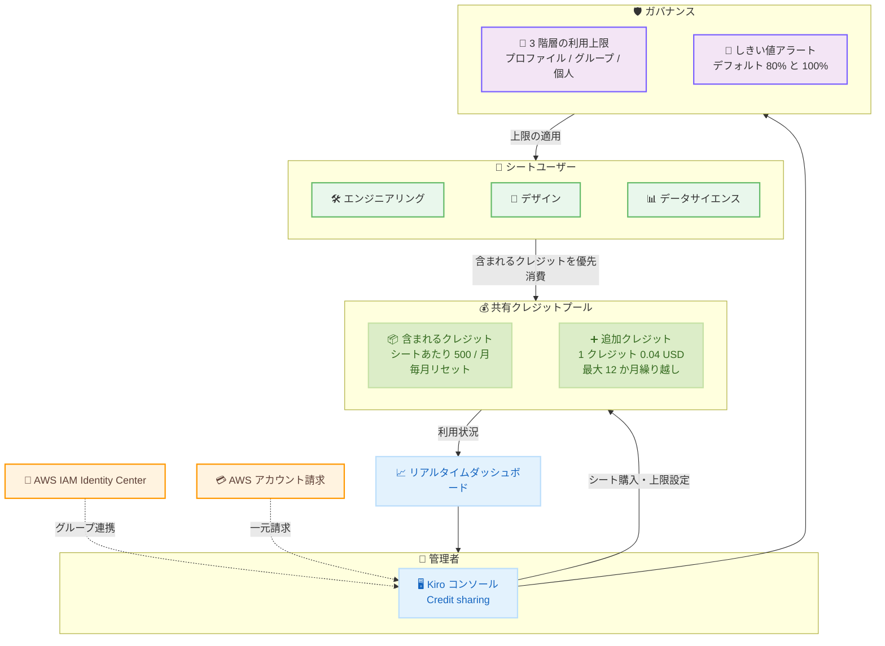

# Kiro - クレジットプーリング (Credit Pooling)

**リリース日**: 2026 年 11 月 4 日
**サービス**: Kiro
**機能**: チーム間で Kiro クレジットを共有するクレジットプーリング

📊 [このアップデートのインフォグラフィックを見る](https://takech9203.github.io/aws-news-summary/20261104-kiro-credit-pooling.html)

## 概要

Kiro は、Kiro Enterprise 向けの新しい価格モデル「クレジットプーリング」を発表しました。組織が購入したシートに付属する Kiro クレジットを単一の共有プールに集約し、チーム全体で共有できるようになります。ライトユーザーが使い切れないクレジットをヘビーユーザーが自動的に活用できるため、クレジットの無駄を削減し、AI 利用コストの予測可能性を高めます。なお、Kiro コンソール上では本機能は「Credit sharing」というラベルで表示されます。

クレジットプーリングは、共有クレジットによるコスト効率、プロファイル / グループ / 個人の 3 階層での詳細なガバナンス、リアルタイムの利用状況モニタリングを提供します。請求は AWS アカウントを通じて行われるため、Kiro の利用料金はその他の AWS 利用料金と一緒に管理できます。新規の Kiro Enterprise 顧客ではクレジットプーリングがデフォルト (新規 Kiro プロファイルでは唯一の選択肢) となり、既存の Enterprise 顧客は任意のタイミングでオプトインできます。

**アップデート前の課題**

AI コーディングツールの利用が拡大する中、個人シート単位のクレジット割り当てには以下の課題がありました。

- 一部のパワーユーザーがクレジットを使い切る一方、ライトユーザーのクレジットは未使用のまま失効していた
- 個人シートライセンスが請求のサイロを生み、あるグループの余剰クレジットを別のグループの超過利用に充当できなかった
- AI エージェントが気付かないうちに想定外の課金を発生させるリスクがあった
- 利用上限を強制する簡単な方法がなかった

**アップデート後の改善**

- シートに含まれるクレジットが共有プールに集約され、チーム内の利用量の偏りを自動的に吸収できるようになった
- プロファイル / グループ / 個人の 3 階層で利用上限を設定でき、上限到達時は追加購入まで利用がブロックされるため、月末の想定外課金を防止できるようになった
- プールレベルのダッシュボードとしきい値アラート (デフォルトで 80% と 100%) により、組織全体の AI 利用状況をリアルタイムに可視化できるようになった
- 購入した追加クレジットは最大 12 か月繰り越せるため、調達サイクルに合わせた計画的な購入が可能になった

## アーキテクチャ図

各シートが毎月 500 クレジットを共有プールに追加し、全ユーザーが同じプールから消費します。管理者は 3 階層の利用上限としきい値アラートでガバナンスを効かせながら、ダッシュボードで利用状況をリアルタイムに把握できます。

## サービスアップデートの詳細

### 主要機能

1. **共有クレジットプール**
   - 各シート (月額 20 USD、最低 2 シート) が毎月 500 クレジットを共有プールに追加
   - 全ユーザーが同じプールから消費するため、ライトユーザーの余剰クレジットをパワーユーザーが自動的に活用可能
   - 手動でのクレジット再配分は不要
   - 初月のシート料金とクレジットは、請求サイクルの残日数に基づいて日割り計算

2. **スマートなクレジット消費順序**
   - 含まれるクレジット (毎月リセット) を先に消費し、その後に購入済みの追加クレジットを消費
   - 追加クレジットは有効期限が近いものから順に消費
   - ユーザーが複数のグループに所属していても、支払いは 1 シート分のみ (二重課金なし)

3. **3 階層の利用上限によるガバナンス**
   - プロファイルレベル、グループレベル、個人レベルの順に優先度が高くなる利用上限を設定可能
   - 複数グループに所属するユーザーには、ユーザーに有利な最も高いグループ上限を適用
   - 上限到達時は管理者が追加クレジットを購入するまで利用をブロックし、月末の想定外課金を防止

4. **しきい値通知とリアルタイムダッシュボード**
   - ユーザーごとの上限、プールのクレジット上限、シート利用率に対して、デフォルトで 80% と 100% の時点でアラートを送信 (しきい値は設定可能)
   - プールレベルのダッシュボードで、組織全体の利用可能 / 消費済み / 残りクレジットを可視化
   - シート利用率のトラッキングにより、十分に活用されていないシートを特定してプールを適正化可能

5. **プールメンバーシップ管理**
   - グループは手動作成のほか、AWS IAM Identity Center (IDC) 経由での作成に対応
   - サードパーティ ID プロバイダーによるグループ管理は近日提供予定
   - 月中のシート追加にも対応し、クレジットは即座にプールに追加。ユーザーの退職や役割変更時も請求の中断なくシート割り当てを更新
   - これらの管理機能への API アクセスも近日提供予定

## 技術仕様

### 価格モデルの構成要素

| 項目 | 詳細 |
|------|------|
| シート料金 | 1 シートあたり月額 20 USD (最低 2 シート) |
| 含まれるクレジット | 1 シートあたり毎月 500 クレジットを共有プールに追加 (毎月リセット) |
| 追加クレジット | 1 クレジットあたり 0.04 USD、購入後即座にプールに追加 |
| 追加クレジットの有効期限 | 購入から最大 12 か月繰り越し可能 |
| 消費順序 | 含まれるクレジット → 購入済みクレジット (有効期限が近い順) |
| 初月の扱い | シート料金・クレジットとも請求サイクルの残日数で日割り |
| 複数グループ所属 | 1 シート分のみ課金 (二重課金なし) |
| 請求 | AWS アカウント経由 |

### 利用上限の階層

| 階層 | 優先度 | 備考 |
|------|--------|------|
| プロファイルレベル | 低 | 組織全体のベースライン |
| グループレベル | 中 | 複数グループ所属時は最も高い上限を適用 |
| 個人レベル | 高 | 個別ユーザーへの上書き設定 |

## 設定方法

### 前提条件

1. Kiro Enterprise の契約 (新規顧客はクレジットプーリングがデフォルト)
2. 請求に使用する AWS アカウント
3. グループを IDC 連携する場合は AWS IAM Identity Center の設定

### 手順

#### ステップ 1: Kiro コンソールでシートを購入

Kiro コンソールの「Credit sharing」からシートを購入します (最低 2 シート)。各シートが毎月 500 クレジットを共有プールに追加します。

#### ステップ 2: ユーザーとグループを追加

ユーザーまたはグループをプールに追加します。グループは手動で作成するか、AWS IAM Identity Center 経由で取り込みます。シートの調整は自動で行われます。

#### ステップ 3: 利用上限としきい値アラートを設定

プロファイル / グループ / 個人の各レベルで利用上限を設定します。しきい値アラート (デフォルト 80% と 100%) を必要に応じて調整し、クレジット枯渇を事前に検知できるようにします。

#### ステップ 4: 既存顧客は「Switch to credit sharing」ウィザードで移行

既存の Enterprise 顧客は、「Switch to credit sharing」ウィザードを使用して個人サブスクリプションからユーザーを移行します。**この切り替えは元に戻せない**点に注意してください。

詳細な設定手順は [公式ドキュメント](https://kiro.dev/docs/enterprise/credit-pooling/) を参照してください。

## メリット

### ビジネス面

- **コスト効率の向上**: ライトユーザーの未使用クレジットがプール経由でパワーユーザーに自動的に流れるため、クレジットの失効による無駄を削減できる
- **予算計画の精度向上**: 追加クレジットは最大 12 か月有効なため、単一の調達サイクルでまとめて購入し、長期的な計画が可能
- **請求の一元化**: AWS アカウント経由の請求により、Kiro の費用をその他の AWS 支出と一緒に管理できる

### 技術面

- **ガバナンスの強化**: 3 階層の利用上限とリアルタイムの強制により、AI 利用を他のエンタープライズリソースと同様にポリシーベースで管理できる
- **可視性の向上**: プールレベルのダッシュボードとシート利用率トラッキングにより、組織全体の AI 支出をリアルタイムに把握できる
- **運用負荷の軽減**: シート調整の自動化、月中のシート追加、IDC 連携によるグループ管理で、管理者の手作業を削減できる

## デメリット・制約事項

### 制限事項

- Kiro Enterprise 顧客向けの機能であり、個人プランでは利用できない
- 最低 2 シートからの購入が必要
- 既存顧客が「Switch to credit sharing」で移行した後は、元の個人サブスクリプションモデルに戻せない
- 新規の Kiro プロファイルではクレジットプーリングが唯一の選択肢となる
- サードパーティ ID プロバイダーによるグループ管理と、管理機能への API アクセスは近日提供予定 (現時点では未提供)

### 考慮すべき点

- 利用上限に到達したユーザーは、管理者が追加クレジットを購入するまで利用がブロックされるため、開発を止めないよう、しきい値アラートに基づいた事前の購入計画が重要
- 含まれるクレジットは毎月リセットされるため、繰り越しできるのは購入した追加クレジットのみである点に注意
- 複数グループ所属時はユーザーに有利な最も高いグループ上限が適用されるため、グループ設計時に上限の意図を整理しておく必要がある

## ユースケース

### ユースケース 1: 部門横断でのクレジット共有による無駄の削減

**シナリオ**: ある企業が 20 シートを購入し、毎月 10,000 クレジットが共有プールに追加される。エンジニアリング (9 名)、デザイン (5 名)、データサイエンス (6 名) が同じプールから消費する。

**効果**: AI コーディングツールをあまり使わない 3 名の開発者の合計 1,500 クレジット (1 シートあたり 500) が失効せず、複雑なリファクタリングを行うパワーユーザーに自動的に流れる。追加クレジットの購入を要求する前にプール内の余剰を使い切れるため、手動の再配分なしでコストを最適化できる。

### ユースケース 2: AI エージェントの想定外課金の防止

**シナリオ**: 夜間に自律的に動作する AI エージェントが、気付かないうちにクレジットを大量消費するリスクを管理したい。

**実装例**: 対象ユーザーに個人レベルの利用上限を設定し、しきい値アラートを 80% に設定する。

**効果**: 上限到達時に利用が自動的にブロックされ、管理者がアラートで事前に状況を把握できるため、月末の請求で初めて超過に気付くという事態を防げる。

### ユースケース 3: 年間調達サイクルに合わせた計画的なクレジット購入

**シナリオ**: 調達プロセスが厳格な企業で、都度の緊急クレジット購入を避けたい。

**実装例**: グループレベルの利用トレンドをダッシュボードで分析し、年次調達で追加クレジットをまとめて購入する。

**効果**: 購入クレジットは最大 12 か月繰り越せるため、1 回の調達サイクルで年間分の容量を確保でき、緊急購入の削減とプール容量の適正化によるコスト削減が期待できる。

## 料金

クレジットプーリングは Kiro Enterprise 向けの価格モデルです。

| 項目 | 料金 |
|------|------|
| シート料金 | 1 シートあたり月額 20 USD (最低 2 シート、毎月 500 クレジットをプールに追加) |
| 追加クレジット | 1 クレジットあたり 0.04 USD (最大 12 か月有効) |

### 料金例

| 使用量 | 月額料金 (概算) |
|--------|------------------|
| 20 シート (含まれるクレジット 10,000) | 400 USD |
| 20 シート + 追加クレジット 5,000 購入月 | 600 USD |

最新の料金は [Kiro 料金ページ](https://kiro.dev/pricing/) を参照してください。

## 利用可能リージョン

グローバル (Kiro はグローバルに提供されるサービスです)

## 関連サービス・機能

- **AWS IAM Identity Center**: クレジットプールのグループ作成・メンバー管理に利用可能。IDC のグループをそのままプールに取り込める
- **AWS Billing**: クレジットプーリングの請求は AWS アカウント経由で行われ、その他の AWS 利用料金と一元管理できる
- **Kiro Enterprise**: クレジットプーリングの対象プラン。新規顧客ではデフォルトの価格モデルとなる

## 参考リンク

- 📊 [インフォグラフィック](https://takech9203.github.io/aws-news-summary/20261104-kiro-credit-pooling.html)
- [公式 Blog: Share Kiro credits across your team with credit pooling](https://kiro.dev/blog/credit-pooling/)
- [Kiro Changelog](https://kiro.dev/changelog/)
- [ドキュメント: Credit pooling](https://kiro.dev/docs/enterprise/credit-pooling/)
- [料金ページ](https://kiro.dev/pricing/)

## まとめ

クレジットプーリングは、Kiro Enterprise のクレジットをチーム全体で共有し、コスト効率・ガバナンス・計画性を同時に実現する新しい価格モデルです。個人シート単位のクレジット管理で無駄や想定外課金に悩んでいた組織は、共有プールと 3 階層の利用上限によって AI 支出を予測可能な形で管理できます。新規顧客はデフォルトで有効になるため、既存の Enterprise 顧客も移行が不可逆である点を理解した上で、「Switch to credit sharing」ウィザードによる移行を検討することを推奨します。
