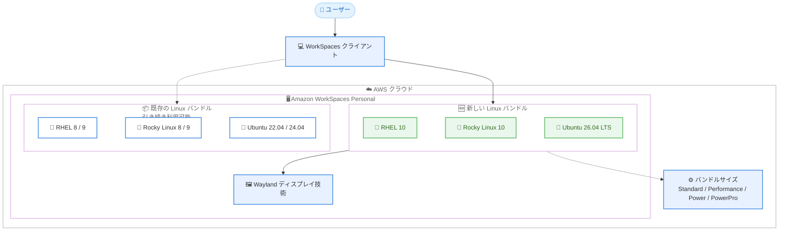

# Amazon WorkSpaces - RHEL 10、Rocky Linux 10、Ubuntu 26.04 LTS バンドルの提供開始

**リリース日**: 2026 年 11 月 4 日
**サービス**: Amazon WorkSpaces (WorkSpaces Personal)
**機能**: Red Hat Enterprise Linux 10、Rocky Linux 10、Ubuntu 26.04 LTS バンドルのサポート

📊 [このアップデートのインフォグラフィックを見る](https://takech9203.github.io/aws-news-summary/20261104-rhel-10-rocky-10-ubuntu-26-04-workspaces.html)

## 概要

AWS は、Amazon WorkSpaces Personal 向けの新しい Linux バンドルとして、Rocky Linux 10、Red Hat Enterprise Linux 10 (RHEL 10)、Ubuntu 26.04 LTS の 3 つを発表しました。これらのバンドルを利用することで、最新のエンタープライズ Linux オペレーティングシステム上で WorkSpaces を起動し、これらのリリースでのみ利用可能な新しいソフトウェアパッケージを使用できるようになります。

新しいバンドルはモダンな Wayland ディスプレイ技術を搭載しており、最新の Linux デスクトップ機能を利用できます。また、新しい OS オプションは各ディストリビューションによる強化されたセキュリティと、より長いサポートライフサイクルを提供します。

対象ユーザーは、Linux ベースの仮想デスクトップ環境を利用している開発者、エンジニアリングチーム、および最新の OS バージョンへの標準化やサポートライフサイクルの長期化を求める IT 管理者です。

**アップデート前の課題**

- WorkSpaces Personal の Linux バンドルは Rocky Linux 8/9、RHEL 8/9、Ubuntu 22.04/24.04 LTS までの提供であり、最新メジャーバージョンの OS を利用できなかった
- 最新の OS リリースでのみ提供されるソフトウェアパッケージやデスクトップ機能を WorkSpaces 上で利用できなかった
- 旧バージョンの OS を使い続けると、ディストリビューションのサポートライフサイクル終了が近づくにつれ、移行計画の制約が大きくなっていた

**アップデート後の改善**

- Rocky Linux 10、RHEL 10、Ubuntu 26.04 LTS のマネージドバンドルを選択して、最新のエンタープライズ Linux デスクトップを起動できるようになった
- モダンな Wayland ディスプレイ技術により、最新の Linux デスクトップ機能を利用できるようになった
- 各ディストリビューションの新リリースが提供する強化されたセキュリティと長期サポートライフサイクルの恩恵を受けられるようになった
- 既存バンドルも引き続き利用可能なため、アプリケーションとワークフローの準備が整ったタイミングで、自社のペースで移行できる

## アーキテクチャ図



新しい 3 つの Linux バンドルが WorkSpaces Personal に追加され、既存バンドルと並行して提供されます。新バンドルは Wayland ディスプレイ技術を搭載し、4 つのバンドルサイズから選択できます。

## サービスアップデートの詳細

### 主要機能

1. **最新エンタープライズ Linux OS のサポート**
   - Rocky Linux 10、Red Hat Enterprise Linux 10、Ubuntu 26.04 LTS のマネージドバンドルを新規提供
   - これらのリリースでのみ利用可能な新しいソフトウェアパッケージを WorkSpaces 上で使用可能
   - 各ディストリビューションによる強化されたセキュリティと長期サポートライフサイクルを享受できる

2. **Wayland ディスプレイ技術の搭載**
   - 新バンドルはモダンな Wayland ディスプレイ技術を搭載
   - 最新の Linux デスクトップ機能へのアクセスが可能

3. **既存環境への影響なしの段階的移行**
   - Rocky Linux 8/9、RHEL 8/9、Ubuntu 22.04/24.04 LTS の既存バンドルは引き続き利用可能
   - 既存の WorkSpaces は変更なしでそのまま稼働を継続
   - アプリケーションとワークフローの準備が整い次第、ユーザーを新 OS へ移行できる

4. **複数のバンドルサイズ**
   - Standard、Performance、Power、PowerPro の 4 サイズで提供
   - ワークロードの要件に応じてコンピューティングリソースを選択可能

## 技術仕様

### 提供される Linux バンドル

| 項目 | 詳細 |
|------|------|
| 新規 OS | Rocky Linux 10、Red Hat Enterprise Linux 10、Ubuntu 26.04 LTS |
| 継続提供 OS | Rocky Linux 8/9、RHEL 8/9、Ubuntu 22.04 LTS、Ubuntu 24.04 LTS |
| バンドルサイズ | Standard、Performance、Power、PowerPro |
| ディスプレイ技術 | Wayland |
| 対象サービス | Amazon WorkSpaces Personal |
| 既存 WorkSpaces への影響 | なし (変更不要で稼働継続) |

## 設定方法

### 前提条件

1. AWS アカウントと Amazon WorkSpaces の利用環境 (ディレクトリ設定など) があること
2. WorkSpaces Personal を利用していること
3. 新しい OS 上で利用するアプリケーションとワークフローの互換性を確認していること

### 手順

#### ステップ 1: バンドルの確認

```bash
aws workspaces describe-workspace-bundles \
  --owner AMAZON \
  --query "Bundles[?contains(Name, 'Ubuntu') || contains(Name, 'Rocky') || contains(Name, 'Red Hat')].{Name:Name,BundleId:BundleId}"
```

AWS が提供するマネージドバンドルの一覧から、Rocky Linux 10、RHEL 10、Ubuntu 26.04 LTS のバンドル ID を確認します。

#### ステップ 2: 新しい WorkSpace の作成

```bash
aws workspaces create-workspaces \
  --workspaces "DirectoryId=<ディレクトリID>,UserName=<ユーザー名>,BundleId=<バンドルID>"
```

確認したバンドル ID を指定して、新しい Linux WorkSpace を作成します。マネジメントコンソールからも、WorkSpace 作成時に新しい OS のマネージドバンドルを選択できます。

#### ステップ 3: 段階的な移行

既存の WorkSpaces は変更なしで稼働を継続するため、アプリケーションの動作確認が完了したユーザーから順次、新 OS バンドルの WorkSpace へ移行します。

## メリット

### ビジネス面

- **長期サポートライフサイクル**: 最新リリースの採用により、各ディストリビューションのサポート期間を最大限活用でき、OS 移行の頻度と計画リスクを低減できる
- **自社ペースでの移行**: 既存バンドルが継続提供されるため、業務影響を抑えながら段階的に最新 OS へ移行できる
- **コンプライアンス対応**: 最新 OS のセキュリティ強化により、セキュリティ要件や社内標準への準拠を維持しやすくなる

### 技術面

- **最新ソフトウェアパッケージの利用**: 新リリースでのみ提供されるパッケージやツールチェーンを WorkSpaces 上で利用できる
- **Wayland による最新デスクトップ体験**: モダンなディスプレイ技術により、最新の Linux デスクトップ機能を活用できる
- **運用の簡素化**: AWS のマネージドバンドルとして提供されるため、OS イメージの独自メンテナンスが不要

## デメリット・制約事項

### 制限事項

- 対象は WorkSpaces Personal であり、新規作成する WorkSpace でバンドルを選択する方式である
- バンドルサイズは Standard、Performance、Power、PowerPro の 4 種類から選択する

### 考慮すべき点

- 既存の WorkSpace を新 OS へ切り替えるには、アプリケーションとワークフローの互換性確認が必要
- Wayland ディスプレイ技術への移行に伴い、X11 前提のアプリケーションやツールは事前に動作検証を行うことが望ましい
- RHEL バンドルの利用にはサブスクリプション体系の確認が必要なため、料金ページで最新の課金条件を確認すること

## ユースケース

### ユースケース 1: 開発者向け最新 Linux デスクトップの標準化

**シナリオ**: 開発チームが最新のコンパイラやライブラリを必要としており、Ubuntu 26.04 LTS でのみ提供されるパッケージを利用したい。

**実装例**:
```bash
aws workspaces create-workspaces \
  --workspaces "DirectoryId=d-xxxxxxxxxx,UserName=developer01,BundleId=<Ubuntu26.04のPowerバンドルID>"
```

**効果**: 最新のツールチェーンを利用できる開発環境を迅速に配布でき、ローカル PC のスペックに依存しない開発体験を提供できる。

### ユースケース 2: RHEL ベースの業務環境のライフサイクル更新

**シナリオ**: RHEL 8 ベースの WorkSpaces を利用している企業が、サポートライフサイクルの長い RHEL 10 へ計画的に移行したい。

**実装例**:
```
1. RHEL 10 バンドルで検証用 WorkSpace を作成
2. 業務アプリケーションの互換性を検証
3. 検証完了後、部門単位で新バンドルの WorkSpace を順次展開
4. 旧 WorkSpace を段階的に削除
```

**効果**: 既存環境を停止することなく、OS のサポート終了リスクを回避しながら段階的に最新環境へ移行できる。

### ユースケース 3: コスト重視の Linux デスクトップでの Rocky Linux 10 採用

**シナリオ**: RHEL 互換のエンタープライズ Linux を低コストで利用したい組織が、Rocky Linux 10 の WorkSpaces を採用する。

**実装例**:
```bash
aws workspaces create-workspaces \
  --workspaces "DirectoryId=d-xxxxxxxxxx,UserName=analyst01,BundleId=<RockyLinux10のStandardバンドルID>"
```

**効果**: RHEL 互換環境を維持しつつ、最新 OS のセキュリティ強化と長期サポートの恩恵を受けられる。

## 料金

Amazon WorkSpaces Personal の料金は、選択するバンドル (OS とサイズ) およびリージョンに応じた月額課金または時間課金で構成されます。新しい Linux バンドルも同様の課金体系で提供されます。最新の料金詳細は [Amazon WorkSpaces 料金ページ](https://aws.amazon.com/workspaces/desktop-as-a-service/pricing/) を参照してください。

## 利用可能リージョン

Amazon WorkSpaces が利用可能なすべての AWS リージョンで提供されます。

## 関連サービス・機能

- **Amazon WorkSpaces Pools**: 非永続型の仮想デスクトップを提供するオプション。用途に応じて Personal と使い分けが可能
- **AWS Directory Service**: WorkSpaces のユーザー認証とディレクトリ管理に使用
- **Amazon WorkSpaces Thin Client**: WorkSpaces へ安全にアクセスするための専用デバイス

## 参考リンク

- 📊 [インフォグラフィック](https://takech9203.github.io/aws-news-summary/20261104-rhel-10-rocky-10-ubuntu-26-04-workspaces.html)
- [公式発表 (What's New)](https://aws.amazon.com/about-aws/whats-new/2026/11/rhel-10-rocky-10-ubuntu-26-04-workspaces/)
- [ドキュメント: Bundles and images for WorkSpaces Personal](https://docs.aws.amazon.com/workspaces/latest/adminguide/amazon-workspaces-bundles.html)
- [料金ページ](https://aws.amazon.com/workspaces/desktop-as-a-service/pricing/)

## まとめ

Amazon WorkSpaces Personal で RHEL 10、Rocky Linux 10、Ubuntu 26.04 LTS の最新 Linux バンドルが利用可能になり、Wayland ディスプレイ技術による最新のデスクトップ体験と長期サポートライフサイクルを享受できるようになりました。既存の WorkSpaces は影響を受けないため、まずは検証用 WorkSpace を新バンドルで作成し、アプリケーションの互換性を確認したうえで段階的な移行を計画することを推奨します。
