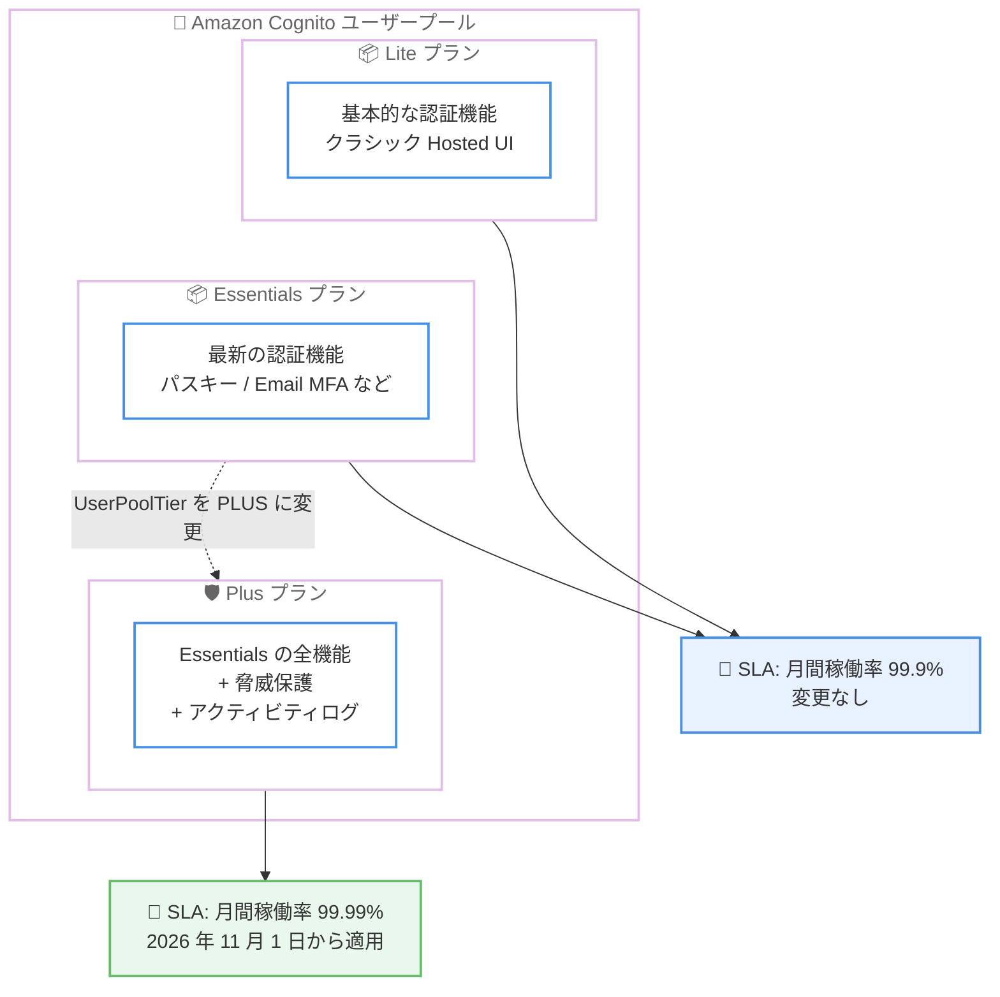

# Amazon Cognito - Plus プランの 99.99% SLA

**リリース日**: 2026 年 11 月 5 日
**サービス**: Amazon Cognito
**機能**: Plus フィーチャープランに対する 99.99% のサービスレベルアグリーメント (SLA)

📊 [このアップデートのインフォグラフィックを見る](https://takech9203.github.io/aws-news-summary/20261105-amazon-cognito-sla-update.html)

## 概要

Amazon Cognito は、Plus フィーチャープランのユーザープールに対する SLA (Service Level Agreement) を強化し、月間稼働率のコミットメントを従来の 99.9% から 99.99% に引き上げたことを発表しました。新しい SLA は 2026 年 11 月 1 日から有効です。

対象となるのは Plus プランのユーザープールのみで、既存の Plus プランのユーザープールは追加の操作なしで自動的に新しい 99.99% のコミットメントの対象となります。Essentials プランおよび Lite プランのユーザープールは、従来どおり 99.9% のコミットメントが適用され、条件に変更はありません。

認証基盤はアプリケーション全体の可用性を左右する重要なコンポーネントであり、金融、医療、EC など高い可用性要件を持つワークロードでは、より強い稼働率保証が求められます。今回のアップデートにより、ミッションクリティカルなアプリケーションの認証基盤として Amazon Cognito を採用する際の根拠が強化されます。

**アップデート前の課題**

- Amazon Cognito の SLA は全フィーチャープラン共通で月間稼働率 99.9% (月あたり最大約 43 分のダウンタイム許容) のコミットメントであった
- 99.99% 級の稼働率保証を要件とするミッションクリティカルなワークロードでは、SLA の観点で Cognito の採用判断が難しい場合があった
- 高可用性要件を満たすために、追加の冗長化設計や代替手段の検討が必要になるケースがあった

**アップデート後の改善**

- Plus プランのユーザープールに対して月間稼働率 99.99% (月あたり約 4.3 分のダウンタイム相当) がコミットされるようになった
- 既存の Plus プランのユーザープールは自動的に新しい SLA の対象となり、追加の設定や申請は不要になった
- コンソール、AWS CLI、AWS SDK からユーザープールを Plus プランに切り替えるだけで、99.99% の SLA を適用できるようになった

## アーキテクチャ図



フィーチャープランごとの SLA コミットメントの関係を示しています。Plus プランのみ 99.99% に引き上げられ、Essentials / Lite プランは従来の 99.9% のままです。

## サービスアップデートの詳細

### 主要機能

1. **Plus プランの月間稼働率コミットメントを 99.99% に引き上げ**
   - 従来の 99.9% から 99.99% に強化 (2026 年 11 月 1 日発効、SLA ドキュメントの最終更新日は 2026 年 11 月 4 日)
   - 99.99% は月あたり約 4.3 分のダウンタイム相当で、従来の 99.9% (月あたり約 43 分相当) から許容ダウンタイムが約 10 分の 1 に短縮
   - 既存の Plus プランのユーザープールは自動的に新しいコミットメントの対象

2. **Essentials / Lite プランは従来どおり**
   - 月間稼働率 99.9% のコミットメントを維持し、条件に変更なし
   - 99.99% の SLA を適用したい場合は、ユーザープールを Plus プランへ切り替える

3. **SLA の測定方法とサービスクレジット**
   - 可用性は 5 分間隔ごとに、500 / 503 エラーで失敗しなかったリクエストの割合として算出 (リクエストがないインターバルは 100% として扱う)
   - 月間稼働率がコミットメントを下回った場合、割合に応じたサービスクレジットを請求可能

## 技術仕様

### フィーチャープラン別の SLA コミットメント

| フィーチャープラン | 月間稼働率コミットメント | 今回の変更 |
|------|------|------|
| Plus | 99.99% | 99.9% から引き上げ |
| Essentials | 99.9% | 変更なし |
| Lite | 99.9% | 変更なし |

### サービスクレジット (Plus プラン)

| 月間稼働率 | サービスクレジット |
|------|------|
| 99.99% 未満かつ 99.0% 以上 | 10% |
| 99.0% 未満かつ 95.0% 以上 | 25% |
| 95.0% 未満 | 100% |

クレジットは将来の Amazon Cognito の支払いにのみ適用され、1 USD を超える場合に付与されます。請求はインシデント発生後 2 回目の請求サイクルの終了までに行う必要があります。

### Plus プランへの切り替え設定

```json
{
  "UserPoolTier": "PLUS"
}
```

`CreateUserPool` および `UpdateUserPool` API の `UserPoolTier` パラメータでフィーチャープランを設定します。未指定の場合のデフォルトは `ESSENTIALS` です。

## 設定方法

### 前提条件

1. AWS アカウントと Amazon Cognito ユーザープールの管理権限 (`cognito-idp:UpdateUserPool` など)
2. 対象のユーザープールの現在のフィーチャープランの確認
3. Plus プランの料金 (MAU あたり 0.02 USD、無料利用枠なし) の確認

### 手順

#### ステップ 1: 現在のフィーチャープランを確認する

```bash
aws cognito-idp describe-user-pool \
  --user-pool-id ap-northeast-1_XXXXXXXXX \
  --query "UserPool.UserPoolTier"
```

対象ユーザープールの現在のフィーチャープラン (`LITE` / `ESSENTIALS` / `PLUS`) を確認します。すでに `PLUS` の場合、追加の操作は不要で自動的に 99.99% の SLA が適用されます。

#### ステップ 2: ユーザープールを Plus プランに切り替える

```bash
aws cognito-idp update-user-pool \
  --user-pool-id ap-northeast-1_XXXXXXXXX \
  --user-pool-tier PLUS
```

`--user-pool-tier PLUS` を指定してユーザープールを Plus プランに切り替えます。AWS Management Console の場合は、ユーザープールの [Settings] メニューの [Feature plans] タブから [Switch to Plus] を選択します。

#### ステップ 3: 脅威保護機能の有効化を検討する

Plus プランには脅威保護機能 (アダプティブ認証、侵害された認証情報の検出、脅威とユーザーアクティビティのログ記録・エクスポート) が含まれます。SLA の強化に加えて、これらのセキュリティ機能の有効化も合わせて検討します。

## メリット

### ビジネス面

- **ミッションクリティカルな用途での採用根拠の強化**: 金融、医療、EC など高可用性要件を持つシステムの認証基盤として、99.99% という契約上のコミットメントを根拠に Cognito を採用しやすくなる
- **コンプライアンス・契約要件への対応**: エンドユーザー向けサービスの SLA 設計や RFP 要件において、認証コンポーネントの稼働率保証を明示できる
- **追加コストなしの SLA 強化**: 既存の Plus プラン利用者は、料金や設定の変更なしで自動的に強化された SLA の恩恵を受けられる

### 技術面

- **可用性設計の簡素化**: 認証基盤の許容ダウンタイムが月あたり約 4.3 分相当に短縮され、システム全体の可用性バジェット設計が容易になる
- **セキュリティ機能との両立**: Plus プランに含まれる脅威保護 (アダプティブ認証、侵害された認証情報の検出、アクティビティログ) と高可用性コミットメントを同時に利用できる
- **切り替えの容易さ**: コンソール、CLI、SDK のいずれからでも `UserPoolTier` の変更のみでプランを切り替えられる

## デメリット・制約事項

### 制限事項

- 99.99% の SLA は Plus プランのユーザープールのみが対象で、Essentials / Lite プランは 99.9% のまま
- Plus プランには無料利用枠がなく、MAU あたり 0.02 USD の料金が発生する (Essentials は 0.015 USD / MAU で月 10,000 MAU の無料利用枠あり)
- SLA には除外事項があり、AWS の合理的な制御を超える要因、お客様側の作為・不作為、ベストプラクティス不遵守、サービス制限超過による復旧遅延などに起因する停止はコミットメントの対象外

### 考慮すべき点

- SLA はサービスクレジットによる補償であり、ダウンタイムが発生しないことを技術的に保証するものではないため、アプリケーション側のリトライやフェイルオーバー設計は引き続き重要
- サービスクレジットの請求には期限 (インシデント発生後 2 回目の請求サイクル終了まで) があるため、可用性のモニタリングと請求プロセスを整備しておく必要がある
- Lite / Essentials から Plus への切り替えはいつでも可能だが、MAU 数が多い場合はコスト増加の影響を事前に試算することを推奨

## ユースケース

### ユースケース 1: 金融サービスの顧客認証基盤

**シナリオ**: ネットバンキングや決済アプリなど、認証停止が直接的な機会損失や規制上の問題につながる金融サービスで、認証基盤に 99.99% 級の稼働率保証が求められている。

**実装例**:
```bash
aws cognito-idp update-user-pool \
  --user-pool-id ap-northeast-1_XXXXXXXXX \
  --user-pool-tier PLUS
```

**効果**: 契約上のコミットメントとして 99.99% の月間稼働率を確保しつつ、侵害された認証情報の検出やアダプティブ認証による不正ログイン対策も同時に実現できる。

### ユースケース 2: 既存の Plus プラン利用者による SLA 要件の再評価

**シナリオ**: すでに脅威保護を目的として Plus プランを利用しており、社内の可用性要件ドキュメントや顧客向け SLA に認証基盤の稼働率を記載している。

**実装例**:
```bash
aws cognito-idp describe-user-pool \
  --user-pool-id ap-northeast-1_XXXXXXXXX \
  --query "UserPool.UserPoolTier"
```

**効果**: 追加の操作なしで 2026 年 11 月 1 日から 99.99% のコミットメントが自動適用されるため、可用性要件ドキュメントの更新のみで強化された SLA を反映できる。

### ユースケース 3: Essentials プランからの段階的アップグレード

**シナリオ**: Essentials プランで運用中の SaaS アプリケーションが成長し、エンタープライズ顧客から認証基盤の稼働率保証とセキュリティ強化を求められている。

**実装例**:
```
1. 現在の MAU 数から Plus プランのコスト増分を試算
   Essentials: 0.015 USD / MAU → Plus: 0.020 USD / MAU
2. UpdateUserPool で UserPoolTier を PLUS に変更
3. 脅威保護 (フルファンクションモード) とログエクスポートを有効化
```

**効果**: 99.99% の SLA と脅威保護機能をセットで提供でき、エンタープライズ顧客の要件に対応できる。

## 料金

今回の SLA 強化自体による追加料金はありません。Plus プランの料金は従来どおり MAU (月間アクティブユーザー) ベースの従量課金です。

### 料金例 (ダイレクト / ソーシャルサインインの場合)

| フィーチャープラン | 料金 | 無料利用枠 |
|--------|------------------|------------------|
| Lite | 段階制 (無料枠超過分は 0.0055 USD / MAU から) | 月 10,000 MAU |
| Essentials | 0.015 USD / MAU | 月 10,000 MAU |
| Plus | 0.020 USD / MAU | なし |

最新の料金は [Amazon Cognito 料金ページ](https://aws.amazon.com/cognito/pricing/) を参照してください。

## 利用可能リージョン

What's New では特定のリージョンへの言及はなく、新しい SLA は 2026 年 11 月 1 日以降、Plus プランのユーザープールに適用されます。SLA の適用条件と除外事項の詳細は [Amazon Cognito SLA](https://aws.amazon.com/cognito/sla/) を参照してください。

## 関連サービス・機能

- **Amazon Cognito フィーチャープラン (Lite / Essentials / Plus)**: 2024 年 11 月に導入されたプラン体系で、今回の SLA 強化は Plus プランが対象
- **Amazon Cognito 脅威保護**: Plus プランに含まれるアダプティブ認証、侵害された認証情報の検出、ユーザーアクティビティログの記録とエクスポート機能
- **AWS IAM Identity Center / IAM**: ワークフォース向け認証との使い分けの検討対象。Cognito はカスタマー向け (CIAM) 認証に最適

## 参考リンク

- 📊 [インフォグラフィック](https://takech9203.github.io/aws-news-summary/20261105-amazon-cognito-sla-update.html)
- [公式発表 (What's New)](https://aws.amazon.com/about-aws/whats-new/2026/11/amazon-cognito-sla-update/)
- [Amazon Cognito Service Level Agreement](https://aws.amazon.com/cognito/sla/)
- [ドキュメント: ユーザープールのフィーチャープラン](https://docs.aws.amazon.com/cognito/latest/developerguide/cognito-sign-in-feature-plans.html)
- [料金ページ](https://aws.amazon.com/cognito/pricing/)

## まとめ

Amazon Cognito の Plus プランに対する SLA が 99.99% に引き上げられ、ミッションクリティカルなワークロードの認証基盤として Cognito を採用する際の契約上の裏付けが強化されました。既存の Plus プラン利用者は自動的に対象となるため、可用性要件ドキュメントへの反映を推奨します。Essentials / Lite プランで高可用性要件を持つワークロードを運用している場合は、脅威保護機能の価値も含めて Plus プランへの切り替えを検討する価値があります。
