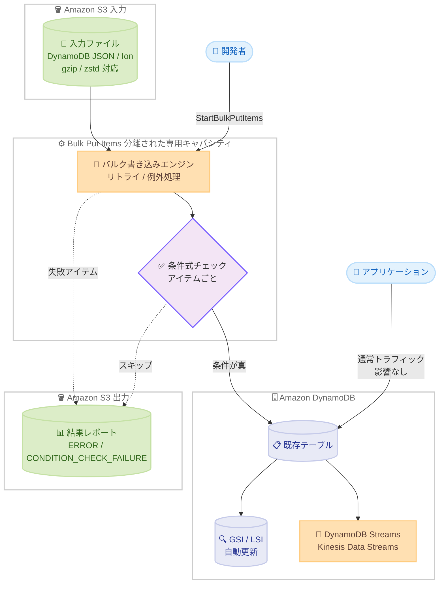

# Amazon DynamoDB - バルクプットアイテム機能

**リリース日**: 2026 年 11 月 5 日
**サービス**: Amazon DynamoDB
**機能**: Bulk put items (バルクプットアイテム)

📊 [このアップデートのインフォグラフィックを見る](https://takech9203.github.io/aws-news-summary/20261105-amazon-dynamodb-now-supports-bulk-put-items.html)

## 概要

Amazon DynamoDB が、Amazon S3 上のデータを既存の DynamoDB テーブルに直接書き込むフルマネージド機能「bulk put items」の一般提供を開始しました。入力ファイルの S3 ロケーションを指定するだけで、ファイルの読み取り、テーブルへの書き込み、リトライや例外処理、結果レポートの出力までを DynamoDB が自動的に処理します。

書き込みは通常のアプリケーショントラフィックとは分離された専用のシステムキャパシティで実行されるため、テーブルの読み取り・書き込みキャパシティを一切消費せず、稼働中のワークロードに影響を与えません。また、通常のリクエスト単位の書き込みよりも低コストで実行でき、書き込まれたアイテムは即座に読み取り可能になります。

従来の「Import from Amazon S3」機能が新規テーブルの作成のみに対応していたのに対し、bulk put items は既存テーブルへの書き込みに対応している点が大きな違いです。日次データリフレッシュ、大規模カタログのエンリッチメント、バックフィル、移行などを行う開発者やデータエンジニアが主な対象ユーザーです。

**アップデート前の課題**

- S3 上のデータを既存テーブルに書き込むには、AWS Glue や Lambda などを使ったカスタム取り込みパイプラインの構築が必要だった
- 大量書き込みがアプリケーショントラフィックと競合しないよう、テーブルキャパシティの管理やレート制限付きカスタムライターの実装が必要だった
- 「Import from Amazon S3」は新規テーブルの作成のみ対応しており、稼働中のテーブルへデータを投入するにはテーブルの再構築や切り替えが必要だった

**アップデート後の改善**

- S3 ロケーションを指定するだけで、既存テーブルへの大規模データロードをフルマネージドで実行できるようになった
- 書き込みは分離されたシステムキャパシティで実行され、テーブルのキャパシティを消費せず、既存のアラームや Auto Scaling に影響しない
- アイテムごとに条件式を指定でき、挿入専用 (insert-only) やバージョンガード付きの安全な書き込みが可能になった
- Standard と Accelerated の 2 つのパフォーマンスティアから、コストと完了時間の要件に応じて選択できるようになった

## アーキテクチャ図



S3 上の入力ファイルを分離された専用キャパシティで既存テーブルに書き込むフローです。アプリケーションの通常トラフィックとは競合せず、条件チェックに失敗したアイテムや書き込み失敗アイテムは S3 の結果レポートに記録されます。

## サービスアップデートの詳細

### 主要機能

1. **既存テーブルへのフルマネージドなバルクロード**
   - 入力ファイルの S3 ロケーション、対象テーブル、出力レポート用の S3 ロケーションを指定するだけで実行可能
   - DynamoDB が S3 オブジェクトの読み取り、各アイテムの書き込み、リトライと例外処理、レポート出力までを自動処理
   - 書き込みは非同期ジョブとして実行され、書き込まれたアイテムは即座に読み取り可能
   - 別アカウントの S3 バケットを入力・出力に使用するクロスアカウント構成にも対応

2. **テーブルキャパシティを消費しない分離された書き込みパス**
   - バルク書き込みはテーブルの読み取り・書き込みキャパシティを一切消費しない
   - `ConsumedWriteCapacityUnits` メトリクスや Contributor Insights にはカウントされず、既存の CloudWatch アラームや Auto Scaling 設定はそのまま機能する
   - GSI / LSI も分離キャパシティで自動更新される

3. **アイテムごとの条件式サポート**
   - 入力ファイルの各レコードに `PutItem` と同じ構文の条件式 (ConditionExpression) を指定可能
   - `attribute_not_exists` による挿入専用の書き込みや、バージョン属性の比較による新しいデータのみの書き込みを強制できる
   - 条件式がないレコードは無条件で書き込まれ、同じキーの既存アイテムを上書きする
   - 条件チェックでスキップされたアイテムは失敗扱いではなく、レポートに記録される

4. **2 つのパフォーマンスティア**
   - **Standard (デフォルト)**: 低コスト。完了時間に柔軟性がある低優先度のワークロード向け
   - **Accelerated**: 高スループットで完了を早める。移行や RTO 要件のある復旧、固定時間枠での定期ロード向け
   - Accelerated ティアの目安 (1 KB アイテム、理想的な条件の場合): 1,000 万件が 10 分未満、1 億件が 1 時間未満、10 億件が 2〜4 時間

5. **運用性と監視**
   - `StartBulkPutItems` は即座にオペレーション ARN を返却し、クライアントトークンにより再試行は冪等
   - `DescribeBulkOperation` で処理済み / 失敗アイテム数、処理済みバイト数を確認可能
   - `MaxWriteRequestUnits` パラメータで書き込みレートに上限を設定し、Streams の下流コンシューマーを保護できる
   - `ListBulkOperations` は 90 日間の履歴を保持し、全 API コールは CloudTrail に記録される

## 技術仕様

### オペレーションの仕様

| 項目 | 詳細 |
|------|------|
| 入力形式 | 行区切りの DynamoDB JSON または Amazon Ion |
| 入力圧縮 | gzip、zstd、非圧縮 |
| 入力ソース | Amazon S3 (クロスアカウント・クロスリージョンバケット対応) |
| パフォーマンスティア | `STANDARD` (デフォルト) / `ACCELERATED` |
| 条件式 | アイテムごとに `PutItem` と同じ構文で指定可能 |
| 出力レポート | `ERROR` / `CONDITION_CHECK_FAILURE` を選択して S3 に出力 |
| 終了ステータス | `COMPLETED` / `COMPLETED_WITH_ERRORS` / `FAILED` / `CANCELLED` |
| インデックス | GSI / LSI は自動更新 (書き込みバイト数は個別に計測) |
| ストリーム | DynamoDB Streams / Kinesis Data Streams に通常の書き込みと同様に配信 |
| 履歴保持 | `ListBulkOperations` で 90 日間 |

### API 変更履歴

| 日付 | サービス | 変更内容 |
|------|----------|----------|
| 2026/11/04 | [dynamodb](https://awsapichanges.com/archive/changes/f6d89d-dynamodb.html) | 4 new api methods - `StartBulkPutItems`、`DescribeBulkOperation`、`ListBulkOperations`、`CancelBulkOperation` を追加 |

### 入力ファイルの例 (DynamoDB JSON)

```json
{"Item": {"Artist": {"S": "No One You Know"}, "SongTitle": {"S": "Call Me Today"}}}
{"Item": {"Artist": {"S": "Acme Band"}, "SongTitle": {"S": "Happy Day"}, "Origin": {"S": "import"}}, "ConditionExpression": "attribute_not_exists(Artist)"}
{"Item": {"Artist": {"S": "The Ternaries"}, "SongTitle": {"S": "Blue"}, "Version": {"N": "12"}}, "ConditionExpression": "#v < :v", "ExpressionAttributeNames": {"#v": "Version"}, "ExpressionAttributeValues": {":v": {"N": "12"}}}
```

1 行目は無条件の書き込み、2 行目は挿入専用 (既存アイテムを上書きしない)、3 行目はバージョンガード付きの書き込みです。1 つのファイル内にこれらを混在できます。

### 必要な IAM 権限

| アクション | スコープ | 説明 |
|------|------|------|
| `dynamodb:StartBulkOperation` | `bulk-operation/*` | オペレーションの開始 |
| `dynamodb:BulkPutItems` | 対象テーブル | オペレーション中のテーブルへの書き込み |
| `dynamodb:DescribeBulkOperation` | オペレーション ARN | オペレーションの監視 |
| `dynamodb:CancelBulkOperation` | オペレーション ARN | オペレーションのキャンセル |
| `dynamodb:ListBulkOperations` | `bulk-operation/*` | オペレーションの一覧表示 |

上記に加えて、入力バケットの読み取り (`s3:GetObject`、`s3:ListBucket`)、出力バケットへの書き込み (`s3:PutObject`、`s3:AbortMultipartUpload`)、KMS 暗号化を使用する場合は `kms:Decrypt` と `kms:GenerateDataKey` が必要です。オペレーション実行中も権限が再チェックされるため、完了まで権限を維持する必要があります。

## 設定方法

### 前提条件

1. 対象の DynamoDB テーブルが `ACTIVE` 状態であること (セカンダリインデックス作成中、グローバルテーブルへの移行中、バックアップからの復元中は開始不可)
2. 入力データが行区切りの DynamoDB JSON または Amazon Ion 形式で S3 に配置されていること
3. 呼び出し元の IAM プリンシパルに上記の DynamoDB、S3、KMS 権限が付与されていること

### 手順

#### ステップ 1: 入力ファイルを S3 に配置

```bash
aws s3 cp items.jsonl s3://my-import-bucket/daily/items.jsonl
```

行区切りの DynamoDB JSON 形式の入力ファイルを S3 の入力プレフィックスにアップロードします。gzip または zstd で圧縮しておくと転送サイズを削減できます。

#### ステップ 2: バルクプットオペレーションを開始

```bash
aws dynamodb start-bulk-put-items \
    --table-name arn:aws:dynamodb:us-east-1:123456789012:table/MusicCollection \
    --input-s3-configuration '{"S3Bucket":"my-import-bucket","S3KeyPrefix":"daily/","InputFormat":"DYNAMODB_JSON"}' \
    --output-s3-configuration '{"S3Bucket":"my-report-bucket","S3KeyPrefix":"reports/","OutputType":["ERROR","CONDITION_CHECK_FAILURE"]}' \
    --performance-tier ACCELERATED
```

入力 S3 ロケーション、出力レポート先、パフォーマンスティアを指定してオペレーションを開始します。コマンドは即座にオペレーション ARN を返却します。クライアントトークンにより再試行しても重複起動しません。

#### ステップ 3: 進捗を監視

```bash
aws dynamodb describe-bulk-operation \
    --bulk-operation-arn <オペレーション ARN>
```

処理済みアイテム数、失敗アイテム数、処理済みバイト数、ステータスを確認します。開始直後の数分はプロビジョニングのためカウンターがゼロのまま進むことがあります。

#### ステップ 4: 結果レポートを確認

```bash
aws s3 ls s3://my-report-bucket/reports/
```

オペレーション完了後、出力 S3 ロケーションのレポートで書き込めなかったアイテム (`ERROR`) や条件チェックでスキップされたアイテム (`CONDITION_CHECK_FAILURE`) を確認します。条件チェック失敗のレコードには書き込もうとしたアイテム (newImage) と既存アイテム (oldImage) の両方が含まれるため、正確な再インポートファイルを作成できます。

## メリット

### ビジネス面

- **運用コストの削減**: カスタム取り込みパイプラインの構築・保守が不要になり、開発リソースを本来の業務に集中できる
- **書き込みコストの削減**: 通常のリクエスト単位の書き込みよりも低い価格で大量データを書き込める
- **ダウンタイムなしのデータ投入**: 稼働中のサービングテーブルに影響を与えずに数百 GB 規模のデータを投入でき、ビジネス継続性を維持できる

### 技術面

- **ワークロードの完全な分離**: テーブルキャパシティを消費しないため、既存のアラーム、Auto Scaling、アプリケーション性能に影響しない
- **条件式による安全な書き込み**: 挿入専用やバージョンガードにより、再実行可能 (べき等) なインポートを実現できる
- **フルマネージドな信頼性**: リトライ、例外処理、失敗レポートを DynamoDB が処理し、GSI / LSI や Streams への伝播も自動化される

## デメリット・制約事項

### 制限事項

- **グローバルテーブル非対応**: グローバルテーブルの一部であるテーブルには実行できず、オペレーション実行中のテーブルにレプリカを追加することもできない。グローバルテーブルには `BatchWriteItem` または `PutItem` を使用する必要がある
- **ベクトルインデックス付きテーブルは Standard ティアのみ**: Accelerated ティアを指定するとバリデーションエラーになる
- **キャンセル時のロールバックなし**: キャンセルしても書き込み済みのアイテムはテーブルに残る
- **テーブル状態の要件**: セカンダリインデックス作成中、グローバルテーブルへの移行中、バックアップからの復元中は開始できない
- 入力オブジェクト数、オブジェクトサイズ、合計入力サイズ、同時実行数にはクォータがある (詳細はサービスクォータのドキュメントを参照)

### 考慮すべき点

- **DAX をバイパスする**: バルク書き込みは DynamoDB Accelerator (DAX) を経由しないため、DAX にキャッシュされたアイテムは TTL が切れるまで古いままになる
- **Streams コンシューマーのサイジング**: すべてのバルク書き込みがストリームレコードを生成するため、通常トラフィック向けにサイジングされたコンシューマーは遅延する可能性がある。DynamoDB Streams の保持期間は 24 時間のため、`MaxWriteRequestUnits` で書き込みレートに上限を設けることを推奨
- **内部フェイルオーバー時の再書き込み**: オペレーション中に一部レコードが 2 回書き込まれる可能性がある。アプリケーションが同じキーに書き込む場合、全レコードにバージョンガード条件を付与して新しいデータの上書きを防ぐべき
- **条件チェック失敗も課金対象**: バリデーションで拒否されたアイテムは課金されないが、テーブルに到達して条件チェックに失敗したアイテムは課金される
- **少量データには不向き**: 開始直後の数分はプロビジョニングに時間がかかるため、少数アイテムの書き込みには `PutItem` / `BatchWriteItem` が適切
- **クロスリージョンバケットのコスト**: 入力・出力バケットが別リージョンにあるとデータ転送料金が発生し、そのリージョンの障害時にオペレーションが停滞する可能性がある

## ユースケース

### ユースケース 1: ML 推論データの日次リフレッシュ

**シナリオ**: 機械学習パイプラインが毎日生成する数百 GB の推論結果を、稼働中のサービングテーブルに無停止で反映したい。

**実装例**:
```bash
aws dynamodb start-bulk-put-items \
    --table-name arn:aws:dynamodb:ap-northeast-1:123456789012:table/InferenceServing \
    --input-s3-configuration '{"S3Bucket":"ml-output-bucket","S3KeyPrefix":"daily-inference/2026-11-05/","InputFormat":"DYNAMODB_JSON","InputCompressionType":"GZIP"}' \
    --output-s3-configuration '{"S3Bucket":"import-reports","S3KeyPrefix":"inference/","OutputType":["ERROR"]}' \
    --performance-tier STANDARD
```

**効果**: テーブル再構築やレート制限付きカスタムライターが不要になり、サービングトラフィックに影響を与えずに日次リフレッシュを完了できる。

### ユースケース 2: 大規模カタログのエンリッチメント・バックフィル

**シナリオ**: EC サイトの数百万 SKU に新しい属性 (例: サステナビリティスコア) を追加したい。既存の商品データは上書きせず、属性のみを安全に投入したい。

**実装例**:
```json
{"Item": {"SKU": {"S": "PROD-001"}, "EcoScore": {"N": "85"}, "Source": {"S": "backfill"}}, "ConditionExpression": "attribute_not_exists(EcoScore)"}
```

**効果**: 条件式により既にスコアを持つ商品はスキップされ、再実行しても安全なべき等のバックフィルを実現できる。スキップされたアイテムはレポートで確認可能。

### ユースケース 3: バージョンガード付きの移行

**シナリオ**: 旧システムからエクスポートしたデータを移行中、新アプリケーションが既に書き込みを開始している。古いエクスポートデータが新しい書き込みを上書きしないようにしたい。

**実装例**:
```json
{"Item": {"UserId": {"S": "U-1001"}, "Profile": {"S": "..."}, "Version": {"N": "42"}}, "ConditionExpression": "attribute_not_exists(#v) OR #v < :v", "ExpressionAttributeNames": {"#v": "Version"}, "ExpressionAttributeValues": {":v": {"N": "42"}}}
```

**効果**: バージョン比較により新しいアプリケーション書き込みが保護され、Accelerated ティアを使えば 1 億件規模でも 1 時間未満で移行を完了できる。

## 料金

バルク書き込みは、通常のリクエスト単位の書き込み (`PutItem` / `BatchWriteItem`) よりも低い価格で課金されます。テーブル本体に加えて、GSI / LSI への書き込みバイト数も個別に計測され、使用量に含まれます。ベクトルインデックスのバイト数はテーブルやセカンダリインデックスとは別に計測されます。

課金に関する注意点は以下のとおりです。

- バリデーションで拒否されたアイテム (テーブル書き込み前) は課金されない
- テーブルに到達して条件チェックに失敗したアイテムは課金される
- クロスリージョンの S3 バケットを使用する場合、データ転送料金が別途発生する

具体的な料金は [Amazon DynamoDB 料金ページ](https://aws.amazon.com/dynamodb/pricing/)を参照してください。

## 利用可能リージョン

- **Standard ティア**: すべての AWS 商用リージョンおよび AWS GovCloud (US) リージョン (東京・大阪リージョンを含む)
- **Accelerated ティア**: 対応リージョンは[ドキュメントのリージョン一覧](https://docs.aws.amazon.com/amazondynamodb/latest/developerguide/BulkPutItems.Tiers.html#BulkPutItems.Tiers.Accelerated)を参照

## 関連サービス・機能

- **Amazon S3**: 入力データのソースおよび結果レポートの出力先。クロスアカウント・クロスリージョンバケットにも対応
- **DynamoDB Import from Amazon S3**: S3 から新規テーブルを作成する既存機能。bulk put items は既存テーブルへの書き込みという点で補完関係にある
- **DynamoDB Streams / Amazon Kinesis Data Streams**: バルク書き込みも通常の書き込みと同様にストリームに配信され、zero-ETL 統合を含む下流コンシューマーに伝播する
- **AWS KMS**: 暗号化されたテーブル、入力データ、出力レポートに対応
- **AWS CloudTrail**: `StartBulkOperation` イベントとしてオペレーション開始が記録される

## 参考リンク

- 📊 [インフォグラフィック](https://takech9203.github.io/aws-news-summary/20261105-amazon-dynamodb-now-supports-bulk-put-items.html)
- [公式発表 (What's New)](https://aws.amazon.com/about-aws/whats-new/2026/11/amazon-dynamodb-now-supports-bulk-put-items/)
- [AWS Blog: Introducing bulk put items for Amazon DynamoDB](https://aws.amazon.com/blogs/database/introducing-bulk-put-items-for-amazon-dynamodb-load-data-from-amazon-s3-into-existing-tables-at-scale/)
- [ドキュメント: Working with bulk put items](https://docs.aws.amazon.com/amazondynamodb/latest/developerguide/BulkPutItems.HowItWorks.html)
- [ドキュメント: Considerations, quotas, and permissions](https://docs.aws.amazon.com/amazondynamodb/latest/developerguide/BulkPutItems.Considerations.html)
- [料金ページ](https://aws.amazon.com/dynamodb/pricing/)

## まとめ

bulk put items は、S3 から既存 DynamoDB テーブルへの大規模データロードという長年の課題を、カスタムパイプラインなしで解決するフルマネージド機能です。テーブルキャパシティを消費しない分離された書き込みパスと、アイテムごとの条件式による安全な書き込みが大きな特長です。日次リフレッシュ、バックフィル、移行などで S3 とのデータ連携を行っているワークロードでは、既存のカスタム取り込み処理からの置き換えを検討することを推奨します。グローバルテーブルには非対応である点と、DynamoDB Streams の下流コンシューマーのサイジングには注意が必要です。
