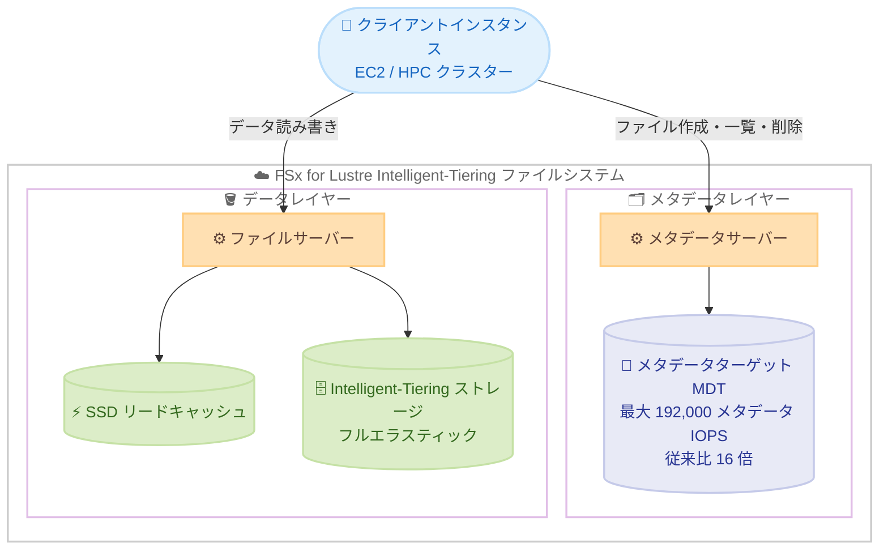

# Amazon FSx for Lustre - Intelligent-Tiering ファイルシステムのメタデータ IOPS が 16 倍に向上

**リリース日**: 2026 年 11 月 5 日
**サービス**: Amazon FSx for Lustre
**機能**: Intelligent-Tiering ファイルシステムにおける最大 192,000 メタデータ IOPS のサポート

📊 [このアップデートのインフォグラフィックを見る](https://takech9203.github.io/aws-news-summary/20261105-amazon-fsx-for-lustre-intelligent-tiering-16x-higher-metadata-iops.html)

## 概要

Amazon FSx for Lustre は、Intelligent-Tiering ストレージクラスを使用するファイルシステムで最大 192,000 メタデータ IOPS をサポートするようになりました。これは従来の上限である 12,000 メタデータ IOPS の 16 倍にあたります。メタデータ IOPS は、ファイルシステムが 1 秒あたりに作成、一覧表示、読み取り、削除できるファイル数とディレクトリ数を決定する重要な性能指標です。

FSx for Lustre Intelligent-Tiering は、クラウドで最も低コストかつ唯一のフルエラスティックな Lustre ファイルストレージであり、ホットデータとコールドデータが混在し、常時 SSD レベルの安定した性能を必要としないワークロードに適しています。今回のアップデートにより、大量の小さなファイルを扱う機械学習の研究開発や HPC (ハイパフォーマンスコンピューティング) のようなメタデータ集約型ワークロードにおいて、性能のスケール、結果取得までの時間短縮、ストレージコストの削減を同時に実現できます。

**アップデート前の課題**

- Intelligent-Tiering ファイルシステムのメタデータ IOPS は最大 12,000 に制限されており、メタデータ集約型ワークロードではメタデータ操作がボトルネックになる可能性があった
- 12,000 を超えるメタデータ IOPS が必要な場合、より高コストな SSD ストレージクラスのファイルシステムを選択する必要があった
- Intelligent-Tiering ファイルシステムではメタデータ IOPS の Automatic モードがサポートされず、User-provisioned モードで 6,000 または 12,000 のいずれかを指定する必要があった

**アップデート後の改善**

- Intelligent-Tiering ファイルシステムで最大 192,000 メタデータ IOPS (従来比 16 倍) をプロビジョニングできるようになった
- スループットキャパシティに基づいてメタデータ IOPS を自動プロビジョニングする Automatic モードが利用可能になった
- 低コストでフルエラスティックな Intelligent-Tiering ストレージのまま、メタデータ集約型の ML / HPC ワークロードに対応できるようになった

## アーキテクチャ図



ファイルの作成・一覧表示・削除などのメタデータ操作はメタデータサーバーが処理し、その処理能力はプロビジョニングされたメタデータ IOPS で決まります。今回のアップデートで、この上限が 12,000 から 192,000 に引き上げられました。

## サービスアップデートの詳細

### 主要機能

1. **最大 192,000 メタデータ IOPS のサポート**
   - Intelligent-Tiering ファイルシステムのメタデータ IOPS 上限が 12,000 から 192,000 に向上 (16 倍)
   - User-provisioned モードの有効な値は 6,000、12,000、および 12,000 の倍数 (最大 192,000)
   - 12,000 を超えてスケールする際は、FSx for Lustre がファイルシステムにメタデータサーバーを追加し、新規メタデータを全サーバーに自動分散

2. **Automatic モードによる自動プロビジョニング**
   - ファイルシステムのスループットキャパシティに基づいてメタデータ IOPS を自動プロビジョニング
   - スループットキャパシティ 4,000〜8,000 MBps で 6,000 IOPS、12,000〜44,000 MBps で 12,000 IOPS、48,000 MBps 以上では 24,000 MBps ごとに 12,000 IOPS を提供

3. **無停止でのメタデータ性能スケーリング**
   - コンソール、AWS CLI、API からメタデータ構成を更新可能で、増加したメタデータ性能は数分以内に利用可能
   - スケーリング中にファイルシステムが数分間利用できない場合があるが、クライアントのファイル操作は透過的に再試行され、完了後に成功する
   - CloudWatch の `Metadata IOPS Utilization` グラフや詳細メトリクスで使用状況をモニタリング可能

## 技術仕様

### メタデータ IOPS と操作レート

プロビジョニングしたメタデータ IOPS 1 あたりに実行できる操作数は以下のとおりです。

| 操作の種類 | プロビジョニングされたメタデータ IOPS あたりの 1 秒間の操作数 |
|------|------|
| ファイルの作成、オープン、クローズ | 2 |
| ファイルの削除 | 1 |
| ディレクトリの作成、名前変更 | 0.1 |
| ディレクトリの削除 | 0.2 |

### Intelligent-Tiering ファイルシステムの Automatic モード

| ファイルシステムのスループットキャパシティ | Automatic モードでプロビジョニングされるメタデータ IOPS |
|------|------|
| 4,000〜8,000 MBps | 6,000 |
| 12,000〜44,000 MBps | 12,000 |
| 48,000 MBps 以上 | 24,000 MBps ごとに 12,000 IOPS |

### User-provisioned モードの有効な値

| ストレージクラス | 有効なメタデータ IOPS 値 |
|------|------|
| Intelligent-Tiering | 6,000、12,000、および 12,000 の倍数 (最大 192,000) |
| SSD | 1,500、3,000、6,000、12,000、および 12,000 の倍数 (最大 192,000) |

## 設定方法

### 前提条件

1. Persistent 2 デプロイメントタイプおよび Intelligent-Tiering ストレージクラスを使用する
2. Lustre バージョン 2.15 のファイルシステムであること (メタデータ構成は 2.15 ファイルシステムのみサポート)
3. 2026 年 11 月 5 日以降に作成された Intelligent-Tiering ファイルシステムであること (それ以前に作成されたファイルシステムは User-provisioned モードの 6,000 または 12,000 のみサポート)

### 手順

#### ステップ 1: メタデータ IOPS を指定してファイルシステムを作成

```bash
aws fsx create-file-system \
  --file-system-type LUSTRE \
  --file-system-type-version 2.15 \
  --storage-type INTELLIGENT_TIERING \
  --subnet-ids subnet-0123456789abcdef0 \
  --lustre-configuration "DeploymentType=PERSISTENT_2,ThroughputCapacity=4000,MetadataConfiguration={Mode=USER_PROVISIONED,Iops=96000}"
```

Intelligent-Tiering ストレージクラス (`--storage-type INTELLIGENT_TIERING`) の Persistent 2 ファイルシステムを作成し、User-provisioned モードで 96,000 メタデータ IOPS をプロビジョニングしています。Automatic モードを使用する場合は `MetadataConfiguration={Mode=AUTOMATIC}` を指定します。

#### ステップ 2: 既存ファイルシステムのメタデータ IOPS を増加

```bash
aws fsx update-file-system \
  --file-system-id fs-0123456789abcdef0 \
  --lustre-configuration "MetadataConfiguration={Mode=USER_PROVISIONED,Iops=192000}"
```

既存のファイルシステムのメタデータ IOPS を 192,000 に増加しています。メタデータ性能の増加リクエストは前回のリクエストから 6 時間以上の間隔を空ける必要があります。

#### ステップ 3: メタデータ構成の確認

```bash
aws fsx describe-file-systems \
  --file-system-ids fs-0123456789abcdef0 \
  --query "FileSystems[0].LustreConfiguration.MetadataConfiguration"
```

ファイルシステムの現在のメタデータ構成 (モードとプロビジョニング済みメタデータ IOPS) を確認しています。コンソールではファイルシステム詳細ページの Summary パネルでも確認できます。

## メリット

### ビジネス面

- **コスト効率の向上**: 高いメタデータ性能のために高コストな SSD ストレージクラスを選択する必要がなくなり、低コストな Intelligent-Tiering のままメタデータ集約型ワークロードを実行できる
- **結果取得までの時間短縮**: メタデータ操作のボトルネックが解消され、ML 研究や HPC ワークロードの処理時間を短縮できる
- **スモールスタートが可能**: Automatic モードで開始し、ワークロードの成長に合わせて User-provisioned モードで段階的にスケールできる

### 技術面

- **16 倍のメタデータ性能**: 最大 192,000 メタデータ IOPS により、1 秒あたり最大 384,000 のファイル作成・オープン・クローズ操作に対応可能
- **無停止スケーリング**: エンドユーザーやアプリケーションへの影響を最小限に抑えながらメタデータ IOPS を増加可能
- **可視性の向上**: `Metadata IOPS Utilization` グラフや、ファイル・ディレクトリの作成、stat、読み取り、削除などの詳細な CloudWatch メトリクスで使用状況を把握できる

## デメリット・制約事項

### 制限事項

- 2026 年 11 月 5 日より前に作成された Intelligent-Tiering ファイルシステムは対象外 (User-provisioned モードの 6,000 または 12,000 のみサポート)。バックアップから復元したファイルシステムは、バックアップ元のファイルシステムのサポート内容を継承する
- メタデータ IOPS は増加のみ可能で、減少はできない
- メタデータ性能の増加リクエストは前回のリクエストから 6 時間以上の間隔が必要
- Automatic モードがプロビジョニングする数より少ないメタデータ IOPS は指定できない

### 考慮すべき点

- 12,000 を超えてメタデータ IOPS をスケールすると新しいメタデータサーバーが追加されるが、スケール前に作成された既存のメタデータやサブディレクトリは元のサーバーに残り、それらのメタデータ IOPS は増加しない
- スループットキャパシティを増加すると、ファイルシステムの最小メタデータ IOPS が増加する場合がある
- メタデータ性能のスケーリング中、ファイルシステムが数分間利用できない場合がある (クライアントの操作は透過的に再試行される)
- Intelligent-Tiering ファイルシステムでは、Automatic モードでプロビジョニングされる分を含むすべてのメタデータ IOPS に課金される (SSD ファイルシステムは Automatic モードの提供分を超えた分のみ課金)

## ユースケース

### ユースケース 1: 機械学習の学習データ処理

**シナリオ**: 数百万件の小さな画像ファイルやテキストファイルで構成される学習データセットを、多数の GPU インスタンスから並列に読み込む。エポックごとのファイルオープンやディレクトリ一覧の操作がボトルネックになっている。

**実装例**:
```bash
aws fsx update-file-system \
  --file-system-id fs-0123456789abcdef0 \
  --lustre-configuration "MetadataConfiguration={Mode=USER_PROVISIONED,Iops=96000}"
```

**効果**: 1 秒あたりのファイルオープン・クローズ操作数が大幅に向上し、GPU の待機時間を削減して学習ジョブ全体の実行時間を短縮できる。

### ユースケース 2: HPC シミュレーションの結果出力

**シナリオ**: 気象シミュレーションやゲノム解析などの HPC ワークロードで、多数の計算ノードが同時に大量の中間ファイルや結果ファイルを作成・削除する。

**実装例**:
```bash
# CloudWatch メトリクスでメタデータ操作の内訳を確認し、必要な IOPS を見積もる
aws cloudwatch get-metric-statistics \
  --namespace AWS/FSx \
  --metric-name DiskWriteOperations \
  --dimensions Name=FileSystemId,Value=fs-0123456789abcdef0 \
  --start-time 2026-11-04T00:00:00Z \
  --end-time 2026-11-05T00:00:00Z \
  --period 3600 \
  --statistics Sum
```

**効果**: メタデータ操作の実測値に基づいて適切なメタデータ IOPS をプロビジョニングし、計算ノードのスケールアウトに合わせてファイルシステムのメタデータ性能を拡張できる。

### ユースケース 3: ホット・コールドデータが混在する研究環境

**シナリオ**: 研究部門の共有ストレージとして、アクセス頻度の高いデータと長期間アクセスされないアーカイブデータが混在する大規模ファイルシステムを低コストで運用したい。

**実装例**:
```bash
aws fsx create-file-system \
  --file-system-type LUSTRE \
  --file-system-type-version 2.15 \
  --storage-type INTELLIGENT_TIERING \
  --subnet-ids subnet-0123456789abcdef0 \
  --lustre-configuration "DeploymentType=PERSISTENT_2,ThroughputCapacity=4000,MetadataConfiguration={Mode=AUTOMATIC}"
```

**効果**: フルエラスティックな Intelligent-Tiering ストレージでコストを抑えながら、Automatic モードでメタデータ IOPS を自動管理し、必要に応じて User-provisioned モードで最大 192,000 IOPS までスケールできる。

## 料金

Intelligent-Tiering ファイルシステムでは、Automatic モードでプロビジョニングされる分を含む、すべてのメタデータ IOPS に対して課金されます (SSD ファイルシステムでは Automatic モードの提供分を超えてプロビジョニングした分のみ課金)。増加したメタデータ性能に対する課金は、その性能が利用可能になった時点から開始されます。具体的な料金はリージョンごとに異なるため、[Amazon FSx for Lustre 料金ページ](https://aws.amazon.com/fsx/lustre/pricing/)を参照してください。

## 利用可能リージョン

Intelligent-Tiering ストレージクラスが提供されているすべての AWS リージョンで、新規に作成する FSx for Lustre Intelligent-Tiering ファイルシステムにて利用可能です。対象リージョンの詳細は [AWS リージョン別サービス一覧](https://aws.amazon.com/about-aws/global-infrastructure/regional-product-services/)を参照してください。

## 関連サービス・機能

- **Amazon EC2 / Elastic Fabric Adapter**: 高スループットが必要な場合、EFA 対応ファイルシステムによりクライアントあたり最大 700 Gbps のスループットを実現可能
- **Amazon CloudWatch**: `Metadata IOPS Utilization` やファイル・ディレクトリ操作の詳細メトリクスにより、メタデータ性能の使用状況をモニタリング
- **Amazon S3 / データリポジトリ関連付け**: S3 バケットとのデータリポジトリ関連付けにより、S3 上のデータセットを Lustre ファイルシステムとして処理可能

## 参考リンク

- 📊 [インフォグラフィック](https://takech9203.github.io/aws-news-summary/20261105-amazon-fsx-for-lustre-intelligent-tiering-16x-higher-metadata-iops.html)
- [公式発表 (What's New)](https://aws.amazon.com/about-aws/whats-new/2026/11/amazon-fsx-for-lustre-intelligent-tiering-16x-higher-metadata-iops)
- [Amazon FSx for Lustre 製品ページ](https://aws.amazon.com/fsx/lustre/)
- [ドキュメント: ファイルシステムのメタデータ性能](https://docs.aws.amazon.com/fsx/latest/LustreGuide/performance.html#dne-metadata-performance)
- [ドキュメント: メタデータ性能の管理](https://docs.aws.amazon.com/fsx/latest/LustreGuide/managing-metadata-performance.html)
- [ドキュメント: Intelligent-Tiering ストレージクラスの性能特性](https://docs.aws.amazon.com/fsx/latest/LustreGuide/intelligent-tiering-file-systems.html)
- [料金ページ](https://aws.amazon.com/fsx/lustre/pricing/)

## まとめ

今回のアップデートにより、低コストでフルエラスティックな FSx for Lustre Intelligent-Tiering ファイルシステムが、SSD ファイルシステムと同等の最大 192,000 メタデータ IOPS をサポートするようになりました。大量の小さなファイルを扱う ML 研究や HPC ワークロードを運用している場合、SSD ストレージクラスから Intelligent-Tiering への移行によるコスト最適化を検討する価値があります。既存の Intelligent-Tiering ファイルシステムは対象外のため、高いメタデータ性能が必要な場合は新規ファイルシステムの作成を検討してください。
