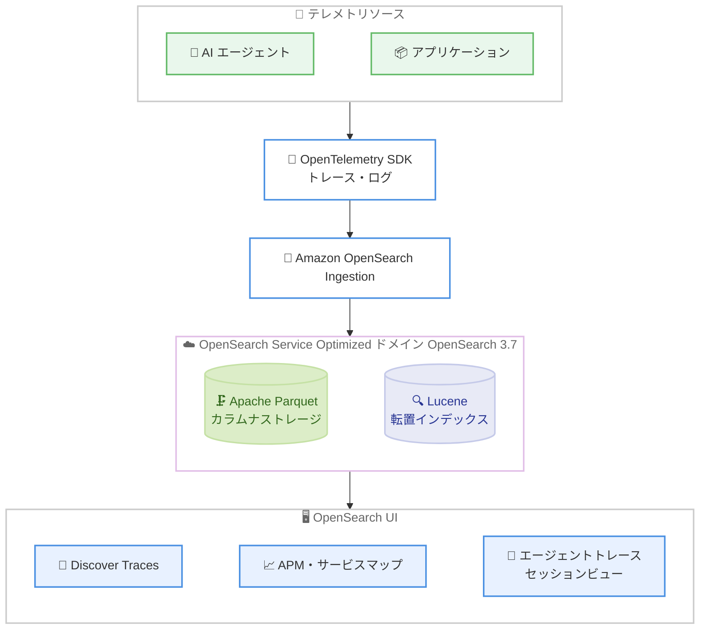

# Amazon OpenSearch Service - Optimized エンジンのエージェントトレースサポート

**リリース日**: 2026 年 11 月 5 日
**サービス**: Amazon OpenSearch Service
**機能**: Optimized エンジンによるエージェントトレース (OpenTelemetry トレース含む) のサポート

📊 [このアップデートのインフォグラフィックを見る](https://takech9203.github.io/aws-news-summary/20261105-amazon-opensearch-service-support-traces.html)

## 概要

Amazon OpenSearch Service の Optimized エンジン (ログ分析最適化エンジン) が、OpenTelemetry トレースを含むエージェントトレースのサポートを開始しました。これにより、トレースとログを同じ場所に保存し、リクエストや AI エージェントのセッションをエンドツーエンドで追跡できるようになります。失敗したステップや遅延しているステップを特定し、関連するログをツールを切り替えることなく確認できます。

Optimized エンジンは、カラムナ型の分析ストレージと全文検索を単一のマネージドサービスに統合した OpenSearch Service の新しいエンジンモードです。今回のアップデートにより、ログ分析に加えてトレース分析や APM (Application Performance Monitoring)、エージェントの可観測性までを単一のエンジンでカバーできるようになり、生成 AI エージェントを運用するチームやアプリケーション運用チームにとって可観測性基盤の統合が進みます。

本機能は OpenSearch 3.7 で追加料金なしで利用でき、東京リージョンを含む 12 の AWS リージョンで利用可能です。

**アップデート前の課題**

- トレースとログが別々のツールに保存されており、障害調査の際にツール間を行き来する必要があった
- スパンイベント、スパンリンク、プロンプト、ツール呼び出しなどのネスト構造を持つデータは、取り込み時にフラット化が必要となり、構造情報が失われていた
- 遅延して到着したデータや誤ったデータを修正する手段が限られており、ダッシュボードやアラートの精度に影響していた

**アップデート後の改善**

- トレースとログが同じ場所に保存され、リクエストやエージェントセッションをエンドツーエンドで追跡し、関連ログまでシームレスに確認できるようになった
- OpenTelemetry のログとトレースが object、nested、flat object フィールドおよび複数値の配列にマッピングされ、取り込み時にデータをフラット化することなくフィールドレベルのクエリが可能になった
- ホットティアでドキュメント ID による update、delete、upsert 操作がサポートされ、遅延データや誤ったデータをその場で修正してダッシュボードとアラートの正確性を維持できるようになった

## アーキテクチャ図



AI エージェントやアプリケーションから OpenTelemetry 形式で出力されたトレースとログを Amazon OpenSearch Ingestion 経由で Optimized ドメインに取り込み、OpenSearch UI の Discover Traces、APM、エージェントトレースビューで分析する流れを示しています。

## サービスアップデートの詳細

### 主要機能

1. **OpenTelemetry データの構造を保持したマッピング**
   - ログとトレースを object、nested、flat object フィールドにマッピングし、複数値の配列もサポート
   - スパンイベント、スパンリンク、プロンプト、ツール呼び出しがネスト構造を保持したまま保存される
   - 取り込み時にデータをフラット化することなく、フィールドレベルのクエリが可能

2. **ホットティアでのデータ操作**
   - ドキュメント ID による update、delete、upsert をサポート
   - 遅延して到着したデータや誤ったデータをその場で修正可能
   - ダッシュボードとアラートの正確性を維持できる

3. **OpenSearch UI の分析ツール**
   - Discover Traces によるトレースの探索
   - APM (Application Performance Monitoring) とサービスマップによるアプリケーション全体の可視化
   - エージェントトレースとセッション専用のビューにより、AI エージェントの動作をセッション単位で分析可能

## 技術仕様

### Optimized エンジンの構成要素

| コンポーネント | 役割 |
|------|------|
| Apache Parquet | ログ・トレースデータの主要ストレージとなるオープンなカラムナ形式。従来のインデックス構造と比較してストレージを大幅に削減 |
| Lucene 転置インデックス | ログ内容の全文検索 (フレーズ、あいまい、ワイルドカード) 用に保持 |
| Apache Calcite | SQL パーサー・プランナー・オプティマイザー。コーディネーターノード上で全クエリ言語の単一フロントエンドとして動作 |
| DataFusion | Rust ベースのベクトル化実行エンジン。集計・フィルタ・範囲スキャンなどの分析処理を実行 |
| Apache Arrow | インメモリカラムナ形式。ゼロコピーのデータ転送とベクトル化処理を実現 |
| Amazon S3 | Parquet ファイルと転置インデックスセグメントの永続ストア |
| OpenSearch UI | Optimized ドメイン用のクエリ・可視化インターフェイス |

### バージョン要件

| 項目 | 詳細 |
|------|------|
| ベースの Optimized エンジン | OpenSearch 3.5 以降が必要 |
| エージェントトレース、APM、nested フィールド、複数値配列、delete 操作 | OpenSearch 3.7 が必要 |
| 追加料金 | なし (通常の OpenSearch Service の料金のみ) |

## 設定方法

### 前提条件

1. OpenSearch 3.7 を実行する Optimized エンジンモードの OpenSearch Service ドメイン
2. OpenTelemetry 形式でトレース・ログを出力するアプリケーションまたは AI エージェント
3. Amazon OpenSearch Ingestion などのデータ取り込み経路

### 手順

#### ステップ1: Optimized ドメインの作成または確認

```bash
aws opensearch create-domain \
  --domain-name my-observability-domain \
  --engine-version OpenSearch_3.7
```

OpenSearch 3.7 を指定して Optimized エンジンモードのドメインを作成します。既存の Optimized ドメインを使用する場合は、OpenSearch 3.7 へのアップグレードを推奨します。コンソールからエンジンモードとして Optimized を選択することもできます。

#### ステップ2: OpenTelemetry データの送信

OpenTelemetry SDK を組み込んだアプリケーションや AI エージェントから、Amazon OpenSearch Ingestion パイプライン経由でトレースとログをドメインに送信します。既存の REST API とクライアントライブラリを通じてデータが取り込まれるため、新しいエージェントや独自のパイプラインは不要です。

#### ステップ3: OpenSearch UI での分析

OpenSearch UI にアクセスし、以下のビューでトレースを分析します。

- Discover Traces でトレースを検索・探索
- APM とサービスマップでアプリケーション全体のパフォーマンスを確認
- エージェントトレースとセッションビューで AI エージェントのセッションを追跡し、失敗や遅延したステップを特定

## メリット

### ビジネス面

- **可観測性ツールの統合**: トレースとログを単一のサービスに集約することで、複数ツールの運用コストとライセンスコストを削減できる
- **障害対応の迅速化**: ツールを切り替えることなくトレースから関連ログまで調査でき、MTTR (平均復旧時間) の短縮につながる
- **追加料金なし**: OpenSearch 3.7 の Optimized ドメインで追加費用なく利用できる

### 技術面

- **構造を保持したクエリ**: スパンイベント、プロンプト、ツール呼び出しなどのネスト構造を保持したまま、フィールドレベルのクエリが可能
- **データ修正能力**: ホットティアでの update、delete、upsert により、遅延データや誤データを修正してダッシュボードの正確性を維持できる
- **AI エージェント専用ビュー**: エージェントトレースとセッション専用のビューにより、生成 AI エージェントのマルチステップな動作を可視化できる

## デメリット・制約事項

### 制限事項

- エージェントトレースを含む最新機能の利用には OpenSearch 3.7 が必要 (ベースの Optimized エンジンは 3.5 以降)
- Optimized エンジンが利用できるのは 12 リージョンに限られる
- 関連性ランキング、Painless スクリプト、ベクトル・セマンティック検索、地理空間クエリなど検索中心のワークロードには General Purpose エンジンが推奨される

### 考慮すべき点

- 既存の General Purpose エンジンのドメインからの移行では、ワークロード特性 (検索中心か分析中心か) に応じたエンジンモードの選定が必要
- OpenSearch Dashboards や検索系プラグインに依存している場合は General Purpose エンジンが適しており、Optimized ドメインでは OpenSearch UI を使用する

## ユースケース

### ユースケース1: 生成 AI エージェントの動作分析

**シナリオ**: Amazon Bedrock などで構築した AI エージェントが複数のツール呼び出しと LLM 呼び出しを行うワークフローで、応答の遅延や失敗の原因を特定したい。

**実装例**:
```
1. エージェントアプリケーションに OpenTelemetry SDK を組み込み、
   プロンプト・ツール呼び出しをスパンとして記録
2. OpenSearch Ingestion 経由で Optimized ドメインに送信
3. OpenSearch UI のエージェントトレース・セッションビューで
   セッション単位にステップを追跡
```

**効果**: どのツール呼び出しやプロンプトで失敗・遅延が発生したかをセッション単位で特定し、関連ログまで同一画面系統で確認できる。

### ユースケース2: マイクロサービスの APM とログの統合調査

**シナリオ**: 複数のマイクロサービスで構成されたアプリケーションで、リクエストのレイテンシー悪化時にトレースとログを横断して調査したい。

**実装例**:
```
1. 各サービスから OpenTelemetry トレースとログを Optimized ドメインに集約
2. OpenSearch UI のサービスマップで依存関係とレイテンシーを可視化
3. Discover Traces で遅いリクエストを特定し、関連ログへドリルダウン
```

**効果**: トレース用とログ用で別々のツールを運用する必要がなくなり、障害調査のコンテキストスイッチが削減される。

### ユースケース3: 遅延データの修正によるダッシュボード精度の維持

**シナリオ**: ネットワーク遅延やリトライにより遅れて到着したテレメトリデータや、誤った値を含むデータがダッシュボードの集計を歪めている。

**実装例**:
```
1. ドキュメント ID を指定して upsert で遅延データを反映
2. 誤ったデータは update で修正、不要なデータは delete で削除
3. ダッシュボードとアラートが正確なデータに基づいて動作
```

**効果**: データの再取り込みやインデックスの再構築なしに、ホットティア上でデータをその場で修正できる。

## 料金

エージェントトレースのサポートは追加料金なしで利用できます。OpenSearch Service の通常料金 (インスタンス時間、ストレージ、OpenSearch Ingestion の OCU など) のみが発生します。

## 利用可能リージョン

OpenSearch 3.7 の Optimized エンジンで、以下の 12 リージョンで利用可能です。

- 米国東部 (バージニア北部)
- 米国東部 (オハイオ)
- 米国西部 (オレゴン)
- カナダ (中部)
- アジアパシフィック (ムンバイ)
- アジアパシフィック (シンガポール)
- アジアパシフィック (シドニー)
- アジアパシフィック (東京)
- 欧州 (フランクフルト)
- 欧州 (アイルランド)
- 欧州 (ロンドン)
- 欧州 (スペイン)

## 関連サービス・機能

- **Amazon OpenSearch Ingestion**: OpenTelemetry データをドメインに取り込むためのマネージドなデータ取り込みサービス。Data Prepper ベースで動作する
- **OpenTelemetry**: トレース・ログ・メトリクスを収集するオープンソースの可観測性フレームワーク。本機能のデータ形式の基盤
- **Amazon CloudWatch**: OpenSearch Service ドメイン自体のモニタリングに使用。Optimized ドメインでもサポートされる
- **Amazon S3**: Optimized エンジンの Parquet ファイルと転置インデックスセグメントの永続ストアとして使用される

## 参考リンク

- 📊 [インフォグラフィック](https://takech9203.github.io/aws-news-summary/20261105-amazon-opensearch-service-support-traces.html)
- [公式発表 (What's New)](https://aws.amazon.com/about-aws/whats-new/2026/11/amazon-opensearch-service-support-traces)
- [ドキュメント: Optimized for log analytics](https://docs.aws.amazon.com/opensearch-service/latest/developerguide/optimized-log-analytics.html)
- [料金ページ](https://aws.amazon.com/opensearch-service/pricing/)

## まとめ

Amazon OpenSearch Service の Optimized エンジンがエージェントトレースをサポートしたことで、ログとトレースを単一のサービスに統合し、AI エージェントやアプリケーションの動作をエンドツーエンドで追跡できるようになりました。生成 AI エージェントを本番運用しているチームや、可観測性ツールの統合を検討しているチームは、OpenSearch 3.7 の Optimized ドメインでの評価を推奨します。追加料金なしで利用でき、東京リージョンにも対応しています。
