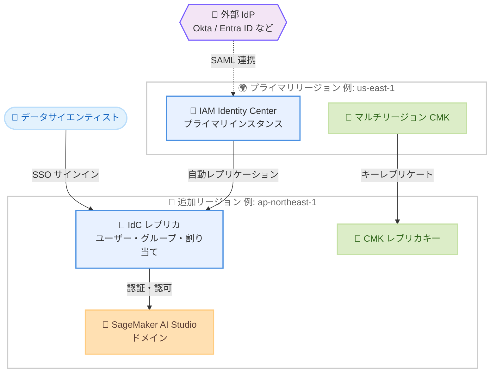

# Amazon SageMaker AI Studio - IAM Identity Center マルチリージョンレプリケーション対応

**リリース日**: 2026 年 11 月 5 日
**サービス**: Amazon SageMaker AI
**機能**: IAM Identity Center マルチリージョンレプリケーションのサポート

📊 [このアップデートのインフォグラフィックを見る](https://takech9203.github.io/aws-news-summary/20261105-amazon-sagemaker-ai-studio-iam.html)

## 概要

Amazon SageMaker AI Studio が、AWS IAM Identity Center (IdC) のマルチリージョンレプリケーションに対応しました。これにより、プライマリ IdC インスタンスを任意のリージョンにレプリケートし、そのレプリケート先リージョンで SageMaker AI Studio ドメインを運用できるようになります。

これまで、IAM Identity Center 認証を使用する SageMaker AI Studio ドメインは、プライマリ IdC インスタンスと同じリージョンに配置する必要がありました。今回のアップデートにより、ワークフォース ID 管理を一元化したまま、データレジデンシー要件やコンプライアンス要件に応じたリージョンへ Studio ドメインを展開できます。グローバルに展開する組織や、データ主権要件のある規制業種のお客様にとって、シングルサインオン (SSO) 機能を損なうことなく柔軟なリージョン選択が可能になる重要なアップデートです。

**アップデート前の課題**

このアップデート以前には、以下の課題がありました。

- IdC 認証を利用する場合、SageMaker AI Studio ドメインはプライマリ IdC インスタンスと同じリージョンに作成する必要があった
- データレジデンシー要件のあるリージョンで Studio を運用するには、IdC インスタンスの配置リージョンに制約が生じ、ID 管理の一元化とコンプライアンス対応の両立が困難だった
- グローバル組織では、ユーザーの所在地やデータの保管場所に合わせた Studio ドメインの展開が制限されていた

**アップデート後の改善**

今回のアップデートにより、以下が可能になりました。

- プライマリ IdC インスタンスを維持したまま、追加リージョンへレプリケートし、そのリージョンで SageMaker AI Studio ドメインを運用できるようになった
- プライマリ IdC インスタンスのリージョンに関係なく、ワークフォースの所在地やデータレジデンシー要件に合わせて Studio ドメインを展開できるようになった
- SSO 機能を維持しながら、データ主権要件やコンプライアンス要件を満たす構成が実現できるようになった

## アーキテクチャ図



プライマリリージョンの IAM Identity Center インスタンスがワークフォース ID、許可セット、割り当てなどを追加リージョンへ自動レプリケートし、追加リージョンの SageMaker AI Studio ドメインがレプリカを利用して SSO 認証を行う構成を示しています。

## サービスアップデートの詳細

### 主要機能

1. **IdC プライマリインスタンスと異なるリージョンでの Studio ドメイン運用**
   - プライマリ IdC インスタンスのレプリケート先リージョンに SageMaker AI Studio ドメインを作成可能
   - これまでの「同一リージョン」制約が解消され、リージョン選択の自由度が向上
   - 既存の一元的なワークフォース ID 管理をそのまま活用可能

2. **IAM Identity Center のマルチリージョンレプリケーション**
   - IdC はワークフォース ID、許可セット、ユーザー・グループ割り当て、セッションなどのメタデータをプライマリリージョンから追加リージョンへ自動レプリケート
   - インスタンス作成時または作成後にレプリケーションを有効化可能
   - 追加リージョンのアプリケーションはレプリケートされた ID 情報をローカルで参照するため、パフォーマンスと信頼性が向上

3. **コンプライアンスとデータレジデンシーへの対応**
   - データ主権要件が課されるリージョンに Studio ワークロードを配置しつつ、ID 管理は既存リージョンに集約可能
   - SSO 機能を維持したまま、規制要件を満たすリージョン構成を実現

## 技術仕様

### IAM Identity Center マルチリージョンレプリケーションの前提条件

IAM Identity Center ユーザーガイドによると、レプリケーションには以下の要件があります。

| 項目 | 詳細 |
|------|------|
| インスタンスタイプ | 組織インスタンスのみ対応。アカウントインスタンスは非対応 |
| ID ソース | 外部 IdP (Okta、Microsoft Entra ID など) または Identity Center ディレクトリ。Active Directory は非対応 |
| 対応リージョン | マルチリージョン対応は一部リージョンのみ。プライマリと追加リージョン双方の対応状況の確認が必要 |
| 暗号化キー | マルチリージョンのカスタマーマネージド KMS キー (CMK) が必須。IdC と同一アカウント内に配置 |
| アプリケーション互換性 | 利用中の AWS マネージドアプリケーションが CMK 構成とレプリカリージョンでのデプロイに対応している必要がある |
| 外部 IdP の要件 | 複数のアサーションコンシューマーサービス (ACS) URL をサポートする IdP が推奨 (Okta、Microsoft Entra ID、PingFederate など) |

### レプリケートされる情報

IAM Identity Center は以下の情報をプライマリリージョンから追加リージョンへ自動レプリケートします。

- ワークフォース ID (ユーザー・グループ)
- 許可セット
- ユーザーおよびグループの割り当て
- セッションおよびその他のメタデータ

## 設定方法

### 前提条件

1. IAM Identity Center の組織インスタンスが有効化されていること
2. ID ソースが外部 IdP または Identity Center ディレクトリであること (Active Directory は不可)
3. マルチリージョンのカスタマーマネージド KMS キーで IdC の保管時暗号化が構成されていること
4. プライマリおよび追加リージョンがマルチリージョン対応リージョンであること

### 手順

#### ステップ 1: マルチリージョン CMK の準備

```bash
# マルチリージョン対応のカスタマーマネージドキーを作成
aws kms create-key \
  --multi-region \
  --description "IdC multi-region key" \
  --region us-east-1

# 追加リージョンへレプリカキーを作成
aws kms replicate-key \
  --key-id <プライマリキーの KeyId> \
  --replica-region ap-northeast-1 \
  --region us-east-1
```

マルチリージョン対応の KMS キーをプライマリリージョンに作成し、Studio ドメインを配置する追加リージョンへレプリカキーを作成します。IAM Identity Center のマルチリージョンレプリケーションには、このマルチリージョン CMK の構成が必須です。

#### ステップ 2: IAM Identity Center のレプリケーション設定

IAM Identity Center コンソールで以下を実施します。

1. IAM Identity Center コンソールを開き、インスタンス設定を表示
2. 保管時の暗号化キーをステップ 1 で作成したマルチリージョン CMK に変更
3. 追加リージョンとして Studio ドメインを配置するリージョンを選択し、レプリケーションを有効化

レプリケーションが完了すると、ワークフォース ID や割り当て情報が追加リージョンから参照可能になります。

#### ステップ 3: 追加リージョンでの SageMaker AI Studio ドメイン作成

```bash
# IdC 認証モードで SageMaker ドメインを作成 (追加リージョン)
aws sagemaker create-domain \
  --domain-name my-studio-domain \
  --auth-mode SSO \
  --default-user-settings '{"ExecutionRole": "arn:aws:iam::123456789012:role/SageMakerExecutionRole"}' \
  --vpc-id vpc-xxxxxxxx \
  --subnet-ids subnet-xxxxxxxx \
  --region ap-northeast-1
```

認証モードに `SSO` (IAM Identity Center) を指定して、レプリケート先リージョンに Studio ドメインを作成します。これまではプライマリ IdC インスタンスと同一リージョンでのみ可能だった操作が、レプリケート先リージョンでも実行できるようになりました。作成後、IdC のユーザーまたはグループをドメインに割り当てることで、ユーザーは SSO で Studio にアクセスできます。

## メリット

### ビジネス面

- **コンプライアンス対応の強化**: データ主権やデータレジデンシー要件のあるリージョンで Studio を運用しつつ、ID 管理を一元化できる
- **グローバル展開の柔軟性**: ワークフォースの所在地に合わせた Studio ドメイン展開により、グローバル組織の ML 基盤整備が容易になる
- **ガバナンスの一元化**: 複数リージョンに分散した ML 環境でも、ユーザー・グループ・アクセス権限の管理を単一の IdC インスタンスに集約できる

### 技術面

- **SSO 体験の維持**: リージョン構成を変更しても、ユーザーはこれまでどおり SSO で Studio にサインインできる
- **ローカル参照によるパフォーマンス向上**: 追加リージョンのアプリケーションはレプリケートされた ID 情報をローカルで参照するため、認証処理の遅延や依存リスクが低減する
- **耐障害性の向上**: IdC のマルチリージョン構成により、プライマリリージョンの障害時にもレプリカ経由でのアクセス継続が期待できる

## デメリット・制約事項

### 制限事項

- IdC のマルチリージョンレプリケーションは組織インスタンスのみ対応で、アカウントインスタンスでは利用できない
- ID ソースに Active Directory を使用している場合はマルチリージョン対応の対象外
- マルチリージョンのカスタマーマネージド KMS キーの構成が必須 (AWS 所有キーのままでは利用不可)
- マルチリージョン対応は一部の AWS リージョンに限定され、レプリケート可能なリージョン数にはクォータがある

### 考慮すべき点

- 外部 IdP を利用する場合、複数の ACS URL をサポートする IdP (Okta、Microsoft Entra ID、PingFederate など) でないと機能を最大限活用できない
- 利用中の他の AWS マネージドアプリケーションがカスタマーマネージド KMS キー構成に対応しているか、事前の確認が必要
- マルチリージョン CMK のレプリカキーはリージョンごとに課金されるため、KMS のコストが増加する
- レプリケーション先リージョンの選定では、コンプライアンス、ユーザーへの近接性、プライマリリージョンとの地理的分散を考慮する必要がある

## ユースケース

### ユースケース 1: データレジデンシー要件下での ML 開発環境の提供

**シナリオ**: 金融機関が、学習データを国内リージョン (東京) に保持する規制要件を満たしつつ、米国リージョンで運用中の IdC による一元的な ID 管理を継続したい。

**実装例**:
```
1. us-east-1 のプライマリ IdC インスタンスを ap-northeast-1 へレプリケート
2. ap-northeast-1 に SSO 認証モードの SageMaker AI Studio ドメインを作成
3. 既存の IdC グループ (data-scientists) をドメインに割り当て
```

**効果**: 学習データと ML 環境を国内に保持しながら、ID 管理・アクセス統制は既存の IdC 運用をそのまま利用でき、規制対応と運用効率を両立できる。

### ユースケース 2: グローバル組織での地域別 Studio 展開

**シナリオ**: 欧米アジアに開発拠点を持つ企業が、各拠点のデータサイエンティストに低レイテンシーな Studio 環境を提供したい。

**実装例**:
```
1. プライマリ IdC インスタンス (eu-west-1) を us-west-2 と ap-northeast-1 へレプリケート
2. 各リージョンに Studio ドメインを作成し、拠点ごとの IdC グループを割り当て
3. 許可セットとグループ管理はプライマリリージョンで一元運用
```

**効果**: 各拠点のユーザーは近接リージョンの Studio を SSO で利用でき、管理者は単一の IdC インスタンスでグローバルのアクセス権限を統制できる。

### ユースケース 3: ID 基盤の耐障害性を考慮した ML 基盤設計

**シナリオ**: ミッションクリティカルな ML ワークロードを運用する企業が、ID 基盤のリージョン障害時にも Studio へのアクセス継続性を確保したい。

**実装例**:
```
1. プライマリ IdC インスタンスのリージョンと地理的に離れたリージョンへレプリケート
2. レプリケート先リージョンに Studio ドメインを配置
3. レプリケートされた ID 情報をローカル参照する構成で認証依存を低減
```

**効果**: プライマリリージョンの IdC に障害が発生しても、レプリカリージョンの ID 情報により Studio へのアクセス継続が期待でき、ML 運用の可用性が向上する。

## 料金

IAM Identity Center のマルチリージョンレプリケーション機能自体、および SageMaker AI Studio の IdC 連携に追加料金は発生しません。ただし、以下のコストに注意が必要です。

- **AWS KMS**: マルチリージョンのカスタマーマネージドキーが必須となるため、プライマリキーおよび各リージョンのレプリカキーに対して KMS のキー保管料金と API リクエスト料金が発生します
- **SageMaker AI Studio**: Studio で起動するノートブックやジョブなどのコンピューティングリソースには、通常どおり SageMaker AI の料金が適用されます

## 利用可能リージョン

SageMaker AI Studio が利用可能なすべての標準 AWS リージョンで利用できます。主なリージョンは以下のとおりです。

- 米国東部 (バージニア北部、オハイオ)、米国西部 (オレゴン)
- アジアパシフィック (東京、ソウル、シンガポール、シドニー、ムンバイ)
- 欧州 (アイルランド、フランクフルト、ロンドン、パリ、ストックホルム)
- カナダ (中部)、南米 (サンパウロ)

なお、IAM Identity Center のマルチリージョンレプリケーション自体は一部リージョンのみの対応となるため、最新の対応状況は AWS Capabilities by Region で確認してください。

## 関連サービス・機能

- **AWS IAM Identity Center**: 本アップデートの基盤となるワークフォース ID 管理サービス。マルチリージョンレプリケーションにより ID 情報を複数リージョンへ自動複製する
- **AWS KMS**: IdC のマルチリージョン構成に必須のマルチリージョンカスタマーマネージドキーを提供する
- **Amazon SageMaker AI**: Studio ドメインのほか、トレーニングや推論など ML ライフサイクル全体を支えるマネージドサービス
- **AWS Organizations**: IdC の組織インスタンスの前提となるマルチアカウント管理サービス

## 参考リンク

- 📊 [インフォグラフィック](https://takech9203.github.io/aws-news-summary/20261105-amazon-sagemaker-ai-studio-iam.html)
- [公式発表 (What's New)](https://aws.amazon.com/about-aws/whats-new/2026/11/amazon-sagemaker-ai-studio-iam/)
- [ドキュメント: SageMaker AI ドメインのカスタムセットアップ](https://docs.aws.amazon.com/sagemaker/latest/dg/onboard-custom.html)
- [ドキュメント: IAM Identity Center のマルチリージョン利用](https://docs.aws.amazon.com/singlesignon/latest/userguide/multi-region-iam-identity-center.html)
- [AWS リージョン別サービス一覧](https://aws.amazon.com/about-aws/global-infrastructure/regional-product-services/)

## まとめ

Amazon SageMaker AI Studio が IAM Identity Center のマルチリージョンレプリケーションに対応したことで、ID 管理の一元化とデータレジデンシー要件への対応を両立したリージョン設計が可能になりました。グローバル展開や規制対応で Studio のリージョン配置に制約を感じていた場合は、IdC の組織インスタンスとマルチリージョン CMK の要件を確認のうえ、レプリケーション構成の導入を検討することを推奨します。
