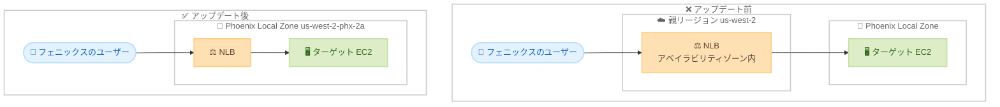

# AWS Network Load Balancer - AWS Phoenix Local Zone での提供開始

**リリース日**: 2026 年 11 月 5 日
**サービス**: Elastic Load Balancing (Network Load Balancer)
**機能**: AWS Phoenix Local Zone (us-west-2-phx-2a) での Network Load Balancer サポート

📊 [このアップデートのインフォグラフィックを見る](https://takech9203.github.io/aws-news-summary/20261105-aws-nlb-available-phx-local-zone.html)

## 概要

AWS Network Load Balancer (NLB) が、AWS Phoenix Local Zone (ゾーン ID: us-west-2-phx-2a、親リージョン: 米国西部 (オレゴン)) で利用可能になりました。これにより、Phoenix Local Zone 内に NLB を直接作成し、同一ゾーン内のターゲットへトラフィックをルーティングできるようになります。

AWS Local Zones は、AWS リージョンが存在しない主要な人口密集地や IT センターの近くに、コンピューティング、ストレージ、データベースなどの AWS サービスを配置するインフラストラクチャです。今回のアップデートにより、フェニックス都市圏のユーザーに対して、より低く安定したレイテンシーでアプリケーションを提供できるようになり、リアルタイムゲーム、メディアストリーミング、ライブ金融アプリケーションなどのレイテンシーに敏感なワークロードに適した構成が可能になります。

**アップデート前の課題**

- Phoenix Local Zone にターゲット (EC2 インスタンスなど) を配置しても、NLB 自体は親リージョンのアベイラビリティゾーンに作成する必要があった
- クライアントからのトラフィックが親リージョンを経由してターゲットに到達するため、余分なレイテンシーが発生していた
- トラフィックがアプリケーションの稼働するゾーンの外にルーティングされ、Local Zone に配置した意味が薄れていた

**アップデート後の改善**

- Phoenix Local Zone 内に NLB を直接作成できるようになった
- 接続がターゲットの近くでローカルにルーティングされ、トラフィックが Local Zone 内で完結するようになった
- フェニックス都市圏のエンドユーザーに対して、より低く一貫したレイテンシーを実現できるようになった

## アーキテクチャ図



アップデート前はトラフィックが親リージョンの NLB を経由するため遅延が発生していましたが、アップデート後は NLB とターゲットの両方を Phoenix Local Zone 内に配置でき、トラフィックがゾーン内で完結します。

## サービスアップデートの詳細

### 主要機能

1. **Phoenix Local Zone 内での NLB 作成**
   - ゾーン ID が us-west-2-phx-2a の Phoenix Local Zone 内に NLB を直接作成可能
   - 親リージョンは米国西部 (オレゴン) (us-west-2)
   - Local Zone のサブネットを NLB にアタッチして利用する

2. **ローカルでのトラフィックルーティング**
   - クライアントからの接続をターゲットの近くでローカルにルーティング
   - トラフィックが親リージョンに往復することなく、Local Zone 内で完結
   - レイテンシーの低減と安定化を実現

3. **レイテンシーに敏感なワークロードへの対応**
   - リアルタイムゲーム、メディアストリーミング、ライブ金融アプリケーションなどに適した構成
   - フェニックス都市圏のエンドユーザーに近い場所で TCP/UDP トラフィックを処理

## 技術仕様

### 対象ゾーンの情報

| 項目 | 詳細 |
|------|------|
| Local Zone | AWS Phoenix Local Zone |
| ゾーン ID | us-west-2-phx-2a |
| 親リージョン | 米国西部 (オレゴン) (us-west-2) |
| 対象ロードバランサー | Network Load Balancer |
| 主な対象ワークロード | リアルタイムゲーム、メディアストリーミング、ライブ金融アプリケーション |

## 設定方法

### 前提条件

1. 米国西部 (オレゴン) (us-west-2) リージョンを利用できる AWS アカウント
2. Phoenix Local Zone (us-west-2-phx-2a) のオプトイン (有効化)
3. Local Zone 内に作成した VPC サブネットとターゲット (EC2 インスタンスなど)

### 手順

#### ステップ 1: Phoenix Local Zone を有効化する

```bash
aws ec2 modify-availability-zone-group \
  --region us-west-2 \
  --group-name us-west-2-phx \
  --opt-in-status opted-in
```

ModifyAvailabilityZoneGroup API を使用して、Phoenix Local Zone のゾーングループを有効化します。AWS マネジメントコンソールの AWS Global View にある Local Zones タブからも有効化できます。

#### ステップ 2: Local Zone にサブネットを作成する

```bash
aws ec2 create-subnet \
  --region us-west-2 \
  --vpc-id vpc-xxxxxxxx \
  --cidr-block 10.0.10.0/24 \
  --availability-zone us-west-2-phx-2a
```

既存の VPC に対して、Phoenix Local Zone (us-west-2-phx-2a) を指定したサブネットを作成します。

#### ステップ 3: Local Zone 内に NLB を作成する

```bash
aws elbv2 create-load-balancer \
  --region us-west-2 \
  --name my-phx-nlb \
  --type network \
  --scheme internet-facing \
  --subnets subnet-xxxxxxxx
```

ステップ 2 で作成した Local Zone のサブネットを指定して NLB を作成します。その後、同じ Local Zone 内のターゲットを登録したターゲットグループとリスナーを設定します。

## メリット

### ビジネス面

- **エンドユーザー体験の向上**: フェニックス都市圏のユーザーに対して低レイテンシーなサービスを提供でき、リアルタイム性が求められるサービスの品質が向上する
- **新しい市場への展開**: AWS リージョンが存在しない都市圏でも、マネージドなロードバランシングを含むフルスタックなアーキテクチャを展開できる
- **運用負荷の軽減**: Local Zone 内で自前のロードバランサーを運用する必要がなく、マネージドサービスとして利用できる

### 技術面

- **レイテンシーの低減**: トラフィックが親リージョンへ往復しなくなり、接続がゾーン内で完結する
- **一貫したパフォーマンス**: 経路が短縮されることで、レイテンシーのばらつきが減少する
- **既存ツールとの互換性**: リージョンの NLB と同じ API、コンソール、IaC ツールで管理できる

## デメリット・制約事項

### 制限事項

- 今回の発表で対象となる Local Zone は Phoenix Local Zone (us-west-2-phx-2a) のみ
- Local Zone の利用には、事前にゾーングループのオプトインが必要
- Local Zones で利用できるサービスや機能はリージョンと比べて限定されるため、組み合わせるサービスの対応状況を事前に確認する必要がある

### 考慮すべき点

- Local Zone 内の NLB とターゲットは単一ゾーン構成となるため、可用性要件に応じて親リージョンとの併用やフェイルオーバー設計を検討する
- Local Zones の料金はリージョンと異なる場合があるため、料金ページで事前に確認する

## ユースケース

### ユースケース 1: リアルタイムゲームサーバー

**シナリオ**: フェニックス都市圏のプレイヤー向けに、低レイテンシーが必須のマルチプレイヤーゲームサーバーを提供する。

**実装例**:
```
Phoenix Local Zone 内に UDP リスナーを持つ NLB を作成し、
同一ゾーン内のゲームサーバー用 EC2 インスタンスをターゲットに登録する。
```

**効果**: プレイヤーとゲームサーバー間の遅延が最小化され、快適なプレイ体験を提供できる。

### ユースケース 2: ライブメディアストリーミング

**シナリオ**: 地域のスポーツイベントなどのライブ配信で、視聴者への配信遅延を最小限に抑えたい。

**実装例**:
```
Local Zone 内の NLB でストリーミングサーバー群への TCP 接続を分散し、
エンコードから配信までをゾーン内で完結させる。
```

**効果**: 配信経路が短縮され、低遅延かつ安定したライブ配信を実現できる。

### ユースケース 3: ライブ金融アプリケーション

**シナリオ**: 取引データの処理など、ミリ秒単位の遅延が業務に影響する金融アプリケーションを都市圏のユーザー近くで稼働させる。

**実装例**:
```
Local Zone 内の NLB を経由して取引処理用インスタンスへ接続を分散し、
機密データの処理をユーザーに近い場所で実行する。
```

**効果**: 一貫した低レイテンシーにより、取引処理の応答性と信頼性が向上する。

## 料金

Network Load Balancer の料金は、稼働時間に応じた時間課金と、処理したトラフィック量に基づく NLCU (Network Load Balancer Capacity Unit) 課金で構成されます。Local Zones での料金はリージョンと異なる場合があるため、詳細は [Elastic Load Balancing の料金ページ](https://aws.amazon.com/elasticloadbalancing/pricing/) を確認してください。

## 利用可能リージョン

- AWS Phoenix Local Zone (us-west-2-phx-2a)
  - 親リージョン: 米国西部 (オレゴン) (us-west-2)

利用可能および発表済みの Local Zones の一覧は、[AWS Local Zones ロケーションページ](https://aws.amazon.com/about-aws/global-infrastructure/localzones/locations/) で確認できます。

## 関連サービス・機能

- **AWS Local Zones**: AWS リージョンが存在しない都市圏の近くにコンピューティングやストレージを配置するインフラストラクチャ。今回のアップデートの基盤
- **Amazon EC2**: Local Zone 内で NLB のターゲットとして動作するコンピューティングサービス
- **Application Load Balancer**: HTTP/HTTPS 向けのロードバランサー。レイヤー 7 の機能が必要な場合の選択肢
- **AWS Global View**: コンソール上で Local Zones の有効化状況を一元的に確認・管理できる機能

## 参考リンク

- 📊 [インフォグラフィック](https://takech9203.github.io/aws-news-summary/20261105-aws-nlb-available-phx-local-zone.html)
- [公式発表 (What's New)](https://aws.amazon.com/about-aws/whats-new/2026/10/aws-nlb-available-phx-local-zone/)
- [Network Load Balancer ドキュメント](https://docs.aws.amazon.com/elasticloadbalancing/latest/network/introduction.html)
- [AWS Local Zones](https://aws.amazon.com/about-aws/global-infrastructure/localzones/)
- [AWS Local Zones ロケーション](https://aws.amazon.com/about-aws/global-infrastructure/localzones/locations/)
- [ModifyAvailabilityZoneGroup API リファレンス](https://docs.aws.amazon.com/AWSEC2/latest/APIReference/API_ModifyAvailabilityZoneGroup.html)
- [Elastic Load Balancing 料金](https://aws.amazon.com/elasticloadbalancing/pricing/)

## まとめ

Network Load Balancer が Phoenix Local Zone で利用可能になり、フェニックス都市圏のユーザーに対して低レイテンシーなロードバランシングをゾーン内で完結して提供できるようになりました。リアルタイムゲーム、メディアストリーミング、金融アプリケーションなどレイテンシーに敏感なワークロードを同都市圏で展開している場合は、NLB を Local Zone 内に移行することでユーザー体験の向上が期待できます。まずは Phoenix Local Zone のオプトインと、既存アーキテクチャでの効果検証から始めることを推奨します。
