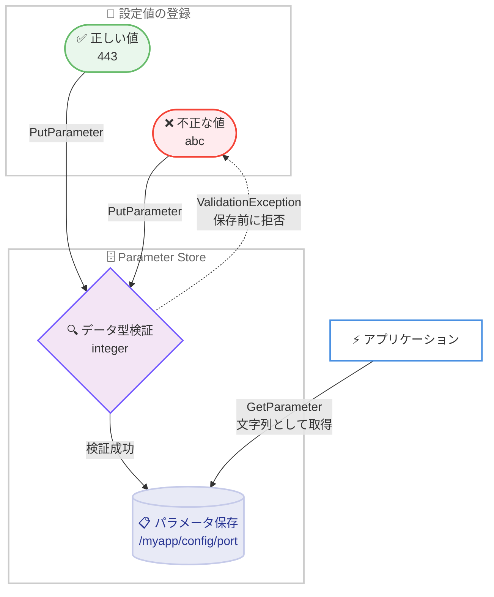

# AWS Systems Manager Parameter Store - 組み込みデータ型による整理と検証のサポート

**リリース日**: 2026 年 11 月 5 日
**サービス**: AWS Systems Manager Parameter Store
**機能**: 組み込みデータ型 (built-in data types) によるパラメータ値の検証と整理

📊 [このアップデートのインフォグラフィックを見る](https://takech9203.github.io/aws-news-summary/20261105-aws-ssm-parameter-store-allows-organization-validation-with-new-data-types.html)

## 概要

AWS Systems Manager Parameter Store に、パラメータ値を作成時・更新時に自動検証する 13 種類の組み込みデータ型が追加されました。`integer` や `boolean` のような基本的な型から、`ipv4-address`、`email`、`aws:account:id` のような形式固有の型、さらに `json` や `jsonc` のような構造化データの型までをサポートします。データ型を指定すると、Parameter Store は `PutParameter` 操作の時点で値を検証し、データ型に一致しない値を拒否します。

これにより、不正な IP アドレスや壊れた JSON などの誤った設定値がアプリケーションに読み込まれる前に検出できるようになり、アプリケーション側で独自の検証コードを実装する必要がなくなります。設定値を Parameter Store で一元管理している多くのワークロードにおいて、設定ミスに起因する障害の予防と、パラメータの整理・分類の両面で価値のあるアップデートです。

データ型は `String` および `SecureString` パラメータで利用でき、一部の型は `StringList` にも対応してリスト内の各項目を個別に検証します。`AllowedPattern` と組み合わせた追加の制約も可能で、既存の `text` パラメータのデータ型を後から変更することもできます。また、`DescribeParameters` API とコンソールでデータ型によるフィルタリングが可能になり、パラメータの整理にも活用できます。

**アップデート前の課題**

- Parameter Store のデータ型は `text` (検証なし)、`aws:ec2:image`、`aws:ssm:integration` に限られており、一般的な設定値の形式検証はできなかった
- 不正な IP アドレス、アカウント ID、JSON などの誤った値もそのまま保存され、アプリケーションが値を読み込むまで誤りに気づけなかった
- 値の形式を保証するには、`AllowedPattern` で正規表現を自作するか、アプリケーション側に独自の検証コードを実装する必要があった

**アップデート後の改善**

- 13 種類の組み込みデータ型により、`PutParameter` の時点で値の形式が自動検証され、不正な値は保存前に拒否されるようになった
- IP アドレス、メールアドレス、JSON などの一般的な形式について、正規表現や独自検証コードの実装が不要になった
- `DescribeParameters` API とコンソールでデータ型によるフィルタリングが可能になり、パラメータの整理・分類がしやすくなった

## アーキテクチャ図



`PutParameter` 時にデータ型検証が実行され、不正な値は保存前に拒否される流れを示しています。アプリケーションが誤った設定値を読み込むリスクを、保存の時点で排除できます。

## サービスアップデートの詳細

### 主要機能

1. **13 種類の組み込みデータ型の追加**
   - 標準・アドバンスドパラメータ共通: `aws:region`、`aws:account:id`、`boolean`、`integer`、`float`、`binary`、`hostname`、`email`、`ipv4-address`、`ipv6-address` の 10 種類
   - アドバンスドパラメータ専用: `url`、`json`、`jsonc` の 3 種類
   - デフォルトは従来どおり `text` (検証なし) で、既存パラメータへの影響はない

2. **PutParameter 時の同期検証**
   - データ型に一致しない値は `PutParameter` 操作の時点で拒否される
   - `String` と `SecureString` の両方のパラメータタイプで利用可能
   - 一部のデータ型 (`aws:account:id`、`email`、`ipv4-address`、`ipv6-address`) は `StringList` にも対応し、リスト内の各項目を個別に検証する (1 項目でも不正なら要求全体が失敗)

3. **AllowedPattern との併用と既存パラメータの型変更**
   - `AllowedPattern` 制約と組み合わせると、データ型検証とパターンマッチングの両方を満たす必要があり、より厳密な制約を定義できる
   - 既存の `text` パラメータのデータ型を `integer` などに変更可能 (`aws:ec2:image` と `aws:ssm:integration` への変更・からの変更は不可)

4. **データ型によるフィルタリング**
   - `DescribeParameters` API およびコンソールで、データ型を条件にパラメータを検索・一覧化できる
   - パラメータの整理・分類・棚卸しに活用できる

## 技術仕様

### 追加されたデータ型の一覧

| データ型 | 検証内容 | 対応パラメータタイプ | ティア |
|----------|----------|----------------------|--------|
| `aws:region` | 有効な AWS リージョン名 (オプトインリージョン含む) | String、SecureString | 標準 / アドバンスド |
| `aws:account:id` | AWS アカウント ID 形式 (12 桁。存在確認はしない) | String、StringList、SecureString | 標準 / アドバンスド |
| `boolean` | `true`/`false` (全小文字、全大文字、先頭のみ大文字)、`0`、`1` | String、SecureString | 標準 / アドバンスド |
| `integer` | 符号付き 32 ビット整数。先頭ゼロ、`+` 記号、小数点は不可 | String、SecureString | 標準 / アドバンスド |
| `float` | 64 ビット IEEE 754 浮動小数点数。指数表記可、`NaN`/`Infinity` 不可 | String、SecureString | 標準 / アドバンスド |
| `binary` | `0` と `1` のみで構成される値 (Base64 ではない) | String、SecureString | 標準 / アドバンスド |
| `hostname` | 有効なホスト名。アンダースコア、IP アドレスは不可 | String、SecureString | 標準 / アドバンスド |
| `email` | 有効なメールアドレス。表示名付き形式は不可 | String、StringList、SecureString | 標準 / アドバンスド |
| `ipv4-address` | 単一の IPv4 アドレス。CIDR、ポート、先頭ゼロは不可 | String、StringList、SecureString | 標準 / アドバンスド |
| `ipv6-address` | 単一の IPv6 アドレス。省略形可、CIDR やゾーン ID は不可 | String、StringList、SecureString | 標準 / アドバンスド |
| `url` | スキームとホストを含む有効な URL。パスワード埋め込みは不可 | String、SecureString | アドバンスド専用 |
| `json` | 有効な JSON。トップレベルはオブジェクトまたは配列、重複キー不可、最大ネスト 64 | String、SecureString | アドバンスド専用 |
| `jsonc` | コメント付き JSON。行コメントとブロックコメントを許可、末尾カンマ不可 | String、SecureString | アドバンスド専用 |

### 検証の動作仕様

| 項目 | 詳細 |
|------|------|
| 検証タイミング | `PutParameter` 操作時に同期検証 (`aws:ec2:image` のみ従来どおり非同期) |
| 不一致時の動作 | 要求が失敗し、値は保存されない |
| StringList の検証 | リスト内の各項目を個別に検証。1 項目でも不正なら要求全体が失敗 |
| 値の取得 | `GetParameter` などの取得系 API は、データ型に関係なく常に文字列として値を返す (例: `integer` の `443` は文字列 `"443"`) |
| AllowedPattern との併用 | 可能。両方の条件を満たす必要がある |
| 既存パラメータの型変更 | 可能 (例: `text` → `integer`)。標準パラメータをアドバンスド専用型に変更する場合はアドバンスドティアへの変更も必要 |
| Intelligent-Tiering | アドバンスド専用型を指定した場合、自動的にアドバンスドパラメータとして作成・昇格される |

## 設定方法

### 前提条件

1. AWS Systems Manager Parameter Store へのアクセス権限 (`ssm:PutParameter`、`ssm:GetParameter`、`ssm:DescribeParameters` など) があること
2. `url`、`json`、`jsonc` を使用する場合は、アドバンスドパラメータ (または Intelligent-Tiering) を利用できること
3. AWS CLI または AWS マネジメントコンソールが利用できること

### 手順

#### ステップ 1: データ型を指定してパラメータを作成

```bash
aws ssm put-parameter \
    --name "/myapp/config/port" \
    --value "443" \
    --type String \
    --data-type "integer"
```

`--data-type` オプションでデータ型を指定して `String` パラメータを作成しています。値 `443` は `integer` の検証を通過して保存されます。`--value "abc"` のように型に一致しない値を指定すると、コマンドはエラーで失敗します。

#### ステップ 2: 既存パラメータのデータ型を変更

```bash
aws ssm put-parameter \
    --name "/myapp/config/allowed-ips" \
    --value "192.0.2.1,192.0.2.2" \
    --type StringList \
    --data-type "ipv4-address" \
    --overwrite
```

既存のパラメータを `--overwrite` で更新し、データ型を `ipv4-address` に変更しています。`StringList` の場合はカンマ区切りの各項目が個別に検証されます。

#### ステップ 3: データ型でパラメータをフィルタリング

```bash
aws ssm describe-parameters \
    --parameter-filters "Key=DataType,Values=integer"
```

`DescribeParameters` API のパラメータフィルターでデータ型を条件に指定し、`integer` 型のパラメータの一覧を取得しています。コンソールでも同様のフィルタリングが可能です。

## メリット

### ビジネス面

- **設定ミスによる障害の予防**: 不正な設定値が保存前に拒否されるため、誤設定がアプリケーションに波及して障害につながるリスクを低減できる
- **開発・運用コストの削減**: 一般的な形式の検証コードを自前で実装・保守する必要がなくなり、本来の開発に集中できる
- **ガバナンスの向上**: データ型によるフィルタリングで、組織内のパラメータの分類・棚卸し・監査がしやすくなる

### 技術面

- **保存時点での早期検証**: `PutParameter` の同期検証により、CI/CD パイプラインや IaC の適用時点で設定ミスを検出できる
- **AllowedPattern との組み合わせ**: データ型検証に加えて正規表現による追加制約を定義でき、柔軟かつ厳密なバリデーションを実現できる
- **段階的な導入が可能**: 既存の `text` パラメータの型を後から変更できるため、重要なパラメータから順次検証を適用できる

## デメリット・制約事項

### 制限事項

- `url`、`json`、`jsonc` はアドバンスドパラメータ専用であり、標準パラメータでは利用できない
- `aws:ec2:image` と `aws:ssm:integration` は他のデータ型との相互変更ができない
- `aws:account:id` は 12 桁の形式のみを検証し、アカウントが実在するかは確認しない
- `StringList` に対応するのは一部のデータ型 (`aws:account:id`、`email`、`ipv4-address`、`ipv6-address` など) に限られる
- 取得系 API は常に文字列を返すため、アプリケーション側での型変換は引き続き必要

### 考慮すべき点

- 既存パラメータに型を適用する際、現在の値が検証に通らない場合は更新が失敗するため、事前に値の形式を確認する必要がある
- `integer` は先頭ゼロや `+` 記号を許可しない、`ipv4-address` は CIDR を許可しないなど、検証ルールが厳密なため、既存の値の表記との互換性に注意が必要
- `jsonc` のコメントは記述されたまま保存・返却されるため、読み取り側で JSONC 対応パーサーを使用する必要がある
- 標準パラメータをアドバンスド専用型に変更する場合、アドバンスドティアへの昇格が必要で料金が発生する

## ユースケース

### ユースケース 1: アプリケーション設定値の型安全な管理

**シナリオ**: マイクロサービスのポート番号、機能フラグ、タイムアウト値などを Parameter Store で管理しており、デプロイ時の設定ミスによる起動失敗を防ぎたい。

**実装例**:
```bash
aws ssm put-parameter --name "/svc/api/port" --value "8080" \
    --type String --data-type "integer"
aws ssm put-parameter --name "/svc/api/feature-x-enabled" --value "true" \
    --type String --data-type "boolean"
aws ssm put-parameter --name "/svc/api/timeout-seconds" --value "30.5" \
    --type String --data-type "float"
```

**効果**: 数値や真偽値の形式が保存時に保証されるため、アプリケーション起動時のパースエラーや予期しない動作を未然に防止できる。

### ユースケース 2: ネットワーク設定の検証付き一元管理

**シナリオ**: 複数環境の許可 IP リスト、接続先ホスト名、エンドポイント URL を Parameter Store で一元管理し、不正な形式の値の混入を防ぎたい。

**実装例**:
```bash
aws ssm put-parameter --name "/network/allow-list" \
    --value "192.0.2.1,198.51.100.7" \
    --type StringList --data-type "ipv4-address"
aws ssm put-parameter --name "/network/api-endpoint" \
    --value "https://api.example.com" \
    --type String --tier Advanced --data-type "url"
```

**効果**: IP アドレスのタイプミスや CIDR 表記の誤混入が保存時に拒否され、ネットワーク設定の信頼性が向上する。`StringList` ではリスト内の全項目が個別に検証される。

### ユースケース 3: JSON 設定ドキュメントの構文保証

**シナリオ**: アプリケーションの複合的な設定を JSON ドキュメントとして `SecureString` のアドバンスドパラメータに保存しており、壊れた JSON のデプロイを防ぎたい。コメント付きで管理したい設定もある。

**実装例**:
```bash
aws ssm put-parameter --name "/myapp/config/settings" \
    --value '{"port": 443, "retries": 3}' \
    --type SecureString --tier Advanced --data-type "json"
aws ssm put-parameter --name "/myapp/config/settings-annotated" \
    --value '{"port": 443 /* HTTPS */}' \
    --type SecureString --tier Advanced --data-type "jsonc"
```

**効果**: 構文エラーのある JSON や重複キーを含む値が保存前に拒否され、アプリケーションが設定の読み込みに失敗するリスクを排除できる。`jsonc` を使えばコメント付きの設定も管理できる。

## 料金

データ型の指定自体に追加料金はありません。標準パラメータで利用できる 10 種類のデータ型は、標準パラメータの既存の料金 (無料) の範囲で利用できます。

`url`、`json`、`jsonc` のデータ型を使用するパラメータはアドバンスドパラメータとなり、既存のアドバンスドパラメータ料金が適用されます。詳細は [AWS Systems Manager 料金ページ](https://aws.amazon.com/systems-manager/pricing/) を参照してください。

## 利用可能リージョン

AWS Systems Manager が提供されているすべての AWS リージョンで利用可能です。

## 関連サービス・機能

- **AWS Systems Manager Parameter Store**: 本アップデートの対象機能。設定データとシークレットを階層的に一元管理するサービス
- **Parameter Store アドバンスドパラメータ**: `url`、`json`、`jsonc` データ型の利用に必要。8 KB までの値やパラメータポリシーもサポートする
- **AWS Lambda / Amazon ECS**: Parameter Store から設定値を読み込む代表的なコンシューマー。保存時検証により、これらのワークロードが不正な設定値を読み込むリスクを低減できる
- **AWS CloudFormation / AWS CDK**: IaC でパラメータを管理する場合、デプロイ時点でデータ型検証が機能し、設定ミスを早期に検出できる

## 参考リンク

- 📊 [インフォグラフィック](https://takech9203.github.io/aws-news-summary/20261105-aws-ssm-parameter-store-allows-organization-validation-with-new-data-types.html)
- [公式発表 (What's New)](https://aws.amazon.com/about-aws/whats-new/2026/11/aws-ssm-parameter-store-allows-organization-validation-with-new-data-types/)
- [Parameter data types in Parameter Store (ユーザーガイド)](https://docs.aws.amazon.com/systems-manager/latest/userguide/parameter-store-data-types.html)
- [AWS Systems Manager 料金ページ](https://aws.amazon.com/systems-manager/pricing/)

## まとめ

このアップデートにより、Parameter Store は 13 種類の組み込みデータ型でパラメータ値を保存時に自動検証できるようになり、誤った設定値がアプリケーションに到達する前に検出できるようになりました。独自の検証コードや複雑な `AllowedPattern` で形式チェックを行っていた場合は、組み込みデータ型への置き換えを検討する価値があります。まずはポート番号や IP アドレスなど、形式が明確で影響の大きいパラメータから段階的に適用することを推奨します。
