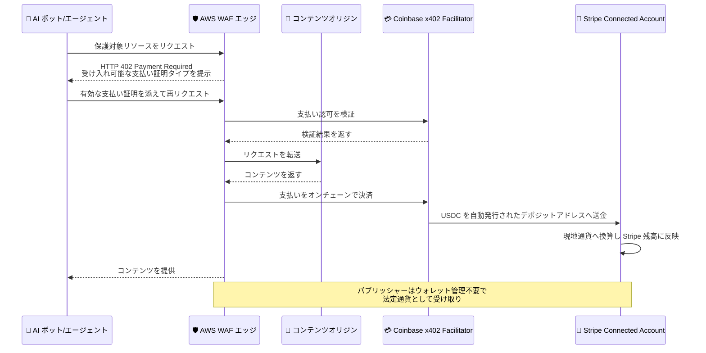

# AWS WAF - AI トラフィックマネタイゼーションの Stripe 法定通貨ペイアウト対応

**リリース日**: 2026 年 11 月 5 日
**サービス**: AWS WAF
**機能**: AI traffic monetization - Stripe fiat payouts (Stripe 経由の法定通貨ペイアウト)

📊 [このアップデートのインフォグラフィックを見る](https://takech9203.github.io/aws-news-summary/20261105-aws-waf-stripe-fiat-payouts.html)
<!-- INFOGRAPHIC_BASE_URL は環境変数から取得 -->

## 概要

AWS WAF の AI traffic monetization (AI トラフィックマネタイゼーション) が、Stripe との統合に対応しました。パブリッシャー、コンテンツ所有者、API プロバイダーは、AI ボットやエージェントから収集したステーブルコインによる支払いを、現地通貨 (法定通貨) に換算して Stripe 残高に直接受け取れるようになります。

2026 年 6 月に発表された AI traffic monetization では、支払いの受け取りにステーブルコイン対応の暗号資産ウォレットを自分で用意する必要がありました。今回のアップデートにより、ステーブルコインを保有したり暗号資産ウォレットを管理したりすることなく、エージェントアクセスのマネタイズが可能になります。Stripe は、既存のステーブルコインペイアウトに加わる新しいペイアウト方法として提供されます。

利用を開始するには、AWS WAF コンソールから Stripe Connect を通じて Stripe アカウントを AWS WAF に接続します。既存の価格設定とエージェントポリシーは変更なしでそのまま動作します。暗号資産の取り扱いに慣れていない企業や、会計処理の観点から法定通貨での受け取りを求める企業にとって、AI トラフィック収益化の導入障壁を大きく下げるアップデートです。

**アップデート前の課題**

- 以前は AI traffic monetization の支払い受け取りにステーブルコイン対応の暗号資産ウォレットを自分で用意し、管理する必要があった
- 以前はステーブルコインで受け取った収益を法定通貨に換金する処理を、自社で別途行う必要があった
- 以前は暗号資産の保有に関する会計・税務・規制上の取り扱いが導入の障壁となるケースがあった

**アップデート後の改善**

- 今回のアップデートにより、AI ボットやエージェントからのステーブルコイン支払いを、現地通貨に決済して Stripe 残高に直接受け取れるようになった
- 今回のアップデートにより、ステーブルコインの保有や暗号資産ウォレットの管理が不要になった
- 今回のアップデートにより、Stripe Connect によるアカウント接続だけで利用を開始でき、既存の価格設定とエージェントポリシーは変更なしで動作するようになった

## アーキテクチャ図



上図は、AI エージェントの支払いから Stripe Connected Account への法定通貨での着金までの流れを示しています。デポジットアドレスの発行とステーブルコインから現地通貨への換算は自動で行われるため、パブリッシャーは暗号資産ウォレットを管理する必要がありません。

## サービスアップデートの詳細

### 主要機能

1. **Stripe 経由の法定通貨ペイアウト**
   - AI ボットやエージェントから収集したステーブルコイン支払いを、現地通貨に決済して Stripe 残高に直接受け取れる
   - ステーブルコインの保有や暗号資産ウォレットの管理が不要になる
   - 既存のステーブルコインペイアウト (自己管理ウォレット) と並ぶ新しいペイアウト方法として選択できる

2. **Stripe Connect によるシンプルなセットアップ**
   - AWS WAF コンソールから Stripe Connect を通じて Stripe アカウントを接続するだけで利用を開始できる
   - 既存の価格設定とエージェントポリシーは変更なしでそのまま動作する
   - 接続アカウント利用時は、支払いネットワークごとのデポジットアドレスが自動的にプロビジョニングされる

3. **統合された収益分析**
   - すべての決済プロバイダーからの収益を AWS WAF コンソールの収益分析で一元的に確認できる
   - ステーブルコインペイアウトと Stripe ペイアウトを併用する場合も、収益を横断的に把握できる

## 技術仕様

### 機能概要

| 項目 | 詳細 |
|------|------|
| 機能種別 | AWS WAF AI traffic monetization のペイアウト方法追加 |
| 使用プロトコル | x402 (マシン間支払い向けオープンプロトコル)、HTTP 402 レスポンス |
| 設定方法 | MonetizationConfig の ConnectedAccountConfigs で構成 |
| 既存の設定方法 | CryptoConfig (自己管理の暗号資産ウォレット) |
| 決済ファシリテーター | Coinbase Developer Platform の x402 Facilitator |
| 決済通貨 | USDC (オンチェーン決済) → Stripe で現地通貨へ換算 |
| アカウント接続 | AWS WAF コンソールの Stripe Connect |
| 追加料金 | なし (標準の AWS WAF 料金と Stripe の決済手数料が適用) |

### 決済の仕組み

AWS WAF Developer Guide によると、決済は以下の流れで行われます。

```text
1. オリジンからコンテンツを取得する前に、クライアントの支払い認可を検証
2. オリジンが正常なレスポンスを返した後、支払いをブロックチェーン上で決済
3. USDC がクライアントのウォレットから送金される
   - 自己管理ウォレットの場合: 構成済みのウォレットアドレスへ
   - 接続アカウントの場合: 自動プロビジョニングされたデポジットアドレスへ
4. 決済確認がクライアントへのレスポンスに含まれる
```

いずれのペイアウト方法でも、AWS は受け取る支払いの当事者ではなく、資金の流れにも関与しません。Stripe Connected Account を開設するには、Stripe のウェブサイトで Stripe Connected Account Agreement への同意が必要です。

### API 変更履歴

| 日付 | サービス | 変更内容 |
|------|----------|----------|
| 2026/11/05 | [wafv2](https://awsapichanges.com/archive/changes/7e892e-wafv2.html) | 7 updated api methods - Web ACL で AI トラフィックをマネタイズする際に、接続アカウント (Stripe) を通じた支払い設定が可能に |

## 設定方法

### 前提条件

1. AWS WAF の Web ACL が Amazon CloudFront ディストリビューションに関連付けられていること
2. AI traffic monetization が構成済みであること (価格設定とエージェントポリシー)
3. Stripe アカウントを保有しており、Stripe Connected Account Agreement に同意できること

### 手順

#### ステップ 1: Stripe アカウントの接続

AWS WAF コンソールの AI traffic monetization 設定から、Stripe Connect を通じて Stripe アカウントを AWS WAF に接続します。接続時に Stripe のウェブサイトで Stripe Connected Account Agreement への同意が求められます。

#### ステップ 2: ペイアウト方法の確認

MonetizationConfig のペイアウト設定で、接続アカウント (ConnectedAccountConfigs) が有効になっていることを確認します。支払いネットワークごとのデポジットアドレスは自動的にプロビジョニングされるため、ウォレットアドレスを自分で管理する必要はありません。既存の価格設定とエージェントポリシーは変更不要です。

#### ステップ 3: 収益分析の確認

エージェントが保護対象コンテンツにアクセスし、支払いが決済されると、収益が Stripe 残高に現地通貨で反映されます。AWS WAF コンソールの収益分析で、すべての決済プロバイダーからの収益を一元的に確認します。

## メリット

### ビジネス面

- **導入障壁の低減**: 暗号資産ウォレットの準備や管理が不要になり、暗号資産に慣れていない企業でも AI トラフィック収益化を始めやすくなる
- **会計処理の簡素化**: 収益を法定通貨として Stripe 残高で受け取れるため、ステーブルコイン保有に伴う会計・税務上の論点を回避しやすくなる
- **既存設定の継続利用**: 価格設定とエージェントポリシーは変更不要のため、移行コストなしでペイアウト方法を追加できる

### 技術面

- **ウォレット管理の自動化**: 支払いネットワークごとのデポジットアドレスが自動プロビジョニングされ、アドレス管理の運用負荷がなくなる
- **一元化された収益分析**: ステーブルコインと Stripe の両方の収益を AWS WAF コンソールで横断的に確認できる
- **シンプルな接続フロー**: Stripe Connect による標準的なアカウント接続のみで構成が完了する

## デメリット・制約事項

### 制限事項

- Amazon CloudFront ディストリビューションに関連付けられた AWS WAF Web ACL があるエッジロケーションでのみ利用可能
- Stripe Connected Account の開設には Stripe Connected Account Agreement への同意が必要
- 決済ファシリテーターは Coinbase Developer Platform の x402 Facilitator であり、Coinbase の利用規約への同意が必要

### 考慮すべき点

- AWS WAF 自体の統合は追加料金なしだが、標準の AWS WAF 料金に加えて Stripe の決済手数料が適用される
- エージェント側の支払いは引き続きステーブルコイン (USDC) によるオンチェーン決済であり、法定通貨になるのはパブリッシャー側の受け取りのみである
- Stripe が利用可能な国・地域や、Stripe 残高からの出金条件は Stripe 側の仕様に従う

## ユースケース

### ユースケース 1: 暗号資産を扱わないメディア企業の収益化

**シナリオ**: ニュースメディアが AI エージェントによる記事アクセスを収益化したいが、社内規程により暗号資産を保有できない。

**実装例**:
```text
AWS WAF コンソールで Stripe Connect により Stripe アカウントを接続。
既存の記事単位の価格設定とエージェントポリシーをそのまま利用。
収益は現地通貨で Stripe 残高に着金。
```

**効果**: 暗号資産を保有せずに AI トラフィックからの収益を法定通貨で受け取れる。

### ユースケース 2: 既存の Stripe 決済基盤との統合

**シナリオ**: SaaS 事業者がすでに Stripe で売上を管理しており、AI エージェント向け API 課金の収益も同じ基盤に集約したい。

**実装例**:
```text
API エンドポイントを保護対象に設定し、x402 による従量課金を構成。
ペイアウト方法に Stripe を選択し、既存の Stripe アカウントへ収益を集約。
```

**効果**: AI エージェント課金の収益を既存の Stripe ベースの経理・精算フローに統合できる。

### ユースケース 3: ステーブルコインと法定通貨の併用

**シナリオ**: データプロバイダーが、用途に応じてステーブルコインペイアウトと Stripe ペイアウトを使い分けたい。

**実装例**:
```text
MonetizationConfig で CryptoConfig と ConnectedAccountConfigs を要件に応じて構成。
AWS WAF コンソールの収益分析で両プロバイダーの収益を一元確認。
```

**効果**: 受け取り方法の選択肢を確保しつつ、収益の可視化を一本化できる。

## 料金

Stripe 統合は、Amazon CloudFront で AWS WAF を使用するすべてのお客様に追加料金なしで提供されます。標準の AWS WAF 料金と Stripe の決済手数料が適用されます。詳細は AWS WAF 料金ページを参照してください。

## 利用可能リージョン

AWS WAF の Web ACL が Amazon CloudFront ディストリビューションに関連付けられているすべてのエッジロケーションで利用可能です。

## 関連サービス・機能

- **AWS WAF AI traffic monetization**: 本アップデートの基盤となる機能。x402 プロトコルと HTTP 402 レスポンスにより AI トラフィックをエッジで収益化する
- **Amazon CloudFront**: Web ACL を CloudFront ディストリビューションに関連付けることで、エッジでの支払い処理を実現する
- **Stripe Connect**: AWS WAF と Stripe アカウントを接続する仕組み。Connected Account を通じて法定通貨での受け取りを可能にする
- **Coinbase x402 Facilitator**: 支払いのオンチェーン決済を提供するサードパーティファシリテーター

## 参考リンク

- 📊 [インフォグラフィック](https://takech9203.github.io/aws-news-summary/20261105-aws-waf-stripe-fiat-payouts.html)
- [公式発表 (What's New)](https://aws.amazon.com/about-aws/whats-new/2026/11/aws-waf-stripe-fiat-payouts/)
- [ドキュメント: AI traffic monetization](https://docs.aws.amazon.com/waf/latest/developerguide/waf-ai-traffic-monetization.html)
- [ドキュメント: Payment networks and settlement](https://docs.aws.amazon.com/waf/latest/developerguide/waf-ai-traffic-monetization-payment.html)
- [AWS WAF 料金ページ](https://aws.amazon.com/waf/pricing/)

## まとめ

今回のアップデートにより、AWS WAF の AI traffic monetization は、暗号資産ウォレットの管理という導入上の最大の障壁を取り除き、Stripe 残高への法定通貨での受け取りを実現しました。既存の価格設定とエージェントポリシーは変更不要のため、すでに本機能を利用中のお客様はペイアウト方法の追加のみで移行できます。暗号資産の取り扱いを理由に導入を見送っていたパブリッシャーや API プロバイダーは、AWS WAF コンソールから Stripe Connect での接続を試すことを推奨します。
