# Amazon EC2 - ImdsV1Enabled CloudWatch メトリクスの公開

**リリース日**: 2026 年 11 月 5 日
**サービス**: Amazon EC2 / Amazon CloudWatch
**機能**: ImdsV1Enabled CloudWatch メトリクス

📊 [このアップデートのインフォグラフィックを見る](https://takech9203.github.io/aws-news-summary/20261105-ec2-imdsv1enabled-cloudwatch-metric.html)

## 概要

Amazon EC2 は、インスタンスメタデータサービスバージョン 1 (IMDSv1) が有効になっている EC2 インスタンスを特定できる新しい CloudWatch メトリクス「ImdsV1Enabled」の公開を開始しました。このメトリクスは各インスタンスの設定 (`HttpTokens` の値) に基づいて発行され、値 `1` は IMDSv1 が有効 (`HttpTokens = optional`)、値 `0` は IMDSv1 が無効 (`HttpTokens = required`) であることを示します。

従来の `MetadataNoToken` メトリクスは実際に IMDSv1 の呼び出しが発生したときにのみ発行されるのに対し、`ImdsV1Enabled` はインスタンスの設定そのものを反映するため、IMDSv1 の呼び出しが行われていない場合でも「IMDSv1 を許可したまま」のインスタンスを特定できます。これにより、アカウントやリージョンをまたいだ IMDSv2 への移行進捗を、独自ツールを構築することなく継続的に追跡できるようになります。

IMDSv2 はセッション指向のトークンベース認証を採用しており、SSRF (サーバーサイドリクエストフォージェリ) などの脆弱性を悪用した認証情報の窃取に対する多層防御を提供します。本アップデートは、IMDSv2 への全面移行を進めるセキュリティチームやクラウド運用チームにとって有用な機能です。

**アップデート前の課題**

このアップデート以前は、IMDSv1 を許可しているインスタンスの棚卸しに手間がかかっていました。

- `MetadataNoToken` メトリクスは IMDSv1 の呼び出しが実際に発生したときのみ発行されるため、「IMDSv1 を許可しているが呼び出しがない」インスタンスを検出できなかった
- 複数アカウント・複数リージョンにまたがる IMDSv1 許可インスタンスの一覧化には、`describe-instances` を定期実行するなどの独自ツールの構築が必要だった
- 移行の進捗を継続的・定量的に可視化する標準的な手段がなかった

**アップデート後の改善**

今回のアップデートにより、設定ベースでの移行追跡が可能になりました。

- インスタンスの設定に基づいてメトリクスが発行されるため、IMDSv1 の呼び出しがなくても IMDSv1 を許可しているインスタンスを特定できるようになった
- CloudWatch ダッシュボードとアラームを設定するだけで、IMDSv1 を許可するインスタンス数をアカウント・リージョン横断で追跡できるようになった
- 独自ツールを構築することなく、IMDSv2 移行の残作業の把握と優先順位付けが可能になった

## アーキテクチャ図

```mermaid
flowchart TD
    subgraph Account["☁️ AWS アカウント"]
        subgraph EC2Layer["🖥️ EC2 インスタンス"]
            direction LR
            I1["🖥️ インスタンス A<br/>HttpTokens = optional<br/>ImdsV1Enabled = 1"]
            I2["🖥️ インスタンス B<br/>HttpTokens = required<br/>ImdsV1Enabled = 0"]
            I1 ~~~ I2
        end
        subgraph Monitoring["📈 モニタリング"]
            CW["📊 CloudWatch<br/>AWS/EC2 名前空間"]
            Dashboard["📋 ダッシュボード<br/>Sum = IMDSv1 許可台数"]
            Alarm["🔔 CloudWatch アラーム"]
        end
    end

    I1 -->|"設定に基づき発行"| CW
    I2 -->|"設定に基づき発行"| CW
    CW --> Dashboard
    CW --> Alarm
    Alarm -.->|"通知"| Ops(["👤 運用チーム"])
    Ops -.->|"ModifyInstanceMetadataOptions<br/>で IMDSv2 必須化"| I1

    classDef account fill:none,stroke:#CCCCCC,stroke-width:2px,color:#666666
    classDef layer fill:none,stroke:#E1BEE7,stroke-width:2px,color:#666666
    classDef warn fill:#FFF3E0,stroke:#FF9800,stroke-width:2px,color:#5D4037
    classDef ok fill:#E9F7EC,stroke:#66BB6A,stroke-width:2px,color:#33691E
    classDef monitor fill:#E8F1FF,stroke:#4A90E2,stroke-width:2px,color:#333333
    classDef user fill:#E3F2FD,stroke:#BBDEFB,stroke-width:2px,color:#1565C0

    class Account account
    class EC2Layer,Monitoring layer
    class I1 warn
    class I2 ok
    class CW,Dashboard,Alarm monitor
    class Ops user
```



各 EC2 インスタンスが自身の IMDS 設定に基づいて `ImdsV1Enabled` メトリクスを CloudWatch に発行し、運用チームはダッシュボードとアラームで IMDSv1 を許可しているインスタンスを特定して IMDSv2 必須化を進める流れを示しています。

## サービスアップデートの詳細

### 主要機能

1. **設定ベースのメトリクス発行**
   - `ImdsV1Enabled` は各インスタンスの IMDS 設定に基づいて `AWS/EC2` 名前空間に発行される
   - 値 `1`: IMDSv1 が有効 (`HttpTokens = optional`)
   - 値 `0`: IMDSv1 が無効 (`HttpTokens = required`)
   - 呼び出しの有無に依存しないため、IMDSv1 の利用がないインスタンスでも設定の棚卸しが可能

2. **移行進捗の定量的な追跡**
   - Sum 統計を使用すると、そのアカウント・リージョンで IMDSv1 を許可しているインスタンス数を把握できる
   - CloudWatch ダッシュボードで複数アカウント・複数リージョンの移行状況を一元的に可視化できる
   - CloudWatch アラームを設定すれば、IMDSv1 許可インスタンスの新規出現を検知できる

3. **既存の IMDS 関連メトリクスとの補完関係**
   - `MetadataNoToken`: IMDSv1 でのアクセス回数を記録 (IMDSv1 有効時のみ発行)
   - `MetadataNoTokenRejected`: IMDSv1 無効化後に拒否された IMDSv1 呼び出し回数を記録 (IMDSv1 無効時のみ発行)
   - `ImdsV1Enabled`: 呼び出しの有無にかかわらず設定状態を記録
   - 3 つのメトリクスを組み合わせることで、移行の各フェーズを漏れなくモニタリングできる

## 技術仕様

### メトリクスの詳細

| 項目 | 詳細 |
|------|------|
| メトリクス名 | `ImdsV1Enabled` |
| 名前空間 | `AWS/EC2` |
| 値 | `1` (IMDSv1 有効 / `HttpTokens = optional`)、`0` (IMDSv1 無効 / `HttpTokens = required`) |
| 単位 | Count |
| 有用な統計 | Sum (IMDSv1 許可インスタンス数)、Average、Maximum |
| ディメンション | `InstanceId` など EC2 インスタンスメトリクスの標準ディメンション |
| 追加料金 | なし |

### IMDS 関連メトリクスの比較

| メトリクス | 発行条件 | 用途 |
|------|------|------|
| `ImdsV1Enabled` | インスタンスの設定に基づき常時発行 | IMDSv1 を許可しているインスタンスの特定、移行進捗の追跡 |
| `MetadataNoToken` | IMDSv1 有効時に IMDSv1 呼び出しが発生した場合 | IMDSv1 を実際に使用しているソフトウェアの検出 |
| `MetadataNoTokenRejected` | IMDSv1 無効時に IMDSv1 呼び出しが拒否された場合 | IMDSv1 無効化後の影響確認 |

`MetadataNoToken` と `MetadataNoTokenRejected` は相互排他であり、`HttpTokens = optional` のときは前者のみ、`HttpTokens = required` のときは後者のみが発行されます。

## 設定方法

### 前提条件

1. EC2 インスタンスが起動していること
2. CloudWatch メトリクスを参照できる IAM 権限 (`cloudwatch:GetMetricData`、`cloudwatch:ListMetrics` など) があること
3. 設定変更を行う場合は `ec2:ModifyInstanceMetadataOptions` 権限があること

### 手順

#### ステップ 1: IMDSv1 を許可しているインスタンス数を確認する

```bash
aws cloudwatch get-metric-statistics \
  --namespace AWS/EC2 \
  --metric-name ImdsV1Enabled \
  --start-time 2026-11-05T00:00:00Z \
  --end-time 2026-11-05T01:00:00Z \
  --period 300 \
  --statistics Sum
```

`ImdsV1Enabled` メトリクスの Sum 統計を取得しています。Sum の値が、その期間に IMDSv1 を許可している (`HttpTokens = optional`) インスタンスの数に相当します。

#### ステップ 2: IMDSv1 を許可している具体的なインスタンスを特定する

```bash
aws ec2 describe-instances \
  --filters "Name=metadata-options.http-tokens,Values=optional" \
  --query "Reservations[*].Instances[*].[InstanceId]" \
  --output text
```

`describe-instances` コマンドで `metadata-options.http-tokens` が `optional` のインスタンスをフィルタリングし、IMDSv1 を許可しているインスタンス ID の一覧を出力しています。

#### ステップ 3: CloudWatch アラームを作成して継続的に監視する

```bash
aws cloudwatch put-metric-alarm \
  --alarm-name imdsv1-enabled-instances \
  --namespace AWS/EC2 \
  --metric-name ImdsV1Enabled \
  --statistic Sum \
  --period 300 \
  --evaluation-periods 1 \
  --threshold 0 \
  --comparison-operator GreaterThanThreshold \
  --alarm-actions arn:aws:sns:ap-northeast-1:123456789012:imds-alerts
```

`ImdsV1Enabled` の Sum が 0 を超えた場合、つまり IMDSv1 を許可するインスタンスが 1 台でも存在する場合に SNS トピックへ通知するアラームを作成しています。

#### ステップ 4: 対象インスタンスで IMDSv2 を必須化する

```bash
aws ec2 modify-instance-metadata-options \
  --instance-id i-0123456789abcdef0 \
  --http-tokens required \
  --http-endpoint enabled
```

`modify-instance-metadata-options` コマンドで `HttpTokens` を `required` に変更し、IMDSv1 を無効化しています。この変更は実行中のインスタンスに対して再起動なしで即時に反映されます。無効化後は `MetadataNoTokenRejected` メトリクスで拒否された IMDSv1 呼び出しの有無を監視します。

## メリット

### ビジネス面

- **セキュリティ態勢の可視化**: IMDSv2 移行の進捗を定量的に経営層やセキュリティ監査に報告できる
- **運用コストの削減**: アカウント・リージョン横断の棚卸しツールを独自開発・保守する必要がなくなる
- **追加コストなし**: メトリクスは追加料金なしで発行されるため、導入の障壁がない

### 技術面

- **設定ベースの検出**: 呼び出しの有無に依存せず、IMDSv1 を許可したままのインスタンスを漏れなく検出できる
- **既存メトリクスとの補完**: `MetadataNoToken` / `MetadataNoTokenRejected` と組み合わせて移行の全フェーズをカバーできる
- **自動化との親和性**: CloudWatch アラームや EventBridge と連携し、検出から是正までのワークフローを自動化できる

## デメリット・制約事項

### 制限事項

- メトリクスは設定状態を示すのみであり、どのソフトウェアが IMDSv1 を使用しているかの特定には `MetadataNoToken` や IMDS Packet Analyzer の併用が必要
- 複数アカウントの集約表示には CloudWatch のクロスアカウントオブザーバビリティなどの追加設定が必要
- メトリクスの確認だけでは是正されない。IMDSv2 必須化には `ModifyInstanceMetadataOptions` などによる設定変更が別途必要

### 考慮すべき点

- IMDSv1 を無効化する前に、`MetadataNoToken` メトリクスで IMDSv1 呼び出しがゼロであることを確認し、SDK やエージェントを IMDSv2 対応バージョンへ更新しておく必要がある
- 恒久的な対策としては、アカウントレベルの IMDS デフォルト設定 (`ModifyInstanceMetadataDefaults`) や AWS Organizations の宣言型ポリシーによる IMDSv2 強制の併用が推奨される

## ユースケース

### ユースケース 1: 組織全体の IMDSv2 移行進捗ダッシュボード

**シナリオ**: 複数アカウント・複数リージョンで数千台の EC2 インスタンスを運用しており、セキュリティ基準として IMDSv2 必須化を全社的に進めている。

**実装例**:
```
1. CloudWatch クロスアカウントオブザーバビリティでモニタリングアカウントに各アカウントのメトリクスを集約
2. ImdsV1Enabled の Sum をアカウント・リージョンごとにウィジェット化したダッシュボードを作成
3. 週次で Sum の推移を確認し、残存インスタンスの多いアカウントから優先的に是正
```

**効果**: 独自の棚卸しスクリプトなしで移行進捗を一元的に可視化し、是正の優先順位付けが容易になる。

### ユースケース 2: IMDSv1 許可インスタンスの新規出現の検知

**シナリオ**: IMDSv2 必須化が完了した環境で、古い AMI や起動テンプレートから IMDSv1 を許可するインスタンスが誤って起動されることを防ぎたい。

**実装例**:
```
1. ImdsV1Enabled の Sum > 0 を条件とする CloudWatch アラームを作成
2. アラームアクションで SNS トピックに通知し、セキュリティチームへエスカレーション
3. 必要に応じて EventBridge と Lambda で ModifyInstanceMetadataOptions を自動実行
```

**効果**: 設定ドリフトを早期に検知し、IMDSv1 許可状態の放置を防止できる。

### ユースケース 3: IMDSv1 無効化前の安全確認

**シナリオ**: レガシーアプリケーションが稼働するインスタンス群で、影響を最小化しながら段階的に IMDSv2 必須化を進めたい。

**実装例**:
```
1. ImdsV1Enabled = 1 のインスタンスを対象リストとして抽出
2. 各インスタンスの MetadataNoToken を監視し、IMDSv1 呼び出しがゼロであることを一定期間確認
3. IMDS Packet Analyzer で呼び出し元ソフトウェアを特定し、必要な更新を実施
4. HttpTokens = required に変更後、MetadataNoTokenRejected で拒否呼び出しの有無を監視
```

**効果**: 3 つのメトリクスを組み合わせることで、サービス影響のリスクを抑えた段階的な移行が可能になる。

## 料金

`ImdsV1Enabled` メトリクスは追加料金なしで利用できます。ただし、CloudWatch ダッシュボードやアラームの作成、メトリクス API の呼び出しには、通常の Amazon CloudWatch の料金が適用されます。

## 利用可能リージョン

すべての AWS リージョンで利用可能です。

## 関連サービス・機能

- **Amazon CloudWatch**: 本メトリクスの発行先。ダッシュボード、アラーム、クロスアカウントオブザーバビリティと組み合わせて移行進捗を可視化できる
- **EC2 インスタンスメタデータサービス (IMDS)**: 本アップデートの対象。IMDSv2 はトークンベースのセッション認証により SSRF などへの多層防御を提供する
- **AWS Organizations 宣言型ポリシー**: 組織全体で IMDSv2 必須をデフォルト設定・強制するために使用できる
- **IMDS Packet Analyzer**: IMDSv1 呼び出しを行っているソフトウェアを特定するオープンソースツール

## 参考リンク

- 📊 [インフォグラフィック](https://takech9203.github.io/aws-news-summary/20261105-ec2-imdsv1enabled-cloudwatch-metric.html)
- [公式発表 (What's New)](https://aws.amazon.com/about-aws/whats-new/2026/11/ec2-imdsv1enabled-cloudwatch-metric/)
- [ドキュメント: EC2 インスタンスの CloudWatch メトリクス](https://docs.aws.amazon.com/AWSEC2/latest/UserGuide/viewing_metrics_with_cloudwatch.html#ec2-cloudwatch-metrics)
- [ドキュメント: IMDSv2 への移行ガイド](https://docs.aws.amazon.com/AWSEC2/latest/UserGuide/instance-metadata-transition-to-version-2.html)
- [料金ページ: Amazon CloudWatch](https://aws.amazon.com/cloudwatch/pricing/)

## まとめ

`ImdsV1Enabled` メトリクスの登場により、IMDSv1 を許可しているインスタンスを呼び出しの有無にかかわらず、追加コストなしで継続的に特定できるようになりました。IMDSv2 への移行を進めている組織は、まず本メトリクスでアカウント・リージョン横断の現状を把握し、`MetadataNoToken` / `MetadataNoTokenRejected` と組み合わせた段階的な IMDSv1 無効化を進めることを推奨します。
