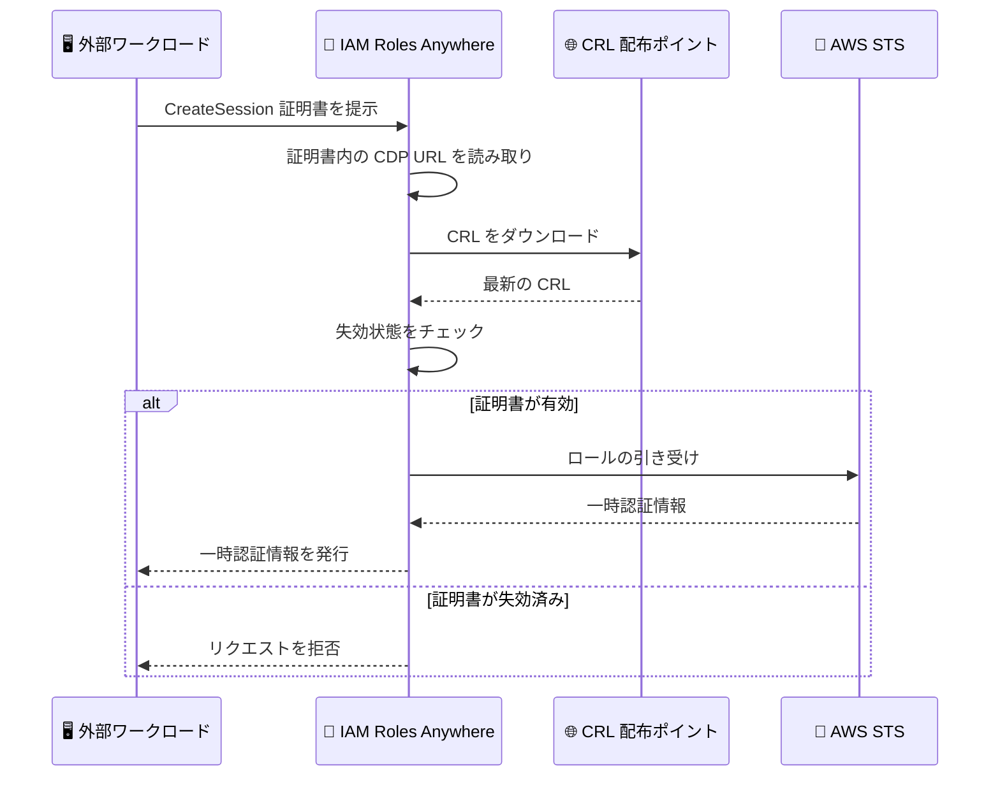

# AWS IAM Roles Anywhere - 証明書失効の自動チェック機能

**リリース日**: 2026 年 11 月 5 日
**サービス**: AWS IAM Roles Anywhere
**機能**: CRL 配布ポイント (CDP) による自動失効チェック

📊 [このアップデートのインフォグラフィックを見る](https://takech9203.github.io/aws-news-summary/20261105-iam-roles-anywhere-cdp.html)

## 概要

AWS IAM Roles Anywhere が、証明書失効リスト (CRL) 配布ポイント (CDP) を利用した自動失効チェックをサポートしました。トラストアンカーでこの機能を有効化すると、IAM Roles Anywhere は認証に使用される X.509 証明書に埋め込まれた CDP の URL を読み取り、対応する CRL を自動的にダウンロードして、失効済み証明書による認証情報のリクエストを拒否します。

IAM Roles Anywhere は、オンプレミスサーバーやコンテナ、IoT デバイスなど AWS 外部のワークロードが X.509 証明書を使って IAM ロールの一時認証情報を取得できるサービスです。今回のアップデートにより、失効チェックを認証局 (CA) と常に同期した状態に保てるようになり、CRL の手動インポートと再インポートという運用負荷が解消されます。

この機能は AWS Private Certificate Authority (AWS Private CA) だけでなく、独自の PKI で発行した証明書でも利用できます。証明書に、配布ポイントの要件を満たすパブリックにアクセス可能な CDP の URL が含まれていることが条件です。

**アップデート前の課題**

- 失効チェックを行うには、CA が生成した CRL を `ImportCrl` API または CLI で手動インポートする必要があった
- CA が CRL を更新するたびに、最新の失効状態を反映するために CRL を再インポートする運用作業が発生していた
- インポート済み CRL は `nextUpdate` の期限が過ぎても使用され続けるため、再インポートを怠ると古い失効情報に基づく判定が行われるリスクがあった

**アップデート後の改善**

- トラストアンカーの設定 `crlDpRevocationEnabled` を有効化するだけで、証明書ごとの追加設定なしに失効チェックが自動化された
- IAM Roles Anywhere が CRL を定期的に自動ダウンロード・更新するため、CRL の手動インポートと再インポートが不要になった
- CA の最新の失効情報と同期した状態を維持でき、失効済み証明書による認証情報の発行を確実に防止できるようになった

## アーキテクチャ図



自動失効チェック有効時の `CreateSession` の流れです。IAM Roles Anywhere が証明書内の CDP の URL から CRL を取得して失効状態を確認し、失効済み証明書によるリクエストを拒否します。

## サービスアップデートの詳細

### 主要機能

1. **CDP による自動失効チェック**
   - 認証に使用される証明書に埋め込まれた CRL 配布ポイントの URL を IAM Roles Anywhere が自動的に読み取る
   - 対応する CRL をダウンロードし、証明書チェーン内の各証明書について失効状態をチェックする
   - 失効済み証明書による `CreateSession` リクエストを拒否し、認証情報を発行しない

2. **CRL の自動更新**
   - IAM Roles Anywhere が配布ポイントから取得した CRL を定期的に自動更新する
   - CA が更新した CRL は、公開後最大 30 分以内に失効チェックへ反映される
   - CRL の `nextUpdate` 期限内であれば、一時的に配布ポイントへ到達できなくても既存の CRL で失効チェックを継続する

3. **トラストアンカー単位の有効化**
   - トラストアンカーの設定 `crlDpRevocationEnabled` で制御する (デフォルトは無効)
   - 有効化すると、そのトラストアンカーで認証されるすべてのリクエストに適用される
   - IAM Roles Anywhere コンソール、AWS SDK、AWS CLI から有効化できる

4. **既存の CRL インポート機能との併用**
   - 手動インポートした CRL と自動失効チェックは併用可能
   - 併用時は、どちらか一方のリストに記載されている証明書は失効済みとして扱われる

## 技術仕様

### CDP の要件と動作

| 項目 | 詳細 |
|------|------|
| 有効化設定 | トラストアンカーの `crlDpRevocationEnabled` を `true` に設定 (デフォルトは `false`) |
| 対象 URL スキーム | HTTP または HTTPS のみ (LDAP などは無視される) |
| チェック対象の URL 数 | 証明書ごとに最大 5 つの CDP URL |
| URL 長 | 2,048 文字以内 |
| ポート | HTTP は 80、HTTPS は 443 のデフォルトポートのみ |
| アクセス性 | ホスト名がパブリック IP アドレスに解決され、インターネットから到達可能であること |
| リダイレクト | 非対応 (URL が CRL を直接返す必要がある) |
| CRL サイズ | 1 MB 以内の単一の CRL |
| CRL 更新の反映 | CA による CRL 公開後、最大 30 分で反映 |
| 間接 CRL | 非対応 (証明書を発行した CA 自身が発行・署名した CRL のみ対応) |
| OCSP | 非対応 (IAM Roles Anywhere は OCSP による失効チェックをサポートしない) |

### フェイルクローズ動作

チェック対象の配布ポイントから有効な CRL を取得できず、過去にダウンロードした有効な CRL も存在しない場合、IAM Roles Anywhere は失効状態を確認できないため `CreateSession` リクエストを拒否します。失効状態が確認できない状態で認証情報が発行されることはありません。

### API 変更履歴

| 日付 | サービス | 変更内容 |
|------|----------|----------|
| 2026/11/04 | [IAM Roles Anywhere](https://awsapichanges.com/archive/changes/f6d89d-rolesanywhere.html) | 9 updated api methods - CRL 配布ポイントによる自動失効チェックを有効化する `crlDpRevocationEnabled` フィールドを追加 |

## 設定方法

### 前提条件

1. IAM Roles Anywhere のトラストアンカーが設定済みであること
2. 認証に使用する証明書に CDP の URL が含まれていること (AWS Private CA または独自 PKI で発行)
3. CDP の URL がインターネットからパブリックにアクセス可能で、配布ポイントの要件を満たしていること

### 手順

#### ステップ 1: 証明書の CDP URL を確認する

```bash
openssl x509 -text -noout -in certificate.pem | grep -A 4 "CRL Distribution Points"
```

認証に使用する証明書に CRL 配布ポイントの URL が含まれているかを確認します。`X509v3 CRL Distribution Points` 拡張に HTTP または HTTPS の URL が表示されれば、自動失効チェックの対象になります。

#### ステップ 2: トラストアンカーで自動失効チェックを有効化する

```bash
aws rolesanywhere update-trust-anchor \
  --trust-anchor-id <トラストアンカー ID> \
  --crl-dp-revocation-enabled
```

対象のトラストアンカーの `crlDpRevocationEnabled` 設定を有効化します。この設定は、該当トラストアンカーで認証されるすべてのリクエストに適用されます。コンソールの場合は、トラストアンカーの編集画面から有効化できます。

#### ステップ 3: 動作を確認する

```bash
./aws_signing_helper credential-process \
  --certificate certificate.pem \
  --private-key private-key.pem \
  --trust-anchor-arn <トラストアンカー ARN> \
  --profile-arn <プロファイル ARN> \
  --role-arn <ロール ARN>
```

credential helper を使用して一時認証情報の取得をテストします。有効な証明書では認証情報が発行され、CA で失効させた証明書ではリクエストが拒否されることを確認します。なお、IAM Roles Anywhere が配布ポイントの URL を初めて処理する際は、`CreateSession` リクエスト中に CRL をダウンロードするため、初回リクエストのレイテンシーが増加する場合があります。

## メリット

### ビジネス面

- **運用負荷の削減**: CRL の手動インポートと CA 更新のたびの再インポートが不要になり、PKI 運用チームの作業負担を軽減できる
- **セキュリティポスチャの向上**: 失効チェックが CA と自動的に同期されるため、失効済み証明書による不正アクセスのリスクを低減できる
- **追加コストなし**: 追加料金なしで利用でき、セキュリティ強化に伴うコスト増加がない

### 技術面

- **CA との自動同期**: CA が公開した最新の CRL が最大 30 分で失効チェックに反映され、人手による更新遅延がなくなる
- **フェイルクローズ設計**: 失効状態を確認できない場合はリクエストを拒否するため、不確実な状態で認証情報が発行されない
- **PKI の選択肢が広い**: AWS Private CA に加えて独自 PKI でも利用でき、既存の証明書基盤をそのまま活用できる

## デメリット・制約事項

### 制限事項

- CDP の URL はインターネットからパブリックにアクセス可能である必要があり、プライベートネットワーク内のみで公開される CRL は利用できない
- OCSP による失効チェックはサポートされない
- 間接 CRL (証明書を発行した CA と異なる主体が発行する CRL) はサポートされず、CRL 発行者フィールドを含む配布ポイントはスキップされる
- チェック対象は証明書ごとに最大 5 つの HTTP/HTTPS URL で、CRL は 1 MB 以内である必要がある
- 自動検出された配布ポイントはアカウント内のリソースとして作成されないため、個別に表示・管理できない

### 考慮すべき点

- 配布ポイントが要件を満たさず、有効な CRL が過去のダウンロードにも存在しない場合、`CreateSession` が拒否される。有効化前に CDP の URL の到達性と応答速度を確認することが重要
- CA は前の CRL の `nextUpdate` 期限が切れる前に、更新した CRL を各配布ポイントへ公開する必要がある。期限切れの CRL は使用されず、新しい CRL を取得できなければリクエストが拒否される
- AWS Private CA を使用する場合、CRL は Amazon S3 バケットに公開されるため、S3 の CRL 公開先が配布ポイントの要件 (パブリックアクセス可能であることなど) を満たすよう設定する必要がある
- 初めて処理される配布ポイントの URL では、初回の `CreateSession` リクエストにレイテンシーが追加される

## ユースケース

### ユースケース 1: オンプレミスサーバーの証明書失効管理の自動化

**シナリオ**: オンプレミスのアプリケーションサーバー群が IAM Roles Anywhere で AWS リソースにアクセスしており、社内 PKI が発行する証明書の失効情報を手動で CRL インポートして管理している。

**実装例**:
```bash
# 既存の手動 CRL インポート運用から自動失効チェックへ移行
aws rolesanywhere update-trust-anchor \
  --trust-anchor-id ta-example1234567890 \
  --crl-dp-revocation-enabled
```

**効果**: CA が CRL を更新するたびに行っていた再インポート作業が不要になり、退職者や漏えいした証明書の失効が最大 30 分で自動的に反映される。

### ユースケース 2: AWS Private CA と組み合わせたハイブリッド環境のセキュリティ強化

**シナリオ**: AWS Private CA で発行した証明書を使用して、ハイブリッド環境のワークロードが IAM Roles Anywhere 経由で AWS にアクセスしている。インシデント発生時に、漏えいした証明書からの認証を迅速に遮断したい。

**実装例**:
```bash
# AWS Private CA で証明書を失効させる
aws acm-pca revoke-certificate \
  --certificate-authority-arn <CA の ARN> \
  --certificate-serial <証明書のシリアル番号> \
  --revocation-reason "KEY_COMPROMISE"

# AWS Private CA が S3 に公開する CRL を IAM Roles Anywhere が自動取得
# 追加の運用作業は不要
```

**効果**: 証明書の失効操作のみでインシデント対応が完結し、IAM Roles Anywhere 側での CRL インポート作業なしに失効済み証明書からの認証情報発行を防止できる。

### ユースケース 3: 手動インポート CRL との併用による多層防御

**シナリオ**: 複数の CA を利用しており、一部の CA の CRL はパブリックな CDP で公開できないため手動インポートを継続しつつ、CDP を公開できる CA は自動失効チェックへ移行したい。

**実装例**:
```bash
# CDP を公開できない CA の CRL は従来どおり手動インポート
aws rolesanywhere import-crl \
  --name internal-ca-crl \
  --crl-data fileb://crl.der \
  --trust-anchor-arn <トラストアンカー ARN>

# トラストアンカーでは自動失効チェックも有効化
aws rolesanywhere update-trust-anchor \
  --trust-anchor-id ta-example1234567890 \
  --crl-dp-revocation-enabled
```

**効果**: 手動インポートと自動チェックを併用でき、どちらか一方のリストに記載された証明書は失効済みとして扱われるため、CA ごとの運用形態に合わせた柔軟な失効管理が実現する。

## 料金

追加料金なしで利用できます。IAM Roles Anywhere 自体も追加料金なしで利用でき、ワークロードがアクセスする AWS サービスの利用料金のみが発生します。

## 利用可能リージョン

すべての商用 AWS リージョンで利用可能です。

## 関連サービス・機能

- **AWS Private Certificate Authority**: プライベート証明書の発行と CRL の S3 への自動公開を行う CA サービス。発行した証明書の CDP を自動失効チェックに利用できる
- **AWS IAM**: IAM Roles Anywhere が引き受ける IAM ロールと信頼ポリシーを管理するサービス
- **AWS STS**: IAM Roles Anywhere が発行する一時認証情報の基盤となるトークンサービス
- **Amazon S3**: AWS Private CA 利用時に CRL の配布ポイントとして機能するストレージサービス

## 参考リンク

- 📊 [インフォグラフィック](https://takech9203.github.io/aws-news-summary/20261105-iam-roles-anywhere-cdp.html)
- [公式発表 (What's New)](https://aws.amazon.com/about-aws/whats-new/2026/11/iam-roles-anywhere-cdp/)
- [ドキュメント: IAM Roles Anywhere の失効チェック](https://docs.aws.amazon.com/rolesanywhere/latest/userguide/trust-model.html#crl-distribution-point-revocation)
- [IAM Roles Anywhere 製品ページ](https://aws.amazon.com/iam/roles-anywhere)
- [AWS Private CA: CRL の計画](https://docs.aws.amazon.com/privateca/latest/userguide/crl-planning.html)

## まとめ

IAM Roles Anywhere の自動失効チェックにより、CRL の手動インポートという運用負荷が解消され、失効チェックを CA と常に同期した状態に保てるようになりました。現在 CRL を手動インポートしている環境や、失効チェックを行っていない環境では、証明書の CDP の URL が要件を満たすことを確認したうえで、トラストアンカーの `crlDpRevocationEnabled` の有効化を検討することを推奨します。
