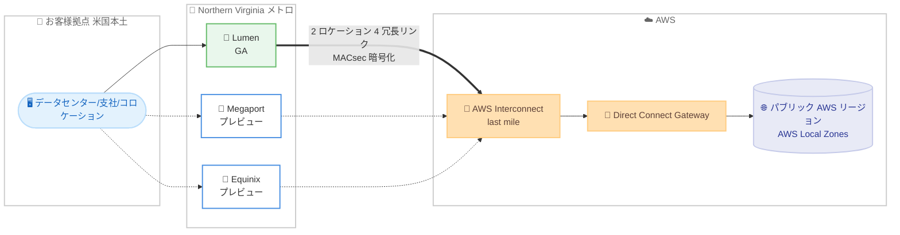

# AWS Interconnect - last mile - Northern Virginia メトロの提供を開始

**リリース日**: 2026 年 11 月 5 日
**サービス**: AWS Interconnect - last mile
**機能**: 新メトロ Northern Virginia, USA の追加 (New York に続く 2 番目のメトロ)

📊 [このアップデートのインフォグラフィックを見る](https://takech9203.github.io/aws-news-summary/20261105-interconnect-last-mile-northern-virginia.html)
<!-- INFOGRAPHIC_BASE_URL は環境変数から取得 -->

## 概要

AWS は、フルマネージドなラストマイル接続サービス「AWS Interconnect - last mile」の新しいメトロとして Northern Virginia, USA の提供を発表しました。Northern Virginia は New York に続く 2 番目のメトロとなり、データセンター、支社、コロケーション施設から AWS へのプライベート接続の選択肢が拡大しました。

AWS Interconnect - last mile は、クロスコネクトの発注やルーターの設定を行うことなく、マネージドでプライベートかつ高耐障害性の接続を AWS へ確立できるサービスです。すべての接続は、物理的に分離された 2 つのロケーションと 4 つの冗長リンクにまたがってデフォルトでプロビジョニングされ、Direct Connect ポートまで 99.99% の可用性 SLA が適用されます。AWS とパートナーのエッジデバイス間のトラフィックは、デフォルトで MACsec により暗号化されます。

Northern Virginia メトロでは、Lumen のお客様は米国本土のどこからでも一般提供 (GA) の接続を発注でき、中国リージョンを除くすべてのパブリック AWS リージョンおよび AWS Local Zones へ到達できます。さらに、同メトロでは Megaport と Equinix を通じたプレビュー接続も利用可能です。接続は AWS Management Console、AWS CLI、AWS Interconnect API から作成できます。

**アップデート前の課題**

このアップデート以前は、GA の接続で利用できるメトロが限られていました。

- 以前は、Lumen 経由の GA 接続で利用できるメトロが New York のみであり、接続経路の選択肢が限られていた
- 以前は、us-east-1 周辺に拠点やワークロードを持つお客様も、地理的に離れたメトロを経由する必要があった
- 以前は、メトロの選択肢が少なく、メトロ単位での経路分散や冗長構成の設計自由度が限られていた

**アップデート後の改善**

今回のアップデートにより、Northern Virginia メトロが利用可能になりました。

- 今回のアップデートにより、New York に続く 2 番目のメトロとして Northern Virginia が追加され、接続経路の選択肢が拡大した
- 今回のアップデートにより、Lumen のお客様は米国本土のどこからでも Northern Virginia メトロ経由で GA の接続を発注し、中国を除く全パブリック AWS リージョンと AWS Local Zones へ到達できるようになった
- 今回のアップデートにより、同一メトロで Megaport と Equinix のプレビュー接続も利用でき、パートナーの選択肢が広がった

## アーキテクチャ図

米国本土のお客様拠点から Northern Virginia メトロのパートナー (Lumen は GA、Megaport と Equinix はプレビュー) を経由して AWS Interconnect - last mile に接続し、Direct Connect Gateway を介して中国を除くすべてのパブリック AWS リージョンおよび AWS Local Zones へ到達する構成を示しています。すべての接続は 2 つの物理的に分離されたロケーションと 4 つの冗長リンクでプロビジョニングされます。

## サービスアップデートの詳細

### 主要機能

1. **Northern Virginia メトロの追加**
   - New York に続く 2 番目のメトロとして Northern Virginia, USA が利用可能になった
   - データセンター、支社、コロケーション施設から AWS へのプライベート接続の経路として選択できる
   - メトロは、パートナーのネットワークインフラストラクチャと AWS が相互接続する地点であり、料金ティアの算出基準にもなる

2. **Lumen 経由の GA 接続**
   - Lumen のお客様は、米国本土のどこからでも Northern Virginia メトロ経由で GA の接続を発注できる
   - 中国リージョンを除くすべてのパブリック AWS リージョンと AWS Local Zones へ到達可能
   - 接続は AWS Management Console、AWS CLI、AWS Interconnect API から作成できる

3. **Megaport と Equinix 経由のプレビュー接続**
   - Northern Virginia メトロでは、Megaport および Equinix を通じたプレビュー接続も利用できる
   - 2026 年 10 月の Megaport プレビュー、2026 年 11 月 4 日の Equinix プレビュー発表に続き、同一メトロで複数パートナーを選択できる体制が整った

4. **デフォルトでの高耐障害性とセキュリティ**
   - すべての接続は、物理的に分離された 2 つのロケーションと 4 つの冗長リンクにまたがってデフォルトでプロビジョニングされる
   - Direct Connect ポートまで 99.99% の可用性 SLA が適用される
   - AWS とパートナーのエッジデバイス間のトラフィックはデフォルトで MACsec により暗号化される

## 技術仕様

### Northern Virginia メトロの提供形態

| 項目 | 詳細 |
|------|------|
| メトロ | Northern Virginia, USA (New York に続く 2 番目のメトロ) |
| GA パートナー | Lumen (米国本土のどこからでも発注可能) |
| プレビューパートナー | Megaport、Equinix |
| 到達可能なリージョン | 中国を除くすべてのパブリック AWS リージョンおよび AWS Local Zones (Lumen GA 接続) |
| 冗長性 | 物理的に分離された 2 ロケーション、4 冗長リンク |
| SLA | 99.99% (Direct Connect ポートまで) |
| 暗号化 | MACsec (デフォルトで有効) |
| 作成方法 | AWS Management Console、AWS CLI、AWS Interconnect API |

### 料金ティアの考え方

料金ページによると、AWS Interconnect - last mile の料金ティアは、Interconnect メトロと単一の Direct Connect Gateway に接続された最も遠い AWS リージョンとの地理的距離に基づいて自動的に割り当てられます。

| 項目 | 詳細 |
|------|------|
| ティア数 | Tier 1 (最安) 〜 Tier 5 (最高) の 5 段階 |
| ティア決定基準 | メトロと、Direct Connect Gateway に接続された最も遠い AWS リージョンとの距離 |
| 課金単位 | Interconnect ごとの時間課金 (1 時間単位で切り上げ) |
| データ転送料金 | GB あたりのデータ転送料金は発生しない |

Northern Virginia メトロは us-east-1 に近接しているため、接続先リージョンが us-east-1 のみであれば低いティアで利用できる可能性があります。ただし、Cloud WAN 構成では最も遠い CNE がティアに反映される点に注意が必要です。

## 設定方法

### 前提条件

1. Direct Connect Gateway が作成済みであること
2. パートナー (Lumen、Megaport、Equinix のいずれか) のサブスクライバー ID またはプロジェクト ID を保有していること
3. 接続元拠点がパートナーのネットワークフットプリントでカバーされていること (Lumen GA の場合は米国本土)

### 手順

#### ステップ 1: Interconnect の作成

AWS Management Console、AWS CLI、AWS Interconnect API のいずれかで、希望する AWS リージョン、帯域速度、Direct Connect Gateway、パートナー情報を指定し、メトロとして Northern Virginia を選択して Interconnect を作成します。この操作により、AWS が接続に必要な構成を準備します。

#### ステップ 2: パートナー側でのプロビジョニング完了

接続を開始すると AWS がアクティベーションキーを生成します。このキーをパートナーのポータルに入力することで、パートナー側のプロビジョニングが完了し、拠点から AWS への接続が確立されます。

#### ステップ 3: 接続の確認

BGP ピアリング、VLAN 設定、ASN 割り当てなどのネットワーク構成は自動化されるため、プロビジョニング完了後に Direct Connect Gateway を介した接続先リージョンへの疎通を確認します。

## メリット

### ビジネス面

- **接続経路の選択肢拡大**: New York に加えて Northern Virginia メトロを選択できるようになり、拠点の立地や接続先リージョンに応じた最適な経路を選べる
- **コスト最適化の可能性**: 料金ティアはメトロと最も遠い接続先リージョンの距離で決まるため、us-east-1 を中心に利用するお客様は近接メトロの選択によりコストを抑えられる可能性がある
- **広域からの発注**: Lumen のお客様は米国本土のどこからでも GA の接続を発注でき、拠点の所在地にかかわらず利用しやすい

### 技術面

- **デフォルトの高耐障害性**: 物理的に分離された 2 ロケーションと 4 冗長リンクによる構成が標準で提供され、追加の冗長設計が不要
- **Direct Connect ポートまでの SLA**: 99.99% の可用性 SLA が Direct Connect ポートまで適用され、エンドツーエンドに近い品質保証が得られる
- **デフォルトの MACsec 暗号化**: AWS とパートナーのエッジデバイス間が追加設定なしで暗号化される

## デメリット・制約事項

### 制限事項

- GA の接続は現時点で Lumen 経由に限られ、Megaport と Equinix はプレビュー段階である
- Lumen の GA 接続は米国本土のお客様が対象であり、日本を含む米国外の拠点からは利用できない
- 中国リージョンは接続先の対象外である

### 考慮すべき点

- 料金ティアは Direct Connect Gateway に接続された最も遠い AWS リージョンで決まるため、遠方リージョンや Cloud WAN の CNE を追加するとティアが上がる可能性がある
- プレビューパートナー (Megaport、Equinix) を利用する場合は、本番適用前に提供条件や SLA を確認する必要がある

## ユースケース

### ユースケース 1: us-east-1 を中心としたハイブリッド接続のコスト最適化

**シナリオ**: 米国東海岸にデータセンターを持つ企業が、us-east-1 のワークロードと接続するハイブリッド構成を運用したい。

**効果**: Northern Virginia メトロは us-east-1 に近接しているため、低い料金ティアでの接続が期待でき、GB あたりのデータ転送料金なしの時間課金でコストを予測しやすくなります。

### ユースケース 2: メトロ分散による接続経路の冗長化

**シナリオ**: ミッションクリティカルなワークロードのため、単一メトロの障害にも耐えられる接続構成を設計したい。

**効果**: New York メトロと Northern Virginia メトロの両方で Interconnect を作成することで、各接続が持つ 2 ロケーション・4 リンクの冗長性に加え、メトロレベルでの地理的な経路分散を実現できます。

### ユースケース 3: 複数パートナーの比較評価

**シナリオ**: ラストマイルパートナーの選定にあたり、同一メトロで複数パートナーのサービスを比較したい。

**効果**: Northern Virginia メトロでは Lumen (GA) に加えて Megaport と Equinix (いずれもプレビュー) が利用できるため、既存のパートナー契約や拠点カバレッジに応じた比較評価を単一メトロで実施できます。

## 料金

AWS Interconnect - last mile は、Interconnect ごとに選択した帯域幅と自動割り当てされる料金ティア (Tier 1〜Tier 5) に基づく時間課金制で、GB あたりのデータ転送料金は発生しません。課金は Interconnect の作成時に開始し、削除時に終了します (1 時間単位で切り上げ)。料金ティアは、Interconnect メトロと Direct Connect Gateway に接続された最も遠い AWS リージョンとの地理的距離に基づいて決定されます。

### 料金例

料金ページに記載されている例を示します。

| 構成 | 料金 |
|--------|------------------|
| New York メトロ (Lumen) から us-east-1 へ 10 Gbps 接続 (Tier 1) | $12.33/時 (730 時間で約 $9,000.90/月) |
| 同構成で Cloud WAN の CNE が us-east-1 と ap-southeast-1 にある場合 (Tier 4) | $51.78/時 (約 $37,799.40/月) |

詳細は [料金ページ](https://aws.amazon.com/interconnect/lastmile/pricing/) を参照してください。

## 利用可能リージョン

Northern Virginia, USA メトロが、New York に続く 2 番目のメトロとして利用可能になりました。

- Lumen 経由 (GA): 米国本土のお客様が対象。中国を除くすべてのパブリック AWS リージョンおよび AWS Local Zones に到達可能
- Megaport 経由 (プレビュー): Northern Virginia メトロで利用可能
- Equinix 経由 (プレビュー): Northern Virginia メトロで利用可能

## 関連サービス・機能

- **AWS Direct Connect**: 専用ネットワーク接続を提供するサービス。AWS Interconnect - last mile の SLA は Direct Connect ポートまで適用される
- **AWS Direct Connect Gateway**: 複数の VPC やリージョンへの接続を集約するゲートウェイ。接続作成時に指定し、接続された最も遠いリージョンが料金ティアの算出に使用される
- **AWS Cloud WAN**: グローバルネットワークを構築するサービス。CNE の配置が料金ティアに影響する
- **AWS Interconnect - multicloud**: 他クラウドプロバイダーとのプライベート接続を提供する姉妹機能

## 参考リンク

- 📊 [インフォグラフィック](https://takech9203.github.io/aws-news-summary/20261105-interconnect-last-mile-northern-virginia.html)
- [公式発表 (What's New)](https://aws.amazon.com/about-aws/whats-new/2026/11/interconnect-last-mile-northern-virginia/)
- [ドキュメント](https://docs.aws.amazon.com/interconnect/)
- [料金ページ](https://aws.amazon.com/interconnect/lastmile/pricing/)
- [関連レポート: Equinix プレビュー発表 (2026 年 11 月 4 日)](./2026-11-04-interconnect-last-mile-preview-equinix.md)

## まとめ

AWS Interconnect - last mile の Northern Virginia メトロ追加により、New York に続く 2 番目のメトロとして、Lumen 経由の GA 接続と Megaport および Equinix 経由のプレビュー接続が利用可能になりました。us-east-1 に近接したメトロの追加は、料金ティアの最適化やメトロレベルでの経路分散の観点で有用です。米国に拠点を持ち AWS へのプライベート接続を検討しているお客様は、拠点の立地と接続先リージョンに応じて New York と Northern Virginia のメトロを比較し、最適な構成を評価することを推奨します。
