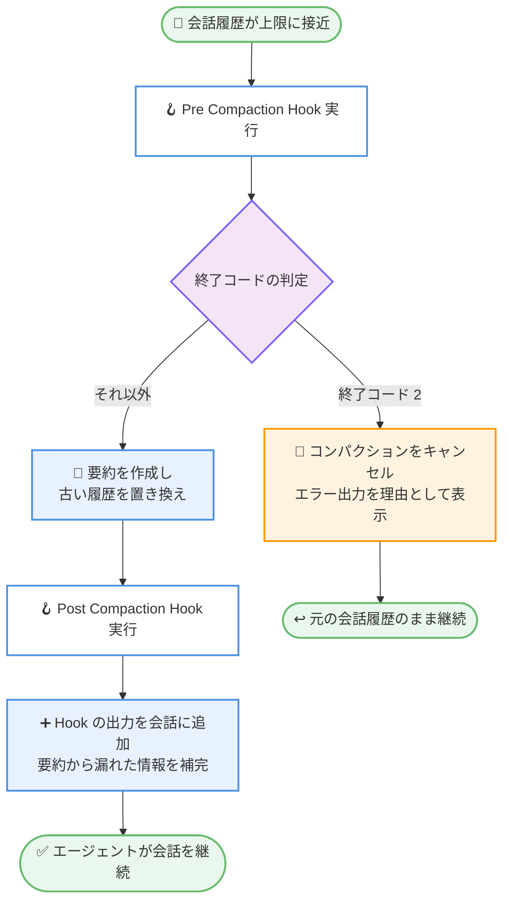

# Kiro - Compaction Hooks、ワークフロー実行検索、サブエージェントの Memory アクセス

**リリース日**: 2026 年 11 月 5 日
**サービス**: Kiro (AWS が提供する AI 搭載 IDE)
**機能**: Compaction Hooks (Pre Compaction / Post Compaction トリガー)、Workflow Runs 検索、サブエージェントの読み取り専用 Memory アクセス (IDE 1.4.121)

📊 [このアップデートのインフォグラフィックを見る](https://takech9203.github.io/aws-news-summary/20261105-kiro-changelog-2026-11-05.html)

## 概要

Kiro IDE 1.4.121 がリリースされ、会話のコンパクション (圧縮) の前後に Hook を実行できる新しいトリガー「Pre Compaction Hook」と「Post Compaction Hook」が追加されました。コンパクションとは、会話履歴が長くなった際に Kiro が古い履歴を要約に置き換えてコンテキストを節約する処理です。今回のアップデートにより、この処理のライフサイクルにユーザー独自の処理を組み込めるようになりました。

また、Workflow Runs ビューへの検索機能の追加、コンパクトなワークフロー実行カード、Web ページ取得時に Markdown 形式をサイトへ要求する改善、サブエージェントによる読み取り専用の Memory アクセスも含まれています。さらに、接続が完了しないウィンドウで Agent Focus が停止する問題、MCP トークンリフレッシュの障害時に再サインインを強制される問題、非常に大きなセッションが開けない問題などの修正も行われています。

**アップデート前の課題**

- コンパクションは Kiro が自動的に実行するため、要約によって重要なコンテキストが失われても、ユーザーが介入したり補完したりする手段がなかった
- コンパクション前の会話履歴を保存したり、コンパクションの実行可否を制御したりすることができなかった
- Workflow Runs ビューに検索機能がなく、実行数が増えると目的の実行を見つけにくかった
- サブエージェントは親セッションの Memory (ローカルメモリ) にアクセスできず、親エージェントが蓄積したコンテキストを活用できなかった
- Web ページの取得結果でコードブロックやリンクの構造が失われることがあった

**アップデート後の改善**

- Pre Compaction Hook により、要約が書き込まれる前に処理を実行し、終了コード 2 でコンパクション自体をキャンセルできるようになった
- Post Compaction Hook により、要約への置き換え後に Hook の出力を会話へ追加し、要約から漏れた情報をエージェントに保持させられるようになった
- Workflow Runs ビューで実行の名前、ステータス、記録された実行時間による絞り込みが可能になった
- サブエージェントが親セッションのローカルメモリを読み取り専用で参照できるようになった
- Web ページ取得時にサイトへ Markdown または HTML を要求し、Markdown を提供するサイトではコードブロックとリンクが保持されるようになった

## アーキテクチャ図



Kiro が会話を自動コンパクションする際の Hook 実行フローです。Pre Compaction Hook は要約の書き込み前に実行されて終了コード 2 でキャンセルでき、Post Compaction Hook は要約への置き換え後に実行されて出力が会話に追加されます。

## サービスアップデートの詳細

### 主要機能

1. **Pre Compaction Hook (コンパクション前トリガー)**
   - Hook エディターの「Compaction Hooks」グループに追加された新しいトリガー
   - Kiro が会話を自動コンパクションする際、要約が書き込まれる前に実行される
   - 終了コード 2 で終了するとコンパクションをキャンセルでき、その際の標準エラー出力がキャンセル理由として表示される
   - matcher (対象を絞り込む条件) は指定できない

2. **Post Compaction Hook (コンパクション後トリガー)**
   - 要約が古い会話履歴を置き換えた後に実行される
   - Hook の出力が会話に追加されるため、要約から漏れた情報をエージェントに保持させることができる
   - matcher は指定できない

3. **Workflow Runs ビューの検索**
   - Workflows を有効にしている場合、実行一覧の上にある「Search workflows」フィールドに入力すると、実行の名前、ステータス、記録された実行時間で絞り込みができる
   - 「Clear search」の選択または Escape キーで全件表示に戻る
   - Recipes ビューの初期サイズが小さくなり、実行一覧の表示領域が広くなった

4. **コンパクトなワークフロー実行カード**
   - Workflow Runs ビュー、チャット、セッションヘッダーのドロップダウンで、実行カードが記録された実行時間を表示する共通のコンパクトレイアウトになった
   - カードにホバーまたはフォーカスすると Pause、Resume、Stop が表示され、カードからステップを開くこともできる

5. **Web ページの Markdown 取得**
   - Kiro が Web ページを取得する際、サイトに対して Markdown または HTML を要求するようになった
   - Markdown を提供するサイトでは、コードブロックとリンクが保持される

6. **サブエージェントの読み取り専用 Memory アクセス**
   - Kiro がディスパッチしたサブエージェントが、親セッションで利用可能なローカルメモリを読み取れるようになった
   - サブエージェントはメモリの追加、変更、削除はできない (読み取り専用)

### 主な修正

- 接続が完了しないエディターウィンドウのエージェントがあっても、Agent Focus がリフレッシュ中に停止しなくなった
- MCP サーバーのトークンリフレッシュが失敗 (トークンエンドポイントへの到達不能またはエラー応答) しても、新しいサインインを強制されなくなった。ツール呼び出しは失敗するが、サーバーはサインイン状態を維持する
- 終了コード 2 で終了する Pre Tool Use Hook が、標準エラー出力に何も書き込まなくてもツール呼び出しをブロックするようになった
- ファイル編集時にドル記号のシーケンスが置換パターンとして展開されず、そのまま書き込まれるようになった
- 最後のツール呼び出しの後にモデルがテキストを返さない場合、再試行を繰り返さずにターンが正常に終了するようになった
- 非常に大きなセッションが内部エラーで失敗せずに開けるようになった
- ターン上限に達したサブエージェントが、成功に見える空の結果ではなく、未完了の作業を親エージェントに報告するようになった
- サインアウト状態でプロンプトを送信すると、認証エラーでターンが失敗する代わりに、すぐにサインインメッセージが表示されるようになった
- 別の Kiro ウィンドウを開いても、実行中のウィンドウの Kiro Logs および Kiro - MCP Logs ビューの履歴が失われなくなった
- Windows では、オートコンプリートが PowerShell プロセスを起動せずにエディターから電源状態を読み取るようになり、拡張機能のロード時にコードページコマンドを実行しなくなった

## 技術仕様

### Compaction Hooks の仕様

| 項目 | Pre Compaction Hook | Post Compaction Hook |
|------|---------------------|----------------------|
| 実行タイミング | 要約が書き込まれる前 | 要約が古い履歴を置き換えた後 |
| コンパクションのキャンセル | 可能 (終了コード 2) | 不可 |
| キャンセル時の表示 | 標準エラー出力が理由として表示 | - |
| 出力の扱い | - | 会話に追加され、エージェントが保持 |
| matcher の指定 | 不可 | 不可 |
| 設定場所 | Hook エディターの Compaction Hooks グループ | Hook エディターの Compaction Hooks グループ |

なお、同日リリースの Kiro CLI 3.1.0 でも、CLI V3 セッション向けに同様の `PreCompact` / `PostCompact` Hook が追加されています。CLI 版では手動・自動どちらのコンパクションでも実行されます。

## 設定方法

### 前提条件

1. Kiro IDE 1.4.121 以降がインストールされていること
2. Workflow Runs 検索を利用する場合は、Workflows 機能が有効になっていること

### 手順

#### ステップ 1: Kiro IDE を最新バージョンに更新

Kiro IDE を再起動するか、アップデートを確認して 1.4.121 以降に更新します。

#### ステップ 2: Hook エディターで Compaction Hook を作成

Hook エディターを開き、「Compaction Hooks」グループから「Pre Compaction」または「Post Compaction」トリガーを選択して Hook を作成します。matcher は指定できないため、トリガーとコマンドのみを設定します。

#### ステップ 3: Hook の動作を実装

```bash
#!/bin/bash
# Pre Compaction Hook の例: 特定条件でコンパクションをキャンセルする
if [ -f ".kiro-no-compact" ]; then
  echo "コンパクションは .kiro-no-compact により禁止されています" >&2
  exit 2
fi
exit 0
```

このスクリプトは、ワークスペースに `.kiro-no-compact` ファイルが存在する場合に終了コード 2 で終了し、コンパクションをキャンセルします。標準エラー出力の内容がキャンセル理由として表示されます。

## メリット

### ビジネス面

- **コンテキスト損失の防止**: 長時間の開発セッションで重要な決定事項や指示が要約により失われるリスクを低減し、手戻りを削減できる
- **ワークフロー運用の効率化**: 実行数が多い環境でも検索により目的の実行へ素早くアクセスでき、監視・運用コストを削減できる
- **サブエージェント活用の促進**: 親セッションのメモリをサブエージェントが参照できるため、タスク分割時のコンテキスト共有が容易になる

### 技術面

- **コンパクションのライフサイクル制御**: Hook によりコンパクション前の履歴保存、監査ログの記録、条件付きキャンセルなどを自動化できる
- **要約の補完**: Post Compaction Hook の出力が会話に追加されるため、プロジェクト固有の重要情報を要約後も確実に保持できる
- **取得コンテンツの品質向上**: Markdown 対応サイトからの Web 取得でコードブロックとリンク構造が保持され、エージェントの参照精度が向上する

## デメリット・制約事項

### 制限事項

- Pre Compaction / Post Compaction トリガーは matcher を指定できない (すべてのコンパクションで実行される)
- IDE の Compaction Hooks は Kiro が会話を自動コンパクションする場合に実行される
- サブエージェントの Memory アクセスは読み取り専用であり、追加・変更・削除はできない
- Web ページの Markdown 取得は、サイト側が Markdown を提供している場合にのみ効果がある

### 考慮すべき点

- Pre Compaction Hook でコンパクションをキャンセルし続けると、会話履歴が増え続けてコンテキスト上限に影響する可能性がある
- Post Compaction Hook の出力は会話に追加されるため、出力が大きすぎるとコンパクションによる節約効果が薄れる
- Hook スクリプトの実行時間や失敗時の挙動を考慮し、シンプルで堅牢な実装にすることが望ましい

## ユースケース

### ユースケース 1: コンパクション前の会話履歴のバックアップ

**シナリオ**: 長時間のリファクタリング作業で、コンパクションにより過去の設計判断の詳細が失われることを避けたい。

**実装例**:
```bash
#!/bin/bash
# Pre Compaction Hook: コンパクション前にタイムスタンプ付きで記録を残す
mkdir -p ~/.kiro-compaction-logs
date "+%Y-%m-%d %H:%M:%S compaction triggered" >> ~/.kiro-compaction-logs/history.log
exit 0
```

**効果**: コンパクションの発生タイミングを記録し、必要に応じて外部ツールで会話のアーカイブ処理を連動できる。

### ユースケース 2: 要約から漏れやすい規約情報の再注入

**シナリオ**: プロジェクト固有のコーディング規約やブランチ運用ルールが、コンパクションの要約で省略されてしまう。

**実装例**:
```bash
#!/bin/bash
# Post Compaction Hook: 重要な規約を会話に再注入する
cat .kiro/compaction-reminder.md
exit 0
```

**効果**: Hook の標準出力が会話に追加されるため、コンパクション後もエージェントが規約を確実に参照し続けられる。

### ユースケース 3: 多数のワークフロー実行からの素早い絞り込み

**シナリオ**: 複数のワークフローを日常的に実行しており、失敗した実行や特定の名前の実行をすぐに見つけたい。

**実装例**:
```
Workflow Runs ビューの Search workflows フィールドに
実行名、ステータス、実行時間などのキーワードを入力して絞り込む。
Escape キーまたは Clear search で全件表示に戻す。
```

**効果**: 実行一覧をスクロールせずに目的の実行へ到達でき、カード上の Pause / Resume / Stop で直接操作できる。

## 利用可能リージョン

グローバル (Kiro はリージョンに依存しないサービスとして提供)

## 関連サービス・機能

- **Kiro Hooks**: エージェントのライフサイクルイベントで任意の処理を実行する仕組み。今回 Compaction Hooks グループが追加された
- **Kiro CLI 3.1.0**: 同日リリースの CLI バージョンで、V3 セッション向けに `PreCompact` / `PostCompact` Hook とセッションクレジット表示が追加された
- **Kiro Workflows**: 計画を提示してから実行するワークフロー機能。今回 Workflow Runs ビューの検索とコンパクトな実行カードが追加された
- **Kiro Memory**: リポジトリのコンテキストをセッションをまたいで保持する機能。今回サブエージェントからの読み取り専用アクセスが可能になった

## 参考リンク

- 📊 [インフォグラフィック](https://takech9203.github.io/aws-news-summary/20261105-kiro-changelog-2026-11-05.html)
- [Kiro Changelog](https://kiro.dev/changelog/)
- [Kiro Hooks Types ドキュメント - Pre Compaction](https://kiro.dev/docs/hooks/types/#pre-compaction)
- [Kiro Workflows ドキュメント - 実行の検索と確認](https://kiro.dev/docs/workflows/manage/#find-and-inspect-a-run)
- [Kiro Memory ドキュメント - IDE](https://kiro.dev/docs/memory/#ide)

## まとめ

Kiro IDE 1.4.121 は、会話コンパクションの前後に Hook を実行できる Pre Compaction / Post Compaction トリガーを導入し、長時間セッションでのコンテキスト管理をユーザーが制御できるようにした重要なアップデートです。Workflow Runs の検索やサブエージェントの Memory 読み取りも日常的な開発体験を向上させます。長時間のエージェントセッションを運用しているユーザーは、まず Post Compaction Hook で重要情報の再注入を試すことを推奨します。
