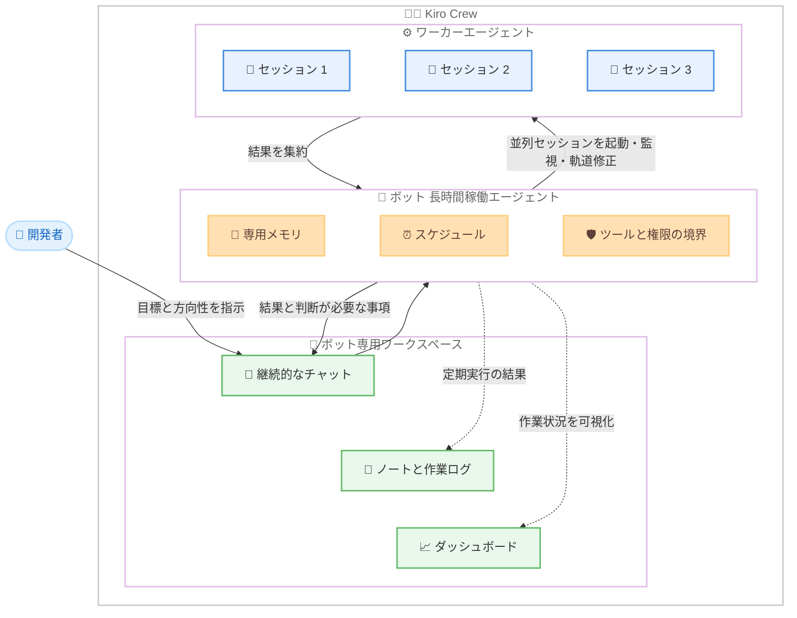

# Kiro - Kiro Crew のボット (Bots in Kiro Crew)

**リリース日**: 2026 年 11 月 5 日
**サービス**: Kiro
**機能**: Kiro Crew におけるボット (長時間稼働するカスタマイズ可能なエージェント) の一般提供

📊 [このアップデートのインフォグラフィックを見る](https://takech9203.github.io/aws-news-summary/20261105-kiro-crew-bots.html)

## 概要

Kiro は、Kiro Crew における「ボット (Kiro bots)」の一般提供を発表しました。ボットは、エージェントによる作業を構造化して推進するための新しい仕組みです。これまでの独立したセッション単位の作業とは異なり、各ボットは名前を持つ長時間稼働のエージェントとして動作し、担当する業務領域ごとにユーザーが定義・カスタマイズできます。各ボットは専用のメモリを持ち、自らセッションを起動・管理するため、ユーザーがセッションを個別に追跡する必要がなくなります。

各ボットには名前、アバター、そして 1 つの継続的なチャットがあり、ユーザーはそのチャットで方向性を指示し、結果を受け取ります。ボットは設定された目標 (例: コードベースに適合する継続的なリサーチ) に向けて能動的に作業を進め、作業の記録として専用のノートを保持します。ボットが所有するすべての情報は Kiro Crew 内の専用ワークスペースに集約され、カスタマイズ可能なダッシュボードにより、個別のセッションを開かずに作業の進捗を把握できます。

Kiro Crew はこれまでもユーザーの作業スタイルを学習してきましたが、ボットの導入により、その学習の蓄積先がボット単位に変わります。これにより、単発のタスクの委任ではなく、継続的な「責務」の委任が可能になります。

**アップデート前の課題**

複数のエージェントセッションを並列実行する際、以下の課題がありました。

- 並列実行したセッションごとに、どこまで進んだか、何が完了したか、どの判断が必要かをユーザー自身が個別に確認する必要があった
- セッション間でユーザーの意図やコンテキストを引き継ぐ作業 (コンテキストの運搬) に時間を取られ、並列タスクが増えるほど管理負荷が増大した
- ツールの承認待ちでセッションが長時間停止したり、完了したセッションがアイドル状態で放置されたりしても気付きにくかった
- 判断の背景やトレードオフの理由を、セッションを開始するたびに説明し直す必要があった

**アップデート後の改善**

- ボットが並列セッションの起動・監視・軌道修正を自律的に行い、結果を 1 つの継続的なチャットに集約するため、個別セッションの追跡が不要になった
- ボットごとに専用のメモリを持つため、各業務領域での学習内容 (過去の決定、トレードオフの理由、変更の制約など) が混ざらずに蓄積され、方向性の再説明が不要になった
- スケジュール実行により、夜間のビルド失敗の調査や毎週金曜のリリースノート作成など、定期的な作業を自動化できるようになった
- ボットごとにツールと権限の境界を設定でき、各ボットの責務に応じた最小権限での運用が可能になった

## アーキテクチャ図



開発者は 1 つの継続的なチャットで方向性を指示するだけで、ボットが並列セッションの起動・監視・軌道修正を担い、結果と判断が必要な事項のみをチャットに戻します。定期実行の結果は作業ログに記録され、ダッシュボードで全体の進捗を一覧できます。

## サービスアップデートの詳細

### 主要機能

1. **名前付きの長時間稼働エージェント**
   - 各ボットは名前とアバターを持ち、担当する業務領域ごとに定義・カスタマイズできる
   - 1 つの継続的なチャットを通じて方向性の指示と結果の確認を行う
   - 目標を設定すると、ボットはその目標に向けて能動的に作業を進める
   - ボットは作業環境を問わず動作し、ラップトップ、Mac Mini、EC2 インスタンス上の Kiro Crew いずれでも実行できる

2. **並列セッションの自律的なオーケストレーション**
   - 作業が発生すると、ボットが複数のセッションを並列で起動し、進捗を監視し、計画から逸脱した作業を軌道修正する
   - 結果は 1 つの継続的なチャットに集約される
   - あるタスクでユーザーの判断が必要になった場合、ボットは質問を投げつつ、回答に依存しない部分の作業を継続する
   - ボットとワーカーエージェントで異なるモデルを選択でき、計画立案は高性能なモデル、定型チェックは高速・低コストなモデルという使い分けが可能

3. **ボットごとの専用メモリとノート**
   - 各ボットは専用のメモリを持ち、デプロイボットが学習したリリースプロセスの知識と、リサーチボットが学習した知識が混ざらない
   - 過去の決定事項 (採用したエラーハンドリングパターン、除外した依存関係など) を記憶し、レビューなどの作業をゼロから始めない
   - ノートには作業の経緯、決定事項、未解決の項目が記録され、ユーザーはボットが記憶している内容をいつでも閲覧・編集・削除できる
   - 制約が変わった場合はチャットで伝えるだけで、ボットは検査可能なノートとともに新しい方針に従う

4. **スケジュール実行**
   - チャットでスケジュールを設定でき、夜間のビルド失敗を始業前に調査したり、毎週金曜にリリースノートを準備したりできる
   - 定期実行の結果は作業ログに記録され、ユーザーの判断が必要な発見や決定事項のみがチャットに戻される
   - 想定内の失敗を誤って追跡した場合は、その場で修正すれば以降の実行に反映される

5. **ツールと権限の境界**
   - 各ボットには担当業務に必要なツールと権限のみを付与する
   - 例: リサーチボットは Web 検索とファイルの読み取りは可能だが変更は不可。デプロイボットはデプロイスクリプトを実行できるが、変更のたびにユーザーの承認を求める
   - ボットは追加のツールを要求できるが、ユーザーが承認するまで何も変更されない
   - ボットごとにルールの調整、ツールの追加、権限の制限を個別に行えるため、すべての業務に単一のルールを強制する必要がない

6. **カスタマイズ可能なダッシュボード**
   - 活動やレポートの見せ方をボットに指示すると、ボットがダッシュボードを維持し、作業の現在の状態を 1 か所に表示する
   - チャットは発見事項、引き継ぎ、ユーザーの判断が必要な質問に集中できる
   - 任意の活動を詳しく調べたい場合は、関連するセッションをレビューできる

## 技術仕様

### ボットの構成要素

| 構成要素 | 詳細 |
|------|------|
| 名前・アバター | ボットごとに設定し、担当業務を識別 |
| チャット | 方向性の指示と結果の受け取りを行う 1 つの継続的な会話 |
| 目標 (Goals) | ボットが能動的に取り組む目標とマイルストーン、チェックイン |
| メモリ | ボット専用。他のボットの学習内容とは分離。閲覧・編集・削除が可能 |
| ノート・作業ログ | 決定事項や未解決項目の記録。スケジュール実行の結果は作業ログに記録 |
| ダッシュボード | ボットが維持する作業状況の可視化ページ。表示内容はチャットで指示 |
| ツール・権限 | 担当業務に必要な最小限を付与。追加はユーザー承認制 |
| モデル選択 | ボット本体とワーカーエージェントで別々のモデルを選択可能 |
| ベースエージェント | デフォルトまたはカスタムエージェント (プロンプト、モデル、ツール、スキルを供給) |
| 実行環境 | ラップトップ、Mac Mini、EC2 インスタンスなど、Kiro Crew が動作する環境 |

## 設定方法

### 前提条件

1. Kiro Crew のインストール ([ダウンロードページ](https://kiro.dev/downloads/) から入手)
2. ボットに任せたい、繰り返し発生する責務の整理 (1 回のレビューで確認できる程度に範囲が狭く、繰り返す価値のあるものから開始することを推奨)

### 手順

#### ステップ 1: ボットワークスペースでボットを追加

Kiro Crew のサイドバーからボットワークスペースを開き、ボットを追加します。ベースとして、デフォルトエージェントまたはカスタムエージェントを選択できます。カスタムエージェントを選ぶと、既存のプロンプト、モデル、ツール、スキルの設定をそのまま引き継げるため、既存のチャットを変更せずに使い慣れた構成の上にボットを構築できます。

#### ステップ 2: 名前と責務を定義

ボットに名前を付け、何を担当させるかを伝えます。作業の受け取り方、参照すべき情報源、有用な引き継ぎの形、ユーザーに確認を求めるタイミングといった境界を、任せたい業務の範囲と性質に合わせて設定します。

#### ステップ 3: スケジュールを設定

チャットでスケジュールを設定します。例えば、ビルドヘルスボットに「30 分ごとに CI パイプラインを確認し、新規の失敗を調査して、対応が必要なものだけを報告する」と指示できます。

#### ステップ 4: 結果を評価してチューニング

数回の実行後、ノートでボットが引き継いでいる内容を確認し、作業ログで完了した作業を把握します。余分な確認、ずれた結果、無駄なステップが見えた箇所で、ルールの調整、ツールの追加、権限の制限、スケジュールや入力の変更を行います。修正や決定を重ねるたびに、ボットのユーザー意図への理解が洗練されます。その後、プロセス内の次の責務に対応するボットを追加していきます。

## メリット

### ビジネス面

- **タスク委任からプロセス委任への移行**: 単発タスクではなく継続的な責務ごと委任できるため、開発者は個別セッションの調整ではなく、方向性の設定と判断が必要な箇所のレビューに時間を使える
- **定期業務の自動化**: イシューのトリアージ、CI の監視、リリース前チェックリストなどの繰り返し業務をスケジュール実行で自動化し、チームの運用負荷を削減できる
- **判断基準の資産化**: レビュー基準、リリースプロセス、チーム固有の方針がボットに蓄積され、修正のたびに精度が向上するため、ノウハウが単一の汎用ワークフローに平準化されない

### 技術面

- **コンテキスト管理の負荷軽減**: ボットが専用メモリで過去の決定やトレードオフを保持するため、セッションごとに意図や制約を再説明する必要がない
- **最小権限の分離**: ボットごとにツールと権限の境界を設定でき、リサーチは読み取り専用、デプロイは承認制といったきめ細かな制御が可能
- **モデルコストの最適化**: 計画立案には高性能なモデル、定型チェックには高速・低コストなモデルと、ボットとワーカーエージェントでモデルを使い分けられる

## デメリット・制約事項

### 制限事項

- Kiro Crew の機能であり、利用には Kiro Crew のインストールが必要
- ボットの能動性はユーザーが許可した範囲に限られる (自律的に動作させるには適切な権限とスケジュールの設定が必要)
- ボットが要求する追加ツールはユーザーの承認が必要なため、完全に放置した運用はできない

### 考慮すべき点

- 効果を出すには、開発プロセスを「繰り返し発生する責務」に分解する設計作業が必要。作業の目的が変わる箇所、異なるツール・権限・レビューが必要な箇所でボットを分けることが推奨されている
- 最初から広い責務を持たせるのではなく、説明と評価が可能な 1 つのプロセスから始め、結果を評価しながら段階的に範囲を広げる運用が推奨されている
- ボットのメモリは判断に影響するため、記憶内容を定期的にレビューし、不要・不正確な内容は編集・削除することが望ましい

## ユースケース

### ユースケース 1: イシューのトリアージ自動化

**シナリオ**: チケットキューに日々届く新規イシューの分類とトリアージに時間を取られている。

**実装例**:
```text
インテイクボットを作成し、チケットキューへのアクセスのみを付与する。
新規イシューの読み取り、ラベル付け、重複候補のフラグ付けを指示し、
バグとマークされたものには再現手順のドラフト作成を指示する。
チケットへのコメントは許可し、クローズ権限は付与しない。
```

**効果**: イシューの一次対応が自動化され、開発者は判断が必要なイシューのみに集中できる。運用に慣れたら Slack などの他のインテイクチャネルへアクセスを拡張できる。

### ユースケース 2: CI パイプラインの継続監視

**シナリオ**: CI の失敗に気付くのが遅れ、既知の不安定なテストと新規の失敗の切り分けに毎回時間がかかる。

**実装例**:
```text
ビルドヘルスボットを作成し、30 分ごとに CI パイプラインを
確認するスケジュールを設定する。既知の不安定なテストと
新規の失敗を区別し、対応が必要なものだけを報告するよう指示する。
```

**効果**: 夜間のビルド失敗も始業前に調査が完了し、対応が必要な失敗だけがチャットに届く。想定内の失敗を誤って報告した場合は修正すればよく、以降の実行で区別の精度が向上する。

### ユースケース 3: 過去の決定を踏まえたコードレビュー

**シナリオ**: プルリクエストのレビューで、チームで合意済みのパターンや方針を毎回説明し直している。

**実装例**:
```text
コードレビューボットを作成し、新規プルリクエストを過去の決定事項
(採用したエラーハンドリングパターン、除外した依存関係など) と
照合するよう指示する。コメントと変更リクエストは許可し、
承認・マージの権限は付与しない。
```

**効果**: レビューがゼロから始まらず、チームの合意事項が一貫して適用される。最終的な承認・マージは人間が行うため、ガバナンスも維持できる。

### ユースケース 4: リリース前チェックリストの運用

**シナリオ**: リリース前の確認作業 (テストの有無、リリースノートの整備) が属人化している。

**実装例**:
```text
リリースレディネスボットを作成し、リリース前チェックリストを
所有させる。マージ済みの変更にテストとリリースノートが
揃っていることを確認し、出荷前にユーザーのサインオフを
求めるよう設定する。
```

**効果**: リリース品質の確認が標準化される。運用が成熟したら、単純な変更はテスト成功時に自動マージを許可するなど、ボットごとに段階的にルールを緩和できる。

## 利用可能リージョン

グローバル (Kiro はグローバルに提供されるサービスです)

## 関連サービス・機能

- **Kiro Crew**: ボットの実行基盤。ボットワークスペース、ダッシュボード、継続的なチャットを提供する
- **カスタムエージェント**: ボットのベースとして選択可能。プロンプト、モデル、ツール、スキルの既存設定を引き継げる
- **Amazon EC2**: ボットの実行環境の 1 つ。ラップトップや Mac Mini と同様に、EC2 インスタンス上の Kiro Crew でもボットを実行できる

## 参考リンク

- 📊 [インフォグラフィック](https://takech9203.github.io/aws-news-summary/20261105-kiro-crew-bots.html)
- [公式 Blog: Introducing bots in Kiro Crew](https://kiro.dev/blog/crew-bots/)
- [Kiro Crew ページ](https://kiro.dev/crew/)
- [Kiro Changelog](https://kiro.dev/changelog/)
- [ダウンロードページ](https://kiro.dev/downloads/)

## まとめ

Kiro Crew のボットは、エージェントとの関わり方を「並列セッションの管理」から「責務を持つボットの管理」へと転換する機能です。名前付きの長時間稼働エージェントが専用メモリ、スケジュール、権限境界を持つことで、単発タスクの委任ではなく継続的なプロセスの委任が可能になります。まずはセッションをまたいでコンテキストの再接続が必要になっている責務を 1 つ選び、範囲の狭いボットを作成して結果を評価しながらチューニングし、段階的にボットの数と権限を広げていくアプローチを推奨します。
