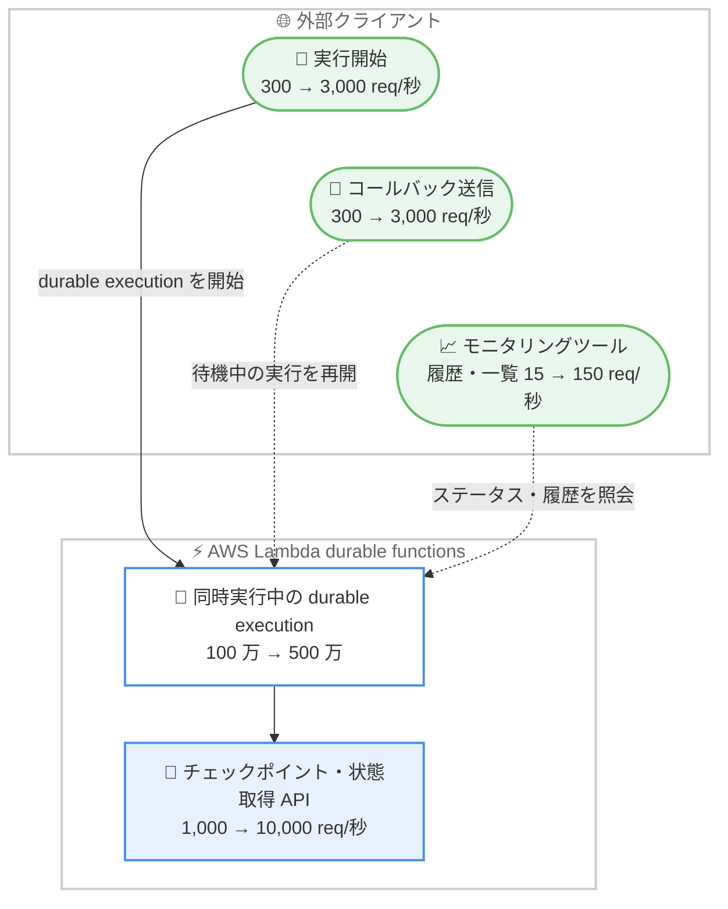

# AWS Lambda - durable functions のデフォルト実行数と API クォータの引き上げ

**リリース日**: 2026 年 11 月 5 日
**サービス**: AWS Lambda
**機能**: durable functions の同時実行数および API リクエストレートのデフォルトクォータ引き上げ

📊 [このアップデートのインフォグラフィックを見る](https://takech9203.github.io/aws-news-summary/20261105-lambda-durable-functions-default-quotas.html)

## 概要

AWS Lambda durable functions において、同時に実行できる durable execution 数と、関連 API のリクエストレートのデフォルトクォータが引き上げられました。同時実行中の durable execution 数は 100 万から 500 万へ 5 倍に、durable execution を開始する関数呼び出しレートは 300 リクエスト/秒から 3,000 リクエスト/秒へ 10 倍に引き上げられています。チェックポイントや状態取得、コールバック、モニタリング関連の各 API も、それぞれ 10 倍のリクエストレートに引き上げられました。

AWS Lambda durable functions は、最長 1 年間実行できる耐障害性のあるマルチステップアプリケーションや AI ワークフローを構築するための機能で、チェックポイント、自動リトライ、コンピューティング課金なしで実行を一時停止する wait を組み込みで提供します。今回の引き上げにより、注文処理やドキュメントパイプラインのようなワークロードが、クォータ引き上げ申請なしでより多くの並列実行を処理できるようになりました。また、モニタリングツールは実行ステータスや履歴を従来の少なくとも 10 倍の頻度で照会できます。

新しいクォータは追加の設定や料金なしで自動的に適用されます。バージニア北部、オレゴン、アイルランドの 3 リージョンでは、さらにこれらの 2 倍のクォータが適用されます。

**アップデート前の課題**

- 同時実行中の durable execution は 100 万までで、大量の注文やドキュメントを並列処理する大規模ワークロードではクォータ引き上げ申請が必要になるケースがあった
- durable execution の開始レートが 300 リクエスト/秒に制限されており、トラフィックの急増時に新規実行の開始がスロットリングされるおそれがあった
- 実行ステータスや履歴を照会する API のレートが低く (GetDurableExecution: 30 リクエスト/秒、履歴・一覧系: 15 リクエスト/秒)、多数の実行を高頻度で監視するダッシュボードの構築が難しかった

**アップデート後の改善**

- 同時実行中の durable execution 数が 5 倍の 500 万 (3 リージョンでは 1,000 万) になり、大規模な並列ワークロードをクォータ引き上げ申請なしで実行できるようになった
- 実行開始レートが 10 倍の 3,000 リクエスト/秒 (3 リージョンでは 6,000 リクエスト/秒) になり、トラフィックの急増にも対応しやすくなった
- チェックポイント、コールバック、モニタリング関連の各 API レートがすべて 10 倍になり、高頻度のチェックポイント書き込みや実行監視が可能になった

## アーキテクチャ図



durable functions に関わる各操作のデフォルトクォータが引き上げられた全体像を示しています。実行開始、コールバック、モニタリングの各経路でレートが 10 倍になり、同時実行数も 5 倍に拡大しました。

## サービスアップデートの詳細

### 主要機能

1. **同時実行中の durable execution 数を 100 万から 500 万に引き上げ**
   - リージョンごとに適用されるソフトリミットで、さらなる引き上げ申請も可能
   - 注文処理やドキュメントパイプラインのような大規模な並列ワークロードを、クォータ引き上げ申請なしで実行できる
   - バージニア北部、オレゴン、アイルランドでは 1,000 万が適用される

2. **実行開始とコールバック系 API のレートを 10 倍に引き上げ**
   - durable execution を開始する関数呼び出しレート: 300 → 3,000 リクエスト/秒
   - SendDurableExecutionCallbackSuccess、SendDurableExecutionCallbackFailure、SendDurableExecutionCallbackHeartbeat: 300 → 3,000 リクエスト/秒
   - 外部システムからのコールバックで待機中の実行を再開するパターンを、より高いスループットで利用できる

3. **チェックポイントとモニタリング系 API のレートを 10 倍に引き上げ**
   - CheckpointDurableExecution、GetDurableExecutionState: 1,000 → 10,000 リクエスト/秒
   - GetDurableExecution、StopDurableExecution: 30 → 300 リクエスト/秒
   - GetDurableExecutionHistory、ListDurableExecutionsByFunction: 15 → 150 リクエスト/秒
   - モニタリングツールが実行ステータスと履歴を従来の少なくとも 10 倍の頻度で照会できる

## 技術仕様

### デフォルトクォータの変更内容

| 項目 | 変更前 | 変更後 | 3 リージョンでの値 |
|------|--------|--------|--------------------|
| 同時実行中の durable execution 数 | 1,000,000 | 5,000,000 | 10,000,000 |
| durable execution を開始する関数呼び出しレート | 300 req/秒 | 3,000 req/秒 | 6,000 req/秒 |
| CheckpointDurableExecution、GetDurableExecutionState | 1,000 req/秒 | 10,000 req/秒 | 20,000 req/秒 |
| SendDurableExecutionCallbackSuccess、SendDurableExecutionCallbackFailure、SendDurableExecutionCallbackHeartbeat | 300 req/秒 | 3,000 req/秒 | 6,000 req/秒 |
| GetDurableExecution、StopDurableExecution | 30 req/秒 | 300 req/秒 | 600 req/秒 |
| GetDurableExecutionHistory、ListDurableExecutionsByFunction | 15 req/秒 | 150 req/秒 | 300 req/秒 |

「3 リージョン」はバージニア北部、オレゴン、アイルランドを指します。公式ドキュメントによると、これらのクォータはリージョンごとに適用され、記載がある場合を除き引き上げ申請が可能です。

### 設定変更の要否

今回のアップデートはデフォルトクォータの引き上げであり、API の変更や関数側の設定変更は不要です。新しいクォータは durable functions が利用可能なすべてのリージョンで自動的に適用されます。

## 設定方法

### 前提条件

1. AWS Lambda durable functions が利用可能なリージョンで durable 設定付きの Lambda 関数を利用していること
2. 必要に応じて Service Quotas コンソールへのアクセス権限があること

### 手順

#### ステップ 1: 新しいクォータの確認

```bash
# Lambda 開発者ガイドのクォータページで durable functions のクォータを確認
# https://docs.aws.amazon.com/lambda/latest/dg/gettingstarted-limits.html#durable-functions-quotas
```

新しいクォータは自動的に適用されるため、追加の申請や設定は不要です。公式ドキュメントまたは Service Quotas コンソールで最新のクォータ値を確認します。

#### ステップ 2: スロットリング対策の見直し

従来のレート (実行開始 300 リクエスト/秒など) を前提に実装していたクライアント側のレート制御やバックオフ処理があれば、新しいレートに合わせて緩和できるか検討します。SDK の標準的なリトライとエクスポネンシャルバックオフは引き続き推奨されます。

#### ステップ 3: さらなる引き上げが必要な場合の申請

同時実行中の durable execution 数はソフトリミットであり、新しいデフォルト値でも不足する場合は [Service Quotas](https://console.aws.amazon.com/servicequotas/home) から引き上げを申請します。

## メリット

### ビジネス面

- **クォータ引き上げ申請の削減**: 注文処理やドキュメントパイプラインなどの大規模ワークロードを、申請の待ち時間なしにデフォルトクォータの範囲で拡大できる
- **追加コストなし**: クォータ引き上げによる追加料金はなく、既存の durable functions ワークフローがそのまま恩恵を受けられる
- **ピークトラフィックへの耐性向上**: セールやキャンペーンなどの急激な負荷増にも、実行開始レート 10 倍の余裕を持って対応できる

### 技術面

- **スロットリングリスクの低減**: 実行開始、チェックポイント、コールバックの各 API レートが 10 倍になり、高スループット時のスロットリングが発生しにくくなる
- **高頻度モニタリングの実現**: ステータス・履歴照会系 API のレート向上により、多数の実行をほぼリアルタイムで追跡するダッシュボードや運用ツールを構築しやすくなる
- **コールバックパターンの拡張**: 外部システムからのコールバック送信レートが 3,000 リクエスト/秒になり、human-in-the-loop や外部ジョブ完了待ちのパターンを大規模に適用できる

## デメリット・制約事項

### 制限事項

- 1 実行あたりの durable operation 数 (30,000)、操作あたりの最大ペイロード (1 MB)、累積ストレージ書き込み量 (100 MB) は今回の変更対象外で、引き続きハードリミット
- バージニア北部、オレゴン、アイルランド以外のリージョンでは、3 リージョンの半分のクォータが適用される
- クォータはリージョンごとに適用されるため、マルチリージョン構成では各リージョンで個別に管理が必要

### 考慮すべき点

- 同時実行数や API レートの上限が上がっても、関数の同時実行数 (アカウントのコンカレンシー) など他の Lambda クォータが先にボトルネックになる可能性がある
- モニタリングの照会頻度を上げる場合、CloudWatch などの下流サービスのコストやクォータへの影響も確認が必要
- 新しいレートを前提にクライアント側のレート制御を緩和する場合は、負荷テストで実際の挙動を確認することが望ましい

## ユースケース

### ユースケース 1: 大規模な注文処理ワークフロー

**シナリオ**: EC サイトのセール期間中に大量の注文を受け付け、各注文を 1 つの durable execution として在庫確認、決済、配送手配のステップを実行する。

**実装例**:
```
変更前: 実行開始 300 req/秒、同時実行 100 万が上限
        ピーク時はクォータ引き上げ申請やキューイングによる平準化が必要
変更後: 実行開始 3,000 req/秒、同時実行 500 万まで対応
        セールのピークトラフィックをデフォルトクォータの範囲で処理
```

**効果**: クォータ引き上げ申請なしで 10 倍の受付レートと 5 倍の並列実行に対応でき、ピーク対策のための追加アーキテクチャを簡素化できる。

### ユースケース 2: 実行状況のリアルタイムダッシュボード

**シナリオ**: 数十万件の durable execution の進行状況を運用ダッシュボードで可視化し、遅延や失敗を早期に検知する。

**実装例**:
```
GetDurableExecution: 30 → 300 req/秒
GetDurableExecutionHistory / ListDurableExecutionsByFunction: 15 → 150 req/秒
ポーリング間隔を 1/10 に短縮し、ほぼリアルタイムの状況把握を実現
```

**効果**: 従来の少なくとも 10 倍の頻度でステータスと履歴を照会でき、異常検知までの時間を短縮できる。

### ユースケース 3: 外部承認を待つ human-in-the-loop ワークフロー

**シナリオ**: ドキュメントパイプラインで人間の承認や外部システムのジョブ完了を wait で待機し、完了時にコールバック API で実行を再開する。

**実装例**:
```
SendDurableExecutionCallbackSuccess / Failure / Heartbeat: 300 → 3,000 req/秒
多数の承認イベントやジョブ完了通知を同時に処理し、
待機中の実行を高スループットで再開
```

**効果**: コールバックのスロットリングを気にせずに大量の待機中実行を再開でき、wait 中はコンピューティング課金が発生しないため、コスト効率よく大規模な待機パターンを運用できる。

## 料金

今回のクォータ引き上げに伴う追加料金はありません。AWS Lambda durable functions の既存の料金体系がそのまま適用され、wait による実行の一時停止中はコンピューティング料金が発生しません。

詳細は [AWS Lambda 料金ページ](https://aws.amazon.com/lambda/pricing/) を参照してください。

## 利用可能リージョン

新しいクォータは、AWS Lambda durable functions が利用可能なすべての AWS リージョンで適用されます。バージニア北部、オレゴン、アイルランドの 3 リージョンでは、さらにこれらの 2 倍のクォータが適用されます。

## 関連サービス・機能

- **AWS Lambda durable functions**: 本アップデートの対象機能。チェックポイント、自動リトライ、wait により最長 1 年間の耐障害性のある実行を実現する
- **Service Quotas**: クォータの現在値の確認と、ソフトリミットのさらなる引き上げ申請に使用する
- **Amazon CloudWatch**: durable execution のメトリクス監視に使用。照会系 API のレート向上と組み合わせて運用監視を強化できる
- **AWS Step Functions**: ワークフローオーケストレーションの選択肢。コードと密結合したワークフローには durable functions、サービス横断のビジュアルオーケストレーションには Step Functions が適する

## 参考リンク

- 📊 [インフォグラフィック](https://takech9203.github.io/aws-news-summary/20261105-lambda-durable-functions-default-quotas.html)
- [公式発表 (What's New)](https://aws.amazon.com/about-aws/whats-new/2026/11/lambda-durable-functions-default-quotas/)
- [AWS Lambda durable functions 開発者ガイド](https://docs.aws.amazon.com/lambda/latest/dg/durable-functions.html)
- [durable functions のクォータ (開発者ガイド)](https://docs.aws.amazon.com/lambda/latest/dg/gettingstarted-limits.html#durable-functions-quotas)
- [AWS Lambda 料金ページ](https://aws.amazon.com/lambda/pricing/)

## まとめ

このアップデートにより、AWS Lambda durable functions の同時実行数が 5 倍の 500 万に、実行開始・チェックポイント・コールバック・モニタリングの各 API レートが 10 倍に引き上げられました。これまでクォータを理由に実行の平準化や引き上げ申請を行っていた大規模ワークロードは、デフォルトクォータの範囲で運用できないか見直す価値があります。1 実行あたりの操作数やペイロードサイズなどのハードリミットは変更されていないため、ワークフロー単体の設計上の制約は引き続き意識する必要があります。
