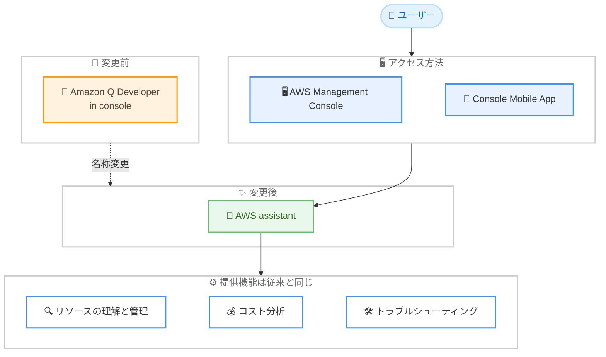

# AWS assistant - コンソールの Amazon Q Developer が AWS assistant に名称変更

**リリース日**: 2026 年 11 月 5 日
**サービス**: AWS assistant (旧 Amazon Q Developer in console)
**機能**: AWS Management Console および Console Mobile App における AI アシスタントの名称変更

📊 [このアップデートのインフォグラフィックを見る](https://takech9203.github.io/aws-news-summary/20261105-q-developer-renamed-aws-assistant.html)

## 概要

AWS Management Console および AWS Console Mobile App で提供されてきた Amazon Q Developer が、「AWS assistant」という新しい名称に変更されました。これまでコンソール上で Amazon Q Developer とやり取りしていたユーザーは、今後は AWS assistant として同じ機能を利用できます。AWS は名称変更の理由として、「製品が何をするものかが即座に伝わる名前にするため」と説明しています。

AWS assistant は、アカウント情報を踏まえたパーソナライズされたガイダンスとアクション (account-aware guidance and actions) を提供し、AWS 上での構築、運用、最適化を簡素化します。名称は変わりますが、機能自体は従来と同じものが提供されます。

AWS assistant は現在無料で利用でき、既存の Amazon Q Developer Pro サブスクライバーは、AWS assistant においても Pro ティアの機能を自動的に維持できます。

**アップデート前の課題**

- コンソール内の AI アシスタントが「Amazon Q Developer」という名称であり、IDE やコマンドラインで利用する開発者向け製品と同じブランド名のため、コンソール上のアシスタント機能との区別がわかりにくかった
- 製品名から「AWS の操作を支援するアシスタント」という役割が直感的に伝わりにくかった

**アップデート後の改善**

- 「AWS assistant」という名称により、AWS の構築、運用、最適化を支援するアシスタントであることが名前から即座に理解できるようになった
- コンソールおよび Console Mobile App 上の機能は従来のまま維持され、ユーザー側の移行作業は不要
- 既存の Amazon Q Developer Pro サブスクライバーは Pro ティアの機能を自動的に引き継げる

## アーキテクチャ図



コンソールおよび Console Mobile App 上の Amazon Q Developer が AWS assistant に名称変更され、提供機能はそのまま維持されることを示しています。

## サービスアップデートの詳細

### 主要機能

AWS assistant の製品ページによると、以下の機能が提供されます (機能自体は従来の Amazon Q Developer in console と同じです)。

1. **リソースの理解と管理**
   - スクリプトを書いたり複数のコンソールページを行き来したりせずに、AWS インフラの構成や関係性を自然言語で確認可能
   - 例: 「このバケットのアラームを表示して」「米国東部 (オハイオ) で実行中の EC2 インスタンスを表示して」

2. **コスト分析**
   - AWS Cost Explorer のコストデータを分析し、主要なコスト要因や月次の支出推移などを質問できる
   - 例: 「先月の請求額は?」

3. **トラブルシューティング**
   - コンソールの [Diagnose with AWS assistant] ボタンで、権限エラー、設定ミス、サービス制限超過などの一般的なエラーを診断
   - 例: 「Lambda 関数の何が問題?」「API Gateway でエラーが出るのはなぜ?」

4. **運用インシデントの調査**
   - 調査のためのインサイトやランブック提案を提供し、メトリクスの精査や問題リソースの手動特定の手間を削減

5. **ネットワークセキュリティ構成の分析 (プレビュー)**
   - 不足または誤設定されたネットワークセキュリティサービスを特定し、修復手順を推奨

6. **構築支援**
   - サーバーレス API 構築のためのサービス提案、CLI コマンドの案内、DynamoDB と RDS の使い分けなどの質問に対応

## 技術仕様

### 変更内容の整理

| 項目 | 詳細 |
|------|------|
| 変更前の名称 | Amazon Q Developer (in console) |
| 変更後の名称 | AWS assistant |
| 対象 | AWS Management Console、AWS Console Mobile App |
| 機能への影響 | なし (同じ機能を AWS assistant として提供) |
| 料金 | 無料で利用可能 |
| 既存 Pro サブスクライバー | Pro ティアの機能を自動的に維持 |
| 提供範囲 | グローバル |

## 設定方法

### 前提条件

1. AWS アカウントを保有していること
2. AWS Management Console または Console Mobile App にアクセスできること

### 手順

#### ステップ 1: コンソールで AWS assistant を開く

AWS Management Console にサインインし、画面上のアシスタントアイコンから AWS assistant を開きます。従来 Amazon Q Developer を利用していた場所と同じ導線で、名称のみが AWS assistant に変わります。

#### ステップ 2: 自然言語で質問する

リソースの状態確認、コスト分析、エラーのトラブルシューティングなどを自然言語で質問します。アカウント情報を踏まえたパーソナライズされた回答とアクションが提供されます。

#### ステップ 3: 既存の Pro サブスクリプションの確認 (該当する場合)

既存の Amazon Q Developer Pro サブスクライバーは、特別な移行作業なしに AWS assistant でも Pro ティアの機能を自動的に利用できます。

## メリット

### ビジネス面

- **直感的な製品名**: 「AWS assistant」という名称により、製品の役割が名前から即座に理解でき、組織内での認知や利用促進が容易になる
- **移行コストゼロ**: 名称変更のみで機能は維持されるため、ユーザー側の移行作業や再学習は不要
- **無料で利用可能**: 追加費用なしでコンソール内の AI アシスタントを活用できる

### 技術面

- **機能の継続性**: リソース管理、コスト分析、トラブルシューティングなどの既存機能はすべてそのまま利用可能
- **Pro ティアの自動引き継ぎ**: 既存の Amazon Q Developer Pro サブスクライバーは設定変更なしで Pro 機能を維持
- **アカウント認識型の支援**: アカウント情報を踏まえたパーソナライズされたガイダンスとアクションを提供

## デメリット・制約事項

### 制限事項

- 今回の発表はコンソールおよび Console Mobile App 上の名称変更であり、新機能の追加はない
- 一部機能 (ネットワークセキュリティ構成の分析など) はプレビュー段階である

### 考慮すべき点

- 社内ドキュメントや手順書で「Amazon Q Developer (コンソール)」と記載している場合は、「AWS assistant」への表記更新を検討する必要がある
- 名称変更に伴い、チームメンバーへの周知を行うことが望ましい

## ユースケース

### ユースケース 1: コンソール操作中のエラー診断

**シナリオ**: Lambda 関数の実行時に権限エラーが発生し、原因の特定に時間がかかっている。

**実装例**:
```text
コンソールのエラー画面で [Diagnose with AWS assistant] を選択し、
「この Lambda 関数の何が問題?」と質問する
```

**効果**: 権限エラー、設定ミス、サービス制限超過などの一般的なエラーの原因と解決策を迅速に把握できる。

### ユースケース 2: コストの可視化

**シナリオ**: 月次のコストレビューで、主要なコスト要因を短時間で把握したい。

**実装例**:
```text
AWS assistant に「先月の請求額は?」
「コストが最も増加しているサービスは?」と質問する
```

**効果**: Cost Explorer を直接操作しなくても、コンソール内の会話でコストデータの分析結果を取得できる。

### ユースケース 3: リソース構成の確認

**シナリオ**: 複数リージョンにまたがるリソースの状態を、コンソールページを行き来せずに確認したい。

**実装例**:
```text
AWS assistant に「米国東部 (オハイオ) で実行中の
EC2 インスタンスを表示して」と質問する
```

**効果**: スクリプト作成や複数ページの確認が不要になり、インフラの構成や関係性を迅速に把握できる。

## 料金

AWS assistant は現在無料で利用できます。既存の Amazon Q Developer Pro サブスクライバーは、AWS assistant においても Pro ティアの機能を自動的に維持できます。

## 利用可能リージョン

グローバルで利用可能です。

## 関連サービス・機能

- **AWS Management Console**: AWS assistant の主要な利用場所であり、コンソール内の各画面から呼び出せる
- **AWS Console Mobile App**: モバイルアプリでも AWS assistant として同じ体験を提供
- **Amazon Q Developer**: IDE やコマンドラインなど開発者向けの体験は引き続き提供される (今回の発表はコンソール上の名称変更に関するもの)
- **AWS Cost Explorer**: AWS assistant のコスト分析機能がコストデータの分析に利用

## 参考リンク

- 📊 [インフォグラフィック](https://takech9203.github.io/aws-news-summary/20261105-q-developer-renamed-aws-assistant.html)
- [公式発表 (What's New)](https://aws.amazon.com/about-aws/whats-new/2026/11/q-developer-renamed-aws-assistant/)
- [AWS assistant 製品ページ](https://aws.amazon.com/products/assistant/)

## まとめ

コンソールおよび Console Mobile App 上の Amazon Q Developer が AWS assistant に名称変更されました。機能は従来と同じまま、製品の役割が名前から直感的に伝わるようになっています。ユーザー側の移行作業は不要ですが、社内ドキュメントの表記更新とチームへの周知を進めることを推奨します。
