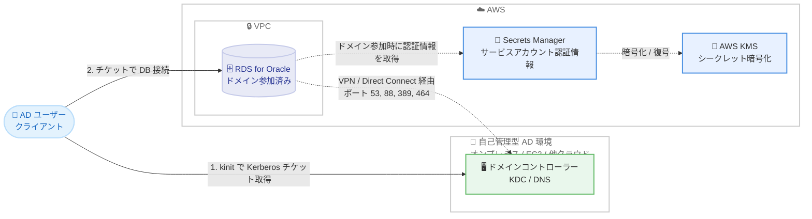

# Amazon RDS for Oracle - 自己管理型 Active Directory による Kerberos 認証のサポート

**リリース日**: 2026 年 11 月 5 日
**サービス**: Amazon RDS for Oracle
**機能**: 自己管理型 Microsoft Active Directory を使用した Kerberos 認証

📊 [このアップデートのインフォグラフィックを見る](https://takech9203.github.io/aws-news-summary/20261105-rds-oracle-kerberos-self-managed-ad.html)

## 概要

Amazon RDS for Oracle が、自己管理型 Microsoft Active Directory (AD) ドメインへの DB インスタンスの直接参加をサポートしました。自己管理型 AD は、オンプレミスのデータセンター、Amazon EC2 上、または他のクラウドプロバイダー上でホストできます。AD ドメイン内のユーザーは、Kerberos プロトコルを使用して RDS for Oracle DB インスタンスに認証できるようになります。

ユーザーがドメインコントローラーから発行された Kerberos チケットで接続すると、RDS for Oracle は Amazon RDS がドメインに登録したサービスキーに対してチケットを検証します。既存の ID 管理基盤をそのまま維持しながら、Amazon RDS のマネージドデータベース機能を利用できます。設定は AWS Management Console、AWS CLI、AWS SDK から行えます。

**アップデート前の課題**

- 以前は RDS for Oracle で Kerberos 認証を使用するために AWS Managed Microsoft AD のデプロイが必須だった
- 自己管理型 AD のユーザーを認証するには、AWS Managed Microsoft AD と自己管理型 AD の間にフォレスト信頼関係を構成する必要があった
- 中間ディレクトリと信頼関係の構築・運用により、構成が複雑化し、管理コストが発生していた

**アップデート後の改善**

- 既存の自己管理型 AD に DB インスタンスを直接参加させ、ユーザーの認証と認可を行えるようになった
- AWS Managed Microsoft AD の追加デプロイや信頼関係の設定が不要になった
- オンプレミス、EC2、他クラウドのいずれでホストされた AD でも利用でき、追加料金なしで使用できる

## アーキテクチャ図



AD ユーザーは自己管理型 AD のドメインコントローラーから Kerberos チケットを取得し、そのチケットで RDS for Oracle に接続します。RDS はドメイン参加時に Secrets Manager に保存されたサービスアカウント認証情報を使用し、VPC とドメインコントローラー間のネットワーク接続を介してドメインに参加します。

## サービスアップデートの詳細

### 主要機能

1. **自己管理型 AD への直接ドメイン参加**
   - オンプレミス、Amazon EC2、他クラウドプロバイダーでホストされた AD に DB インスタンスを直接参加可能
   - AWS Managed Microsoft AD や中間ドメイン、フォレスト信頼が不要
   - 新規作成、既存インスタンスの変更、スナップショット復元、ポイントインタイムリカバリ、リードレプリカ作成の各操作でドメインパラメータを指定可能

2. **Kerberos 認証は既存認証に追加される方式**
   - ドメイン参加後も既存のデータベースユーザーのサインイン方法は変わらない
   - マスターユーザーおよび `IDENTIFIED BY` で作成されたユーザーは引き続きパスワード認証を使用
   - AD ユーザーを接続させるには、対応する外部認証ユーザー (`IDENTIFIED EXTERNALLY`) を Oracle 側に作成

3. **ベストエフォートのドメイン参加と可観測性**
   - ドメイン参加に失敗しても DB インスタンスはパスワード認証で利用可能なまま維持される
   - 失敗の詳細はドメインメンバーシップステータスと RDS イベントで報告される
   - コンソールの [接続とセキュリティ] タブまたは `describe-db-instances` の `DomainMemberships` フィールドでステータスを確認可能

## 技術仕様

### 自己管理型 AD の要件

| 項目 | 詳細 |
|------|------|
| ドメイン機能レベル | Windows Server 2008 R2 以上 |
| FQDN の長さ | 64 文字以内 |
| Kerberos 暗号化タイプ | AES128-CTS-HMAC-SHA1-96 または AES256-CTS-HMAC-SHA1-96 (RC4、DES は非サポート) |
| AD サイト | VPC のサブネットを AD サイトに定義し、他の AD サイトのサブネットと競合しないこと |
| サービスアカウント | 専用 OU に対してユーザーオブジェクトの作成・削除、全プロパティの読み取り、パスワードリセット、`servicePrincipalName` と `msDS-SupportedEncryptionTypes` の読み書き権限を委任 |

### ネットワーク要件

VPC のセキュリティグループおよびネットワーク ACL で、DB インスタンスとドメインコントローラー間の以下の通信を許可する必要があります。

| プロトコル | ポート | 用途 |
|-----------|--------|------|
| TCP/UDP | 53 | DNS |
| TCP/UDP | 88 | Kerberos 認証 |
| TCP/UDP | 464 | パスワードの変更・設定 |
| TCP/UDP | 389 | LDAP |

ネットワーク ACL を使用している場合は、戻りトラフィック用にポート 9000〜65500 の許可も必要です。VPC と AD 間の接続には AWS Site-to-Site VPN、AWS Direct Connect、VPC ピアリングなどを使用できます。

### ドメインメンバーシップステータス

| ステータス | 説明 |
|-----------|------|
| `kerberos-enabled` | Kerberos 認証が有効 |
| `enabling-kerberos` / `pending-enable-kerberos` | 有効化処理中または保留中 |
| `pending-maintenance-enable-kerberos` | 次回メンテナンスウィンドウで有効化 |
| `enable-kerberos-failed` | 設定の問題により有効化に失敗 |
| `disabling-kerberos` / `pending-disable-kerberos` | 無効化処理中または保留中 |

ステータスは最後の参加・削除操作の結果を示すものであり、ドメインへの接続の現在の健全性を反映しない点に注意が必要です。接続断や認証情報の問題は RDS イベントで通知されます。

## 設定方法

### 前提条件

1. 自己管理型 Microsoft AD が稼働しており、上記の AD 要件を満たしていること
2. DB インスタンスを配置する VPC とドメインコントローラー間のネットワーク接続が確立されていること
3. AD 内に専用 OU と、必要な権限を委任されたドメインサービスアカウントが作成されていること
4. サービスアカウントの認証情報を保存する AWS Secrets Manager シークレットと、それを暗号化するカスタマー管理の AWS KMS キーが DB インスタンスと同じアカウント・リージョンに作成されていること

### 手順

#### ステップ 1: Secrets Manager シークレットの作成

シークレットには以下の 2 つのキーを設定します。

```json
{
  "SELF_MANAGED_ACTIVE_DIRECTORY_USERNAME": "rds-join-svc",
  "SELF_MANAGED_ACTIVE_DIRECTORY_PASSWORD": "<サービスアカウントのパスワード>"
}
```

ユーザー名にはドメインプレフィックスを含めません (含めるとインスタンス作成が失敗します)。シークレットのリソースポリシーで `rds.amazonaws.com` に `secretsmanager:GetSecretValue` を許可し、混乱した代理問題を防ぐため `aws:sourceAccount` と `aws:sourceArn` 条件の使用が推奨されます。また、KMS キーポリシーには `rds.amazonaws.com` への `kms:Decrypt` 許可を追加します。

#### ステップ 2: DB インスタンスのドメイン参加

```bash
aws rds modify-db-instance \
    --db-instance-identifier my-oracle-instance \
    --domain-fqdn corp.example.com \
    --domain-ou "OU=AWS-RDS-OU,DC=corp,DC=example,DC=com" \
    --domain-auth-secret-arn "arn:aws:secretsmanager:us-west-2:123456789012:secret:my-ad-secret-AbCdEf" \
    --domain-dns-ips "10.0.1.100" "10.0.1.101"
```

既存の DB インスタンスを自己管理型 AD ドメインに参加させるコマンドです。`--domain-fqdn` にドメインの完全修飾ドメイン名、`--domain-ou` に OU の識別名、`--domain-auth-secret-arn` にシークレットの ARN、`--domain-dns-ips` にドメインの DNS サーバー IPv4 アドレスを 2 つ指定します (セカンダリがない場合はプライマリを 2 回指定)。

参加結果は以下のコマンドで確認し、`Status` が `kerberos-enabled` になっていることを確認します。

```bash
aws rds describe-db-instances \
    --db-instance-identifier my-oracle-instance \
    --query 'DBInstances[0].DomainMemberships'
```

DB インスタンスのドメインメンバーシップ情報を取得し、参加ステータスを表示するコマンドです。

#### ステップ 3: 外部認証ユーザーの作成

```sql
CREATE USER "KRBUSER@CORP.EXAMPLE.COM" IDENTIFIED EXTERNALLY;
GRANT CREATE SESSION TO "KRBUSER@CORP.EXAMPLE.COM";
```

マスターユーザーで DB インスタンスに接続し、AD ユーザーに対応する外部認証の Oracle ユーザーを作成して接続権限を付与する SQL です。リードレプリカは読み取り専用のため、ユーザーはプライマリ DB インスタンス上で作成します (レプリカに自動複製されます)。

#### ステップ 4: Kerberos クライアントの設定と接続

クライアント側では `krb5.conf` (Windows では `krb5.ini`) を作成し、`sqlnet.ora` に以下を設定します。

```
SQLNET.AUTHENTICATION_SERVICES=(KERBEROS5PRE,KERBEROS5)
SQLNET.KERBEROS5_CONF=path_to_krb5.conf_file
SQLNET.KERBEROS5_CONF_MIT=TRUE
```

MIT Kerberos 形式の `krb5.conf` を使用する場合、`SQLNET.KERBEROS5_CONF_MIT=TRUE` の設定が必要です。この設定がないと、`kinit` で有効なチケットを取得していても認証に失敗します。接続時は `kinit KRBUSER@CORP.EXAMPLE.COM` でチケットを取得してから SQL*Plus などで接続します。

## メリット

### ビジネス面

- **コスト削減**: AWS Managed Microsoft AD の追加デプロイが不要になり、自己管理型 AD の利用自体に追加料金もかからない
- **既存資産の活用**: 既存の ID 管理基盤 (ユーザー、グループポリシー、運用プロセス) をそのまま維持してクラウド上のデータベースに適用できる
- **コンプライアンス対応**: 認証を一元化することで、ID 管理に関する監査やガバナンス要件への対応が容易になる

### 技術面

- **構成の簡素化**: 中間ドメインやフォレスト信頼の構築・維持が不要になり、障害点と運用負荷が減少する
- **柔軟な AD ホスティング**: オンプレミス、EC2、他クラウドのいずれにホストされた AD にも対応する
- **安全な認証**: AES128/AES256 ベースの Kerberos 暗号化タイプのみをサポートし、RC4 や DES などの脆弱な方式を排除している

## デメリット・制約事項

### 制限事項

- AD ユーザーごとに `IDENTIFIED EXTERNALLY` の Oracle ユーザーを個別に作成する必要があり、AD グループから Oracle ロールやスキーマへのマッピングはサポートされない
- ドメインコントローラーが AES128-CTS-HMAC-SHA1-96 または AES256-CTS-HMAC-SHA1-96 のいずれかを許可している必要がある (RC4、DES は非サポート)
- スナップショットからの復元、ポイントインタイムリカバリ、リードレプリカはドメインメンバーシップを継承しないため、操作時にドメインパラメータの再指定が必要

### 考慮すべき点

- VPC とドメインコントローラー間のネットワーク接続は利用者の責任で維持する必要があり、接続が失われると Kerberos 認証は復旧まで機能しない (パスワード認証は利用可能)
- マスターユーザーは常にパスワード認証を使用するため、ドメイン到達不能時の管理手段として、管理権限を持つユーザーを少なくとも 1 人パスワード認証で維持することが推奨される
- RDS が OU 内に作成したユーザーオブジェクトを移動すると DB インスタンスが設定不良になるため、移動が必要な場合は `ModifyDBInstance` でドメインパラメータを変更する
- AWS アカウントごとに専用の OU とサービスアカウントを作成し、最小権限の原則に従うことが推奨される

## ユースケース

### ユースケース 1: オンプレミス Oracle データベースの RDS 移行

**シナリオ**: オンプレミスで AD と連携した Kerberos 認証を使用している Oracle データベースを RDS for Oracle に移行したいが、認証基盤は既存のオンプレミス AD を継続利用したい。

**実装例**:
```bash
aws rds create-db-instance \
    --db-instance-identifier migrated-oracle \
    --engine oracle-ee \
    --domain-fqdn corp.example.com \
    --domain-ou "OU=AWS-RDS-OU,DC=corp,DC=example,DC=com" \
    --domain-auth-secret-arn "arn:aws:secretsmanager:ap-northeast-1:123456789012:secret:ad-secret-AbCdEf" \
    --domain-dns-ips "10.0.1.100" "10.0.1.101" \
    --db-instance-class db.m6i.large \
    --allocated-storage 100 \
    --master-username admin \
    --master-user-password <パスワード>
```

**効果**: AWS Managed Microsoft AD や信頼関係を新設することなく、移行後も既存ユーザーが同じ AD 認証情報でデータベースに接続できる。

### ユースケース 2: マルチクラウド環境での認証統合

**シナリオ**: 他のクラウドプロバイダー上に AD をホストしており、AWS 上の RDS for Oracle でも同じ ID 基盤で認証を統一したい。

**実装例**:
```bash
# 他クラウドの AD と VPC を VPN で接続後、ドメイン参加を実行
aws rds modify-db-instance \
    --db-instance-identifier multi-cloud-oracle \
    --domain-fqdn ad.othercloud.example.com \
    --domain-ou "OU=AWS-RDS-OU,DC=ad,DC=othercloud,DC=example,DC=com" \
    --domain-auth-secret-arn "arn:aws:secretsmanager:us-east-1:123456789012:secret:mc-ad-secret-XyZ" \
    --domain-dns-ips "172.16.0.10" "172.16.0.11"
```

**効果**: クラウドをまたいだ単一の ID 管理基盤を維持しつつ、各ユーザーの個別パスワード管理を排除できる。

### ユースケース 3: リードレプリカを含む読み取りスケールアウト構成

**シナリオ**: Kerberos 認証を使用したまま、レポート用途の読み取りトラフィックをリードレプリカにオフロードしたい。

**実装例**:
```bash
aws rds create-db-instance-read-replica \
    --db-instance-identifier oracle-replica \
    --source-db-instance-identifier my-oracle-instance \
    --domain-fqdn corp.example.com \
    --domain-ou "OU=AWS-RDS-OU,DC=corp,DC=example,DC=com" \
    --domain-auth-secret-arn "arn:aws:secretsmanager:us-west-2:123456789012:secret:my-ad-secret-AbCdEf" \
    --domain-dns-ips "10.0.1.100" "10.0.1.101"
```

**効果**: リードレプリカはドメインメンバーシップを継承しないため作成時にパラメータを指定する。プライマリで作成した外部認証ユーザーがレプリカに複製され、AD ユーザーは Kerberos 認証でレプリカにも接続できる。

## 料金

自己管理型 AD の利用に追加料金はかかりません。RDS for Oracle の通常のインスタンス料金、ストレージ料金に加え、Secrets Manager のシークレット保管料金、KMS キーの料金、およびオンプレミス接続に使用する VPN や Direct Connect の料金が別途発生します。

## 利用可能リージョン

Amazon RDS for Oracle が利用可能なすべての AWS 商用リージョンで利用できます。

## 関連サービス・機能

- **AWS Secrets Manager**: ドメインサービスアカウントの認証情報を安全に保管し、RDS がドメイン参加時に参照する
- **AWS KMS**: Secrets Manager シークレットの暗号化に使用するカスタマー管理キーを提供する
- **AWS Directory Service (AWS Managed Microsoft AD)**: 従来の Kerberos 認証構成で使用されていたマネージドディレクトリ。引き続き利用可能で、要件に応じて選択できる
- **AWS Site-to-Site VPN / AWS Direct Connect**: オンプレミス AD と VPC 間のネットワーク接続を提供する
- **Amazon RDS イベント通知**: ドメイン接続や認証情報の問題を検知するために、イベント通知のサブスクライブが推奨される

## 参考リンク

- 📊 [インフォグラフィック](https://takech9203.github.io/aws-news-summary/20261105-rds-oracle-kerberos-self-managed-ad.html)
- [公式発表 (What's New)](https://aws.amazon.com/about-aws/whats-new/2026/11/rds-oracle-kerberos-self-managed-ad/)
- [ドキュメント: Working with self-managed Active Directory with an Amazon RDS for Oracle DB instance](https://docs.aws.amazon.com/AmazonRDS/latest/UserGuide/oracle-smad.html)
- [ドキュメント: Requirements for self-managed Active Directory](https://docs.aws.amazon.com/AmazonRDS/latest/UserGuide/oracle-smad-requirements.html)
- [ドキュメント: Setting up self-managed Active Directory](https://docs.aws.amazon.com/AmazonRDS/latest/UserGuide/oracle-smad-setting-up.html)
- [Amazon RDS for Oracle 製品ページ](https://aws.amazon.com/rds/oracle/)

## まとめ

Amazon RDS for Oracle が自己管理型 Active Directory への直接ドメイン参加をサポートしたことで、AWS Managed Microsoft AD と信頼関係の構築が不要になり、既存の ID 基盤を維持したまま Kerberos 認証を利用できるようになりました。オンプレミスから RDS for Oracle への移行や、マルチクラウド環境での認証統合を検討している場合は、ネットワーク要件 (ポート 53、88、389、464) とサービスアカウントの権限委任要件を確認した上で、検証環境でのドメイン参加から試すことを推奨します。
