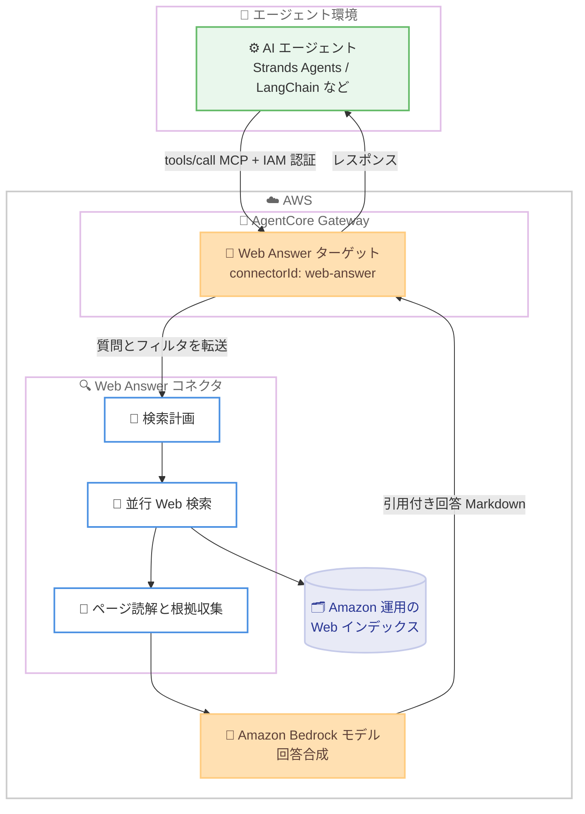

# Amazon Bedrock AgentCore - Web Answer

**リリース日**: 2026 年 11 月 5 日
**サービス**: Amazon Bedrock AgentCore
**機能**: Web Answer on Amazon Bedrock AgentCore

📊 [このアップデートのインフォグラフィックを見る](https://takech9203.github.io/aws-news-summary/20261105-web-answer-amazon-bedrock.html)

## 概要

Amazon Bedrock AgentCore の新しいマネージドツール「Web Answer」が一般提供 (GA) されました。Web Answer は、自然言語の質問を 1 回のツール呼び出しで受け取り、最新の Web ソースに基づいて合成された、引用 (citation) 付きの回答を返すツールです。AgentCore Gateway のターゲットとして追加するだけで、エージェントは標準の MCP (Model Context Protocol) ツールとして呼び出せます。

2026 年 6 月にリリースされた Web Search on Amazon Bedrock AgentCore は「Web コンテンツを見つける」機能を提供しましたが、Web Answer はこれを拡張し「完成した引用付きの回答を届ける」機能を実現します。質問を受け取ると、Web Answer 自身がエージェント的に動作し、複数の検索を並行して計画・実行し、十分な証拠が集まったと判断した時点で回答を生成します。

これにより、エージェント開発者は検索 API の呼び出し、検索結果のフィルタリング、ページの取得と整形、合成プロンプトの作成、引用の抽出といった独自の検索・取得・合成パイプラインを構築・保守する必要がなくなります。コンプライアンス要件のある業界や、エージェントワークフロー内で事実確認を行いたい開発者に特に有用なアップデートです。

**アップデート前の課題**

- Web 検索結果から最終的な回答を得るには、検索、ページ取得、合成、引用抽出のパイプラインを自前で構築・保守する必要があった
- Web Search ツールはランク付けされた検索結果 (タイトル、URL、スニペット) を返すため、エージェント側のモデルが生の検索結果を処理する必要があり、トークン消費と複雑性が増加していた
- 回答の根拠を検証するための引用管理を開発者自身が実装する必要があった

**アップデート後の改善**

- 1 回のツール呼び出しで、合成済み・引用付きの完成した回答を取得できるようになった
- Web Answer 自身が検索を計画し、複数の検索を並行実行し、証拠が十分かどうかを自律的に判断するため、エージェント側のモデルは生の検索結果を処理する必要がなくなった
- ドメインの包含 / 除外リストや公開日フィルタにより、管理者が回答のソースを制御できるようになった
- IAM 認証と AWS 内で完結するデータパス (データエグレスなし) により、セキュアに利用できるようになった

## アーキテクチャ図



エージェントは AgentCore Gateway 経由で Web Answer を MCP ツールとして 1 回呼び出すだけで、検索計画、並行検索、ページ読解、回答合成がすべて AWS 内部で実行され、引用付きの回答が返されます。質問が第三者の検索エンジンに送信されることはありません。

## サービスアップデートの詳細

### 主要機能

1. **ビルトインのエージェント型 Web 検索**
   - 1 回のツール呼び出しで、質問をカバーする複数の検索を並行して実行
   - 関連ページを読み込んで回答の根拠を収集し、証拠が十分と判断した時点で回答を生成
   - 質問ごとに新しい検索を実行するため、常に最新のソースに基づく回答を取得可能

2. **引用付きの回答**
   - 回答はインライン引用マーカー付きの Markdown テキストとして返却
   - 引用元 URL の構造化リスト (`structuredContent`) も同時に返却され、プログラムによる検証が可能
   - 引用マーカーは `[[N](url)]` 形式で、コンプライアンスレビューで主張の根拠を検証可能

3. **ドメイン・日付・ロケーション制御 (コネクタバージョン 1.1.0 以降)**
   - ターゲットレベルのドメイン包含 / 除外リスト (各最大 50 ドメイン)。エージェントからは参照不可で、すべてのリクエストに強制適用
   - リクエストレベルのドメインフィルタと公開日フィルタ (ISO-8601 形式、UTC 解釈)
   - リクエストレベルのフィルタはターゲットレベルの設定を上書きできず、管理者の統制が常に優先
   - `userLocation.country` (ISO 3166-1 alpha-2) による国単位の結果調整

4. **プライバシーとセキュリティ**
   - 質問は AWS インフラストラクチャ内のみで処理され、第三者の検索エンジンには送信されない (データエグレスゼロ)
   - Amazon が構築・運用する Web インデックスを検索し、Amazon Bedrock 上のモデルで回答を合成
   - IAM 認証のため、外部 API キーのプロビジョニングやローテーションが不要
   - 地理的クロスリージョン推論により、データ処理は地理的境界 (US、EU、APAC など) 内のリージョンに留まる

5. **ゼロインフラストラクチャ管理とフレームワーク非依存**
   - 検索 API、モデルエンドポイント、アウトバウンド認証情報のプロビジョニングが不要
   - Strands Agents、LangChain、LangGraph、CrewAI など、MCP 互換のあらゆるクライアントから利用可能
   - 検索・読解・回答品質の改善は、アップグレードやマイグレーションなしで同じマネージドコネクタ経由で自動的に反映

## 技術仕様

### 入力スキーマ (tools/call)

| フィールド | 型 | 必須 | 説明 |
|------|------|------|------|
| `query` | string | はい | 回答対象の質問または検索クエリ。1〜30,000 文字 |
| `filters.domainFilter.include` | array | いいえ | 包含するドメイン。1〜50 件 (バージョン 1.1.0 以降) |
| `filters.domainFilter.exclude` | array | いいえ | 除外するドメイン。ルートドメインはサブドメインにも一致。1〜50 件 |
| `filters.publishedDateFilter.from` / `to` | string | いいえ | 公開日の範囲 (両端を含む)。ISO-8601 形式、UTC 解釈 |
| `userLocation.country` | string | いいえ | ISO 3166-1 alpha-2 国コード (例: `JP`)。大文字小文字の区別なし |

### レスポンス形式

| フィールド | 説明 |
|------|------|
| `content[0].text` | インライン引用マーカー付きの Markdown 回答テキスト |
| `structuredContent.answer[]` | 回答ブロックのリスト。各ブロックは `text` と `citations` を持つ |
| `structuredContent.answer[].citations[]` | 引用元の `url` と `domain` |
| `isError` | 回答できなかった場合に `true` |
| `_meta.latencyMs` | サーバーサイドのレイテンシー |

```json
{
  "isError": false,
  "content": [
    {
      "type": "text",
      "text": "バーゼル III では、銀行は普通株式等 Tier 1 資本をリスク加重資産の 4.5% 以上保有する必要があります [[1](https://example.com/basel-iii)]..."
    }
  ],
  "structuredContent": {
    "answer": [
      {
        "text": "...",
        "citations": [
          { "domain": "example.com", "url": "https://example.com/basel-iii" }
        ]
      }
    ]
  },
  "_meta": { "latencyMs": 5210 }
}
```

### ドメインフィルタの合成ルール

- ターゲットレベルまたはリクエストレベルのいずれかの除外リストに含まれるドメインは除外される (マージ後の除外リストは最大 100 ドメイン)
- ターゲットレベルとリクエストレベルの両方に包含リストが設定されている場合、両方に含まれるドメインのみが使用される。共通ドメインがない場合はバリデーションエラー
- `publishedDateFilter.from` が `to` より後の場合はバリデーションエラー

## 設定方法

### 前提条件

1. AgentCore Gateway が作成済みであること
2. Gateway サービスロールに Web Answer コネクタの呼び出しを許可する IAM 権限が設定されていること
3. エージェント (MCP クライアント) が Gateway エンドポイントに接続できること

### 手順

#### ステップ 1: Web Answer ターゲットを Gateway に追加

```bash
aws bedrock-agentcore-control create-gateway-target \
  --gateway-identifier <gateway-id> \
  --name web-answer-target \
  --target-configuration '{
    "mcp": {
      "connector": {
        "connectorId": "web-answer",
        "parameterValues": {
          "domainFilter": {
            "include": ["docs.example.com"],
            "exclude": ["forum.example.com"]
          }
        }
      }
    }
  }'
```

既存の AgentCore Gateway に `connectorId: "web-answer"` を指定してターゲットを追加します。Gateway がツールスキーマのスナップショットを取得し、統合をプロビジョニングします。`parameterValues.domainFilter` はターゲットレベルのドメインフィルタ設定です (任意)。

#### ステップ 2: エージェントからツールを検出

```python
# MCP クライアントで Gateway エンドポイントのツール一覧を取得
tools = await session.list_tools()
web_answer_tool = next(
    t for t in tools.tools if t.name.endswith("___WebAnswer")
)
```

エージェントが Gateway エンドポイントに対して `tools/list` を呼び出すと、`<target-name>___WebAnswer` という名前のツールが入力スキーマとともに検出されます。Gateway がセマンティック検索を使用している場合はリストの順序に依存せず、名前の末尾 `___WebAnswer` で一致させます。

#### ステップ 3: 質問を送信して引用付き回答を取得

```python
result = await session.call_tool(
    web_answer_tool.name,
    {
        "query": "バーゼル III における CET1 比率の最低要件は?",
        "filters": {
            "publishedDateFilter": {"from": "2024-01-01"}
        }
    }
)
print(result.content[0].text)  # 引用マーカー付き Markdown 回答
```

`tools/call` で自然言語の質問を送信します。Gateway はサービスロールでバックエンドに認証し、ターゲット設定を適用します。Web Answer が検索・読解・合成を実行し、引用付きの回答を返します。

## メリット

### ビジネス面

- **開発工数の削減**: 検索 API 呼び出し、結果フィルタリング、ページ整形、合成プロンプト、引用抽出といったパイプラインの構築と保守が不要になり、1 回の API 呼び出しに集約される
- **予測可能なコスト**: トークン数ではなくツール呼び出し単位の課金のため、回答の長短にかかわらずコストが一定で予算計画が容易
- **コンプライアンス対応**: すべての回答に引用が付くため、金融・医療・公共部門などの規制業界でレビュー担当者が主張の根拠を検証可能

### 技術面

- **運用負荷ゼロ**: 検索 API、モデルエンドポイント、外部認証情報の管理が不要。品質改善も自動的に反映される
- **エージェントモデルの負荷軽減**: 生の検索結果をエージェント側モデルが処理する必要がなく、トークン消費とレイテンシーの要因を削減
- **セキュアなデータパス**: IAM 認証、AWS 内で完結する処理、第三者検索エンジンへの送信なし。クエリと結果は保存されず、モデル学習にも使用されない

## デメリット・制約事項

### 制限事項

- 利用可能リージョンは米国東部 (バージニア北部) `us-east-1` のみ (今後拡大予定)
- リリース時点では英語のみ対応 (今後多言語対応予定)
- `query` は最大 30,000 文字、ドメインフィルタは各リスト最大 50 ドメイン
- Web Answer の結果を大量に抽出・保存・複製すること、および競合するインデックスやデータベースの構築は利用規約で禁止

### 考慮すべき点

- エンドユーザーに回答を表示する際は、提供されたソース引用とリンクを保持・表示する必要がある (Acceptable Use)
- 専門的助言の代替にはならないため、規制対象の文脈では出力を利用する前にレビューが必要
- エージェント自身のモデルで検索結果を推論させたい場合 (回答の構成を自分で制御したい場合) は、Web Answer ではなく Web Search ツールが適している
- 地理的クロスリージョン推論を使用するため、データ処理が単一リージョンではなく地理的境界内の複数リージョンで行われる点をデータレジデンシー要件と照合する必要がある

## ユースケース

### ユースケース 1: 規制業界の Q&A (銀行・医療・公共部門)

**シナリオ**: 銀行のコンプライアンス部門が、規制や基準の変更に関する質問に引用付きで回答するエージェントを構築する。

**実装例**:
```python
result = await session.call_tool(tool_name, {
    "query": "2026 年のバーゼル III 最終化で変更された自己資本要件は?",
    "filters": {
        "domainFilter": {"include": ["bis.org", "fsa.go.jp"]},
        "publishedDateFilter": {"from": "2025-01-01"}
    }
})
```

**効果**: 信頼できる公式ドメインに限定した引用付き回答により、コンプライアンスレビュー担当者がすべての主張を情報源で検証できる。

### ユースケース 2: カスタマーサポートエージェント

**シナリオ**: サポートエージェントが、外部の変化する情報 (公的な要件、サードパーティ製品、交通・市場状況など) についてリアルタイムに回答する。

**実装例**:
```python
result = await session.call_tool(tool_name, {
    "query": "日本からドイツへの渡航に必要な入国要件は?",
    "userLocation": {"country": "JP"}
})
# result.structuredContent.answer[0].citations を顧客に提示
```

**効果**: サポート担当者が顧客に情報源を提示でき、最新の公開情報に基づく信頼性の高い回答を提供できる。

### ユースケース 3: 大規模エージェントワークフロー内の事実確認サブタスク

**シナリオ**: マルチステップのエージェントワークフローの中で、1 つの事実確認ステップだけ Web 上の最新情報が必要になる。

**実装例**:
```python
# Strands Agents などのフレームワークで Gateway を MCP ツールとして登録
# エージェントがワークフロー内の事実確認で自律的に Web Answer を呼び出す
agent = Agent(tools=[gateway_mcp_client])
agent("最新の EU AI Act の施行スケジュールを確認し、対応計画を作成して")
```

**効果**: エージェントが独自の検索パイプラインを持つことなく、ワークフロー内の単一の事実確認・調査ステップを 1 回のツール呼び出しで完結できる。

## 料金

ツール呼び出し単位の課金です。トークン数ではなく呼び出し回数に基づくため、回答の長短にかかわらずコストは一定です。

### 料金例

| 使用量 | 月額料金 (概算) |
|--------|------------------|
| 1,000 ツール呼び出し | $10 |
| 100,000 ツール呼び出し | $1,000 |

詳細は [Web Answer 製品ページ](https://aws.amazon.com/bedrock/grounding/web-answer/) を参照してください。

## 利用可能リージョン

- 米国東部 (バージニア北部) `us-east-1`

Web Answer は地理的クロスリージョン推論を使用し、データ処理は US、EU、APAC などの地理的境界内のサポート対象商用リージョンに留まります。対応リージョンと言語は今後拡大予定です。

## 関連サービス・機能

- **Web Search on Amazon Bedrock AgentCore**: 2026 年 6 月リリースの補完ツール。エージェント自身のモデルにランク付けされた検索結果 (タイトル、URL、スニペット、公開日) を推論させたい場合に使用。Web Answer と併用可能
- **Amazon Bedrock AgentCore Gateway**: Web Answer をターゲットとしてホストし、スキーマ管理、パラメータガバナンス、サービス認証を担うマネージド MCP ゲートウェイ
- **Amazon Bedrock**: Web Answer の回答合成に使用されるモデルの実行基盤。地理的クロスリージョン推論もこの基盤上で提供
- **Amazon CloudWatch**: Web Answer の呼び出しメトリクスを初回呼び出しから自動的に取得可能

## 参考リンク

- 📊 [インフォグラフィック](https://takech9203.github.io/aws-news-summary/20261105-web-answer-amazon-bedrock.html)
- [公式発表 (What's New)](https://aws.amazon.com/about-aws/whats-new/2026/11/web-answer-amazon-bedrock/)
- [ドキュメント: Web Answer](https://docs.aws.amazon.com/bedrock-agentcore/latest/devguide/gateway-target-connector-web-answer-tool.html)
- [製品ページ: Web Answer](https://aws.amazon.com/bedrock/grounding/web-answer/)
- [リージョン対応表](https://docs.aws.amazon.com/bedrock-agentcore/latest/devguide/agentcore-regions.html)

## まとめ

Web Answer は、エージェントに「引用付きの完成した回答」を 1 回のツール呼び出しで提供するマネージドツールであり、検索・取得・合成パイプラインの構築・保守を不要にします。IAM 認証、AWS 内で完結するデータパス、管理者によるドメイン統制により、規制業界でも採用しやすい設計です。AgentCore Gateway を利用中であればターゲット追加だけで導入できるため、まずは `us-east-1` でエージェントワークフロー内の事実確認ステップへの適用を検証することを推奨します。
