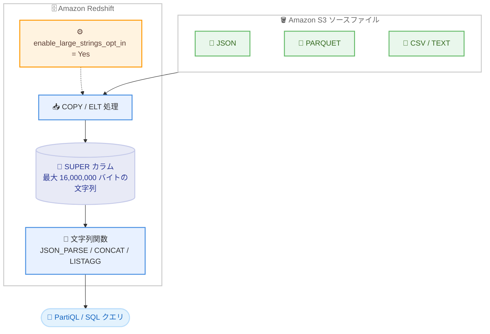

# Amazon Redshift - SUPER データ型の文字列上限を 1,600 万バイトに拡張

**リリース日**: 2026 年 11 月 6 日
**サービス**: Amazon Redshift
**機能**: SUPER データ型における最大 16,000,000 バイトの文字列サポート

📊 [このアップデートのインフォグラフィックを見る](https://takech9203.github.io/aws-news-summary/20261106-amazon-redshift-expands-super-to-16-million-bytes.html)

## 概要

Amazon Redshift は、SUPER データ型に格納できる個々の文字列の上限を、従来の 65,535 バイトから 16,000,000 バイト (約 16 MB) に拡張しました。本機能はデータベースパラメータ `enable_large_strings_opt_in` によるオプトイン方式で有効化します。JSON、PARQUET、TEXT、CSV の各ソースファイルからの構造化・半構造化データの取り込み、および ELT (抽出、ロード、変換) 処理の両方に適用されます。

これまで 65,535 バイトを超える文字列を含むデータは、ロード前に分割や切り詰めなどの複雑な事前変換が必要でした。今回のアップデートにより、契約書や長文の利用規約のような大きなテキストドキュメントをそのまま Redshift に取り込み、PartiQL で探索したり SQL で分析したりできるようになります。また、JSON_PARSE、CONCAT、LISTAGG などの文字列関数も、最大 1,600 万バイトの文字列を入出力として扱えるようになりました。

データウェアハウスで大きな JSON ドキュメントやログ、長文テキストを扱うデータエンジニア、アナリティクスエンジニアにとって、前処理パイプラインを簡素化できる重要なアップデートです。

**アップデート前の課題**

- SUPER データ型内の個々の文字列は 65,535 バイトに制限されており、これを超えるデータはロードエラーや切り詰めの原因となっていた
- 大きな文字列を含む JSON などのデータは、ロード前に分割・圧縮・切り詰めといった複雑な事前変換処理が必要だった
- LISTAGG や CONCAT などの文字列関数の処理結果も 65,535 バイトが上限であり、大量の値を連結する集計が困難だった

**アップデート後の改善**

- SUPER データ型に最大 16,000,000 バイトの個々の文字列を格納できるようになった
- JSON、PARQUET、TEXT、CSV ファイルから大きな文字列を含むデータを事前変換なしで直接取り込めるようになった
- JSON_PARSE、CONCAT、LISTAGG などの文字列関数が最大 1,600 万バイトの文字列を受け取り、返せるようになった
- インメモリの文字列処理により、切り詰めやディスクスピルによるクエリ遅延を回避できるようになった

## アーキテクチャ図



オプトインパラメータを有効化すると、S3 上の各種フォーマットのファイルから最大 16 MB の文字列を含むデータを SUPER カラムに直接ロードし、文字列関数や PartiQL で処理できます。

## サービスアップデートの詳細

### 主要機能

1. **SUPER データ型の文字列上限拡張**
   - SUPER データ型に格納できる個々の文字列が 65,535 バイトから 16,000,000 バイトに拡張
   - JSON、PARQUET、TEXT、CSV ソースファイルからの取り込みに対応
   - ELT 処理での大きな文字列の生成・格納にも対応

2. **インメモリ文字列関数の拡張**
   - JSON_PARSE、CONCAT、LISTAGG などの文字列関数が最大 1,600 万バイトの文字列を入出力可能
   - インメモリ処理により、従来発生し得た切り詰めやディスクスピルを回避
   - 式コンテキスト (CAST 式、ビュー、UDF、ストアドプロシージャ) では `VARCHAR(MAX)` が `VARCHAR(16000000)` として解決される

3. **オプトイン方式による安全な有効化**
   - データベースパラメータ `enable_large_strings_opt_in` で制御 (デフォルトは未設定で既存動作を維持)
   - プロビジョンドクラスターではパラメータ適用に再起動が必要
   - `SELECT is_large_string_enabled();` で現在の状態を確認可能

## 技術仕様

### パラメータ enable_large_strings_opt_in

| 項目 | 詳細 |
|------|------|
| パラメータ名 | `enable_large_strings_opt_in` |
| 設定値 | Yes、No、未設定 (デフォルト: 未設定、既存のクラスター動作を維持) |
| Yes の場合 | SUPER 内の個々の文字列が最大 16,000,000 バイト、インメモリ文字列関数が最大 16,000,000 バイトの VARCHAR を処理 |
| No の場合 | SUPER 内の個々の文字列は 65,535 バイトが上限 |
| 適用方法 | パラメータグループで設定 (プロビジョンドクラスターは再起動が必要)、Serverless はワークグループ設定 |
| 必要バージョン | パッチ 206 以降のクラスター / Serverless ワークグループ |
| 状態確認 | `SELECT is_large_string_enabled();` |
| 注意点 | 一度 Yes または No に設定すると、デフォルト (未設定) には戻せない |

### VARCHAR(MAX) の解決動作

| コンテキスト | 有効化時の動作 |
|------|------|
| CAST 式、ビュー、UDF、ストアドプロシージャ | `VARCHAR(MAX)` は `VARCHAR(16000000)` として解決 |
| `CREATE TABLE` のカラム定義 | `VARCHAR(MAX)` は従来どおり `VARCHAR(65535)` カラムを作成 |
| 有効化前に作成したビュー | 65,535 バイトの上限のまま (再作成が必要) |

## 設定方法

### 前提条件

1. Amazon Redshift プロビジョンドクラスターまたは Redshift Serverless ワークグループ (パッチ 206 以降)
2. パラメータグループまたはワークグループ設定を変更できる IAM 権限
3. S3 からの COPY を行う場合は、適切な権限を持つ IAM ロール

### 手順

#### ステップ 1: パラメータの有効化

```bash
# プロビジョンドクラスターの場合: パラメータグループで有効化
aws redshift modify-cluster-parameter-group \
  --parameter-group-name my-parameter-group \
  --parameters "ParameterName=enable_large_strings_opt_in,ParameterValue=Yes"

# パラメータを適用するためクラスターを再起動
aws redshift reboot-cluster --cluster-identifier my-cluster
```

パラメータグループで `enable_large_strings_opt_in` を Yes に設定し、クラスターを再起動して適用します。Redshift Serverless の場合はワークグループの設定で同パラメータを設定します。

#### ステップ 2: 有効化状態の確認

```sql
SELECT is_large_string_enabled();
```

クエリエディタなどから実行し、大きな文字列のサポートが有効になっていることを確認します。

#### ステップ 3: 大きな文字列を含むデータのロードとクエリ

```sql
-- SUPER カラムを持つテーブルを作成
CREATE TABLE orders (data SUPER);

-- S3 上の JSON ファイルをシュレッドせずにロード
COPY orders FROM 's3://<your-bucket>/orders.json'
IAM_ROLE 'arn:aws:iam::123456789012:role/MyRedshiftRole'
FORMAT JSON 'noshred';

-- camelCase キーを引用符なしで参照するための設定
SET enable_case_sensitive_super_attribute TO true;

-- VARCHAR にキャストして文字列関数を適用
SELECT lower(data.customerId::VARCHAR) AS customer_id FROM orders;
```

COPY コマンドで JSON ドキュメント全体を 1 つの SUPER 値としてロードし、PartiQL でネストされた属性にアクセスします。文字列関数を適用する際は、SUPER を VARCHAR にキャストすることで、Redshift が文字列全体をインメモリで処理します。

## メリット

### ビジネス面

- **データパイプラインの簡素化**: 大きな文字列の分割や切り詰めといった事前変換処理が不要になり、ETL / ELT パイプラインの開発・運用コストを削減できる
- **分析対象データの拡大**: 契約書や利用規約などの長文テキストドキュメントをそのまま取り込み、SQL でクエリ可能な資産として活用できる
- **移行の容易化**: 大きな文字列を扱う他のデータウェアハウスからの移行時に、データ構造の再設計を減らせる

### 技術面

- **大きな JSON ドキュメントの直接ロード**: 最大 16 MB の JSON ドキュメントを `noshred` オプションでそのまま SUPER カラムに格納し、PartiQL でネスト構造を探索できる
- **文字列関数の上限拡張**: LISTAGG による大量の値の連結結果 (65,535 バイト超) も切り詰めなしに生成し、SUPER カラムに保存できる
- **インメモリ処理による性能改善**: 従来発生し得た切り詰めやディスクスピルを回避し、クエリレイテンシへの悪影響を抑制できる

## デメリット・制約事項

### 制限事項

- テーブルカラムとして定義する `VARCHAR(MAX)` は引き続き 65,535 バイトが上限であり、16 MB の上限が適用されるのはインメモリ操作 (CAST、ビュー、UDF、ストアドプロシージャ) のみ
- 機能の有効化前に作成したビューは 65,535 バイトの上限のままとなり、16 MB を利用するにはビューの再作成が必要
- 一度 `enable_large_strings_opt_in` を Yes または No に設定すると、デフォルト (未設定) の状態には戻せない
- プロビジョンドクラスターではパラメータ適用にクラスターの再起動が必要

### 考慮すべき点

- オプトイン機能であるため、既存クラスターの動作は自動では変わらない。利用には明示的なパラメータ設定が必要
- パッチ 206 以降のバージョンが必要なため、事前にクラスター / ワークグループのバージョンを確認する
- SUPER カラムに文字列関数を直接適用するとエラーになる場合があるため、VARCHAR へのキャストを組み合わせる
- ビューは作成時の大文字小文字の区別設定を保持するため、`SET enable_case_sensitive_super_attribute` などの設定はビュー作成前に実行する

## ユースケース

### ユースケース 1: 大きな JSON ドキュメントの直接取り込みと分析

**シナリオ**: EC サイトの注文データが、注文明細や履歴を含む数 MB 規模のネストされた JSON ドキュメントとして S3 に出力されている。従来は 65,535 バイトの制限により分割処理が必要だった。

**実装例**:
```sql
CREATE TABLE orders (data SUPER);

COPY orders FROM 's3://my-bucket/orders.json'
IAM_ROLE 'arn:aws:iam::123456789012:role/MyRedshiftRole'
FORMAT JSON 'noshred';

SET enable_case_sensitive_super_attribute TO true;
SELECT data.orderId::VARCHAR, data.totalAmount FROM orders;
```

**効果**: 事前の分割・変換処理なしで JSON ドキュメント全体を 1 行としてロードし、PartiQL でネストされた属性を直接クエリできる。

### ユースケース 2: 契約書・利用規約など長文テキストの SQL 分析

**シナリオ**: 法務部門が管理する契約書や利用規約の全文テキスト (数百 KB〜数 MB) をデータウェアハウスに集約し、キーワード検索や条項の抽出を SQL で行いたい。

**実装例**:
```sql
CREATE TABLE contracts (contract_id INT, body SUPER);

-- 16 MB までの本文を SUPER に格納し、文字列関数で処理
SELECT contract_id,
       POSITION('解約条項' IN body::VARCHAR) AS clause_pos
FROM contracts;
```

**効果**: 長文ドキュメントを外部ストレージと分析基盤に分けて管理する必要がなくなり、テキスト全文を SQL でクエリ可能な形で一元管理できる。

### ユースケース 3: LISTAGG による大規模な文字列集約

**シナリオ**: 顧客ごとの行動ログを 1 つの文字列に連結してレポートや機械学習の特徴量として利用したいが、従来は連結結果が 65,535 バイトを超えるとエラーになっていた。

**実装例**:
```sql
-- 連結結果が 65,535 バイトを超えても処理可能
CREATE TABLE customer_events_agg AS
SELECT customer_id,
       JSON_PARSE('"' || LISTAGG(event_detail, ',') || '"') AS events_super
FROM customer_events
GROUP BY customer_id;
```

**効果**: 100 万文字を超えるような大規模な連結結果も切り詰めなしに生成し、SUPER カラムとして保存・再利用できる。

## 料金

本機能の利用自体に追加料金はありません。Amazon Redshift の通常の料金 (プロビジョンドクラスターのノード料金、または Redshift Serverless の RPU 時間課金とストレージ料金) が適用されます。大きな文字列を格納することでストレージ使用量が増加する点には留意してください。

## 利用可能リージョン

Amazon Redshift が利用可能なすべての AWS リージョン (AWS GovCloud (US) リージョンを含む) で利用できます。詳細は [AWS リージョン別サービス表](https://aws.amazon.com/about-aws/global-infrastructure/regional-product-services/) を参照してください。

## 関連サービス・機能

- **SUPER データ型 / PartiQL**: JSON などの半構造化データをスキーマレスに格納し、SQL 拡張構文でネスト構造をクエリする Redshift の中核機能。本アップデートの直接の対象
- **Amazon S3**: JSON、PARQUET、TEXT、CSV ファイルのソースとして COPY コマンドと組み合わせて使用
- **大文字小文字を区別しないデータベース (COLLATE CASE_INSENSITIVE)**: SUPER データ型が利用可能になり、レガシーデータウェアハウスからの移行が容易に (関連 Blog 記事で解説)

## 参考リンク

- 📊 [インフォグラフィック](https://takech9203.github.io/aws-news-summary/20261106-amazon-redshift-expands-super-to-16-million-bytes.html)
- [公式発表 (What's New)](https://aws.amazon.com/about-aws/whats-new/2026/11/amazon-redshift-expands-super-to-16-million-bytes/)
- [AWS Blog: Store and process large strings in Amazon Redshift SUPER columns](https://aws.amazon.com/blogs/big-data/store-and-process-large-strings-in-amazon-redshift-super-columns/)
- [ドキュメント: enable_large_strings_opt_in](https://docs.aws.amazon.com/redshift/latest/dg/r_enable_large_strings_opt_in.html)
- [ドキュメント: SUPER 型](https://docs.aws.amazon.com/redshift/latest/dg/r_SUPER_type.html)
- [料金ページ](https://aws.amazon.com/redshift/pricing/)

## まとめ

Amazon Redshift の SUPER データ型が最大 16,000,000 バイトの文字列をサポートし、大きな JSON ドキュメントや長文テキストを事前変換なしで直接取り込めるようになりました。オプトイン方式のため既存環境への影響はなく、`enable_large_strings_opt_in` パラメータの設定だけで利用を開始できます。65,535 バイトの制限が原因で前処理パイプラインを運用しているワークロードでは、パッチ 206 以降への更新と本パラメータの有効化を検討することを推奨します。
