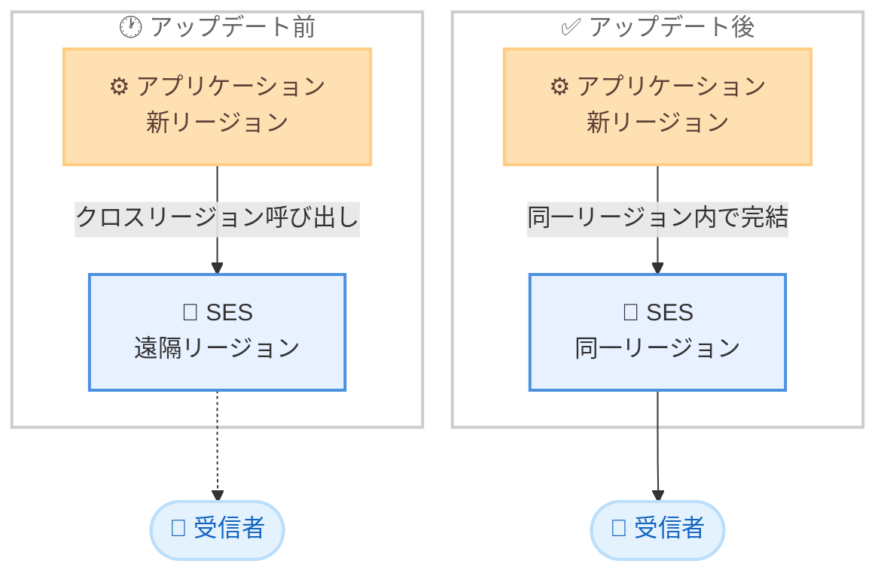

# Amazon Simple Email Service - 6 つの新規 AWS リージョンでの提供開始

**リリース日**: 2026 年 11 月 6 日
**サービス**: Amazon Simple Email Service (SES)
**機能**: 新規 6 リージョンへのサービス拡大

📊 [このアップデートのインフォグラフィックを見る](https://takech9203.github.io/aws-news-summary/20261106-amazon-simple-email-service-new-aws-regions.html)

## 概要

Amazon Simple Email Service (SES) が、新たに 6 つの AWS リージョンで利用可能になりました。対象リージョンは、アジアパシフィック (ニュージーランド)、アジアパシフィック (メルボルン)、アジアパシフィック (台北)、アジアパシフィック (タイ)、メキシコ (中部)、欧州 (スペイン) です。今回の拡大により、SES は全世界で 35 の AWS リージョンで利用できるようになりました。

SES は、スケーラブルでコスト効率に優れた柔軟なクラウドベースのメール送信サービスです。開発者やマーケティング担当者は、あらゆるアプリケーションからマーケティングメール、通知メール、トランザクションメールを送信できます。新規リージョンの利用により、ユーザーに近いリージョンからのメール送信や、データ所在地 (データレジデンシー) 要件への対応が容易になります。

**アップデート前の課題**

今回のアップデート以前には、以下のような課題がありました。

- オセアニア (ニュージーランド、オーストラリア南東部)、台湾、タイ、メキシコ、スペインなどの地域では、SES を利用するために地理的に離れたリージョンを選択する必要があった
- ワークロード本体を上記の新しいリージョンに配置していても、メール送信機能だけ別リージョンを利用する構成となり、アーキテクチャが複雑化していた
- データを特定の国や地域内に保持する必要がある規制要件を持つ組織では、SES の利用が制約となる場合があった

**アップデート後の改善**

今回のアップデートにより、以下が可能になりました。

- 6 つの新規リージョンで SES のメール送信機能を直接利用できるようになった
- ワークロードと同一リージョンで完結するシンプルなアーキテクチャを構成できるようになった
- 各国・地域のデータ所在地要件への対応がしやすくなり、規制の厳しい業界でも SES を採用しやすくなった

## アーキテクチャ図



アップデート前はアプリケーションから遠隔リージョンの SES を呼び出す必要がありましたが、アップデート後は同一リージョン内で SES を利用でき、構成がシンプルになりデータ所在地要件にも対応しやすくなります。

## サービスアップデートの詳細

### 主要機能

1. **新規 6 リージョンでの SES 提供開始**
   - アジアパシフィック (ニュージーランド)、アジアパシフィック (メルボルン)、アジアパシフィック (台北)、アジアパシフィック (タイ)、メキシコ (中部)、欧州 (スペイン) で SES が利用可能になった
   - マーケティングメール、通知メール、トランザクションメールの送信に対応
   - 既存リージョンと同様の SES の機能をそのまま利用できる

2. **グローバルカバレッジの拡大**
   - 今回の拡大により、SES の提供リージョンは全世界で 35 リージョンに到達
   - 米国東部・西部、AWS GovCloud (US)、アジアパシフィック、カナダ、欧州、中東、イスラエル、南米、メキシコ、アフリカの各地域をカバー

3. **データ所在地要件への対応**
   - メール送信処理を特定の国・地域内のリージョンで実行できるため、データレジデンシー要件の管理に役立つ
   - 公共部門や金融など、データの取り扱いに関する規制が厳しい業界での採用が容易になる

## 技術仕様

### 新規提供リージョン

| リージョン名 | リージョンコード |
|------|------|
| アジアパシフィック (ニュージーランド) | ap-southeast-6 |
| アジアパシフィック (メルボルン) | ap-southeast-4 |
| アジアパシフィック (台北) | ap-east-2 |
| アジアパシフィック (タイ) | ap-southeast-7 |
| メキシコ (中部) | mx-central-1 |
| 欧州 (スペイン) | eu-south-2 |

各リージョンの SES エンドポイントの詳細は、[AWS General Reference の SES エンドポイント一覧](https://docs.aws.amazon.com/general/latest/gr/ses.html) を参照してください。

## 設定方法

### 前提条件

1. AWS アカウントを保有していること
2. 送信元として使用するドメインまたはメールアドレスを保有していること
3. 新規リージョンで SES の ID 検証 (ドメイン / メールアドレス) を実施すること (SES の設定はリージョンごとに独立しているため、既存リージョンの設定は引き継がれない)

### 手順

#### ステップ 1: 新規リージョンで送信元 ID を検証する

```bash
aws sesv2 create-email-identity \
  --email-identity example.com \
  --region ap-southeast-6
```

新規リージョン (例: アジアパシフィック (ニュージーランド)) で送信元ドメインの ID を作成します。出力される DKIM トークンを DNS に CNAME レコードとして登録することで、ドメインの所有権が検証されます。

#### ステップ 2: 検証ステータスを確認する

```bash
aws sesv2 get-email-identity \
  --email-identity example.com \
  --region ap-southeast-6
```

ドメイン ID の検証ステータスと DKIM の設定状況を確認します。`VerifiedForSendingStatus` が `true` になれば送信可能です。

#### ステップ 3: テストメールを送信する

```bash
aws sesv2 send-email \
  --from-email-address sender@example.com \
  --destination "ToAddresses=recipient@example.com" \
  --content '{"Simple":{"Subject":{"Data":"Test"},"Body":{"Text":{"Data":"Hello from SES in the new region"}}}}' \
  --region ap-southeast-6
```

新規リージョンの SES からテストメールを送信し、動作を確認します。なお、新規リージョンでは初期状態がサンドボックスモードのため、本番利用にはプロダクションアクセスの申請が必要です。

## メリット

### ビジネス面

- **データ所在地要件への対応**: メール送信処理を特定の国・地域内で完結できるため、各国の規制やコンプライアンス要件を満たしやすくなる
- **新市場への展開支援**: ニュージーランド、台湾、タイ、メキシコ、スペインなどの市場でサービスを展開する企業が、現地リージョンで一貫したアーキテクチャを構築できる
- **運用の簡素化**: ワークロードとメール送信を同一リージョンに集約でき、リージョンをまたぐ構成管理の負担が軽減される

### 技術面

- **アーキテクチャの簡素化**: クロスリージョンの API 呼び出しが不要になり、構成がシンプルになる
- **レイテンシーの低減**: アプリケーションと同一リージョンで SES API を呼び出せるため、送信処理のレイテンシーが低減される
- **障害分離の向上**: リージョン単位で独立した構成を取ることで、他リージョンの障害の影響を受けにくくなる

## デメリット・制約事項

### 制限事項

- SES の設定 (検証済み ID、設定セット、サプレッションリスト、送信制限など) はリージョンごとに独立しているため、新規リージョンで改めて設定が必要
- 新規リージョンで利用を開始する場合、初期状態はサンドボックスモードであり、本番利用にはプロダクションアクセスの申請が必要
- 送信クォータ (送信レート、1 日あたりの送信数) はリージョンごとに管理されるため、新規リージョンでは段階的な引き上げが必要になる場合がある

### 考慮すべき点

- 既存リージョンから新規リージョンへ移行する場合、DKIM / SPF / DMARC などの DNS 設定の再構成と送信レピュテーションの再構築を計画的に行う必要がある
- 専用 IP を利用する場合、新規リージョンでは IP ウォームアップを改めて実施する必要がある
- 一部の SES 機能のリージョンごとの提供状況は、公式ドキュメントで事前に確認することを推奨

## ユースケース

### ユースケース 1: データ所在地要件のあるメール送信基盤の構築

**シナリオ**: 台湾の金融機関が、顧客への取引通知メールを国内リージョンで処理する必要がある。

**実装例**:
```bash
# 台北リージョンで送信元ドメインを検証し、通知メールを送信
aws sesv2 create-email-identity --email-identity bank.example.tw --region ap-east-2
aws sesv2 send-email --from-email-address notify@bank.example.tw \
  --destination "ToAddresses=customer@example.com" \
  --content '{"Simple":{"Subject":{"Data":"取引通知"},"Body":{"Text":{"Data":"お取引が完了しました。"}}}}' \
  --region ap-east-2
```

**効果**: メール送信処理を台北リージョン内で完結させ、データ所在地要件を満たしながら顧客通知を実現できる。

### ユースケース 2: 同一リージョン内でのサーバーレスメール送信

**シナリオ**: メルボルンリージョンで稼働する EC サイトが、注文確認メールを Lambda 関数から送信する。

**実装例**:
```python
import boto3

ses = boto3.client("sesv2", region_name="ap-southeast-4")

def lambda_handler(event, context):
    ses.send_email(
        FromEmailAddress="order@shop.example.com",
        Destination={"ToAddresses": [event["customer_email"]]},
        Content={"Simple": {
            "Subject": {"Data": "ご注文ありがとうございます"},
            "Body": {"Text": {"Data": "ご注文を承りました。"}},
        }},
    )
```

**効果**: Lambda と SES を同一リージョンに配置することで、クロスリージョン呼び出しをなくし、低レイテンシーかつシンプルな構成で注文確認メールを送信できる。

### ユースケース 3: マルチリージョン構成によるメール送信の冗長化

**シナリオ**: スペインの SaaS 事業者が、欧州 (スペイン) をプライマリ、欧州 (アイルランド) をセカンダリとしてメール送信基盤を冗長化する。

**実装例**:
```bash
# 両リージョンで同一ドメインを検証しておき、障害時に送信先リージョンを切り替える
aws sesv2 create-email-identity --email-identity saas.example.es --region eu-south-2
aws sesv2 create-email-identity --email-identity saas.example.es --region eu-west-1
```

**効果**: プライマリリージョンの障害時にもセカンダリリージョンから送信を継続でき、通知メールの可用性を高められる。

## 料金

SES の料金は従量課金制で、新規リージョンでも既存リージョンと同様の料金体系が適用されます。主な料金 (米国東部リージョンの例、リージョンにより異なる場合あり) は以下のとおりです。

- 送信メール: 1,000 通あたり 0.10 USD (従量課金の場合)、加えて添付データ 1 GB あたり 0.12 USD
- 受信メール: 1,000 通あたり 0.10 USD、加えて受信メールチャンク (256 KB 単位) 1,000 チャンクあたり 0.09 USD
- 専用 IP (スタンダード): 1 IP あたり月額 24.95 USD
- 専用 IP (マネージド): アカウントあたり月額 15 USD + 送信量に応じた従量料金

### 料金例

| 使用量 | 月額料金 (概算) |
|--------|------------------|
| 送信 100,000 通 (添付なし) | 10 USD |
| 送信 1,000,000 通 (添付なし) | 100 USD |

最新の料金はリージョンごとに異なる場合があるため、[料金ページ](https://aws.amazon.com/ses/pricing/) で確認してください。

## 利用可能リージョン

今回追加された 6 リージョンは以下のとおりです。

- アジアパシフィック (ニュージーランド)
- アジアパシフィック (メルボルン)
- アジアパシフィック (台北)
- アジアパシフィック (タイ)
- メキシコ (中部)
- 欧州 (スペイン)

今回の拡大により、SES は米国東部・西部、AWS GovCloud (US)、アジアパシフィック、カナダ、欧州、中東、イスラエル、南米、メキシコ、アフリカの各地域を含む、全世界 35 の AWS リージョンで利用可能です。

## 関連サービス・機能

- **Amazon SNS**: SES の送信イベント (バウンス、苦情など) の通知先として連携できるメッセージングサービス
- **AWS Lambda**: SES と組み合わせてサーバーレスなメール送信・受信処理を構築できるコンピューティングサービス
- **Amazon Route 53**: SES のドメイン検証に必要な DKIM / SPF / DMARC などの DNS レコードを管理できる DNS サービス

## 参考リンク

- 📊 [インフォグラフィック](https://takech9203.github.io/aws-news-summary/20261106-amazon-simple-email-service-new-aws-regions.html)
- [公式発表 (What's New)](https://aws.amazon.com/about-aws/whats-new/2026/11/amazon-simple-email-service-new-aws-regions/)
- [Amazon SES 製品ページ](https://aws.amazon.com/ses/)
- [SES エンドポイントとクォータ (AWS General Reference)](https://docs.aws.amazon.com/general/latest/gr/ses.html)
- [料金ページ](https://aws.amazon.com/ses/pricing/)

## まとめ

Amazon SES が 6 つの新規リージョンに拡大し、全世界 35 リージョンで利用可能になりました。ニュージーランド、オーストラリア (メルボルン)、台湾、タイ、メキシコ、スペインの各リージョンでワークロードを運用している場合は、同一リージョンでのメール送信への移行を検討することで、アーキテクチャの簡素化とデータ所在地要件への対応が可能になります。新規リージョンでの利用には ID 検証とプロダクションアクセス申請が必要なため、計画的な準備を推奨します。
