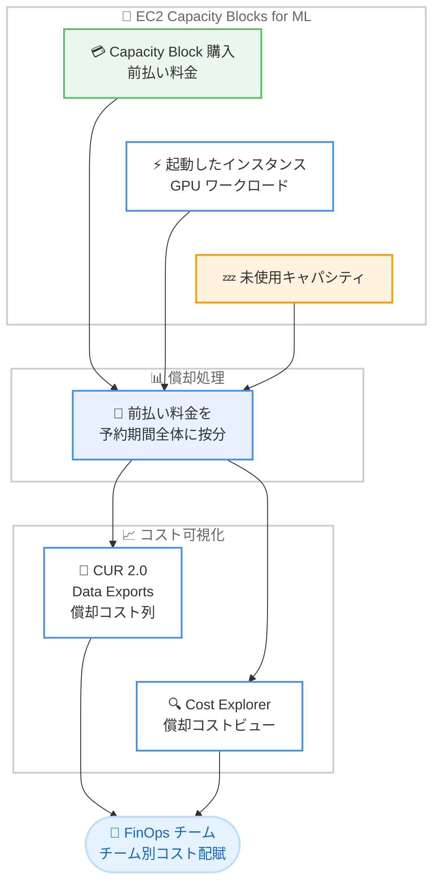

# AWS Billing and Cost Management - EC2 Capacity Blocks for ML の償却コスト (Amortization) サポート

**リリース日**: 2026 年 11 月 6 日
**サービス**: AWS Billing and Cost Management (AWS Data Exports / AWS Cost Explorer)
**機能**: Amortization of EC2 Capacity Blocks for ML

📊 [このアップデートのインフォグラフィックを見る](https://takech9203.github.io/aws-news-summary/20261106-aws-ec2-capacity-blocks-ml.html)

## 概要

AWS Data Exports の Cost and Usage Report (CUR) 2.0 と AWS Cost Explorer が、EC2 Capacity Blocks for ML の前払い料金 (upfront fee) を予約期間全体にわたって按分 (償却) して表示できるようになりました。これにより、Capacity Block 内で起動した各インスタンスの償却コストと、未使用キャパシティの償却コストを確認できます。

EC2 Capacity Blocks for ML は、ML ワークロード向けに GPU ベースのインスタンスを将来の日付で予約できる仕組みで、購入時に前払い料金が発生します。今回のアップデートにより、前払い料金を実際にキャパシティを消費したワークロードに正確に帰属させることができ、GPU 支出をチーム、プロジェクト、アプリケーション単位で配賦できるようになります。ML 基盤のコスト管理を担う FinOps チームや、GPU キャパシティを複数チームで共有している組織にとって重要なアップデートです。

**アップデート前の課題**

- 以前は Capacity Blocks の前払い料金が購入日に単一の請求として計上されており、コストが利用期間や利用実態とどのように対応しているか把握しにくかった
- 前払い料金をインスタンス利用に紐づけられないため、GPU 支出をチームやプロジェクトに配賦するチャージバック / ショーバックが困難だった
- 予約したキャパシティのうち、どれだけが未使用 (アイドル) だったかをコストとして可視化する手段がなかった

**アップデート後の改善**

- 前払い料金が予約期間にわたって按分され、インスタンス使用状況と並べて償却コストを確認できるようになった
- Capacity Block に起動した各インスタンスの償却コストが表示され、GPU 支出をチーム、プロジェクト、アプリケーションに正確に配賦できるようになった
- 未使用キャパシティの償却コストを特定できるようになり、予約のどの部分が使われなかったかを踏まえて将来の購入計画を最適化できるようになった

## アーキテクチャ図



Capacity Block の前払い料金が予約期間全体に按分され、起動済みインスタンスと未使用キャパシティそれぞれの償却コストとして CUR 2.0 と Cost Explorer に表示される流れを示しています。

## サービスアップデートの詳細

### 主要機能

1. **前払い料金の予約期間按分 (償却)**
   - Capacity Block 購入時の前払い料金を、各予約の期間にわたって均等に按分して表示
   - 購入日に単一の請求として表示されていた従来の方式から、利用期間に対応したコスト表示に改善
   - 発生主義ベースのコスト把握が可能になり、月をまたぐ予約でも各月のコストを正確に把握できる

2. **インスタンス単位の償却コスト表示**
   - Capacity Block 内で起動した各インスタンスの償却コストを確認可能
   - 償却コストがインスタンス使用状況と並べて表示されるため、前払い料金を実際にキャパシティを消費したワークロードに帰属させられる
   - コスト配分タグやコストカテゴリと組み合わせることで、チーム / プロジェクト / アプリケーション単位の GPU 支出配賦が可能

3. **未使用キャパシティのコスト可視化**
   - 予約したが使用されなかったキャパシティの償却コストを特定可能
   - アイドルキャパシティのコストを定量化し、予約サイズや期間の見直しなど将来の購入判断に活用できる

## 技術仕様

### CUR 2.0 で利用できる償却関連の列

| 列名 | 内容 |
|------|------|
| `reservation_amortized_upfront_fee_for_billing_period` | 当該請求期間に按分された前払い料金 |
| `reservation_effective_cost` | 償却後の実効コスト (前払い料金の按分額を含む) |
| `reservation_net_effective_cost` | 割引適用後の実効コスト (ネット償却コスト) |

### Cost Explorer での表示

| 項目 | 詳細 |
|------|------|
| 表示方法 | コスト表示設定で「償却コスト (Amortized costs)」ビューを選択 |
| 対象 | EC2 Capacity Blocks for ML の前払い料金 |
| 粒度 | 既存の Cost Explorer のフィルター / グループ化 (サービス、タグ、アカウントなど) と組み合わせ可能 |

### EC2 Capacity Blocks for ML の基本仕様 (参考)

| 項目 | 詳細 |
|------|------|
| 対象インスタンス | P6、P5、P4d、Trn1、Trn2 などの GPU / アクセラレーター搭載インスタンス、UltraServer |
| 予約開始時期 | 最大 8 週間先まで予約可能 |
| 規模 | 1 つの Capacity Block あたり最大 64 インスタンス、合計最大 256 インスタンス |
| 支払い | 購入時に前払い料金が発生 (キャンセル不可) |

## 設定方法

### 前提条件

1. EC2 Capacity Blocks for ML を購入済み、または購入予定であること
2. 償却コストを CUR 2.0 で分析する場合は、AWS Data Exports で CUR 2.0 のエクスポートを作成済みであること
3. Cost Explorer を有効化済みであること

### 手順

#### ステップ 1: Cost Explorer で償却コストビューを確認

```text
1. AWS Billing and Cost Management コンソールで Cost Explorer を開く
2. 右側の設定パネルで「コストの集計方法」を「償却コスト」に変更
3. サービスで「EC2」をフィルターし、必要に応じてタグやアカウントでグループ化
```

Cost Explorer の償却コストビューに切り替えることで、Capacity Blocks の前払い料金が購入日の一括計上ではなく、予約期間に按分された形で表示されます。

#### ステップ 2: CUR 2.0 エクスポートで償却列を含める

```bash
# CUR 2.0 エクスポートの作成例 (抜粋)
aws bcm-data-exports create-export \
  --export '{
    "Name": "cur2-capacity-blocks",
    "DataQuery": {
      "QueryStatement": "SELECT line_item_resource_id, line_item_usage_start_date, reservation_amortized_upfront_fee_for_billing_period, reservation_effective_cost, reservation_net_effective_cost FROM COST_AND_USAGE_REPORT",
      "TableConfigurations": {"COST_AND_USAGE_REPORT": {"TIME_GRANULARITY": "DAILY"}}
    },
    "DestinationConfigurations": {"S3Destination": {"S3Bucket": "my-cur-bucket", "S3Prefix": "cur2", "S3Region": "us-east-1", "S3OutputConfigurations": {"OutputType": "CUSTOM", "Format": "PARQUET", "Compression": "PARQUET", "Overwrite": "OVERWRITE_REPORT"}}}
  }'
```

AWS Data Exports で CUR 2.0 エクスポートを作成し、償却関連の列 (`reservation_amortized_upfront_fee_for_billing_period`、`reservation_effective_cost`、`reservation_net_effective_cost`) を選択して S3 に出力します。

#### ステップ 3: 償却コストを分析してチームに配賦

```sql
-- Athena での分析例: リソース別の実効コスト集計
SELECT
  line_item_resource_id,
  SUM(reservation_effective_cost) AS effective_cost
FROM cur2_table
WHERE line_item_usage_start_date >= DATE '2026-11-01'
GROUP BY line_item_resource_id
ORDER BY effective_cost DESC;
```

CUR 2.0 データを Athena などで分析し、インスタンス (リソース) 単位の償却コストを集計します。コスト配分タグと組み合わせることで、チームやプロジェクト単位の配賦レポートを作成できます。

## メリット

### ビジネス面

- **正確なコスト配賦**: GPU 支出をチーム、プロジェクト、アプリケーション単位に配賦でき、チャージバック / ショーバック運用が可能になる
- **購入計画の最適化**: 未使用キャパシティのコストを定量化できるため、次回の Capacity Block 購入時に予約サイズや期間を適正化できる
- **財務報告の精度向上**: 前払い料金が利用期間に按分されるため、発生主義ベースの月次コスト報告が容易になる

### 技術面

- **既存ツールとの統合**: CUR 2.0 の標準列として提供されるため、Athena、QuickSight など既存のコスト分析パイプラインにそのまま組み込める
- **他の予約型割引との一貫性**: リザーブドインスタンスや Savings Plans と同様の償却列 (`reservation_effective_cost` など) で扱えるため、分析クエリを統一できる
- **追加設定が不要**: Cost Explorer では償却コストビューを選択するだけで利用でき、追加料金も発生しない

## デメリット・制約事項

### 制限事項

- AWS GovCloud (US) リージョンと中国リージョンでは利用できない
- 対象は EC2 Capacity Blocks for ML の前払い料金の償却表示であり、Capacity Blocks 自体の料金体系 (前払い、キャンセル不可) は変わらない

### 考慮すべき点

- CUR 2.0 を利用していない場合 (レガシー CUR のみの場合) は、CUR 2.0 エクスポートへの移行を検討する必要がある
- 既存のコスト分析クエリやダッシュボードが非償却 (unblended) コストを前提としている場合、償却コスト列の追加に合わせて集計ロジックの見直しが必要になる可能性がある

## ユースケース

### ユースケース 1: 複数チームで共有する GPU クラスターのチャージバック

**シナリオ**: ML プラットフォームチームが Capacity Block をまとめて購入し、複数の研究開発チームがインスタンスを起動して利用している。各チームの実際の利用量に応じて GPU コストを配賦したい。

**実装例**:
```sql
SELECT
  resource_tags['user_team'] AS team,
  SUM(reservation_effective_cost) AS team_cost
FROM cur2_table
WHERE product_servicecode = 'AmazonEC2'
GROUP BY resource_tags['user_team'];
```

**効果**: インスタンス単位の償却コストとコスト配分タグを組み合わせて、前払い料金を利用実態に即してチームごとに配賦できる。

### ユースケース 2: 未使用キャパシティの特定と購入計画の見直し

**シナリオ**: 14 日間の Capacity Block を購入したが、トレーニングジョブが早く終了し、後半はインスタンスをほとんど起動しなかった。次回購入の参考にアイドルコストを把握したい。

**実装例**:
```text
1. CUR 2.0 で Capacity Block 予約に紐づく償却コストを日次で集計
2. インスタンス使用分の償却コストと未使用分の償却コストを比較
3. 未使用コストの割合をもとに、次回の予約期間・インスタンス数を調整
```

**効果**: 予約のうち何割が未使用だったかをコストとして定量化でき、次回以降の Capacity Block 購入をデータに基づいて最適化できる。

### ユースケース 3: 月次財務報告での発生主義ベースのコスト計上

**シナリオ**: 月末近くに大規模な Capacity Block を購入したため、購入月のコストが突出して見え、経営層への月次レポートで実態と乖離が生じていた。

**実装例**:
```text
1. Cost Explorer で「償却コスト」ビューを選択
2. 月次の粒度で EC2 コストの推移を表示
3. 前払い料金が予約期間の各月に按分されたレポートを作成
```

**効果**: 購入タイミングによるコストの偏りがなくなり、利用実態に即した月次コストレポートを作成できる。

## 料金

本機能は追加料金なしで利用できます。CUR 2.0 (AWS Data Exports) および Cost Explorer の利用自体も無料です (CUR の出力先 S3 のストレージ料金、Athena などの分析サービスの利用料金は別途発生します)。

EC2 Capacity Blocks for ML 自体の料金は、予約時点の需給に基づく動的な前払い料金制で、購入時に全額が請求されます。

## 利用可能リージョン

AWS GovCloud (US) リージョンと中国リージョンを除く、すべての AWS リージョンで利用可能です。

## 関連サービス・機能

- **EC2 Capacity Blocks for ML**: GPU インスタンスを将来の日付で予約できる仕組み。今回のアップデートの対象となる前払い料金が発生する
- **AWS Data Exports (CUR 2.0)**: コストと使用状況の詳細データを S3 にエクスポートする機能。償却関連の列で Capacity Blocks のコストを分析できる
- **AWS Cost Explorer**: コストの可視化・分析ツール。償却コストビューで Capacity Blocks の按分コストを確認できる
- **コスト配分タグ / AWS Cost Categories**: 償却コストと組み合わせることで、チームやプロジェクト単位の配賦が可能

## 参考リンク

- 📊 [インフォグラフィック](https://takech9203.github.io/aws-news-summary/20261106-aws-ec2-capacity-blocks-ml.html)
- [公式発表 (What's New)](https://aws.amazon.com/about-aws/whats-new/2026/10/aws-ec2-capacity-blocks-ml/)
- [CUR 2.0 データディクショナリ](https://docs.aws.amazon.com/cur/latest/userguide/table-dictionary-cur2.html)
- [Cost Explorer によるデータの探索](https://docs.aws.amazon.com/cost-management/latest/userguide/ce-exploring-data.html)
- [EC2 Capacity Blocks for ML ドキュメント](https://docs.aws.amazon.com/AWSEC2/latest/UserGuide/ec2-capacity-blocks.html)
- [EC2 Capacity Blocks for ML 料金](https://aws.amazon.com/ec2/capacityblocks/pricing/)

## まとめ

EC2 Capacity Blocks for ML の前払い料金が CUR 2.0 と Cost Explorer で予約期間に按分して表示されるようになり、GPU 支出のチーム別配賦と未使用キャパシティの可視化が可能になりました。Capacity Blocks を利用している組織は、Cost Explorer の償却コストビューの確認と、CUR 2.0 の償却関連列 (`reservation_effective_cost` など) を使った分析パイプラインへの組み込みを検討することを推奨します。
